# Smash Egg For Animals

> ⛏️ **Simulator** · clicker / egg hatching simulator · source file `Slbr - Booster - Smash Egg For Animals.rbxl`

[⬅ Back to the catalog](../../README.md) · [Assets inventory](ASSETS.md) · [Style numbers](reference.md) · [Scripts](source/scripts/) · [Code analysis](source/README.md)

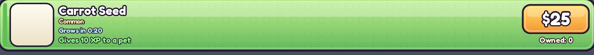

## At a glance

| | |
|---|---|
| Provenance | copy of a live game (saveinstance / decompiled client code) |
| Screens | 19 ScreenGuis, 447 GUI objects → **61 screenshots** |
| Models (.rbxm) | 2876 models, 298 model sets, 2 VFX sets |
| Lua builders (.lua) | 140 UI screens, 19 animation packs, 6 audio packs |
| Code | 822 scripts, 338,147 lines |
| Asset ids | 234 animations, 17 sounds |
| Safety scan | 2 HIGH / 9 MED flags ([flags.txt](source/flags.txt)) |

**Fonts:** `Montserrat Heavy`×79, `RobotoMono Regular`×41, `SourceSansPro Regular`×31, `SourceSansPro Bold`×16, `ComicNeueAngular Regular`×11

## UI screenshots

Captured in Studio from the place's own ScreenGuis (scripts stripped). Each panel was opened on its own; click a thumbnail for the full 1519×886 frame. Runtime-filled lists (shop items, inventories) show their template state.

### Shop & Robux store

<table>
<tr>
<td width="33%" valign="top"> <b>icon pour trainer shop</b></td>
<td width="33%" valign="top"><a href="screenshots/08_ShopGui.jpg">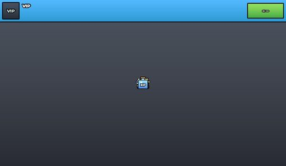</a> <b>ShopGui</b></td>
<td width="33%" valign="top"> <b>Removed_EggShopGui</b> › RowTemplate</td>
</tr>
<tr>
<td width="33%" valign="top"> <b>Removed_SeedShopGui</b> › RowTemplate</td>
<td width="33%" valign="top"><a href="screenshots/18_DragonShopGui.jpg">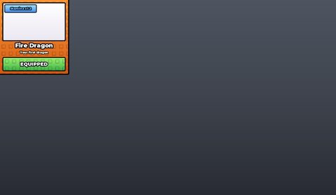</a> <b>DragonShopGui</b></td>
<td width="33%" valign="top"><a href="screenshots/23_icon_amelioration_shop.jpg">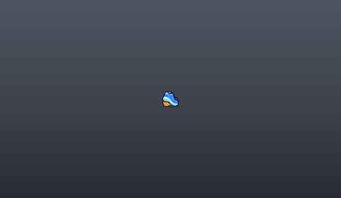</a> <b>icon amelioration shop</b></td>
</tr>
<tr>
<td width="33%" valign="top"><a href="screenshots/37_ShopGui.jpg">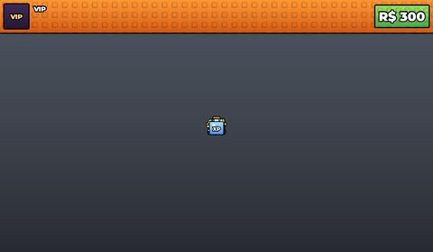</a> <b>ShopGui</b></td>
<td width="33%" valign="top"> <b>ShopGui</b></td>
<td width="33%" valign="top"><a href="screenshots/52_icon_pour_trainer_shop.jpg">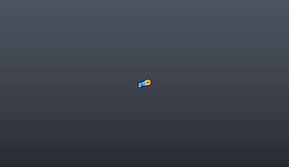</a> <b>icon pour trainer shop</b></td>
</tr>
<tr>
<td width="33%" valign="top"><a href="screenshots/54_VIP.jpg">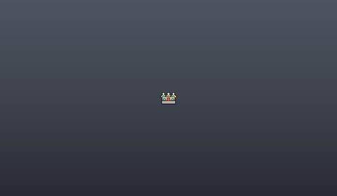</a> <b>VIP</b></td>
</tr>
</table>

### Rewards, daily, spin, codes

<table>
<tr>
<td width="33%" valign="top"><a href="screenshots/04_OfflineGui__Dim.jpg">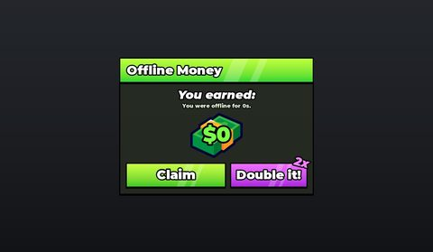</a> <b>OfflineGui</b> › Dim</td>
<td width="33%" valign="top"><a href="screenshots/11_RewardsUI.jpg">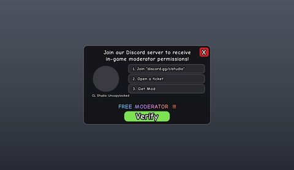</a> <b>RewardsUI</b></td>
<td width="33%" valign="top"><a href="screenshots/33_OfflineGui__Dim.jpg">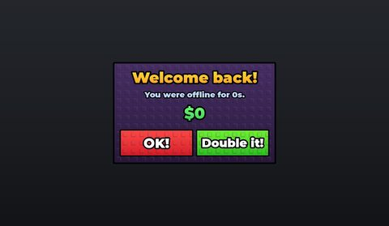</a> <b>OfflineGui</b> › Dim</td>
</tr>
<tr>
<td width="33%" valign="top"><a href="screenshots/44_OfflineGui__Dim.jpg">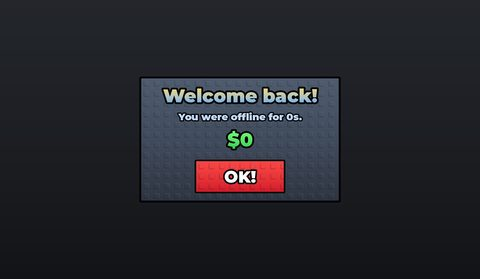</a> <b>OfflineGui</b> › Dim</td>
</tr>
</table>

### Quests & progression

<table>
<tr>
<td width="33%" valign="top"><a href="screenshots/21_UpgradesGui.jpg">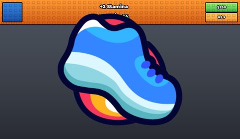</a> <b>UpgradesGui</b></td>
<td width="33%" valign="top"><a href="screenshots/27_RebirthGui.jpg">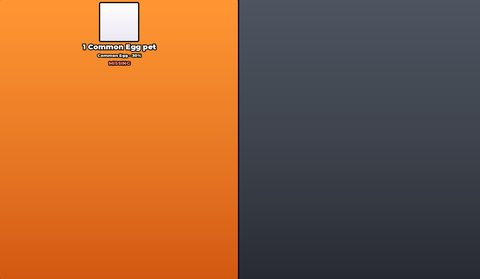</a> <b>RebirthGui</b></td>
</tr>
</table>

### Trading

<table>
<tr>
<td width="33%" valign="top"><a href="screenshots/26_TradeButton.jpg">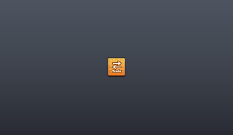</a> <b>TradeButton</b></td>
</tr>
</table>

### Leaderboards & stats

<table>
<tr>
<td width="33%" valign="top"><a href="screenshots/10_icon_leaderboard.jpg">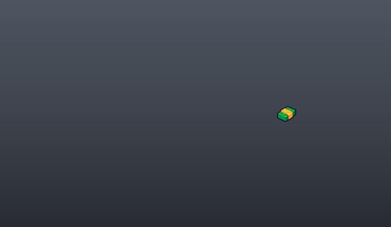</a> <b>icon leaderboard</b></td>
<td width="33%" valign="top"><a href="screenshots/39_icon_leaderboard.jpg">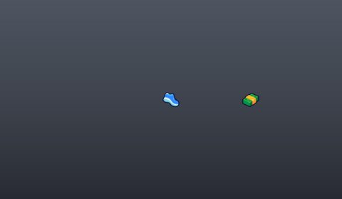</a> <b>icon leaderboard</b></td>
</tr>
</table>

### Admin panels

<table>
<tr>
<td width="33%" valign="top"><a href="screenshots/29_BasePanelGui.jpg">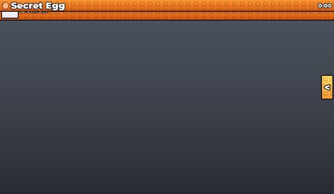</a> <b>BasePanelGui</b></td>
<td width="33%" valign="top"><a href="screenshots/30_BasePanelGui__Panel.jpg">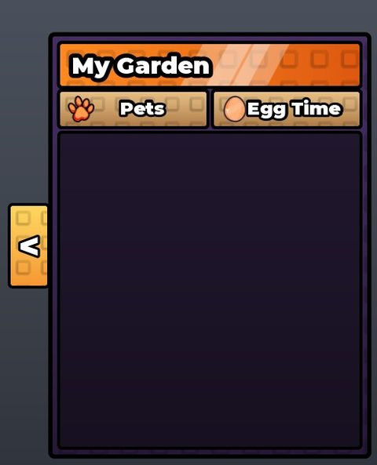</a> <b>BasePanelGui</b> › Panel</td>
</tr>
</table>

### HUD & currency

<table>
<tr>
<td width="33%" valign="top"><a href="screenshots/02_MoneyGui.jpg">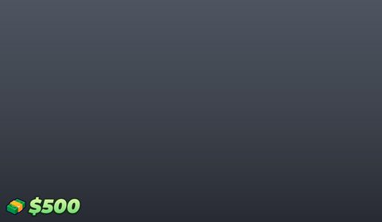</a> <b>MoneyGui</b></td>
<td width="33%" valign="top"><a href="screenshots/03_SettingsGui__Main.jpg">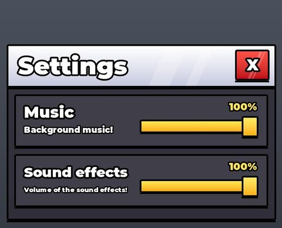</a> <b>SettingsGui</b> › Main</td>
<td width="33%" valign="top"><a href="screenshots/05_PetInventoryGui__Main.jpg">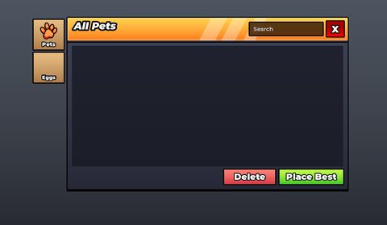</a> <b>PetInventoryGui</b> › Main</td>
</tr>
<tr>
<td width="33%" valign="top"> <b>left bottom</b></td>
<td width="33%" valign="top"><a href="screenshots/07_IndexGui__Main.jpg">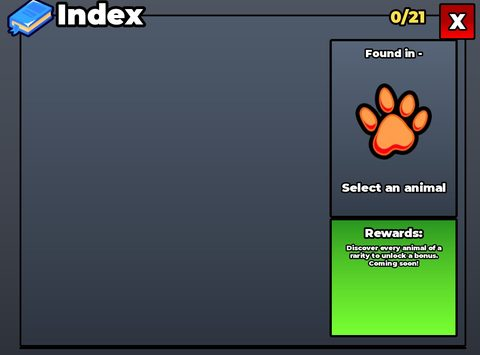</a> <b>IndexGui</b> › Main</td>
<td width="33%" valign="top"><a href="screenshots/09_ShopGui__Main.jpg">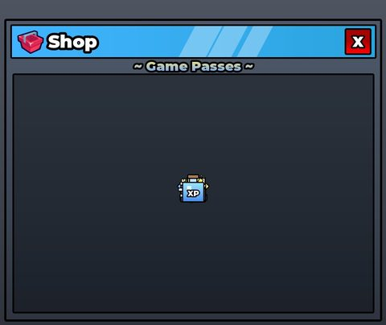</a> <b>ShopGui</b> › Main</td>
</tr>
<tr>
<td width="33%" valign="top"><a href="screenshots/13_Removed_EggShopGui__Main.jpg">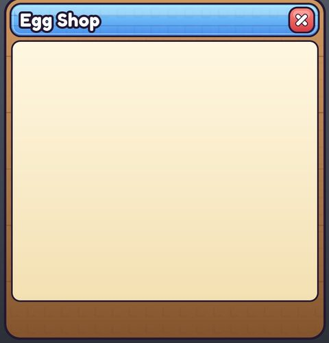</a> <b>Removed_EggShopGui</b> › Main</td>
<td width="33%" valign="top"><a href="screenshots/15_Removed_SeedShopGui__Main.jpg">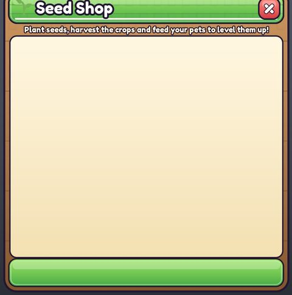</a> <b>Removed_SeedShopGui</b> › Main</td>
<td width="33%" valign="top"><a href="screenshots/17_CodeGui__Main.jpg">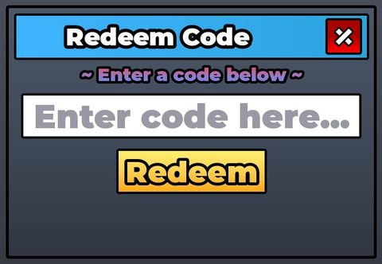</a> <b>CodeGui</b> › Main</td>
</tr>
<tr>
<td width="33%" valign="top"><a href="screenshots/19_DragonShopGui__Main.jpg">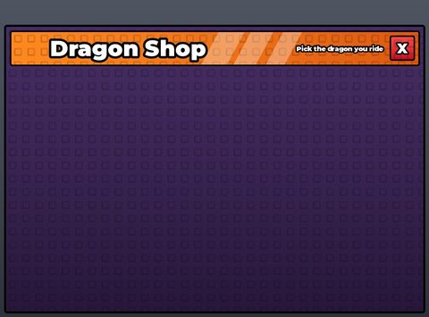</a> <b>DragonShopGui</b> › Main</td>
<td width="33%" valign="top"><a href="screenshots/22_UpgradesGui__Main.jpg">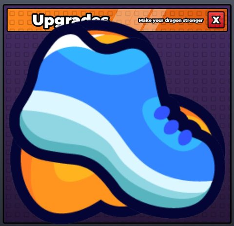</a> <b>UpgradesGui</b> › Main</td>
<td width="33%" valign="top"><a href="screenshots/24_PetInventoryGui_BeforeRestyle__Main.jpg">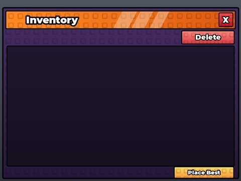</a> <b>PetInventoryGui_BeforeRestyle</b> › Main</td>
</tr>
<tr>
<td width="33%" valign="top"><a href="screenshots/28_RebirthGui__Main.jpg">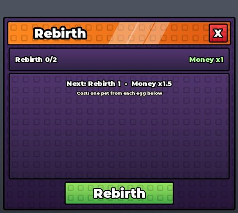</a> <b>RebirthGui</b> › Main</td>
<td width="33%" valign="top"><a href="screenshots/31_MoneyGui.jpg">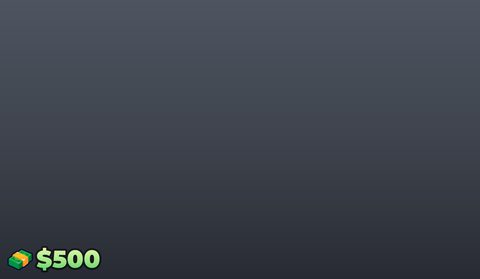</a> <b>MoneyGui</b></td>
<td width="33%" valign="top"><a href="screenshots/32_SettingsGui__Main.jpg">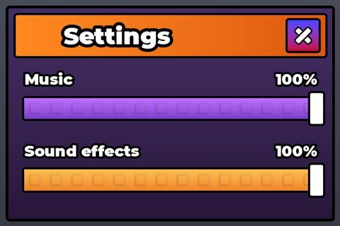</a> <b>SettingsGui</b> › Main</td>
</tr>
<tr>
<td width="33%" valign="top"><a href="screenshots/34_PetInventoryGui__Main.jpg">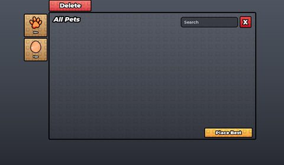</a> <b>PetInventoryGui</b> › Main</td>
<td width="33%" valign="top"><a href="screenshots/35_left_bottom.jpg">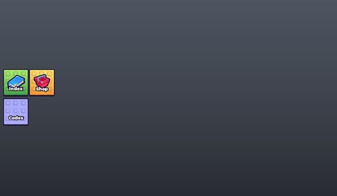</a> <b>left bottom</b></td>
<td width="33%" valign="top"><a href="screenshots/36_IndexGui__Main.jpg">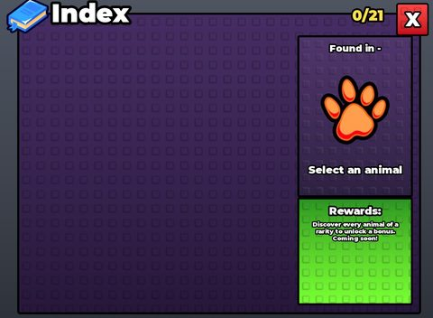</a> <b>IndexGui</b> › Main</td>
</tr>
<tr>
<td width="33%" valign="top"><a href="screenshots/38_ShopGui__Main.jpg">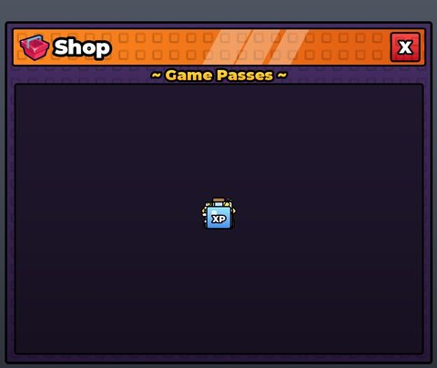</a> <b>ShopGui</b> › Main</td>
<td width="33%" valign="top"><a href="screenshots/40_CodeGui__Main.jpg">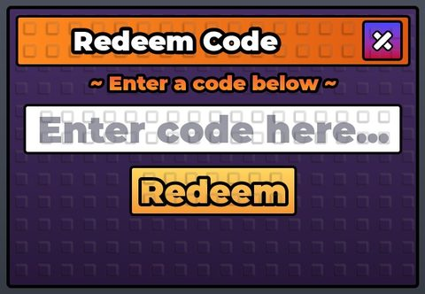</a> <b>CodeGui</b> › Main</td>
<td width="33%" valign="top"> <b>MoneyGui</b></td>
</tr>
<tr>
<td width="33%" valign="top"> <b>SettingsGui</b> › Main</td>
<td width="33%" valign="top"> <b>PetInventoryGui</b> › Main</td>
<td width="33%" valign="top"><a href="screenshots/46_left_bottom.jpg">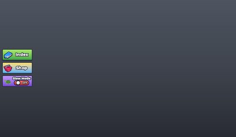</a> <b>left bottom</b></td>
</tr>
<tr>
<td width="33%" valign="top"> <b>IndexGui</b> › Main</td>
<td width="33%" valign="top"><a href="screenshots/49_ShopGui__Main.jpg">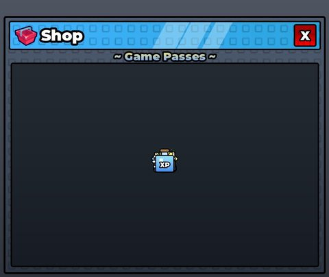</a> <b>ShopGui</b> › Main</td>
<td width="33%" valign="top"><a href="screenshots/51_CodeGui__Main.jpg">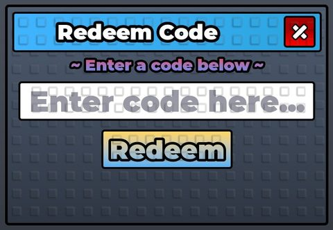</a> <b>CodeGui</b> › Main</td>
</tr>
<tr>
<td width="33%" valign="top"><a href="screenshots/57_SettingsGui__Main.jpg">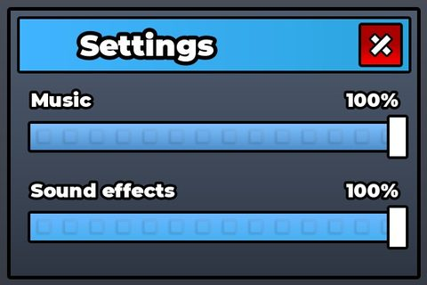</a> <b>SettingsGui</b> › Main</td>
<td width="33%" valign="top"><a href="screenshots/58_PetInventoryGui__Main.jpg">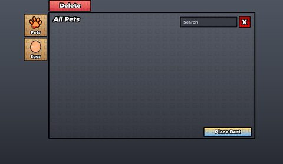</a> <b>PetInventoryGui</b> › Main</td>
<td width="33%" valign="top"><a href="screenshots/59_IndexGui__Main.jpg">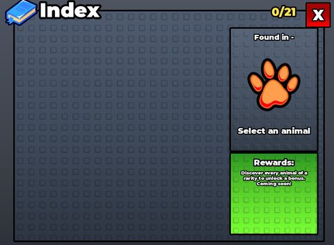</a> <b>IndexGui</b> › Main</td>
</tr>
<tr>
<td width="33%" valign="top"><a href="screenshots/60_left_bottom.jpg">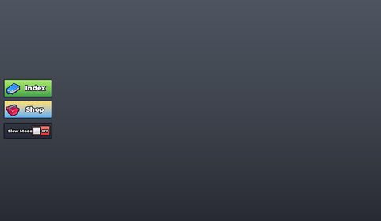</a> <b>left bottom</b></td>
<td width="33%" valign="top"> <b>CodeGui</b> › Main</td>
</tr>
</table>

### Other

<table>
<tr>
<td width="33%" valign="top"><a href="screenshots/16_FigmaImport_Reference.jpg">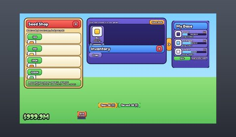</a> <b>FigmaImport_Reference</b></td>
<td width="33%" valign="top"><a href="screenshots/20_BurnGui.jpg">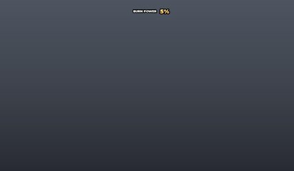</a> <b>BurnGui</b></td>
<td width="33%" valign="top"><a href="screenshots/25_GuideButton.jpg">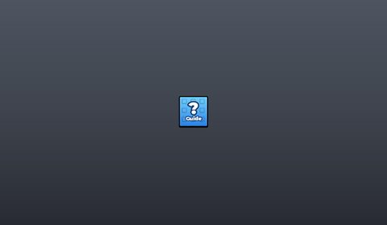</a> <b>GuideButton</b></td>
</tr>
<tr>
<td width="33%" valign="top"><a href="screenshots/41_SlowModeButton_BeforeRestyle.jpg">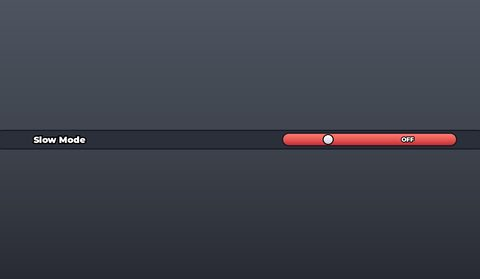</a> <b>SlowModeButton_BeforeRestyle</b></td>
<td width="33%" valign="top"><a href="screenshots/53_RowTemplate.jpg">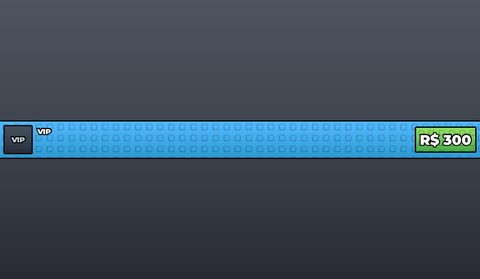</a> <b>RowTemplate</b></td>
<td width="33%" valign="top"><a href="screenshots/55_FastHatch.jpg">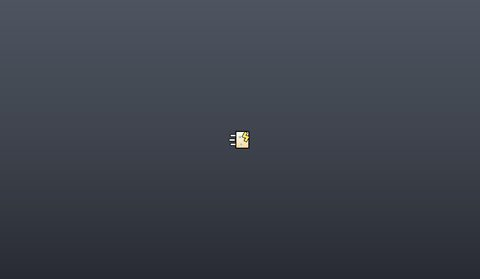</a> <b>FastHatch</b></td>
</tr>
<tr>
<td width="33%" valign="top"> <b>RowTemplate</b></td>
<td width="33%" valign="top"> <b>RowTemplate</b></td>
</tr>
</table>

## Model previews

<table>
<tr>
<td width="25%" valign="top"> <b>RockCandyDragon</b> <code>models/ReplicatedStorage/EggSystem/Pets/RockCandyDragon.rbxm</code></td>
<td width="25%" valign="top"> <b>RockCandyDragonEgg</b> <code>models/ServerStorage/EggModels_BeforeSlim/RockCandyDragonEgg.rbxm</code></td>
<td width="25%" valign="top"> <b>BatEgg</b> <code>models/ServerStorage/EggModels_BeforeSlim/BatEgg.rbxm</code></td>
<td width="25%" valign="top"> <b>Aura_WhiteWings</b> <code>models/Workspace/Aura Pack Premium By luismakako777/Aura_WhiteWings.rbxm</code></td>
</tr>
<tr>
<td width="25%" valign="top"> <b>Trade Machine</b> <code>models/Workspace/Trade Machine.rbxm</code></td>
<td width="25%" valign="top"> <b>Aura_SusanooArms</b> <code>models/Workspace/Aura Pack Premium By luismakako777/Aura_SusanooArms.rbxm</code></td>
<td width="25%" valign="top"> <b>CandyCloud</b> <code>models/ReplicatedStorage/SkyEvents/Models/CandyCloud.rbxm</code></td>
<td width="25%" valign="top"> <b>UPGRADE shop decor</b> <code>models/ServerStorage/Removed_HalloweenTheme/HalloweenTheme/Shops/UPGRADE shop decor.rbxm</code></td>
</tr>
<tr>
<td width="25%" valign="top"> <b>Volcano__x15</b> <code>models/Workspace/ZoneDecor/Lava/Volcano__x15.rbxm</code></td>
<td width="25%" valign="top"> <b>Diamond</b> <code>models/ServerStorage/TreadmillModels/Diamond.rbxm</code></td>
<td width="25%" valign="top"> <b>Crystal Dragon</b> <code>models/ReplicatedStorage/Dragons/Crystal Dragon.rbxm</code></td>
<td width="25%" valign="top"> <b>ShipRoom</b> <code>models/ReplicatedStorage/FightFilm/AlienSets/ShipRoom.rbxm</code></td>
</tr>
<tr>
<td width="25%" valign="top"> <b>AngelCerberus</b> <code>models/ServerStorage/Angels_BeforeGear/AngelCerberus.rbxm</code></td>
<td width="25%" valign="top"> <b>MoneyLeaderboard</b> <code>models/Workspace/MoneyLeaderboard.rbxm</code></td>
</tr>
</table>

## Notable scripts

Top-scored scripts of this game per topic (full tree in [source/scripts](source/scripts/)).

| Topic | Scripts |
|---|---|
| UI animation (tweens, hover / click, pop-ins, springs) | [`TradeClient`](source/scripts/StarterPlayer/StarterPlayerScripts/TradeClient.client.lua) 595 lines [`CreatorPanelClient`](source/scripts/ServerStorage/Backup_BeforePhantomZone/CreatorPanelClient.client.lua) 778 lines [`HammerClient`](source/scripts/ServerStorage/Scripts_BeforeAdminEggHit/HammerClient.client.lua) 663 lines [`HammerClient`](source/scripts/ServerStorage/Scripts_BeforeArenaV2/HammerClient.client.lua) 663 lines [`HammerClient`](source/scripts/ServerStorage/Scripts_BeforeBossSmash/HammerClient.client.lua) 687 lines |
| UI controllers / window managers / menus | [`FuseClient`](source/scripts/ServerStorage/Scripts_BeforeAdminCleanup/FuseClient.client.lua) 441 lines [`FuseClient`](source/scripts/ServerStorage/Scripts_BeforeTradeMachine/FuseClient.client.lua) 458 lines [`TradeClient`](source/scripts/StarterPlayer/StarterPlayerScripts/TradeClient.client.lua) 595 lines [`FuseClient`](source/scripts/StarterPlayer/StarterPlayerScripts/FuseClient.client.lua) 421 lines [`AdminCutsceneEventsTab`](source/scripts/ServerStorage/Obsidian_Backup/AdminCutsceneEventsTab.client.lua) 159 lines |
| Notifications, toasts, popups, prompts | [`GlobalAnnounceClient`](source/scripts/ServerStorage/Scripts_BeforeAdminCleanup/GlobalAnnounceClient.client.lua) 316 lines [`GlobalAnnounceClient`](source/scripts/ServerStorage/Scripts_BeforeMeshAnimals/GlobalAnnounceClient.client.lua) 294 lines [`GlobalAnnounceClient`](source/scripts/ServerStorage/Backup_BeforeGalaxyZone/Scripts/GlobalAnnounceClient.client.lua) 235 lines [`GlobalAnnounceClient`](source/scripts/ServerStorage/Backup_BeforePhantomZone/GlobalAnnounceClient.client.lua) 236 lines [`GlobalAnnounceClient`](source/scripts/ServerStorage/Scripts_BeforeMobileUi/GlobalAnnounceClient.client.lua) 220 lines |
| Loading / intro screens | [`LoadingScreen_BeforeSmashCover`](source/scripts/ServerStorage/LoadingScreen_BeforeSmashCover.client.lua) 106 lines [`LoadingScreen`](source/scripts/ServerStorage/Removed_LoadingScreen/LoadingScreen.client.lua) 107 lines [`IntroClient_BeforeFire`](source/scripts/ServerStorage/IntroClient_BeforeFire.client.lua) 457 lines [`IntroClient`](source/scripts/ServerStorage/Scripts_BeforeGalacticUpdate/IntroClient.client.lua) 545 lines [`IntroClient`](source/scripts/ServerStorage/Scripts_BeforeGlobalBus/IntroClient.client.lua) 545 lines |
| Camera, cutscenes, screen shake | [`ReaperCutsceneClient_Old`](source/scripts/ServerStorage/ReaperCutsceneClient_Old.client.lua) 1314 lines [`HackerCutsceneClient`](source/scripts/ServerStorage/Scripts_BeforeHackerWave2/HackerCutsceneClient.client.lua) 684 lines [`HackerCutsceneClient`](source/scripts/StarterPlayer/StarterPlayerScripts/HackerCutsceneClient.client.lua) 727 lines [`SafeCutsceneClient`](source/scripts/StarterPlayer/StarterPlayerScripts/SafeCutsceneClient.client.lua) 473 lines [`CutsceneClient`](source/scripts/StarterPlayer/StarterPlayerScripts/CutsceneClient.client.lua) 2266 lines |
| VFX, particles, beams, hit effects | [`DiscoFxClient`](source/scripts/ServerStorage/Removed_Events_2026_10_24/DiscoFxClient.client.lua) 297 lines [`Fx`](source/scripts/ReplicatedStorage/FightFilm/Fx.lua) 255 lines [`HammerClient`](source/scripts/ServerStorage/Scripts_BeforeBossSmash/HammerClient.client.lua) 687 lines [`HammerClient`](source/scripts/ServerStorage/Scripts_BeforeEggHitFix/HammerClient.client.lua) 688 lines [`HammerClient`](source/scripts/ServerStorage/Scripts_BeforeEventsShowcase/HammerClient.client.lua) 688 lines |
| DataStore / player data | [`PetServer`](source/scripts/ServerScriptService/PetServer.server.lua) 1663 lines [`PetServer`](source/scripts/ServerStorage/Backup_BeforePhantomZone/PetServer.server.lua) 1663 lines [`PetServer`](source/scripts/ServerStorage/Scripts_BeforeCreatorPanelV2/PetServer.server.lua) 1619 lines [`PetServer`](source/scripts/ServerStorage/Scripts_BeforeGlobalBus/PetServer.server.lua) 1617 lines [`PetServer_BeforeTreadmill11`](source/scripts/ServerStorage/Scripts_BeforeGlobalBus/PetServer_BeforeTreadmill11.server.lua) 1617 lines |
| Monetization (dev products, game passes, receipts) | [`FeaturedShopServer`](source/scripts/ServerScriptService/FeaturedShopServer.server.lua) 115 lines [`FeaturedShopServer`](source/scripts/ServerStorage/Scripts_BeforeAdminRework/FeaturedShopServer.server.lua) 113 lines [`PassShopHandler`](source/scripts/ServerStorage/Scripts_BeforeEventsShowcase/PassShopHandler.client.lua) 649 lines [`PassShopHandler`](source/scripts/StarterGui/ShopGui/PassShopHandler.client.lua) 652 lines [`PassShopHandler`](source/scripts/ServerStorage/Scripts_BeforeGifts/PassShopHandler.client.lua) 455 lines |
| RNG, eggs, gacha, rarity rolls, pets | [`EggZoneServer`](source/scripts/ServerScriptService/EggZoneServer.server.lua) 1474 lines [`EggZoneServer`](source/scripts/ServerStorage/Backup_BeforeGalaxyZone/Scripts/EggZoneServer.server.lua) 1382 lines [`EggZoneServer`](source/scripts/ServerStorage/Backup_BeforePhantomZone/EggZoneServer.server.lua) 1470 lines [`EggZoneServer`](source/scripts/ServerStorage/Scripts_BeforeDiscoFx/EggZoneServer.server.lua) 1428 lines [`EggZoneServer`](source/scripts/ServerStorage/Scripts_BeforeEggHitFix/EggZoneServer.server.lua) 1399 lines |
| Trading systems | [`TradeServer`](source/scripts/ServerScriptService/TradeServer.server.lua) 295 lines [`TradeClient`](source/scripts/ServerStorage/Removed_RebirthTradeGuide/TradeClient.client.lua) 328 lines [`TradeServer`](source/scripts/ServerStorage/Removed_RebirthTradeGuide/TradeServer.server.lua) 441 lines [`TradeClient`](source/scripts/ServerStorage/Scripts_BeforeTradeUI2/TradeClient.client.lua) 371 lines [`TradeServer`](source/scripts/ServerStorage/Scripts_BeforeTradeUI2/TradeServer.server.lua) 290 lines |
| Combat, weapons, hitboxes, abilities | [`CreatorPanelServer`](source/scripts/ServerScriptService/CreatorPanelServer.server.lua) 729 lines [`CreatorPanelServer`](source/scripts/ServerStorage/Scripts_BeforeAntiCheatV2/CreatorPanelServer.server.lua) 725 lines [`CreatorPanelServer`](source/scripts/ServerStorage/Scripts_BeforeCreatorPanelV2/CreatorPanelServer.server.lua) 581 lines [`CreatorPanelServer`](source/scripts/ServerStorage/Scripts_BeforeTradeMachine/CreatorPanelServer.server.lua) 724 lines [`CyberZoneServer`](source/scripts/ServerScriptService/CyberZoneServer.server.lua) 442 lines |
| NPC / AI / monsters | [`ZoneBossServer`](source/scripts/ServerScriptService/ZoneBossServer.server.lua) 523 lines [`ZoneBossServer`](source/scripts/ServerStorage/Backup_BeforeGalaxyZone/Scripts/ZoneBossServer.server.lua) 455 lines [`ZoneBossServer`](source/scripts/ServerStorage/Backup_BeforePhantomZone/ZoneBossServer.server.lua) 519 lines [`ZoneBossServer`](source/scripts/ServerStorage/Scripts_BeforeBossDrop/ZoneBossServer.server.lua) 457 lines [`ZoneBossServer`](source/scripts/ServerStorage/Scripts_BeforeBossFaster/ZoneBossServer.server.lua) 457 lines |
| Character movement (sprint, dash, double jump, slide) | [`NoSlideClient`](source/scripts/ServerStorage/Scripts_BeforeSpeedPass/NoSlideClient.client.lua) 66 lines [`NoSlideClient`](source/scripts/StarterPlayer/StarterPlayerScripts/NoSlideClient.client.lua) 100 lines [`ZoneBossServer`](source/scripts/ServerStorage/Scripts_BeforeBossSmooth/ZoneBossServer.server.lua) 420 lines [`ZoneBossServer`](source/scripts/ServerScriptService/ZoneBossServer.server.lua) 523 lines [`ZoneBossServer`](source/scripts/ServerStorage/Backup_BeforeGalaxyZone/Scripts/ZoneBossServer.server.lua) 455 lines |
| Tycoon / plots / bases / building | [`AdminPanelClient`](source/scripts/ServerStorage/Backup_BeforeGalaxyZone/Scripts/AdminPanelClient.client.lua) 891 lines [`AdminPanelClient`](source/scripts/ServerStorage/Scripts_BeforeGalacticUpdate/AdminPanelClient.client.lua) 897 lines [`AdminPanelClient`](source/scripts/ServerStorage/Scripts_BeforeKgCapNight/AdminPanelClient.client.lua) 900 lines [`AdminPanelClient`](source/scripts/ServerStorage/Scripts_BeforeNoSteal/AdminPanelClient.client.lua) 894 lines [`AdminPanelClient`](source/scripts/ServerStorage/Scripts_BeforeSkipFuseEgg/AdminPanelClient.client.lua) 891 lines |
| Leaderboards & stats | [`LeaderboardServer`](source/scripts/ServerScriptService/LeaderboardServer.server.lua) 88 lines [`SpeedLeaderboardServer`](source/scripts/ServerScriptService/SpeedLeaderboardServer.server.lua) 68 lines [`LeaderboardServer`](source/scripts/ServerStorage/Scripts_BeforeCreatorPanelV2/LeaderboardServer.server.lua) 88 lines [`SpeedLeaderboardServer`](source/scripts/ServerStorage/Scripts_BeforeCreatorPanelV2/SpeedLeaderboardServer.server.lua) 68 lines [`LeaderboardServer`](source/scripts/ServerStorage/Scripts_BeforeDataReset/LeaderboardServer.server.lua) 85 lines |
| Admin panels & commands | [`AdminServer`](source/scripts/ServerScriptService/AdminServer.server.lua) 507 lines [`AdminPanelClient`](source/scripts/ServerStorage/Backup_BeforeGalaxyZone/Scripts/AdminPanelClient.client.lua) 891 lines [`AdminPanelClient`](source/scripts/ServerStorage/Backup_BeforePhantom/AdminPanelClient.client.lua) 1037 lines [`AdminPanelClient`](source/scripts/ServerStorage/Backup_BeforePhantomZone/AdminPanelClient.client.lua) 1001 lines [`AdminServer`](source/scripts/ServerStorage/Backup_BeforePhantomZone/AdminServer.server.lua) 453 lines |
| Sound & music | [`BackgroundMusicClient`](source/scripts/ServerStorage/Scripts_BeforeHammerOwnership/BackgroundMusicClient.client.lua) 37 lines [`BackgroundMusicClient`](source/scripts/StarterPlayer/StarterPlayerScripts/BackgroundMusicClient.client.lua) 42 lines [`SettingsHandler`](source/scripts/ServerStorage/Gui_Before3D/SettingsGui/SettingsHandler.client.lua) 129 lines [`SettingsHandler`](source/scripts/ServerStorage/Scripts_BeforeGuiScale/SettingsHandler.client.lua) 132 lines [`SettingsHandler`](source/scripts/StarterGui/SettingsGui/SettingsHandler.client.lua) 131 lines |
| Daily rewards, quests, codes, playtime | [`CodeHandler`](source/scripts/ServerStorage/Gui_Before3Dv2/CodeGui/CodeHandler.client.lua) 135 lines [`PetServer`](source/scripts/ServerScriptService/PetServer.server.lua) 1663 lines [`PetServer`](source/scripts/ServerStorage/Backup_BeforePhantomZone/PetServer.server.lua) 1663 lines [`PetServer`](source/scripts/ServerStorage/Scripts_BeforeCreatorPanelV2/PetServer.server.lua) 1619 lines [`PetServer`](source/scripts/ServerStorage/Scripts_BeforeDataReset/PetServer.server.lua) 1476 lines |
| Utility modules (number format, signals, tables, timers) | [`Emit`](source/scripts/ReplicatedStorage/VFX/Emit.lua) 934 lines [`EggConfig`](source/scripts/ServerStorage/Backup_BeforePhantom/EggConfig.lua) 878 lines [`EggConfig_BeforeExclusiveX1000`](source/scripts/ServerStorage/EggConfig_BeforeExclusiveX1000.lua) 802 lines [`EggConfig_BeforeMeshAnimals`](source/scripts/ServerStorage/EggConfig_BeforeMeshAnimals.lua) 393 lines [`EggConfig_BeforeZoneSpeed100B`](source/scripts/ServerStorage/EggConfig_BeforeZoneSpeed100B.lua) 560 lines |

### In the curated script library

- [CutsceneLock](../../Scripts/05-Camera-Cutscene/CutsceneLock__smash-egg-for-animals.lua) — One-cutscene-at-a-time lock + StreamingEnabled support (load what the camera sees).
- [Poster loading screen with camera dive](../../Scripts/04-Loading-Screens/PosterLoadingScreen__smash-egg-for-animals.lua) — Code-built ReplicatedFirst loading screen: game poster in a frame, timed progress bar with %, rotating tips, scrolling stud background, then a white flash while the camera dives from the sky to the player.
- [First-join cinematic with Skip](../../Scripts/04-Loading-Screens/ArrivalCinematicWithSkip__smash-egg-for-animals.lua) — First-time-player arrival cinematic: letterbox bars, titles, fades, a boss leaping through a forest, zone fly-over; square SKIP button; hold() helper that aborts every step once skipped; sets IntroState attribute so the tutorial waits.
- [Ground grip & air control](../../Scripts/13-Movement/GroundGripAirControl__smash-egg-for-animals.lua) — Tight ground control + momentum-preserving air control by writing AssemblyLinearVelocity.
- [Global announcements + rarity spawn banners](../../Scripts/03-Notifications/GlobalAnnounceClient__smash-egg-for-animals.lua) — Builds its own UI in code: admin announcements (avatar headshot + name + text) stacked at top of screen, rarity-gradient "egg spawned" announcements with a sliding gradient, plus a small redeem-code window.
- [Zone enter banner](../../Scripts/03-Notifications/ZoneEnterBanner__smash-egg-for-animals.lua) — Area title banner: when the player enters a tagged zone part, a CanvasGroup banner (zone name, gradient, recommended speed) slides in for 3s then fades.
- [Full-screen danger alert](../../Scripts/03-Notifications/DangerAlert__smash-egg-for-animals.lua) — Full-screen "RUN!" warning driven by a player attribute: red flash, pulsing gradient screen edges, heartbeat-scaled text; fades out when the attribute clears.
- [Zone guardian boss (steal-and-run chaser)](../../Scripts/12-NPC-AI/ZoneGuardianBoss__smash-egg-for-animals.lua) — Giant guardian per egg zone: wanders its zone, chases any player carrying an egg from it with a wind-up, target-leading (aims where the player will be), speed matched to the zone's recommended speed, safe-zone wall, leash/give-up rules, knock-back on hit and fast return home. Physics driven by LinearVelocity + AlignOrientation. Comments are in French.
- [Two-phase arena boss with minions](../../Scripts/12-NPC-AI/BossArenaPhases__smash-egg-for-animals.lua) — Server-authoritative boss fight: HP pool, timed ground-slam shockwave you must jump, teleports, and below 50% HP a phase 2 that spawns exploding dog minions that chase the nearest player on a fuse timer. Visuals are driven by attributes / a client FX remote. Comments are in French.
- [Idle NPC that looks at and waves to you](../../Scripts/12-NPC-AI/LookAtPlayerIdleNPC__smash-egg-for-animals.lua) — Client script for NPCs tagged 'LookAtNpc': breathing idle via Motor6D C0 offsets, head + waist turn toward the local player (clamped yaw/pitch, smoothed), one wave when you come close, re-greets after you leave. Comments are in French.
- [Egg spawn / size / pet rolls with luck event](../../Scripts/09-RNG-Gacha-Pets/EggZoneRolls__smash-egg-for-animals.lua) — Three roll helpers: luck() reads a server attribute, rollHeight() picks a size tier, pickKey() boosts every egg except the most common one during a luck event, and hatch() picks the pet and stacks event mutations.
- [Placed egg incubation + hatch](../../Scripts/09-RNG-Gacha-Pets/EggIncubateHatch__smash-egg-for-animals.lua) — Eggs placed in the player's base incubate until ReadyAt, can randomly grow heavier while waiting, then hatch on the server (inventory cap check, roll by % table, egg weight carried into the pet).
- [Cross-server luck event](../../Scripts/09-RNG-Gacha-Pets/GlobalLuckEvent__smash-egg-for-animals.lua) — Admin-started x4 luck event shared by all servers: end time saved in a DataStore (new servers pick it up), broadcast with MessagingService, per-server option, and a resync loop.
- [Minimal seasonal playlist](../../Scripts/17-Sound-Music/BackgroundPlaylist__smash-egg-for-animals.lua) — Minimal background playlist: one Sound in SoundService cycles through a list of IDs on Ended; picks a seasonal (Halloween) playlist from a Lighting attribute. Comments are in French.
- [Button hover/click sounds and bounce](../../Scripts/17-Sound-Music/UIButtonSoundsAndBounce__smash-egg-for-animals.lua) — Auto-adds hover/press scale bounce plus hover and click sounds to every GuiButton, with random pitch and SoundService:PlayLocalSound; also plays a window-opened sound when a large Main/Window/Panel frame becomes visible. Falls back to built-in sounds if an asset fails to load. Comments are in French.
- [3D boss roars with rolloff](../../Scripts/17-Sound-Music/BossRoar3D__smash-egg-for-animals.lua) — 3D positional roars for tagged bosses while they chase: per-boss sound config (id, volume, pitch), linear rolloff from 40 to 190 studs, random offsets so bosses do not roar in sync, fade-out before destroy, muted in safe zone and arenas. Comments are in French.
- [Music/SFX sliders with SoundGroup routing](../../Scripts/17-Sound-Music/VolumeSettingsSoundGroups__smash-egg-for-animals.lua) — Settings panel with Music and SFX volume sliders. Creates Music and SFX SoundGroups and auto-routes every Sound in the game into one of them (long looped sounds count as music), drag-to-set sliders in 5 percent steps for mouse and touch, saves on release, loads saved values from player attributes. Comments are in French.
- [Volume settings DataStore save](../../Scripts/17-Sound-Music/VolumeSettingsSave__smash-egg-for-animals.lua) — Server half of the volume settings: loads Music/SFX volume from its own DataStore into player attributes, validates values sent by the client remote, and writes once on leave or BindToClose. Comments are in French.
- [Trade machine server](../../Scripts/10-Trading/TradeMachineServer__smash-egg-for-animals.lua) — Same-server pet trade with READY->wait->CONFIRM, edit cooldowns, request expiry and action rate limit.
- [Trade bridge atomic swap](../../Scripts/10-Trading/TradeBridgeAtomicSwap__smash-egg-for-animals.lua) — Excerpt: data-owner BindableFunction that lists tradable pets and executes an all-or-nothing swap.
- [Code-built trade UI](../../Scripts/10-Trading/TradeMachineClient__smash-egg-for-animals.lua) — Complete trade window built in code: lobby, request cards with timers, offer grids, ready/confirm countdown.
- [Cross-server escrow trade](../../Scripts/10-Trading/CrossServerEscrowTrade__smash-egg-for-animals.lua) — Cross-server trade that escrows pets per server then delivers through a DataStore inbox with offer signatures.
- [Compact button FX with sounds](../../Scripts/01-UI-Animation/ButtonFX_UIScaleSounds__smash-egg-for-animals.lua) — Compact global button FX: UIScale grow on hover, squash on press, Back-eased return, pitch-randomised sounds, mobile tap fallback, and a sound when big windows open. Comments in French.
- [Auto pop-in for windows](../../Scripts/01-UI-Animation/WindowOpenFx_AutoPopIn__smash-egg-for-animals.lua) — Automatically pops every big window in from 80% scale (0.18 s Back out) when it becomes Visible, preserving any existing UIScale value. Comments in French.
- [Money count-up + gain popup](../../Scripts/01-UI-Animation/MoneyCounter_CountUpGainPopup__smash-egg-for-animals.lua) — Money counter with cubic ease-out count-up on RenderStepped, a "+$N" label that bursts out then rises and fades, batching of simultaneous gains, and a pop on spend. Comments in French.
- [Slowing roll + reveal](../../Scripts/01-UI-Animation/HatchReel_SlowingRoll__smash-egg-for-animals.lua) — Egg hatch reel that cycles silhouettes fast then slows (quadratic slot lengths), never repeats the result just before landing, then reveals with name tag pop, rays spin and highlight fade. Comments in French.
- [Zone entry banner](../../Scripts/01-UI-Animation/ZoneBanner_CanvasGroupFade__smash-egg-for-animals.lua) — Area-entry banner built in code: CanvasGroup fades in (GroupTransparency) while sliding down with Back-out, gradient title, auto-hides after 3 s. Comments in French.
- [Screen-edge danger pulse](../../Scripts/01-UI-Animation/RunAlert_ScreenEdgePulse__smash-egg-for-animals.lua) — Danger alert: big "RUN!" text slams in from 2.4x scale, full-screen red flash, four gradient screen edges and the text heartbeat-pulse via sin() on RenderStepped. Comments in French.
- [Gradient polish + sun rays](../../Scripts/01-UI-Animation/GradientPolish_SunRays__smash-egg-for-animals.lua) — Upgrades every 2-colour UIGradient into a 4-stop "glossy" gradient and spins sun-ray images behind chosen icons. Needs the game PetPortrait.rays helper. Comments in French.
- [Global window pop-in effect](../../Scripts/02-UI-Framework/WindowOpenFx__smash-egg-for-animals.lua) — Watches every Main/Window/Panel frame and pops it in from 80% scale when shown.
- [Fx controller (burst / attach / aura / mesh / projectile / light)](../../Scripts/06-VFX/FxController__smash-egg-for-animals.lua) — Most complete VFX controller: burst, attach-to-part, full-body aura, growing mesh shockwave, projectile, light flash.
- [Black hole portal](../../Scripts/06-VFX/BlackHolePortal__smash-egg-for-animals.lua) — Procedural layered portal (open / close / flare / suck) animated every frame.
- [Boss aura with distance culling](../../Scripts/06-VFX/BossAuraCulling__smash-egg-for-animals.lua) — Client aura manager: idle/run emitter rates, pulsing glow, flickering arcs, distance culling at 8 Hz.

## ⚠️ Safety

HIGH flags (backdoors, `require(id)`, `loadstring`, webhooks). Review or delete before reusing:

- `scripts/ServerStorage/Angels_BeforeTextures/AnimalWiring_BeforeTextures.lua`
- `scripts/ServerStorage/Gui3DBuilderV2.lua`

## Folders

| Folder | What |
|---|---|
| `screenshots/` | full frames; `crops/` = the panel only; `models/` = 3D previews; `thumbs/` = gallery thumbnails |
| `ui/` | every screen as a Lua builder (`require(module)()` returns the ScreenGui); `_StarterGui-all.lua` builds every StarterGui screen |
| `models/` | every model as .rbxm (the only .rbxm files), mirroring the place tree, scripts removed |
| `map/` | `workspace.rbxm` (the map as a model), `lighting.lua` (sky + post effects), `materials.lua`, `Environment.lua` |
| `animations/`, `audio/` | KeyframeSequence / Sound builders (.lua), `AnimationIds.lua`, `Sounds.lua` |
| `source/` | all scripts as .luau, `tree.txt`, `ui.txt`, `remotes.txt`, `assets.txt`, `flags.txt` |
