# Steal a Brainrot (SAB files)

> 🧠 **Brainrot** · steal / tycoon (brainrots, plots) · source file `SLBR VIP _ SAB FILES.rbxl`

[⬅ Back to the catalog](../../README.md) · [Assets inventory](ASSETS.md) · [Style numbers](reference.md) · [Scripts](source/scripts/) · [Code analysis](source/README.md)

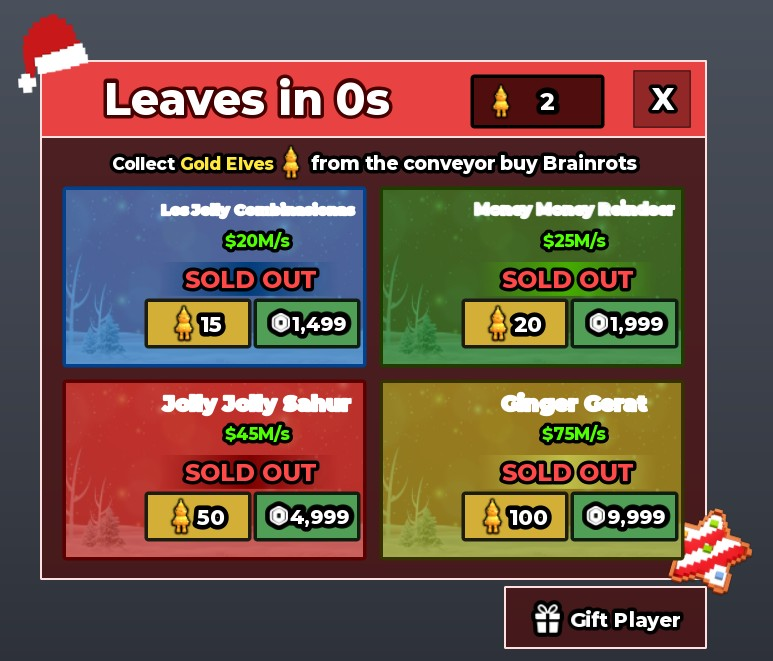

## At a glance

| | |
|---|---|
| Provenance | copy of a live game (saveinstance / decompiled client code) |
| Screens | 83 ScreenGuis, 5987 GUI objects → **93 screenshots** |
| Models (.rbxm) | 5224 models, 290 model sets, 7626 VFX sets |
| Lua builders (.lua) | 143 UI screens, 547 animation packs, 94 audio packs |
| Code | 1967 scripts, 284,519 lines |
| Asset ids | 1443 animations, 949 sounds |
| Safety scan | 30 HIGH / 31 MED flags ([flags.txt](source/flags.txt)) |

**Fonts:** `GothamSSm ExtraBold`×987, `SourceSansPro Bold`×787, `GothamSSm Bold`×564, `GothamSSm Heavy`×114, `FredokaOne Regular`×103

## UI screenshots

Captured in Studio from the place's own ScreenGuis (scripts stripped). Each panel was opened on its own; click a thumbnail for the full 1519×886 frame. Runtime-filled lists (shop items, inventories) show their template state.

### Shop & Robux store

<table>
<tr>
<td width="33%" valign="top"> <b>GamepassUI</b></td>
<td width="33%" valign="top"><a href="screenshots/05_GamepassUI__Frame.jpg">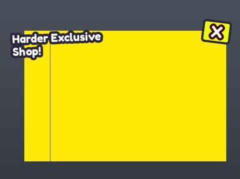</a> <b>GamepassUI</b> › Frame</td>
<td width="33%" valign="top"> <b>SantaMerchant</b> › SantaMerchant</td>
</tr>
<tr>
<td width="33%" valign="top"><a href="screenshots/21_RodsShop__RodsShop.jpg">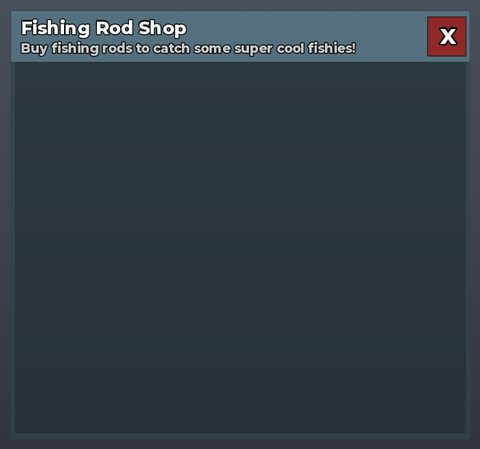</a> <b>RodsShop</b> › RodsShop</td>
<td width="33%" valign="top"><a href="screenshots/27_FakePurchases__Shop.jpg">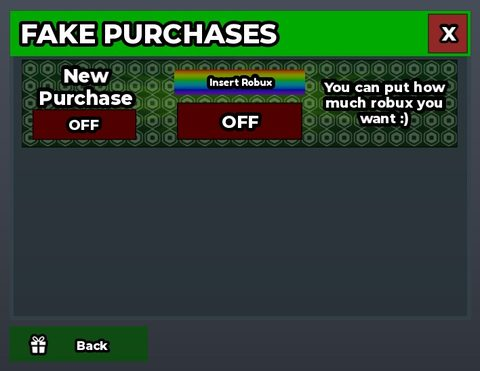</a> <b>FakePurchases</b> › Shop</td>
<td width="33%" valign="top"><a href="screenshots/38_CoinsShop__CoinsShop.jpg">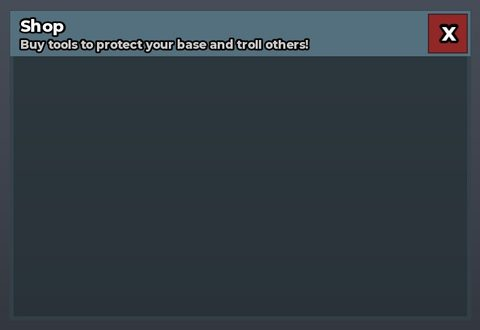</a> <b>CoinsShop</b> › CoinsShop</td>
</tr>
<tr>
<td width="33%" valign="top"><a href="screenshots/49_ValentinesShop.jpg">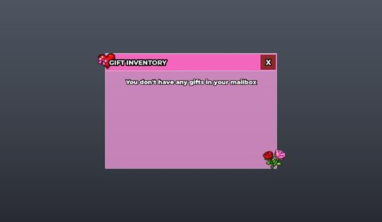</a> <b>ValentinesShop</b></td>
<td width="33%" valign="top"><a href="screenshots/59_JumpShop__JumpShop.jpg">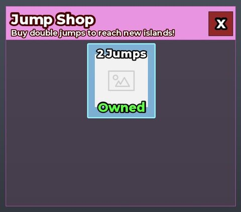</a> <b>JumpShop</b> › JumpShop</td>
<td width="33%" valign="top"><a href="screenshots/64_Merchant__Merchant.jpg">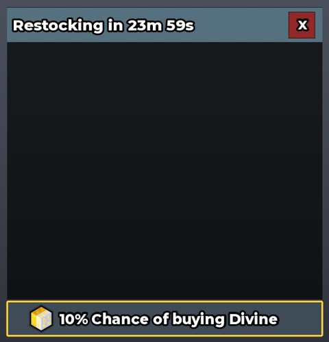</a> <b>Merchant</b> › Merchant</td>
</tr>
<tr>
<td width="33%" valign="top"><a href="screenshots/66_CandyShop__CandyShop.jpg">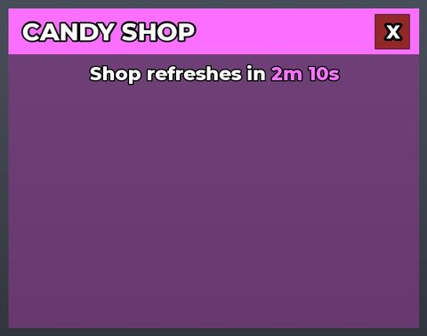</a> <b>CandyShop</b> › CandyShop</td>
<td width="33%" valign="top"><a href="screenshots/79_Shop__Shop.jpg">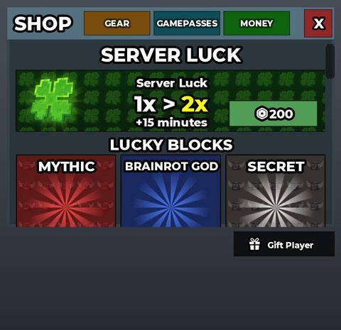</a> <b>Shop</b> › Shop</td>
</tr>
</table>

### Rewards, daily, spin, codes

<table>
<tr>
<td width="33%" valign="top"><a href="screenshots/24_CyberWheel__Buttons.jpg">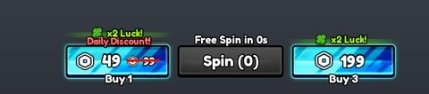</a> <b>CyberWheel</b> › Buttons</td>
<td width="33%" valign="top"><a href="screenshots/25_CyberWheel__Wheel.jpg">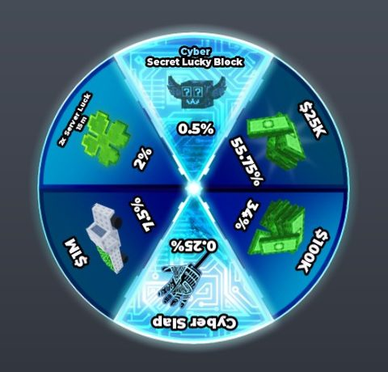</a> <b>CyberWheel</b> › Wheel</td>
<td width="33%" valign="top"><a href="screenshots/28_GiftPlayer__GiftPlayer.jpg">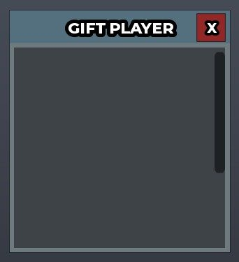</a> <b>GiftPlayer</b> › GiftPlayer</td>
</tr>
<tr>
<td width="33%" valign="top"><a href="screenshots/29_GalaxyWheel__Wheel.jpg">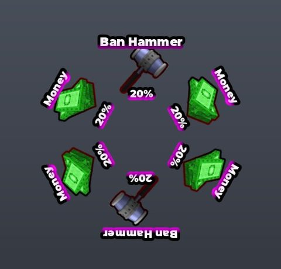</a> <b>GalaxyWheel</b> › Wheel</td>
<td width="33%" valign="top"><a href="screenshots/30_GalaxyWheel__Buttons.jpg">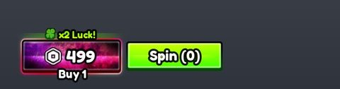</a> <b>GalaxyWheel</b> › Buttons</td>
<td width="33%" valign="top"><a href="screenshots/39_ChristmasWheel__Buttons.jpg">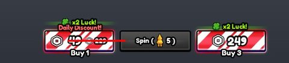</a> <b>ChristmasWheel</b> › Buttons</td>
</tr>
<tr>
<td width="33%" valign="top"><a href="screenshots/40_ChristmasWheel__Wheel.jpg">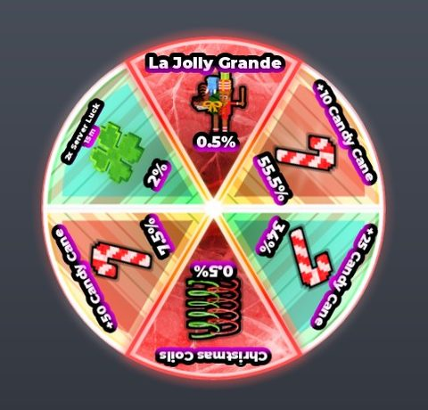</a> <b>ChristmasWheel</b> › Wheel</td>
<td width="33%" valign="top"><a href="screenshots/42_AdventCalendar__Frame.jpg">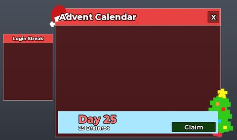</a> <b>AdventCalendar</b> › Frame</td>
<td width="33%" valign="top"><a href="screenshots/43_PhantomWheel__Buttons.jpg">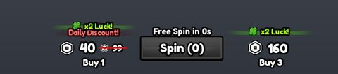</a> <b>PhantomWheel</b> › Buttons</td>
</tr>
<tr>
<td width="33%" valign="top"><a href="screenshots/44_PhantomWheel__Wheel.jpg">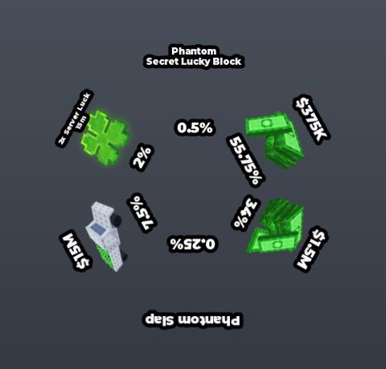</a> <b>PhantomWheel</b> › Wheel</td>
<td width="33%" valign="top"><a href="screenshots/62_ValentinesSendGift__ValentinesSendGift.jpg">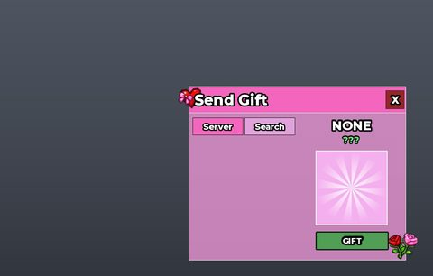</a> <b>ValentinesSendGift</b> › ValentinesSendGift</td>
<td width="33%" valign="top"><a href="screenshots/67_DivineWheel__Buttons.jpg">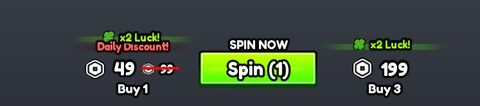</a> <b>DivineWheel</b> › Buttons</td>
</tr>
<tr>
<td width="33%" valign="top"><a href="screenshots/68_DivineWheel__Wheel.jpg">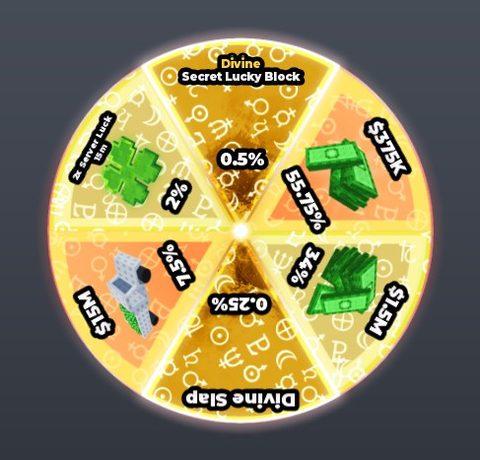</a> <b>DivineWheel</b> › Wheel</td>
<td width="33%" valign="top"><a href="screenshots/80_Codes.jpg">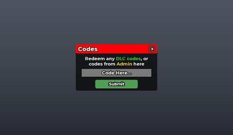</a> <b>Codes</b></td>
</tr>
</table>

### Quests & progression

<table>
<tr>
<td width="33%" valign="top"><a href="screenshots/14_TsunamiSpeedUpgrade__TsunamiSpeedUpgrade.jpg">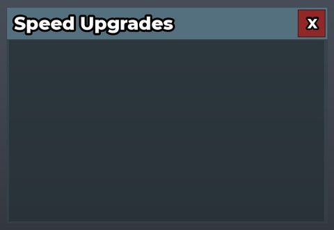</a> <b>TsunamiSpeedUpgrade</b> › TsunamiSpeedUpgrade</td>
<td width="33%" valign="top"><a href="screenshots/22_Rebirth__Rebirth.jpg">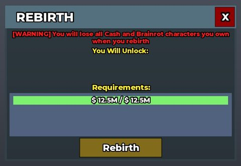</a> <b>Rebirth</b> › Rebirth</td>
<td width="33%" valign="top"><a href="screenshots/52_Index__Progress.jpg">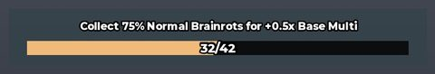</a> <b>Index</b> › Progress</td>
</tr>
</table>

### Trading

<table>
<tr>
<td width="33%" valign="top"><a href="screenshots/13_TradePlayerList__TradePlayerList.jpg">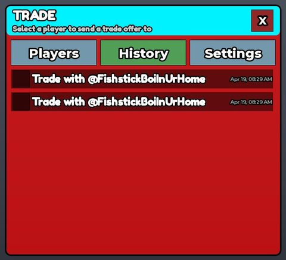</a> <b>TradePlayerList</b> › TradePlayerList</td>
<td width="33%" valign="top"><a href="screenshots/73_BrainrotTrader__Frame.jpg">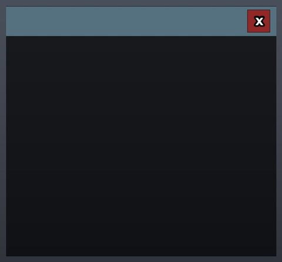</a> <b>BrainrotTrader</b> › Frame</td>
<td width="33%" valign="top"><a href="screenshots/88_TradeLiveTrade__Header.jpg">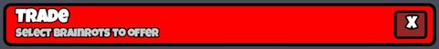</a> <b>TradeLiveTrade</b> › Header</td>
</tr>
<tr>
<td width="33%" valign="top"><a href="screenshots/89_TradeLiveTrade__Other.jpg">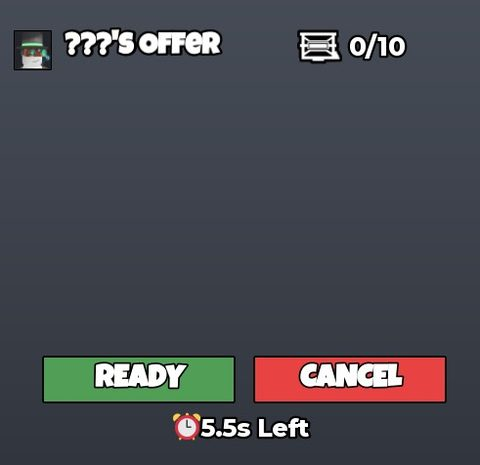</a> <b>TradeLiveTrade</b> › Other</td>
<td width="33%" valign="top"> <b>TradeLiveTrade</b> › YourSign</td>
<td width="33%" valign="top"><a href="screenshots/91_TradeLiveTrade__OtherSign.jpg">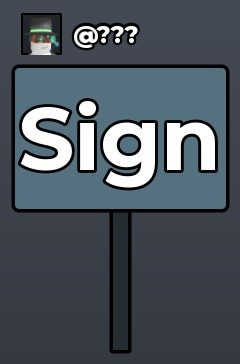</a> <b>TradeLiveTrade</b> › OtherSign</td>
</tr>
<tr>
<td width="33%" valign="top"><a href="screenshots/92_TradeLiveTrade__Chat.jpg">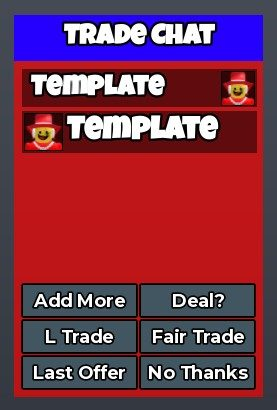</a> <b>TradeLiveTrade</b> › Chat</td>
<td width="33%" valign="top"><a href="screenshots/93_TradeLiveTrade__Your.jpg">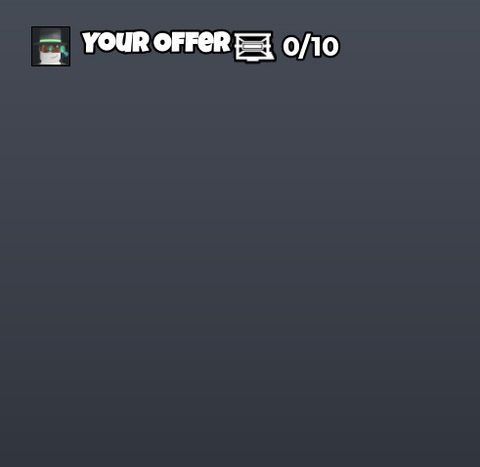</a> <b>TradeLiveTrade</b> › Your</td>
</tr>
</table>

### Settings & menus

<table>
<tr>
<td width="33%" valign="top"><a href="screenshots/23_Settings__Settings.jpg">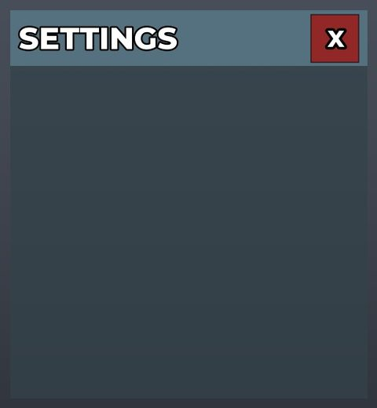</a> <b>Settings</b> › Settings</td>
</tr>
</table>

### Popups, notifications, prompts

<table>
<tr>
<td width="33%" valign="top"><a href="screenshots/02_MainFrame__Notification.jpg">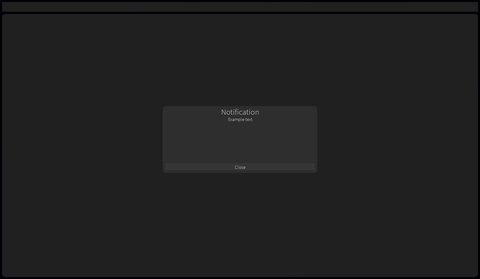</a> <b>MainFrame</b> › Notification</td>
<td width="33%" valign="top"><a href="screenshots/37_Confirmation__Template.jpg">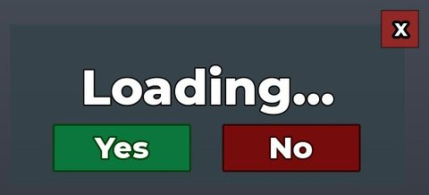</a> <b>Confirmation</b> › Template</td>
<td width="33%" valign="top"><a href="screenshots/81_Confirmation__Template.jpg">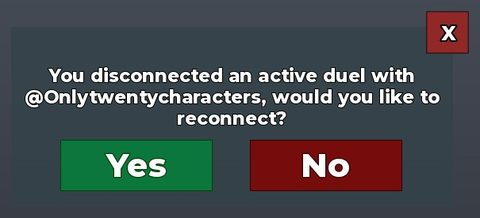</a> <b>Confirmation</b> › Template</td>
</tr>
<tr>
<td width="33%" valign="top"><a href="screenshots/82_Confirmation__ReconnectTemplate.jpg">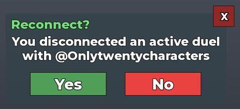</a> <b>Confirmation</b> › ReconnectTemplate</td>
<td width="33%" valign="top"><a href="screenshots/83_Confirmation__WarningTemplate.jpg">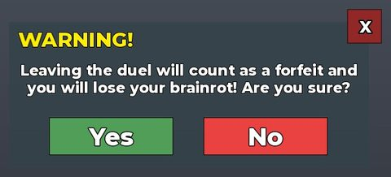</a> <b>Confirmation</b> › WarningTemplate</td>
<td width="33%" valign="top"> <b>Confirmation</b> › JoinCancel</td>
</tr>
</table>

### Leaderboards & stats

<table>
<tr>
<td width="33%" valign="top"> <b>DuelsMachineTopFrame</b> › DuelsMachineTopFrame</td>
<td width="33%" valign="top"><a href="screenshots/56_TopUI__Poll.jpg">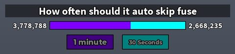</a> <b>TopUI</b> › Frame.Poll</td>
</tr>
</table>

### End of round, death, results

<table>
<tr>
<td width="33%" valign="top"><a href="screenshots/50_ValentinesShop__Send.jpg">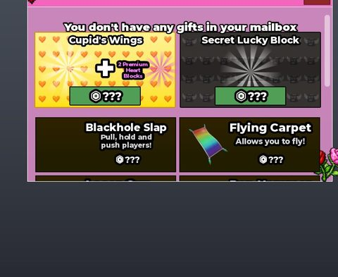</a> <b>ValentinesShop</b> › Sections.Send</td>
</tr>
</table>

### Crafting, fusing, machines

<table>
<tr>
<td width="33%" valign="top"><a href="screenshots/08_ColorDiceMachineGui__DiceFrame.jpg">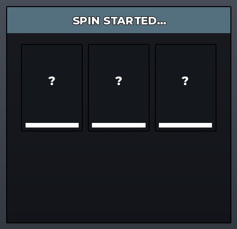</a> <b>ColorDiceMachineGui</b> › DiceFrame</td>
<td width="33%" valign="top"><a href="screenshots/17_DuelsMachinePlayerList__DuelsMachinePlayerList.jpg">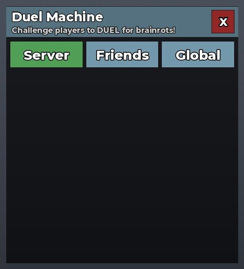</a> <b>DuelsMachinePlayerList</b> › DuelsMachinePlayerList</td>
<td width="33%" valign="top"><a href="screenshots/19_CupidsMachine__CupidsMachine.jpg">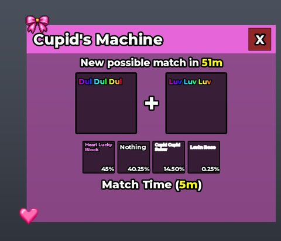</a> <b>CupidsMachine</b> › CupidsMachine</td>
</tr>
<tr>
<td width="33%" valign="top"><a href="screenshots/26_SantaFuse__SantaFuse.jpg">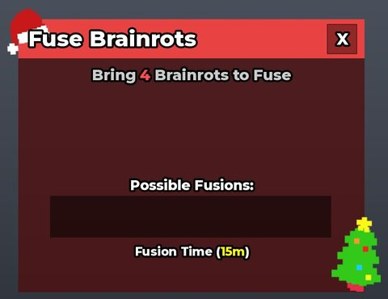</a> <b>SantaFuse</b> › SantaFuse</td>
<td width="33%" valign="top"> <b>DuelsMachineSession</b> › Header</td>
<td width="33%" valign="top"> <b>DuelsMachineSession</b> › ScrollingFrame</td>
</tr>
<tr>
<td width="33%" valign="top"> <b>DuelsMachineSession</b> › Your</td>
<td width="33%" valign="top"><a href="screenshots/35_DuelsMachineSession__Other.jpg">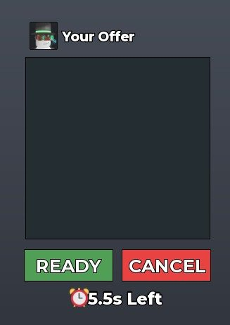</a> <b>DuelsMachineSession</b> › Other</td>
<td width="33%" valign="top"><a href="screenshots/45_CraftingMachine__CraftingMachine.jpg">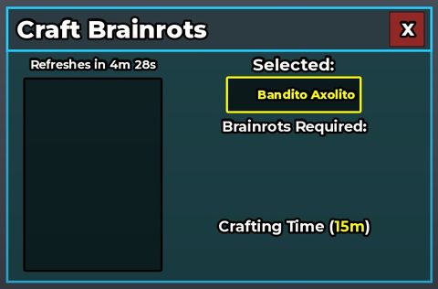</a> <b>CraftingMachine</b> › CraftingMachine</td>
</tr>
<tr>
<td width="33%" valign="top"><a href="screenshots/46_NormalFuse__NormalFuse.jpg">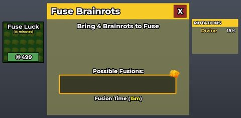</a> <b>NormalFuse</b> › NormalFuse</td>
<td width="33%" valign="top"><a href="screenshots/55_OGCraftingMachine__CraftingMachine.jpg">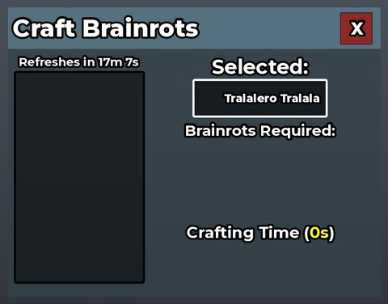</a> <b>OGCraftingMachine</b> › CraftingMachine</td>
<td width="33%" valign="top"> <b>StockMachine</b> › StockMachine</td>
</tr>
<tr>
<td width="33%" valign="top"> <b>WitchFuse</b> › WitchFuse</td>
<td width="33%" valign="top"> <b>FuseMachine</b> › FuseMachine</td>
<td width="33%" valign="top"> <b>SingleStockMachine</b> › SingleStockMachine</td>
</tr>
</table>

### Admin panels

<table>
<tr>
<td width="33%" valign="top"> <b>CommandPanel</b></td>
<td width="33%" valign="top"> <b>BanPanelGui</b> › MainPanel</td>
<td width="33%" valign="top"> <b>AdminSelection</b> › AdminSelection</td>
</tr>
<tr>
<td width="33%" valign="top"> <b>Admin</b> › Header</td>
<td width="33%" valign="top"> <b>Admin</b> › Content</td>
<td width="33%" valign="top"> <b>AdminPanel</b> › AdminPanel</td>
</tr>
</table>

### HUD & currency

<table>
<tr>
<td width="33%" valign="top"> <b>MainFrame</b></td>
<td width="33%" valign="top"> <b>BrainrotShopGui</b> › MainFrame</td>
<td width="33%" valign="top"> <b>ColorDiceMachineGui</b> › Main</td>
</tr>
<tr>
<td width="33%" valign="top"> <b>DuelsMachineSession</b> › Main</td>
<td width="33%" valign="top"> <b>Index</b> › Main</td>
<td width="33%" valign="top"> <b>LeftCenter</b></td>
</tr>
<tr>
<td width="33%" valign="top"> <b>LeftBottom</b></td>
<td width="33%" valign="top"> <b>BanGUI</b> › Main</td>
</tr>
</table>

### Map vote / teams / matchmaking

<table>
<tr>
<td width="33%" valign="top"> <b>TopUI</b> › Frame.Countdown</td>
<td width="33%" valign="top"> <b>Confirmation</b> › DuelsTeleportBackTemplate</td>
</tr>
</table>

### Other

<table>
<tr>
<td width="33%" valign="top"> <b>StartNew</b></td>
<td width="33%" valign="top"> <b>Start</b></td>
<td width="33%" valign="top"> <b>Finish</b></td>
</tr>
<tr>
<td width="33%" valign="top"> <b>VoiceChat</b> › VoiceChat</td>
<td width="33%" valign="top"> <b>SummerBase</b> › SummerBase</td>
<td width="33%" valign="top"> <b>EasterBase</b> › EasterBase</td>
</tr>
<tr>
<td width="33%" valign="top"> <b>FestiveLuckyBlock</b> › Frame</td>
<td width="33%" valign="top"> <b>SelectBrainrots</b> › SelectBrainrots</td>
<td width="33%" valign="top"> <b>LeprechaunLuckyBlock</b> › Frame</td>
</tr>
<tr>
<td width="33%" valign="top"> <b>EggLuckyBlock</b> › Frame</td>
<td width="33%" valign="top"> <b>ValentinesBase</b> › ValentinesBase</td>
<td width="33%" valign="top"> <b>ValentinesCard</b> › ValentinesCard</td>
</tr>
<tr>
<td width="33%" valign="top"> <b>LuckyBase</b> › LuckyBase</td>
<td width="33%" valign="top"> <b>SecurityCam</b></td>
<td width="33%" valign="top"> <b>BasePosition</b> › Base Position</td>
</tr>
<tr>
<td width="33%" valign="top"> <b>News</b> › News</td>
</tr>
</table>

## Model previews

<table>
<tr>
<td width="25%" valign="top"> <b>Model</b> <code>models/ReplicatedStorage/Models/Trucks/Model.rbxm</code></td>
<td width="25%" valign="top"> <b>La Supreme Combinasion</b> <code>models/ReplicatedStorage/Models/Events/1 Year/AnniversaryMap/Brainrots/La Supreme Combinasion.rbxm</code></td>
<td width="25%" valign="top"> <b>ThirdFloor</b> <code>models/ServerStorage/Skins/Summer/ThirdFloor.rbxm</code></td>
<td width="25%" valign="top"> <b>VFXDisco</b> <code>models/ReplicatedStorage/Controllers/EventController/Events/Rap Concert/VFX/VFXDisco.rbxm</code></td>
</tr>
<tr>
<td width="25%" valign="top"> <b>Base</b> <code>models/ServerScriptService/Services/EventService/Events/Eggrot Hunt/Islands/DivineSection/Base.rbxm</code></td>
<td width="25%" valign="top"> <b>EggBuilding~3</b> <code>models/ReplicatedStorage/Controllers/EventController/Events/Egg City/EggCityMap/EnterableBuildings/EggBuilding~3.rbxm</code></td>
<td width="25%" valign="top"> <b>Rainbowrath Sword</b> <code>models/ReplicatedStorage/Items/Rainbowrath Sword.rbxm</code></td>
<td width="25%" valign="top"> <b>Sailboat</b> <code>models/ReplicatedStorage/Controllers/EventController/Events/Laser City/LaserCityMap/Decor/Boats/Sailboat.rbxm</code></td>
</tr>
<tr>
<td width="25%" valign="top"> <b>JungleTree</b> <code>models/ReplicatedStorage/Controllers/SammyRoomController/Cutscene/Assets/GroundDecor/Trees/JungleTree.rbxm</code></td>
<td width="25%" valign="top"> <b>Ghost</b> <code>models/ReplicatedStorage/Assets/Tools/Flash Teleport/Ghost.rbxm</code></td>
<td width="25%" valign="top"> <b>Tree3</b> <code>models/ReplicatedStorage/Models/Events/Matteo/RainbowTrees/Tree3.rbxm</code></td>
<td width="25%" valign="top"> <b>EntranceSign</b> <code>models/ReplicatedStorage/Controllers/EventController/Events/North Pole/EntranceSign.rbxm</code></td>
</tr>
<tr>
<td width="25%" valign="top"> <b>Wall~2</b> <code>models/ReplicatedStorage/Controllers/SammyRoomController/Cutscene/Assets/Lab/Walls/Wall~2.rbxm</code></td>
<td width="25%" valign="top"> <b>BrainrotGrave1</b> <code>models/ReplicatedStorage/Models/Events/1 Year/AnniversaryMap/Decor/HalloweenSection/BrainrotGrave1.rbxm</code></td>
</tr>
</table>

## Notable scripts

Top-scored scripts of this game per topic (full tree in [source/scripts](source/scripts/)).

| Topic | Scripts |
|---|---|
| UI animation (tweens, hover / click, pop-ins, springs) | [`AnimatedButton`](source/scripts/ReplicatedStorage/Classes/AnimatedButton.lua) 107 lines [`Manager`](source/scripts/StarterGui/GamepassUI/Manager.client.lua) 116 lines [`AnimalService`](source/scripts/ServerScriptService/Services/AnimalService.lua) 3796 lines [`a`](source/scripts/ServerScriptService/a.server.lua) 2060 lines [`x`](source/scripts/StarterPlayer/StarterPlayerScripts/x.client.lua) 1304 lines |
| UI controllers / window managers / menus | [`Window`](source/scripts/ServerScriptService/Cmdr/CmdrClient/CmdrInterface/Window.lua) 320 lines [`SettingsController`](source/scripts/ReplicatedStorage/Controllers/SettingsController.lua) 505 lines [`a`](source/scripts/ServerScriptService/a.server.lua) 2060 lines [`ShopController`](source/scripts/ReplicatedStorage/Controllers/ShopController.lua) 2569 lines [`TradeController`](source/scripts/ReplicatedStorage/Controllers/TradeController.lua) 1601 lines |
| Notifications, toasts, popups, prompts | [`CornerNotificationController`](source/scripts/ReplicatedStorage/Controllers/CornerNotificationController.lua) 115 lines [`NotificationController`](source/scripts/ReplicatedStorage/Controllers/NotificationController.lua) 194 lines [`CustomProximityPromptController`](source/scripts/ReplicatedStorage/Controllers/CustomProximityPromptController.lua) 580 lines [`AnnouncementSCRIPT`](source/scripts/ReplicatedStorage/ReplicatedGui/Admin/Admin/Content/CanvasGroup/List/AnnouncementSCRIPT.client.lua) 80 lines [`CodesController`](source/scripts/ReplicatedStorage/Controllers/CodesController.lua) 118 lines |
| Loading / intro screens | [`LocalScript`](source/scripts/StarterPlayer/StarterPlayerScripts/LocalScript.client.lua) 274 lines [`Phase 2_ Galaxy Introduction`](source/scripts/ReplicatedStorage/Controllers/EventController/Events/Phase%202_%20Galaxy%20Introduction.lua) 342 lines [`FakePurchase`](source/scripts/ReplicatedStorage/FakePurchase.lua) 697 lines [`Brazil`](source/scripts/ReplicatedStorage/Controllers/EventController/Events/Brazil.lua) 733 lines [`FuseMachineController`](source/scripts/ReplicatedStorage/Controllers/FuseMachineController.lua) 1663 lines |
| Camera, cutscenes, screen shake | [`SammyRoomController`](source/scripts/ReplicatedStorage/Controllers/SammyRoomController.lua) 1678 lines [`Phase 2_ Galaxy Introduction`](source/scripts/ReplicatedStorage/Controllers/EventController/Events/Phase%202_%20Galaxy%20Introduction.lua) 342 lines [`ShakePresets`](source/scripts/ReplicatedStorage/Shared/ShakePresets.lua) 111 lines [`CameraController`](source/scripts/ReplicatedStorage/Controllers/CameraController.lua) 60 lines [`Laser City`](source/scripts/ReplicatedStorage/Controllers/EventController/Events/Laser%20City.lua) 241 lines |
| VFX, particles, beams, hit effects | [`Controller`](source/scripts/ReplicatedStorage/Items/Ban%20Hammer/Controller.server.lua) 471 lines [`VFX`](source/scripts/ReplicatedStorage/Shared/VFX.lua) 145 lines [`Starfall`](source/scripts/ReplicatedStorage/Controllers/EventController/Events/Starfall.lua) 197 lines [`SkullEmojiEffectController`](source/scripts/ReplicatedStorage/Controllers/SkullEmojiEffectController.lua) 158 lines [`ServerController`](source/scripts/ReplicatedStorage/Items/Flash%20Teleport/ServerController.server.lua) 300 lines |
| DataStore / player data | [`ProfileStore`](source/scripts/ServerScriptService/Controllers/ProfileStore.lua) 1950 lines [`HoverInfoService`](source/scripts/ServerScriptService/Services/HoverInfoService.lua) 508 lines [`CodesService`](source/scripts/ServerScriptService/Services/CodesService.lua) 560 lines [`a`](source/scripts/ServerScriptService/a.server.lua) 2060 lines [`CodeSystemServer`](source/scripts/ServerScriptService/CodeSystemServer.server.lua) 350 lines |
| Monetization (dev products, game passes, receipts) | [`RobuxShopData`](source/scripts/ReplicatedStorage/Datas/RobuxShopData.lua) 131 lines [`BrainrotShopService`](source/scripts/ServerScriptService/BrainrotShopService.server.lua) 50 lines [`promptPurchaseServer`](source/scripts/ServerScriptService/Services/CmdrService/Commands/CustomCommands/promptPurchaseServer.lua) 60 lines [`ShopController`](source/scripts/ReplicatedStorage/Controllers/ShopController.lua) 2569 lines |
| RNG, eggs, gacha, rarity rolls, pets | [`PhantomSpinWheelService`](source/scripts/ServerScriptService/Services/PhantomSpinWheelService.lua) 167 lines [`AnimalService`](source/scripts/ServerScriptService/Services/AnimalService.lua) 3796 lines [`Egg City`](source/scripts/ServerScriptService/Services/EventService/Events/Egg%20City.lua) 393 lines [`Eggrot Hunt`](source/scripts/ServerScriptService/Services/EventService/Events/Eggrot%20Hunt.lua) 699 lines [`PhantomEventController`](source/scripts/ReplicatedStorage/Controllers/PhantomEventController.lua) 398 lines |
| Trading systems | [`TradeController`](source/scripts/ReplicatedStorage/Controllers/TradeController.lua) 1601 lines [`TradePlazaPortalController`](source/scripts/ReplicatedStorage/Controllers/TradePlazaPortalController.lua) 105 lines [`addbrainrotrader`](source/scripts/ServerScriptService/Services/CommandsService/Commands/addbrainrotrader.lua) 238 lines [`TradeService`](source/scripts/ServerScriptService/Services/TradeService.lua) 1812 lines [`TradingFlags`](source/scripts/ReplicatedStorage/Shared/Flags/TradingFlags.lua) 32 lines |
| Combat, weapons, hitboxes, abilities | [`StealService`](source/scripts/ServerScriptService/Services/StealService.lua) 2032 lines [`Rip My Granny`](source/scripts/ServerScriptService/Services/EventService/Events/Rip%20My%20Granny.lua) 588 lines [`Solar Flare`](source/scripts/ServerScriptService/Services/EventService/Events/Solar%20Flare.lua) 562 lines [`Controller`](source/scripts/ReplicatedStorage/Items/Rainbowrath%20Sword/Controller.server.lua) 150 lines [`North Pole`](source/scripts/ServerScriptService/Services/EventService/Events/North%20Pole.lua) 1454 lines |
| NPC / AI / monsters | [`NpcPathfinding`](source/scripts/ServerScriptService/Components/NpcPathfinding.lua) 391 lines [`Dul Dul Dul`](source/scripts/ServerScriptService/Services/EventService/Events/Dul%20Dul%20Dul.lua) 452 lines [`AnimalService`](source/scripts/ServerScriptService/Services/AnimalService.lua) 3796 lines [`Crab Rave`](source/scripts/ServerScriptService/Services/EventService/Events/Crab%20Rave.lua) 678 lines [`Npc`](source/scripts/ReplicatedStorage/Components/Npc.lua) 63 lines |
| Character movement (sprint, dash, double jump, slide) | [`MultiJumpController`](source/scripts/ReplicatedStorage/Controllers/MultiJumpController.lua) 485 lines [`TemuSword`](source/scripts/ReplicatedStorage/Items/Rainbowrath%20Sword/TemuSword.client.lua) 58 lines [`fly`](source/scripts/ServerScriptService/Services/CommandsService/Commands/fly.lua) 204 lines [`JumpShopTutorial`](source/scripts/ReplicatedStorage/Controllers/EventController/Events/Eggrot%20Hunt/JumpShopTutorial.lua) 158 lines [`Controller`](source/scripts/ReplicatedStorage/Items/Ban%20Hammer/Controller.server.lua) 471 lines |
| Tycoon / plots / bases / building | [`PlotClient`](source/scripts/ReplicatedStorage/Classes/PlotClient.lua) 1853 lines [`Fake Base`](source/scripts/ReplicatedStorage/ReplicatedGui/Admin/Admin/Content/CanvasGroup/List/Fake%20Base.client.lua) 269 lines [`a`](source/scripts/ServerScriptService/a.server.lua) 2060 lines [`BasePositionController`](source/scripts/ReplicatedStorage/BasePosition/Base%20Position/BasePositionController.client.lua) 55 lines [`Caylus Base`](source/scripts/ServerScriptService/Services/EventService/Events/Caylus%20Base.lua) 625 lines |
| Leaderboards & stats | [`LeaderboardService`](source/scripts/ServerScriptService/Services/LeaderboardService.lua) 948 lines |
| Admin panels & commands | [`Allcommand`](source/scripts/ServerScriptService/Services/CommandsService/Commands/Allcommand.lua) 618 lines [`Giftcommand`](source/scripts/ServerScriptService/Services/CommandsService/Commands/Giftcommand.lua) 847 lines [`CommandsService`](source/scripts/ServerScriptService/Services/CommandsService.lua) 173 lines [`Newyearsmachinecommands`](source/scripts/ServerScriptService/Services/CommandsService/Commands/Newyearsmachinecommands.lua) 205 lines [`RitualCommands1`](source/scripts/ServerScriptService/Services/CommandsService/Commands/RitualCommands1.lua) 357 lines |
| Sound & music | [`SoundController`](source/scripts/ReplicatedStorage/Controllers/SoundController.lua) 513 lines [`DualAudio`](source/scripts/ReplicatedStorage/Components/DualAudio.lua) 45 lines [`Karkerkar Kurkur`](source/scripts/ReplicatedStorage/Controllers/EventController/Events/Karkerkar%20Kurkur.lua) 295 lines [`Phase 5_ Sammy Snap`](source/scripts/ReplicatedStorage/Controllers/EventController/Events/Phase%205_%20Sammy%20Snap.lua) 412 lines |
| Daily rewards, quests, codes, playtime | [`CodesService`](source/scripts/ServerScriptService/Services/CodesService.lua) 560 lines [`CodeSystemServer`](source/scripts/ServerScriptService/CodeSystemServer.server.lua) 350 lines [`CodeSystemClient`](source/scripts/StarterPlayer/StarterPlayerScripts/CodeSystemClient.client.lua) 266 lines [`CodesController`](source/scripts/ReplicatedStorage/Controllers/CodesController.lua) 118 lines [`LeaderboardService`](source/scripts/ServerScriptService/Services/LeaderboardService.lua) 948 lines |
| Utility modules (number format, signals, tables, timers) | [`Caylus Base`](source/scripts/ServerScriptService/Services/EventService/Events/Caylus%20Base.lua) 625 lines [`Rusty's Base`](source/scripts/ServerScriptService/Services/EventService/Events/Rusty%27s%20Base.lua) 625 lines [`Sammy's Base`](source/scripts/ServerScriptService/Services/EventService/Events/Sammy%27s%20Base.lua) 623 lines [`Steak's Base`](source/scripts/ServerScriptService/Services/EventService/Events/Steak%27s%20Base.lua) 625 lines [`MerchantController`](source/scripts/ReplicatedStorage/Controllers/MerchantController.lua) 492 lines |

### In the curated script library

- [Jumpscare controller](../../Scripts/05-Camera-Cutscene/JumpscareController__steal-a-brainrot-sab-files.lua) — Full jumpscare: model flies at the camera, shake, flash, color/DOF effects, auto cleanup.
- [FOV / blur helper](../../Scripts/05-Camera-Cutscene/FovBlurHelper__steal-a-brainrot-sab-files.lua) — Two-function helper to tween FOV and blur.
- [Limited-stock codes (UpdateAsync + MemoryStore)](../../Scripts/18-Daily-Rewards-Quests/CodesService-AtomicStock__steal-a-brainrot-sab-files.lua) — Codes with limited stock redeemed atomically in UpdateAsync (already-redeemed / out-of-stock reasons), global codes broadcast with MessagingService and stock kept in a MemoryStore sorted map, 5s cooldown.
- [Code-built animated loading screen](../../Scripts/04-Loading-Screens/AnimatedLoadingScreen__steal-a-brainrot-sab-files.lua) — Fully code-built animated loading screen (gradient background, floating particles, title, progress bar driven by asset preloading) that fades out when done.
- [Anchored-NPC pathfinding module](../../Scripts/12-NPC-AI/NpcPathfindingChase__steal-a-brainrot-sab-files.lua) — Reusable module that moves anchored (non-Humanoid) NPC models along PathfindingService waypoints with ground-snapping raycasts, smooth turning, and a chase() loop that re-paths on a timer or when the target moves.
- [Steal guard rails (locks, cooldown, join protection)](../../Scripts/14-Tycoon-Plots/StealGuards__steal-a-brainrot-sab-files.lua) — The guard rails a later Steal-a-Brainrot build added around StartSteal: a per-podium steal lock so two thieves can't grab the same item, a 1s steal cooldown, no stealing from players who are...
- [VFX library](../../Scripts/06-VFX/VFXLibrary__steal-a-brainrot-sab-files.lua) — Compact VFX library: copy-to-position, follow, rescale, emit by attributes, tag-driven emit loops.

## ⚠️ Safety

HIGH flags (backdoors, `require(id)`, `loadstring`, webhooks). Review or delete before reusing:

- `scripts/ReplicatedStorage/Packages/Freeze/List.lua`
- `scripts/ReplicatedStorage/Packages/Freeze/List/compat/findWhereLast.lua`
- `scripts/ServerScriptService/67.server.lua`
- `scripts/ServerScriptService/CmdrSetup.server.lua`
- `scripts/ServerScriptService/Services/CommandsService/Commands/ban.lua`
- `scripts/ServerScriptService/Services/CommandsService/Commands/lockbase.lua`
- `scripts/ServerScriptService/Services/CommandsService/Commands/pushserverluck.lua`
- `scripts/ServerScriptService/Services/CommandsService/Commands/pushserverluck.lua`

## Folders

| Folder | What |
|---|---|
| `screenshots/` | full frames; `crops/` = the panel only; `models/` = 3D previews; `thumbs/` = gallery thumbnails |
| `ui/` | every screen as a Lua builder (`require(module)()` returns the ScreenGui); `_StarterGui-all.lua` builds every StarterGui screen |
| `models/` | every model as .rbxm (the only .rbxm files), mirroring the place tree, scripts removed |
| `map/` | `workspace.rbxm` (the map as a model), `lighting.lua` (sky + post effects), `materials.lua`, `Environment.lua` |
| `animations/`, `audio/` | KeyframeSequence / Sound builders (.lua), `AnimationIds.lua`, `Sounds.lua` |
| `source/` | all scripts as .luau, `tree.txt`, `ui.txt`, `remotes.txt`, `assets.txt`, `flags.txt` |
