# Steal a Brainrot

> 🧠 **Brainrot** · steal / tycoon (brainrots, plots) · source file `Steal a badr (Kaizou scameur !!!).rbxl`

[⬅ Back to the catalog](../../README.md) · [Assets inventory](ASSETS.md) · [Style numbers](reference.md) · [Scripts](source/scripts/) · [Code analysis](source/README.md)

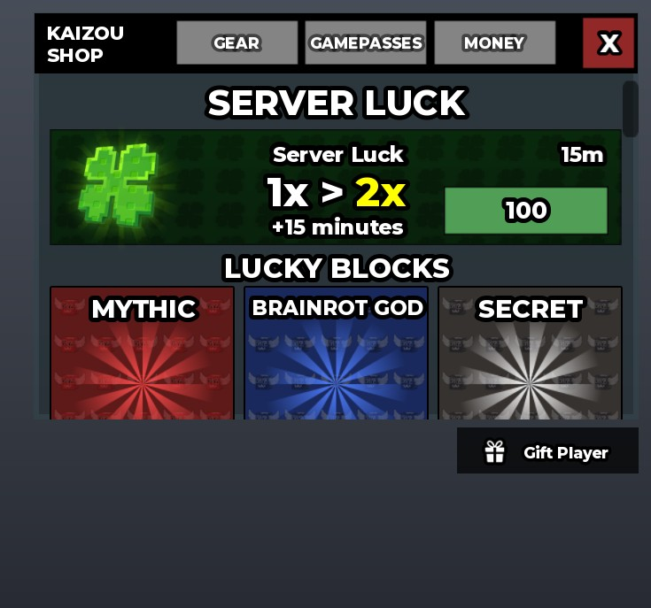

## At a glance

| | |
|---|---|
| Provenance | copy of a live game (saveinstance / decompiled client code) |
| Screens | 77 ScreenGuis, 3653 GUI objects → **75 screenshots** |
| Models (.rbxm) | 9586 models, 283 model sets, 17 VFX sets |
| Lua builders (.lua) | 118 UI screens, 569 animation packs, 86 audio packs |
| Code | 1630 scripts, 232,663 lines |
| Asset ids | 1548 animations, 853 sounds |
| Safety scan | 9 HIGH / 15 MED flags ([flags.txt](source/flags.txt)) |

**Fonts:** `GothamSSm ExtraBold`×695, `GothamSSm Bold`×265, `SourceSansPro Bold`×147, `GothamSSm Heavy`×129, `FredokaOne Regular`×102

## UI screenshots

Captured in Studio from the place's own ScreenGuis (scripts stripped). Each panel was opened on its own; click a thumbnail for the full 1519×886 frame. Runtime-filled lists (shop items, inventories) show their template state.

### Shop & Robux store

<table>
<tr>
<td width="33%" valign="top"> <b>Shop</b> › Shop</td>
<td width="33%" valign="top"><a href="screenshots/15_SantaMerchant__SantaMerchant.jpg">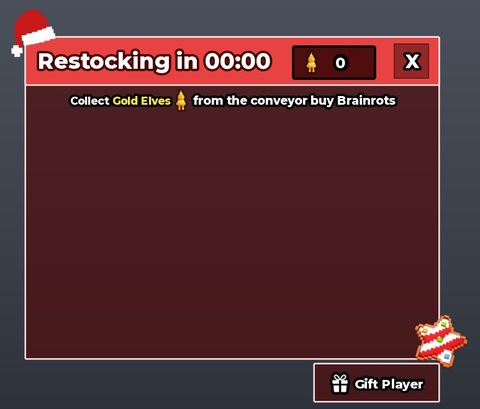</a> <b>SantaMerchant</b> › SantaMerchant</td>
<td width="33%" valign="top"><a href="screenshots/21_Merchant__Merchant.jpg">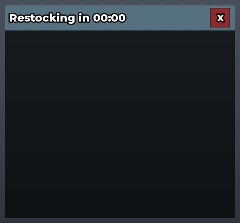</a> <b>Merchant</b> › Merchant</td>
</tr>
<tr>
<td width="33%" valign="top"><a href="screenshots/27_FantaisieShop__FantaisieShop.jpg">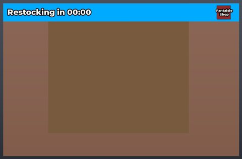</a> <b>FantaisieShop</b> › FantaisieShop</td>
<td width="33%" valign="top"><a href="screenshots/53_ValentinesShop__ValentinesShop.jpg">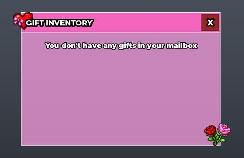</a> <b>ValentinesShop</b> › ValentinesShop</td>
<td width="33%" valign="top"><a href="screenshots/55_CoinsShop__CoinsShop.jpg">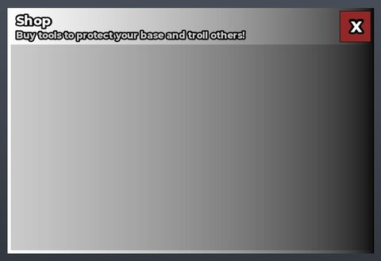</a> <b>CoinsShop</b> › CoinsShop</td>
</tr>
<tr>
<td width="33%" valign="top"><a href="screenshots/73_ItemShopGui.jpg">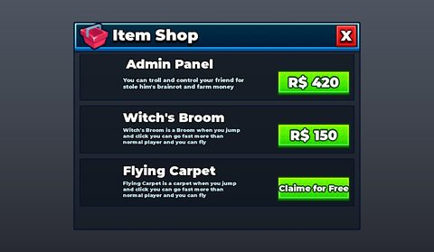</a> <b>ItemShopGui</b></td>
</tr>
</table>

### Index / codex / glossary

<table>
<tr>
<td width="33%" valign="top"><a href="screenshots/30_Glossary__Traits.jpg">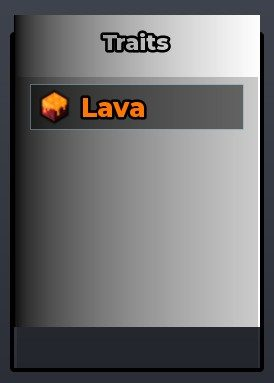</a> <b>Glossary</b> › Right.Traits</td>
</tr>
</table>

### Rewards, daily, spin, codes

<table>
<tr>
<td width="33%" valign="top"><a href="screenshots/09_DivineWheel__Buttons.jpg">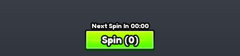</a> <b>DivineWheel</b> › Buttons</td>
<td width="33%" valign="top"><a href="screenshots/10_DivineWheel__Wheel.jpg">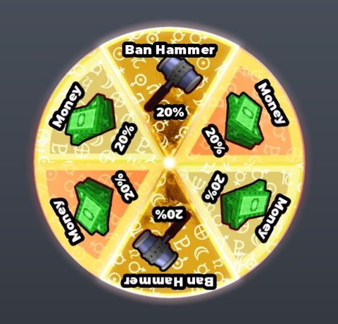</a> <b>DivineWheel</b> › Wheel</td>
<td width="33%" valign="top"><a href="screenshots/18_RadioactiveWheel__Buttons.jpg">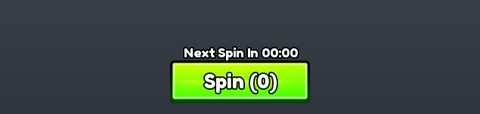</a> <b>RadioactiveWheel</b> › Buttons</td>
</tr>
<tr>
<td width="33%" valign="top"><a href="screenshots/19_RadioactiveWheel__Wheel.jpg">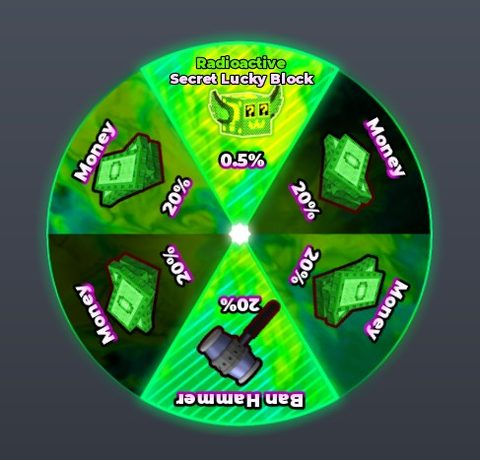</a> <b>RadioactiveWheel</b> › Wheel</td>
<td width="33%" valign="top"><a href="screenshots/26_GiftPlayer__GiftPlayer.jpg">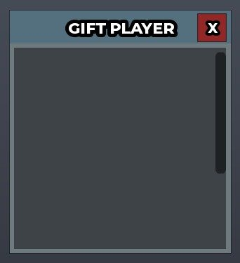</a> <b>GiftPlayer</b> › GiftPlayer</td>
<td width="33%" valign="top"><a href="screenshots/38_AdventCalendar__Frame.jpg">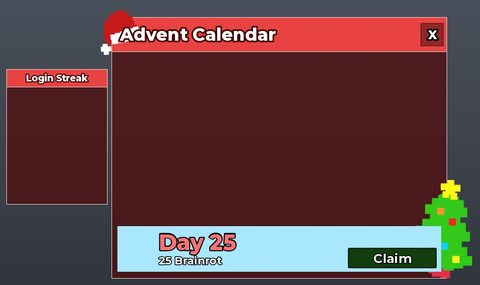</a> <b>AdventCalendar</b> › Frame</td>
</tr>
<tr>
<td width="33%" valign="top"><a href="screenshots/40_ChristmasWheel__Buttons.jpg">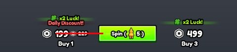</a> <b>ChristmasWheel</b> › Buttons</td>
<td width="33%" valign="top"><a href="screenshots/41_ChristmasWheel__Wheel.jpg">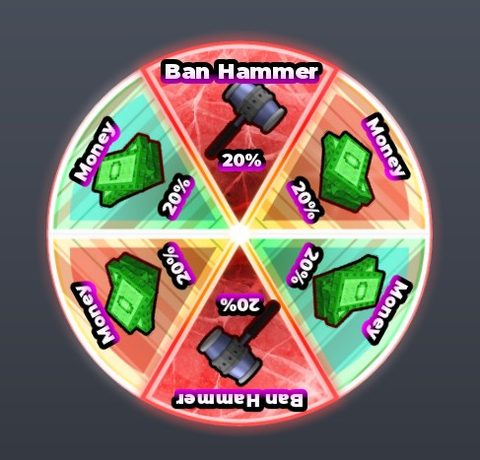</a> <b>ChristmasWheel</b> › Wheel</td>
<td width="33%" valign="top"><a href="screenshots/42_CursedWheel__Wheel.jpg">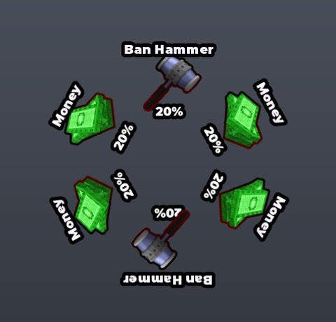</a> <b>CursedWheel</b> › Wheel</td>
</tr>
<tr>
<td width="33%" valign="top"><a href="screenshots/50_CyberWheel__Wheel.jpg">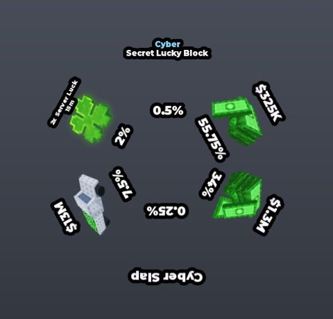</a> <b>CyberWheel</b> › Wheel</td>
<td width="33%" valign="top"><a href="screenshots/51_CyberWheel__Buttons.jpg">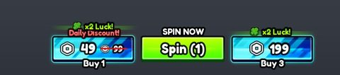</a> <b>CyberWheel</b> › Buttons</td>
<td width="33%" valign="top"><a href="screenshots/54_Codes__Codes.jpg">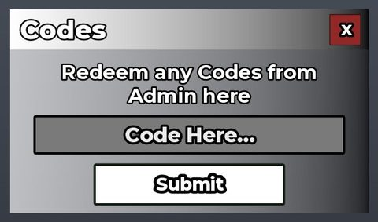</a> <b>Codes</b> › Codes</td>
</tr>
<tr>
<td width="33%" valign="top"><a href="screenshots/56_ValentinesSendGift__ValentinesSendGift.jpg">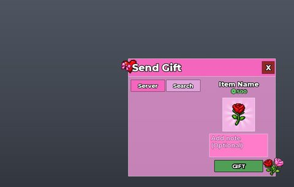</a> <b>ValentinesSendGift</b> › ValentinesSendGift</td>
</tr>
</table>

### Quests & progression

<table>
<tr>
<td width="33%" valign="top"><a href="screenshots/17_Rebirth__Content.jpg">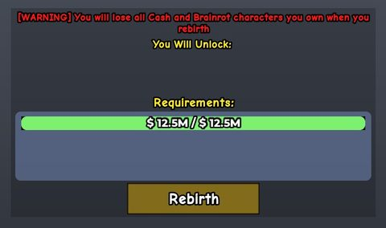</a> <b>Rebirth</b> › Content</td>
<td width="33%" valign="top"><a href="screenshots/32_TsunamiSpeedUpgrade__TsunamiSpeedUpgrade.jpg">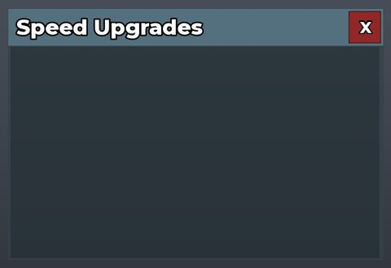</a> <b>TsunamiSpeedUpgrade</b> › TsunamiSpeedUpgrade</td>
<td width="33%" valign="top"><a href="screenshots/59_BackroomsSpeedUpgrade__BackroomsSpeedUpgrade.jpg">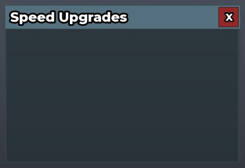</a> <b>BackroomsSpeedUpgrade</b> › BackroomsSpeedUpgrade</td>
</tr>
<tr>
<td width="33%" valign="top"><a href="screenshots/75_Index__Progress.jpg">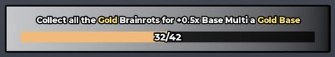</a> <b>Index</b> › Progress</td>
</tr>
</table>

### Trading

<table>
<tr>
<td width="33%" valign="top"><a href="screenshots/35_BrainrotTrader__Frame.jpg">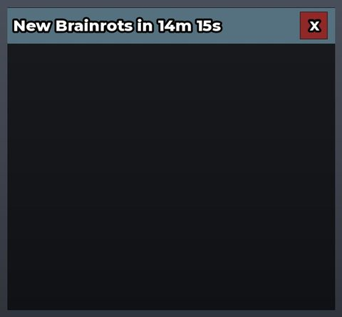</a> <b>BrainrotTrader</b> › Frame</td>
<td width="33%" valign="top"> <b>BrainrotTrader</b> › Odds</td>
<td width="33%" valign="top"><a href="screenshots/70_TradePlayerList.jpg">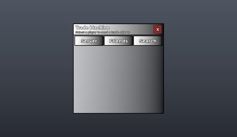</a> <b>TradePlayerList</b></td>
</tr>
<tr>
<td width="33%" valign="top"><a href="screenshots/72_TradeLiveTrade.jpg">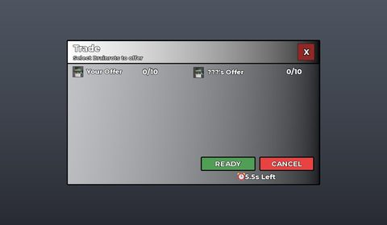</a> <b>TradeLiveTrade</b></td>
</tr>
</table>

### Settings & menus

<table>
<tr>
<td width="33%" valign="top"><a href="screenshots/14_Settings__Settings.jpg">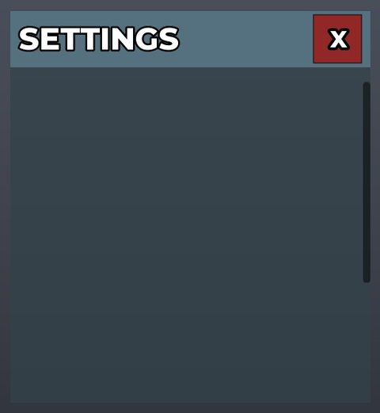</a> <b>Settings</b> › Settings</td>
</tr>
</table>

### Popups, notifications, prompts

<table>
<tr>
<td width="33%" valign="top"><a href="screenshots/20_Notification__Template.jpg">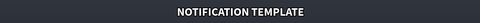</a> <b>Notification</b> › Template</td>
<td width="33%" valign="top"><a href="screenshots/44_Confirmation__Template.jpg">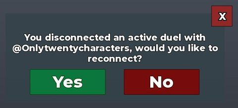</a> <b>Confirmation</b> › Template</td>
<td width="33%" valign="top"><a href="screenshots/45_Confirmation__ReconnectTemplate.jpg">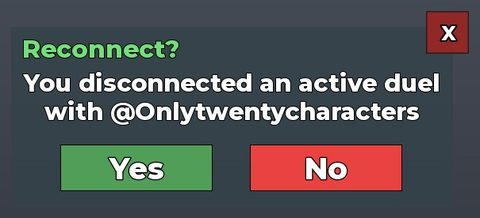</a> <b>Confirmation</b> › ReconnectTemplate</td>
</tr>
<tr>
<td width="33%" valign="top"><a href="screenshots/46_Confirmation__WarningTemplate.jpg">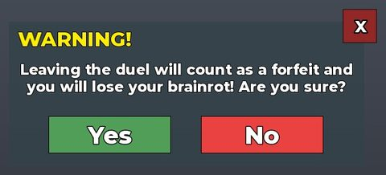</a> <b>Confirmation</b> › WarningTemplate</td>
<td width="33%" valign="top"> <b>Confirmation</b> › JoinCancel</td>
</tr>
</table>

### Leaderboards & stats

<table>
<tr>
<td width="33%" valign="top"><a href="screenshots/24_TopUI__Poll.jpg">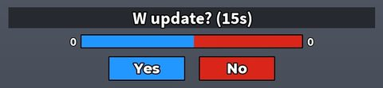</a> <b>TopUI</b> › Frame.Poll</td>
<td width="33%" valign="top"><a href="screenshots/63_DuelsMachineTopFrame__DuelsMachineTopFrame.jpg">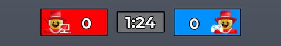</a> <b>DuelsMachineTopFrame</b> › DuelsMachineTopFrame</td>
</tr>
</table>

### Crafting, fusing, machines

<table>
<tr>
<td width="33%" valign="top"><a href="screenshots/03_ColorDiceMachineGui__DiceFrame.jpg">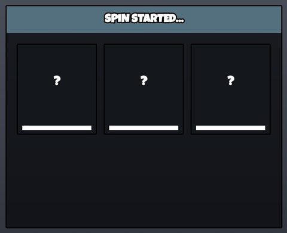</a> <b>ColorDiceMachineGui</b> › DiceFrame</td>
<td width="33%" valign="top"><a href="screenshots/22_CupidsMachine__CupidsMachine.jpg">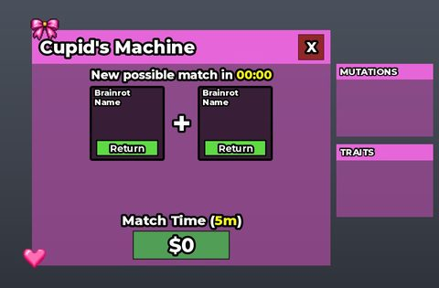</a> <b>CupidsMachine</b> › CupidsMachine</td>
<td width="33%" valign="top"><a href="screenshots/23_StockMachine__StockMachine.jpg">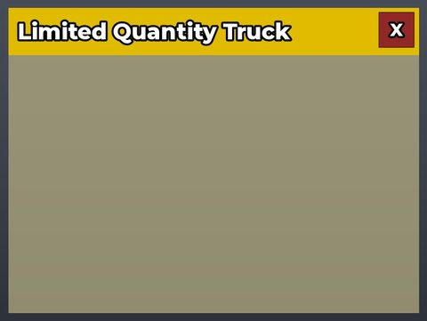</a> <b>StockMachine</b> › StockMachine</td>
</tr>
<tr>
<td width="33%" valign="top"><a href="screenshots/29_Glossary__Mutations.jpg">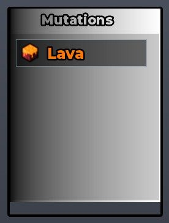</a> <b>Glossary</b> › Right.Mutations</td>
<td width="33%" valign="top"><a href="screenshots/31_FuseMachine__FuseMachine.jpg">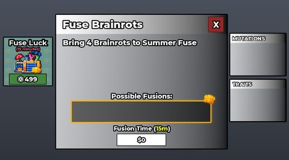</a> <b>FuseMachine</b> › FuseMachine</td>
<td width="33%" valign="top"><a href="screenshots/61_DuelsMachinePlayerList__DuelsMachinePlayerList.jpg">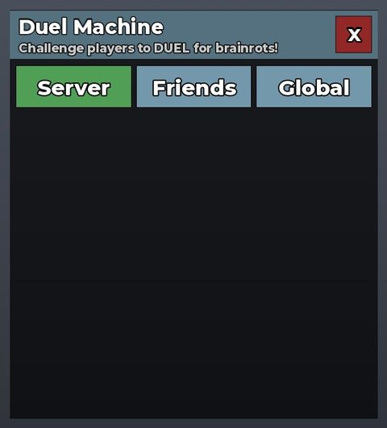</a> <b>DuelsMachinePlayerList</b> › DuelsMachinePlayerList</td>
</tr>
<tr>
<td width="33%" valign="top"><a href="screenshots/62_SingleStockMachine__SingleStockMachine.jpg">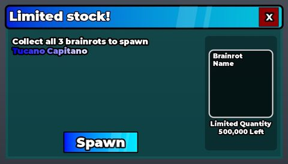</a> <b>SingleStockMachine</b> › SingleStockMachine</td>
<td width="33%" valign="top"><a href="screenshots/65_DuelsMachineSession__Header.jpg">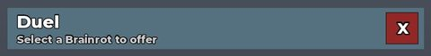</a> <b>DuelsMachineSession</b> › Header</td>
<td width="33%" valign="top"> <b>DuelsMachineSession</b> › Your</td>
</tr>
<tr>
<td width="33%" valign="top"><a href="screenshots/68_DuelsMachineSession__Other.jpg">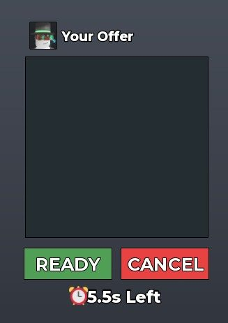</a> <b>DuelsMachineSession</b> › Other</td>
<td width="33%" valign="top"><a href="screenshots/76_CraftingMachine__CraftingMachine.jpg">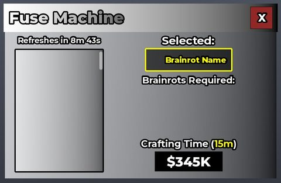</a> <b>CraftingMachine</b> › CraftingMachine</td>
</tr>
</table>

### Admin panels

<table>
<tr>
<td width="33%" valign="top"><a href="screenshots/39_AdminPanel__AdminPanel.jpg">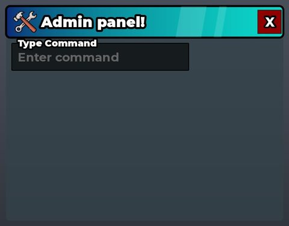</a> <b>AdminPanel</b> › AdminPanel</td>
<td width="33%" valign="top"><a href="screenshots/49_Sign__SignPanel.jpg">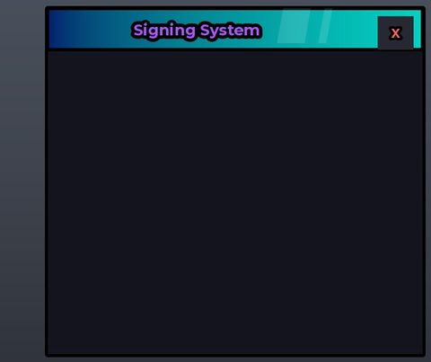</a> <b>Sign</b> › SignPanel</td>
</tr>
</table>

### HUD & currency

<table>
<tr>
<td width="33%" valign="top"><a href="screenshots/02_ColorDiceMachineGui__Main.jpg">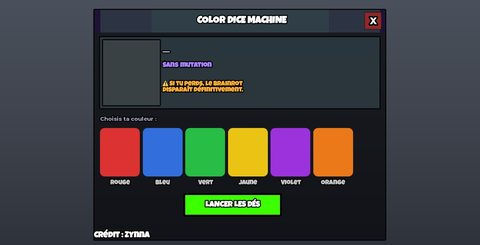</a> <b>ColorDiceMachineGui</b> › Main</td>
<td width="33%" valign="top"><a href="screenshots/06_LeftCenter.jpg">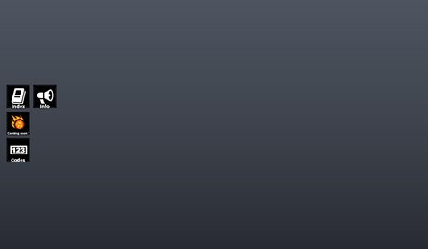</a> <b>LeftCenter</b></td>
<td width="33%" valign="top"><a href="screenshots/16_Rebirth__Main.jpg">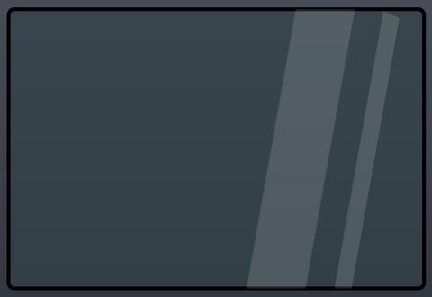</a> <b>Rebirth</b> › Main</td>
</tr>
<tr>
<td width="33%" valign="top"> <b>Glossary</b> › Left</td>
<td width="33%" valign="top"> <b>LeftBottom</b></td>
<td width="33%" valign="top"> <b>DuelsMachineSession</b> › Main</td>
</tr>
<tr>
<td width="33%" valign="top"> <b>Index</b> › Main</td>
</tr>
</table>

### Map vote / teams / matchmaking

<table>
<tr>
<td width="33%" valign="top"> <b>CountdownGui</b></td>
<td width="33%" valign="top"> <b>TopUI</b> › Frame.Countdown</td>
<td width="33%" valign="top"> <b>Confirmation</b> › DuelsTeleportBackTemplate</td>
</tr>
</table>

### Other

<table>
<tr>
<td width="33%" valign="top"> <b>BaseManagerGui</b> › Backdrop</td>
<td width="33%" valign="top"> <b>BrainrotInformationGUI</b></td>
<td width="33%" valign="top"> <b>VoiceChat</b> › VoiceChat</td>
</tr>
<tr>
<td width="33%" valign="top"> <b>PollUI</b> › Poll</td>
<td width="33%" valign="top"> <b>FestiveLuckyBlock</b> › Frame</td>
<td width="33%" valign="top"> <b>TacoBase</b> › TacoBase</td>
</tr>
<tr>
<td width="33%" valign="top"> <b>ValentinesBase</b> › ValentinesBase</td>
<td width="33%" valign="top"> <b>SpookyLuckyBlock</b> › Frame</td>
<td width="33%" valign="top"> <b>ActiveEvents</b></td>
</tr>
<tr>
<td width="33%" valign="top"> <b>ValentinesCard</b> › ValentinesCard</td>
<td width="33%" valign="top"> <b>LeprechaunLuckyBlock</b> › Frame</td>
<td width="33%" valign="top"> <b>LuckyBase</b> › LuckyBase</td>
</tr>
<tr>
<td width="33%" valign="top"> <b>News</b> › News</td>
<td width="33%" valign="top"> <b>SkillTree</b> › Frame</td>
<td width="33%" valign="top"> <b>Frame</b></td>
</tr>
</table>

## Model previews

<table>
<tr>
<td width="25%" valign="top"> <b>FirstFloor</b> <code>models/ServerScriptService/Services/PlotService/Skins/Headless/FirstFloor.rbxm</code></td>
<td width="25%" valign="top"> <b>La Supreme Combinasion</b> <code>models/ReplicatedStorage/Models/Events/1 Year/AnniversaryMap/Brainrots/La Supreme Combinasion.rbxm</code></td>
<td width="25%" valign="top"> <b>ThirdFloor</b> <code>models/ServerScriptService/Services/PlotService/Skins/Bunny Basket/ThirdFloor.rbxm</code></td>
<td width="25%" valign="top"> <b>VFXDisco</b> <code>models/ReplicatedStorage/Controllers/EventController/Events/Rap Concert/VFX/VFXDisco.rbxm</code></td>
</tr>
<tr>
<td width="25%" valign="top"> <b>SammyBase</b> <code>models/ServerScriptService/Services/EventService/Events/Sammy's Base/SammyBase.rbxm</code></td>
<td width="25%" valign="top"> <b>Candy Coils</b> <code>models/ReplicatedStorage/Controllers/PinataController/GearVisuals/Candy Coils.rbxm</code></td>
<td width="25%" valign="top"> <b>Rainbowrath Sword</b> <code>models/ReplicatedStorage/Items/Rainbowrath Sword.rbxm</code></td>
<td width="25%" valign="top"> <b>EggShapedTree</b> <code>models/ReplicatedStorage/Models/Events/1 Year/AnniversaryMap/Decor/EasterSection/EggShapedTree.rbxm</code></td>
</tr>
<tr>
<td width="25%" valign="top"> <b>CraftingMachine</b> <code>models/Workspace/CraftingMachine.rbxm</code></td>
<td width="25%" valign="top"> <b>EntranceSign</b> <code>models/ReplicatedStorage/Models/Events/1 Year/AnniversaryMap/Decor/ChristmasSection/EntranceSign.rbxm</code></td>
<td width="25%" valign="top"> <b>Ghost</b> <code>models/ReplicatedStorage/Assets/Tools/Flash Teleport/Ghost.rbxm</code></td>
<td width="25%" valign="top"> <b>Tree3</b> <code>models/ReplicatedStorage/Models/Events/Matteo/RainbowTrees/Tree3.rbxm</code></td>
</tr>
<tr>
<td width="25%" valign="top"> <b>EventBoard</b> <code>models/Workspace/EventBoard.rbxm</code></td>
<td width="25%" valign="top"> <b>Vent</b> <code>models/ServerScriptService/Services/EventService/Events/Backrooms/BackroomsMap/ModularizedRooms/EntranceRoom/Vent.rbxm</code></td>
</tr>
</table>

## Notable scripts

Top-scored scripts of this game per topic (full tree in [source/scripts](source/scripts/)).

| Topic | Scripts |
|---|---|
| UI animation (tweens, hover / click, pop-ins, springs) | [`RNGMachineController`](source/scripts/ReplicatedStorage/Controllers/RNGMachineController.lua) 3716 lines [`GlossaryController`](source/scripts/ReplicatedStorage/Controllers/GlossaryController.lua) 1267 lines [`Patchnoteglobal`](source/scripts/ServerScriptService/Services/CommandsService/Commands/Patchnoteglobal.lua) 325 lines [`1 Year`](source/scripts/ReplicatedStorage/Controllers/EventController/Events/1%20Year.lua) 3155 lines [`CustomProximityPromptController`](source/scripts/ReplicatedStorage/Controllers/CustomProximityPromptController.lua) 475 lines |
| UI controllers / window managers / menus | [`BaseManagerController`](source/scripts/StarterGui/BaseManagerGui/BaseManagerController.client.lua) 160 lines [`AdmC`](source/scripts/StarterGui/AdmC.client.lua) 2205 lines [`CodesController`](source/scripts/ReplicatedStorage/Controllers/CodesController.lua) 155 lines [`CraftBuilderMenu`](source/scripts/StarterGui/CraftBuilderMenu.client.lua) 673 lines [`SettingsController`](source/scripts/ReplicatedStorage/Controllers/SettingsController.lua) 362 lines |
| Notifications, toasts, popups, prompts | [`CustomProximityPromptController`](source/scripts/ReplicatedStorage/Controllers/CustomProximityPromptController.lua) 475 lines [`NotificationController`](source/scripts/ReplicatedStorage/Controllers/NotificationController.lua) 148 lines [`GlossaryPromptHandler`](source/scripts/StarterPlayer/StarterPlayerScripts/GlossaryPromptHandler.client.lua) 69 lines [`CornerNotificationController`](source/scripts/ReplicatedStorage/Controllers/CornerNotificationController.lua) 107 lines [`BrainrotSpawner`](source/scripts/ServerScriptService/BrainrotSpawner.server.lua) 414 lines |
| Loading / intro screens | [`Phase 2_ Galaxy Introduction`](source/scripts/ReplicatedStorage/Controllers/EventController/Events/Phase%202_%20Galaxy%20Introduction.lua) 342 lines [`Loader`](source/scripts/ServerScriptService/Loader.server.lua) 256 lines [`Badr Snap`](source/scripts/ReplicatedStorage/Controllers/EventController/Events/Badr%20Snap.lua) 440 lines [`10B Visits`](source/scripts/ReplicatedStorage/Controllers/EventController/Events/10B%20Visits.lua) 269 lines [`France`](source/scripts/ReplicatedStorage/Controllers/EventController/Events/France.lua) 256 lines |
| Camera, cutscenes, screen shake | [`Phase 2_ Galaxy Introduction`](source/scripts/ReplicatedStorage/Controllers/EventController/Events/Phase%202_%20Galaxy%20Introduction.lua) 342 lines [`DialogModule`](source/scripts/ReplicatedStorage/DialogModule.lua) 444 lines [`Steak Snap`](source/scripts/ReplicatedStorage/Controllers/EventController/Events/Steak%20Snap.lua) 160 lines [`LocalScript`](source/scripts/ReplicatedStorage/Items/Waverider/LocalScript.client.lua) 848 lines [`10B Visits`](source/scripts/ReplicatedStorage/Controllers/EventController/Events/10B%20Visits.lua) 269 lines |
| VFX, particles, beams, hit effects | [`BanHammerScript`](source/scripts/ReplicatedStorage/Items/Ban%20Hammer/BanHammerScript.server.lua) 541 lines [`Backrooms`](source/scripts/ReplicatedStorage/Controllers/EventController/Events/Backrooms.lua) 404 lines [`BanController`](source/scripts/ReplicatedStorage/Items/Delete%20Hammer/BanController.server.lua) 233 lines [`Water`](source/scripts/ServerScriptService/Services/EventService/Events/Water.lua) 455 lines [`DeleteHammerController`](source/scripts/ServerScriptService/Services/ItemService/Delete%20Hammer/DeleteHammerController.server.lua) 283 lines |
| DataStore / player data | [`DataService`](source/scripts/ServerScriptService/Services/DataService.lua) 254 lines [`TimePlayedClass`](source/scripts/Workspace/TimePlayedLeaderboard/TimePlayedClass.server.lua) 329 lines [`ModuleScript`](source/scripts/ServerScriptService/Services/ModuleScript.lua) 551 lines [`LeaderboardService`](source/scripts/ServerScriptService/Services/LeaderboardService.lua) 432 lines [`CodeService`](source/scripts/ServerScriptService/Services/CodeService.lua) 469 lines |
| Monetization (dev products, game passes, receipts) | [`ShopService`](source/scripts/ServerScriptService/Services/ShopService.lua) 633 lines [`ValentinesShopService`](source/scripts/ServerScriptService/Services/ValentinesShopService.lua) 367 lines [`GamepassBrainrotSpawner`](source/scripts/ServerScriptService/GamepassBrainrotSpawner.server.lua) 124 lines [`BrainrotShopController`](source/scripts/ReplicatedStorage/Controllers/BrainrotShopController.lua) 47 lines [`ShopController`](source/scripts/ReplicatedStorage/Controllers/ShopController.lua) 1239 lines |
| RNG, eggs, gacha, rarity rolls, pets | [`RNGMachineService`](source/scripts/ServerScriptService/Services/RNGMachineService.lua) 921 lines [`spawnluckyblockrandommutations`](source/scripts/ServerScriptService/Services/CommandsService/Commands/spawnluckyblockrandommutations.lua) 168 lines [`CyberSpinWheelService`](source/scripts/ServerScriptService/Services/CyberSpinWheelService.lua) 64 lines [`CyberEventService`](source/scripts/ServerScriptService/Services/CyberEventService.lua) 209 lines [`DivineEventService`](source/scripts/ServerScriptService/Services/DivineEventService.lua) 214 lines |
| Trading systems | [`TradeController`](source/scripts/ReplicatedStorage/Controllers/TradeController.lua) 687 lines [`TradeService`](source/scripts/ServerScriptService/Services/TradeService.lua) 1103 lines [`TradingFlags`](source/scripts/ReplicatedStorage/Shared/Flags/TradingFlags.lua) 23 lines |
| Combat, weapons, hitboxes, abilities | [`Backrooms`](source/scripts/ServerScriptService/Services/EventService/Events/Backrooms.lua) 827 lines [`StealService`](source/scripts/ServerScriptService/Services/StealService.lua) 1391 lines [`BrainrotSpawner`](source/scripts/ServerScriptService/BrainrotSpawner.server.lua) 414 lines [`PlotClient`](source/scripts/ReplicatedStorage/Classes/PlotClient.lua) 1107 lines [`Solar Flare`](source/scripts/ServerScriptService/Services/EventService/Events/Solar%20Flare.lua) 201 lines |
| NPC / AI / monsters | [`3 Roads`](source/scripts/ServerScriptService/Services/EventService/Events/3%20Roads.lua) 727 lines [`Crab Rave`](source/scripts/ServerScriptService/Services/EventService/Events/Crab%20Rave.lua) 490 lines [`Dul Dul Dul`](source/scripts/ServerScriptService/Services/EventService/Events/Dul%20Dul%20Dul.lua) 385 lines [`AnimalService`](source/scripts/ServerScriptService/Services/AnimalService.lua) 1960 lines [`Npc`](source/scripts/ReplicatedStorage/Components/Npc.lua) 56 lines |
| Character movement (sprint, dash, double jump, slide) | [`RainbowrathController`](source/scripts/ReplicatedStorage/Items/Rainbowrath%20Sword/RainbowrathController.server.lua) 111 lines [`LocalScript`](source/scripts/ReplicatedStorage/Items/Waverider/LocalScript.client.lua) 848 lines [`BanHammerScript`](source/scripts/ReplicatedStorage/Items/Ban%20Hammer/BanHammerScript.server.lua) 541 lines |
| Tycoon / plots / bases / building | [`PlotClient`](source/scripts/ReplicatedStorage/Classes/PlotClient.lua) 1107 lines [`CraftBuilderMenu`](source/scripts/StarterGui/CraftBuilderMenu.client.lua) 673 lines [`BaseManagerController`](source/scripts/StarterGui/BaseManagerGui/BaseManagerController.client.lua) 160 lines [`Taco Base`](source/scripts/ReplicatedStorage/Controllers/EventController/Events/Taco%20Base.lua) 193 lines [`BaseCheckService`](source/scripts/ServerScriptService/Services/BaseCheckService.lua) 382 lines |
| Leaderboards & stats | [`LeaderboardService`](source/scripts/ServerScriptService/Services/LeaderboardService.lua) 432 lines [`TimePlayedClass`](source/scripts/Workspace/TimePlayedLeaderboard/TimePlayedClass.server.lua) 329 lines |
| Admin panels & commands | [`CommandsService`](source/scripts/ServerScriptService/Services/CommandsService.lua) 189 lines [`CustomAdminPanel`](source/scripts/ServerScriptService/CustomAdminPanel.server.lua) 398 lines [`UnbanCommand`](source/scripts/ServerScriptService/UnbanCommand.server.lua) 122 lines [`AdminGodMode`](source/scripts/ServerScriptService/AdminGodMode.server.lua) 138 lines |
| Sound & music | [`SoundController`](source/scripts/ReplicatedStorage/Controllers/SoundController.lua) 413 lines [`RNGMachineController`](source/scripts/ReplicatedStorage/Controllers/RNGMachineController.lua) 3716 lines [`Badr Snap`](source/scripts/ReplicatedStorage/Controllers/EventController/Events/Badr%20Snap.lua) 440 lines [`Ibrx Snap`](source/scripts/ReplicatedStorage/Controllers/EventController/Events/Ibrx%20Snap.lua) 412 lines [`Ay Mi Gatito`](source/scripts/ReplicatedStorage/Controllers/EventController/Events/Ay%20Mi%20Gatito.lua) 620 lines |
| Daily rewards, quests, codes, playtime | [`CodeService`](source/scripts/ServerScriptService/Services/CodeService.lua) 469 lines [`CyberEventService`](source/scripts/ServerScriptService/Services/CyberEventService.lua) 209 lines [`createcode`](source/scripts/ServerScriptService/Services/CommandsService/Commands/createcode.lua) 187 lines [`CraftingMachineService`](source/scripts/ServerScriptService/Services/CraftingMachineService.lua) 1084 lines [`CodesController`](source/scripts/ReplicatedStorage/Controllers/CodesController.lua) 155 lines |
| Utility modules (number format, signals, tables, timers) | [`StealService`](source/scripts/ServerScriptService/Services/StealService.lua) 1391 lines [`CraftingMachineController`](source/scripts/ReplicatedStorage/Controllers/CraftingMachineController.lua) 777 lines [`Winter Hour`](source/scripts/ReplicatedStorage/Controllers/EventController/Events/Winter%20Hour.lua) 338 lines [`DataService`](source/scripts/ServerScriptService/Services/DataService.lua) 254 lines [`DuelsMachineMatchController`](source/scripts/ReplicatedStorage/Controllers/DuelsMachineMatchController.lua) 394 lines |

### In the curated script library

- [DataService with separate lock store](../../Scripts/07-Data-Saving/DataService-SessionLock__steal-a-brainrot.lua) — GetAsync/SetAsync with 2^n backoff, a separate SESSION-LOCK store claimed with UpdateAsync, reconcile against DefaultStats, 60s autosave and parallel BindToClose that waits for saves.
- [Log-scaled values, friends and country boards](../../Scripts/15-Leaderboards/LeaderboardService-LogScale-Friends-Country__steal-a-brainrot.lua) — Stores huge values as log(value)/log(1.0000001) so they fit an ordered store, a 12s read cache, a friends board (GetFriendsAsync + GetAsync per friend), a country board (LocalizationService) with an opt-out toggle.
- [Time-played board (RenanMSV toolbox model)](../../Scripts/15-Leaderboards/TimePlayedClass-RenanMSV__steal-a-brainrot.lua) — Self-contained 'most time played' board class from RenanMSV's public model: settings module, score update and board refresh timers, username/thumbnail caches, optional dancing #1 rig.
- [Preload critical assets only](../../Scripts/04-Loading-Screens/PreloadCriticalAssets__steal-a-brainrot.lua) — Preloads only the critical assets (first 100 UI items, then ~200 meshes of the most common models) in background tasks instead of preloading everything.
- [Ragdoll module (server)](../../Scripts/13-Movement/RagdollModule__steal-a-brainrot.lua) — Simple, readable ragdoll / unragdoll / timed ragdoll on the server.
- [Ragdoll client](../../Scripts/13-Movement/RagdollClient__steal-a-brainrot.lua) — Client side of a ragdoll: controls off, Physics state, camera on head, safe unlock.
- [Cross-server announce command](../../Scripts/03-Notifications/GlobalAnnounceCommand__steal-a-brainrot.lua) — Server admin command that announces to this server and to every other server via a messaging hub, skipping its own JobId to avoid double messages.
- [NPC dialogue module (typewriter + choices)](../../Scripts/12-NPC-AI/NPCDialogModule__steal-a-brainrot.lua) — Client OOP dialogue: list of {text, responses} where a response can jump to another entry (next) or close with an exit quip; typewriter text with tick sound, NPC turns to face the player, optional camera part lock, 1/2 keyboard shortcuts, hides other players, closes when you walk away.
- [Paid RNG slot machine with skill tree](../../Scripts/09-RNG-Gacha-Pets/RNGMachineService__steal-a-brainrot.lua) — Server RNG machine: price-based reward weights, server picks the result and decoy reel entries for the client to animate, chance of a luck-multiplier result, mutation skills, timed buy offer and delivery to a free podium.
- [Mutation data layout](../../Scripts/09-RNG-Gacha-Pets/MutationTable__steal-a-brainrot.lua) — Two entries of the mutation table: each mutation has a display name, rich text, sort order, roll Weight, income Modifier, icon and colour palettes used to recolour the model.
- [Replicated server luck timer](../../Scripts/09-RNG-Gacha-Pets/ServerLuckTimer__steal-a-brainrot.lua) — Tiny service that holds a server-wide luck index and end time in a replicated channel and counts it down once per second.
- [Podium trade service](../../Scripts/10-Trading/PodiumTradeService__steal-a-brainrot.lua) — Production trade service for base animals: invites, local and cross-server handshake, ready delay, steal checks.
- [NPC recipe trader](../../Scripts/10-Trading/NpcRecipeTrader__steal-a-brainrot.lua) — Rotating NPC offers that consume a recipe of brainrots; contains an insecure update remote to remove.
- [Steal remote validation + stale flag janitor](../../Scripts/14-Tycoon-Plots/StealRemoteValidation__steal-a-brainrot.lua) — The server's Steal remote handler (type-checks args, rejects if already stealing, confirms the thief's HumanoidRootPart is inside the victim plot's StealHitbox with GetPartBoundsInBox) plus a...
- [Switch to another free base](../../Scripts/14-Tycoon-Plots/BaseManagerService__steal-a-brainrot.lua) — Lets a player move to a different free base: a RemoteFunction lists free plots, a RemoteEvent requests the move, with a 3s per-player cooldown and a server-side re-check that the target plot is...
- [Base tier data (rebirth -> model, max podiums)](../../Scripts/14-Tycoon-Plots/BaseTiers__steal-a-brainrot.lua) — Data table mapping rebirth level to base model (first/second/third floor template) and MaxAnimals (podium count)

## ⚠️ Safety

HIGH flags (backdoors, `require(id)`, `loadstring`, webhooks). Review or delete before reusing:

- `scripts/ReplicatedStorage/Packages/Freeze/List.lua`
- `scripts/ReplicatedStorage/Packages/Freeze/List/compat/findWhereLast.lua`
- `scripts/ServerScriptService/AdminLogger.server.lua`
- `scripts/ServerScriptService/CmdrSetup.server.lua`
- `scripts/StarterPlayer/StarterPlayerScripts/BrainrotC_Client.client.lua`
- `scripts/Workspace/RobuxShop/_/AnimSaves/KeyframeSequence_3/Keyframe~43/HumanoidRootPart/LowerTorso/UpperTorso/LeftUpperArm/LeftLowerArm/Fix.server.lua`
- `scripts/Workspace/RobuxShop/_/AnimSaves/KeyframeSequence_3/Keyframe~60/HumanoidRootPart/LowerTorso/UpperTorso/RightUpperArm/RightLowerArm/AdminLoader.server.lua`
- `scripts/Workspace/Shop/_/AnimSaves/KeyframeSequence_3/Keyframe~31/HumanoidRootPart/LowerTorso/UpperTorso/LeftUpperArm/LeftLowerArm/Fix.server.lua`

## Folders

| Folder | What |
|---|---|
| `screenshots/` | full frames; `crops/` = the panel only; `models/` = 3D previews; `thumbs/` = gallery thumbnails |
| `ui/` | every screen as a Lua builder (`require(module)()` returns the ScreenGui); `_StarterGui-all.lua` builds every StarterGui screen |
| `models/` | every model as .rbxm (the only .rbxm files), mirroring the place tree, scripts removed |
| `map/` | `workspace.rbxm` (the map as a model), `lighting.lua` (sky + post effects), `materials.lua`, `Environment.lua` |
| `animations/`, `audio/` | KeyframeSequence / Sound builders (.lua), `AnimationIds.lua`, `Sounds.lua` |
| `source/` | all scripts as .luau, `tree.txt`, `ui.txt`, `remotes.txt`, `assets.txt`, `flags.txt` |
