# Steal an Egg + P2W Admin Panel

> 🧠 **Brainrot** · steal / tycoon (eggs) + admin panel · source file `SU - SAE + P2W ADMIN PANEL.rbxl`

[⬅ Back to the catalog](../../README.md) · [Assets inventory](ASSETS.md) · [Style numbers](reference.md) · [Scripts](source/scripts/) · [Code analysis](source/README.md)

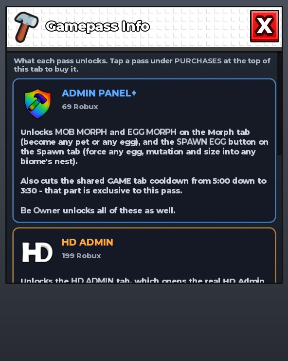

## At a glance

| | |
|---|---|
| Provenance | copy of a live game (saveinstance / decompiled client code) |
| Screens | 62 ScreenGuis, 3982 GUI objects → **79 screenshots** |
| Models (.rbxm) | 715 models, 25 model sets, 27 VFX sets |
| Lua builders (.lua) | 141 UI screens, 19 animation packs, 14 audio packs |
| Code | 1933 scripts, 248,518 lines |
| Asset ids | 78 animations, 263 sounds |
| Safety scan | 5 HIGH / 7 MED flags ([flags.txt](source/flags.txt)) |

**Fonts:** `GothamSSm ExtraBold`×645, `Rubik Bold`×233, `GothamSSm Heavy`×187, `SourceSansPro Regular`×96, `GothamSSm Bold`×79

## UI screenshots

Captured in Studio from the place's own ScreenGuis (scripts stripped). Each panel was opened on its own; click a thumbnail for the full 1519×886 frame. Runtime-filled lists (shop items, inventories) show their template state.

### Shop & Robux store

<table>
<tr>
<td width="33%" valign="top"><a href="screenshots/34_PopupPrompt__PurchaseSuccess.jpg">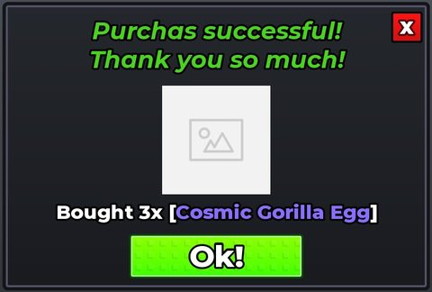</a> <b>PopupPrompt</b> › PurchaseSuccess</td>
<td width="33%" valign="top"><a href="screenshots/41_RobuxShop.jpg">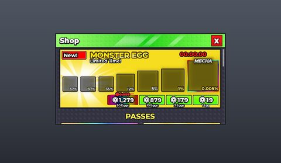</a> <b>RobuxShop</b></td>
<td width="33%" valign="top"><a href="screenshots/51_SpeedShop.jpg">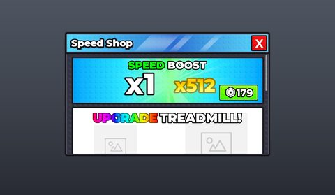</a> <b>SpeedShop</b></td>
</tr>
<tr>
<td width="33%" valign="top"><a href="screenshots/52_TrailShop.jpg">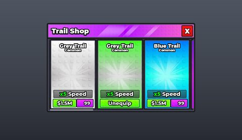</a> <b>TrailShop</b></td>
<td width="33%" valign="top"> <b>AdminPanelPassInfo</b> › AdminPanelPassInfo</td>
</tr>
</table>

### Inventory / backpack / pets

<table>
<tr>
<td width="33%" valign="top"><a href="screenshots/01_HotbarTemplate.jpg">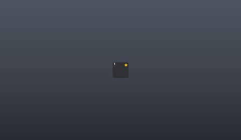</a> <b>HotbarTemplate</b></td>
<td width="33%" valign="top"> <b>InventoryTemplate</b></td>
<td width="33%" valign="top"><a href="screenshots/04_ActivePets.jpg">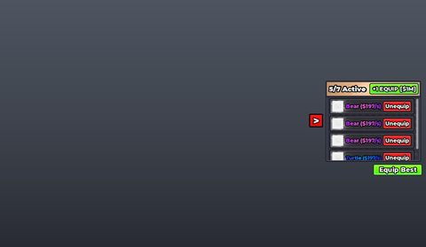</a> <b>ActivePets</b></td>
</tr>
<tr>
<td width="33%" valign="top"><a href="screenshots/08_BackpackGui__Backpack.jpg">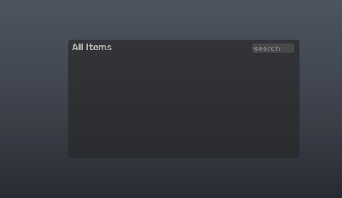</a> <b>BackpackGui</b> › Backpack</td>
<td width="33%" valign="top"><a href="screenshots/27_PetFuse.jpg">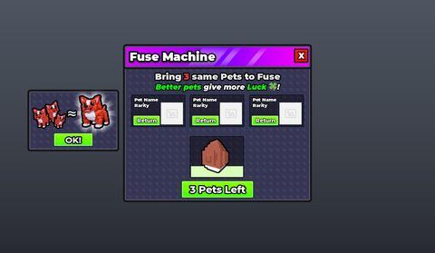</a> <b>PetFuse</b></td>
<td width="33%" valign="top"><a href="screenshots/28_PetFuse__FusePetInventory.jpg">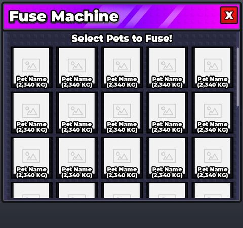</a> <b>PetFuse</b> › FusePetInventory</td>
</tr>
<tr>
<td width="33%" valign="top"><a href="screenshots/35_PopupPrompt__SellAllPets.jpg">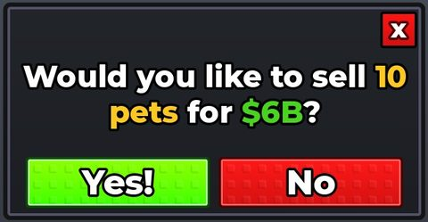</a> <b>PopupPrompt</b> › SellAllPets</td>
<td width="33%" valign="top"><a href="screenshots/36_PopupPrompt__PetFused.jpg">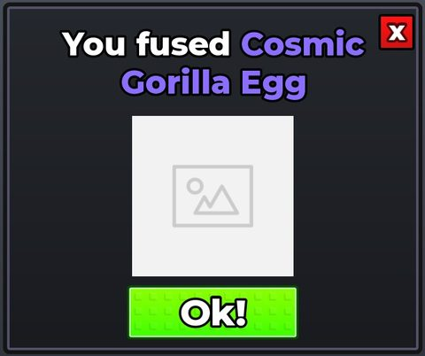</a> <b>PopupPrompt</b> › PetFused</td>
<td width="33%" valign="top"><a href="screenshots/61_AdminPanelPetIconPicker__AdminPanelPetIconPicker.jpg">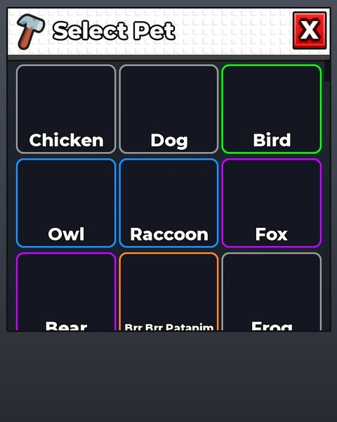</a> <b>AdminPanelPetIconPicker</b> › AdminPanelPetIconPicker</td>
</tr>
<tr>
<td width="33%" valign="top"><a href="screenshots/62_AdminPanelPetPicker__AdminPanelPetPicker.jpg">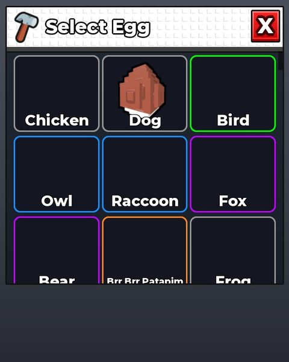</a> <b>AdminPanelPetPicker</b> › AdminPanelPetPicker</td>
</tr>
</table>

### Index / codex / glossary

<table>
<tr>
<td width="33%" valign="top"><a href="screenshots/22_Index.jpg">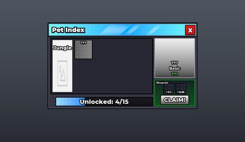</a> <b>Index</b></td>
</tr>
</table>

### Rewards, daily, spin, codes

<table>
<tr>
<td width="33%" valign="top"><a href="screenshots/14_FreeGift.jpg">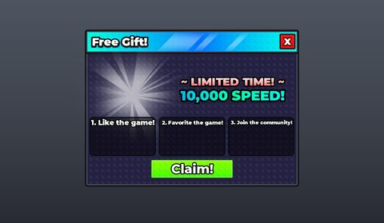</a> <b>FreeGift</b></td>
<td width="33%" valign="top"><a href="screenshots/25_MonsterChestRewards.jpg">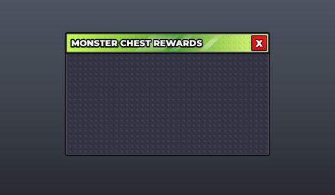</a> <b>MonsterChestRewards</b></td>
<td width="33%" valign="top"><a href="screenshots/42_RollbackRewardUI.jpg">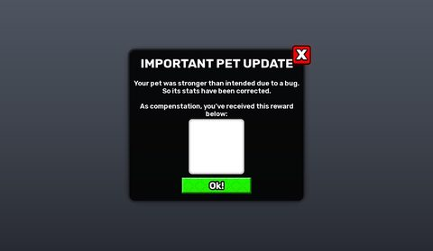</a> <b>RollbackRewardUI</b></td>
</tr>
<tr>
<td width="33%" valign="top"><a href="screenshots/64_CodesGui__Frame.jpg">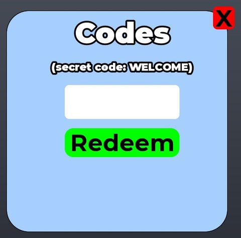</a> <b>CodesGui</b> › Frame</td>
</tr>
</table>

### Quests & progression

<table>
<tr>
<td width="33%" valign="top"><a href="screenshots/46_SakuraEggCharge__ProgressBarHolder.jpg">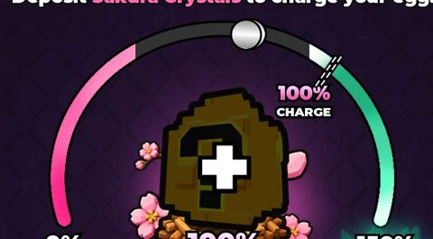</a> <b>SakuraEggCharge</b> › Content.ProgressBarHolder</td>
</tr>
</table>

### Settings & menus

<table>
<tr>
<td width="33%" valign="top"><a href="screenshots/33_PhoneVideoUI__Paused.jpg">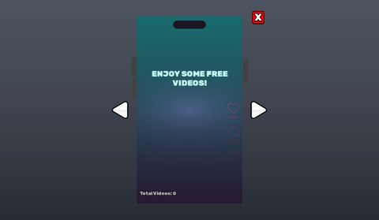</a> <b>PhoneVideoUI</b> › Phone.Paused</td>
<td width="33%" valign="top"><a href="screenshots/50_Settings.jpg">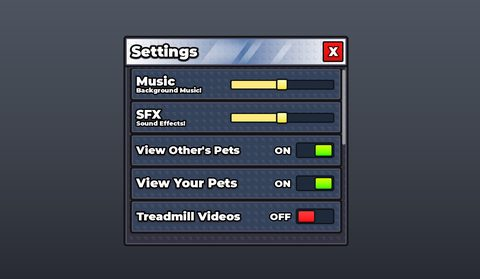</a> <b>Settings</b></td>
<td width="33%" valign="top"><a href="screenshots/57_AdminPanelSettings__AdminPanelSettings.jpg">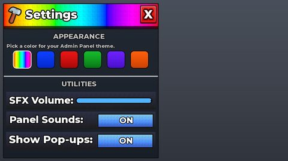</a> <b>AdminPanelSettings</b> › AdminPanelSettings</td>
</tr>
</table>

### Popups, notifications, prompts

<table>
<tr>
<td width="33%" valign="top"><a href="screenshots/23_Message.jpg">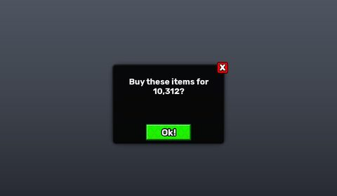</a> <b>Message</b></td>
<td width="33%" valign="top"><a href="screenshots/37_PopupPrompt__Sellv2.jpg">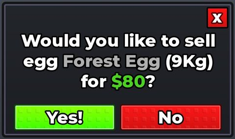</a> <b>PopupPrompt</b> › Sellv2</td>
<td width="33%" valign="top"><a href="screenshots/38_PopupPrompt__Sellv1.jpg">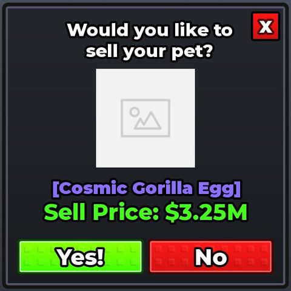</a> <b>PopupPrompt</b> › Sellv1</td>
</tr>
<tr>
<td width="33%" valign="top"><a href="screenshots/39_PopupPrompt__Emptyv2.jpg">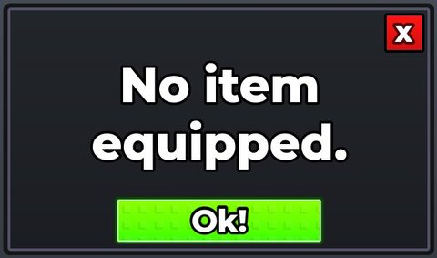</a> <b>PopupPrompt</b> › Emptyv2</td>
<td width="33%" valign="top"><a href="screenshots/40_PopupPrompt__Emptyv1.jpg">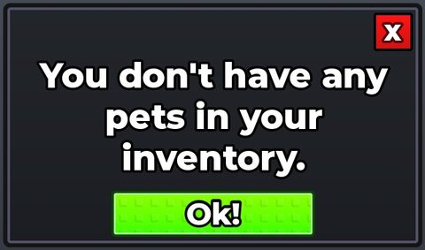</a> <b>PopupPrompt</b> › Emptyv1</td>
</tr>
</table>

### End of round, death, results

<table>
<tr>
<td width="33%" valign="top"><a href="screenshots/17_GrowingEggs.jpg">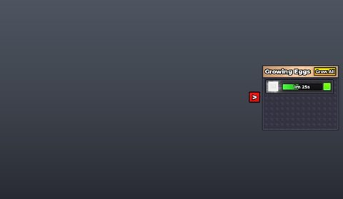</a> <b>GrowingEggs</b></td>
</tr>
</table>

### Crafting, fusing, machines

<table>
<tr>
<td width="33%" valign="top"><a href="screenshots/59_AdminPanelMutationPicker__AdminPanelMutationPicker.jpg">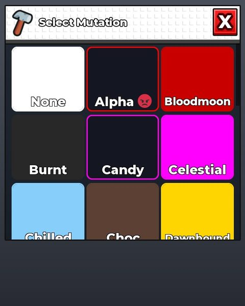</a> <b>AdminPanelMutationPicker</b> › AdminPanelMutationPicker</td>
</tr>
</table>

### Admin panels

<table>
<tr>
<td width="33%" valign="top"><a href="screenshots/54_Cmdr__Autocomplete.jpg">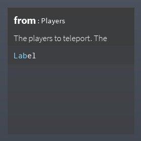</a> <b>Cmdr</b> › Autocomplete</td>
<td width="33%" valign="top"><a href="screenshots/55_AdminModelBrowser__Shade.jpg">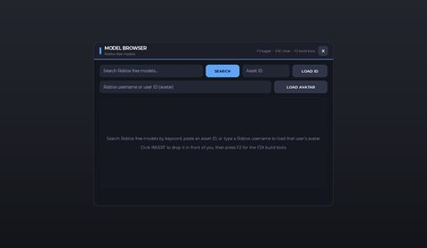</a> <b>AdminModelBrowser</b> › Shade</td>
<td width="33%" valign="top"><a href="screenshots/56_AdminPanel_PREVIEW__AdminPanel.jpg">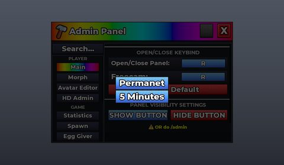</a> <b>AdminPanel_PREVIEW</b> › AdminPanel</td>
</tr>
<tr>
<td width="33%" valign="top"><a href="screenshots/58_AdminPanelEggPicker__AdminPanelEggPicker.jpg">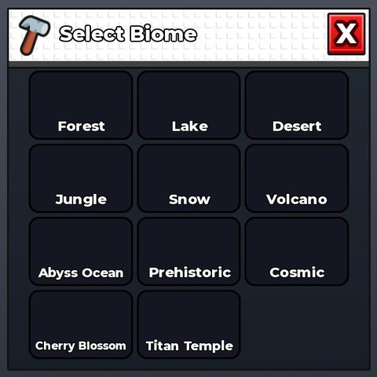</a> <b>AdminPanelEggPicker</b> › AdminPanelEggPicker</td>
</tr>
</table>

### HUD & currency

<table>
<tr>
<td width="33%" valign="top"><a href="screenshots/18_HUD.jpg">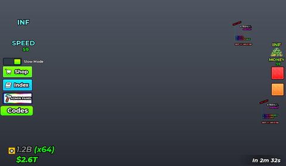</a> <b>HUD</b></td>
<td width="33%" valign="top"><a href="screenshots/19_HUD__RightButtons.jpg">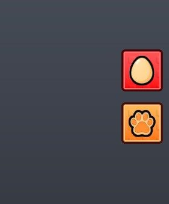</a> <b>HUD</b> › TradmilHud.RightButtons</td>
<td width="33%" valign="top"><a href="screenshots/20_HUD__LeftControls.jpg">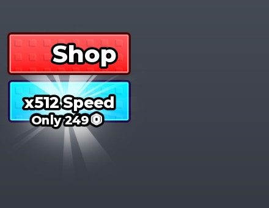</a> <b>HUD</b> › TradmilHud.LeftControls</td>
</tr>
<tr>
<td width="33%" valign="top"><a href="screenshots/21_HUD__BottomLeft.jpg">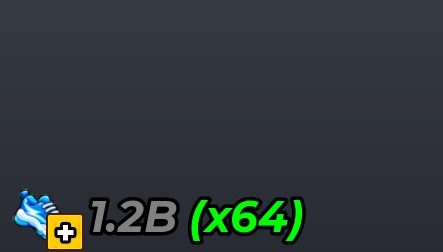</a> <b>HUD</b> › TradmilHud.BottomLeft</td>
<td width="33%" valign="top"><a href="screenshots/66_Money.jpg">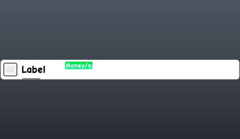</a> <b>Money</b></td>
</tr>
</table>

### Map vote / teams / matchmaking

<table>
<tr>
<td width="33%" valign="top"> <b>RoundChoices</b> › EscapeAndKeep</td>
</tr>
</table>

### Other

<table>
<tr>
<td width="33%" valign="top"><a href="screenshots/05_AreaGui.jpg">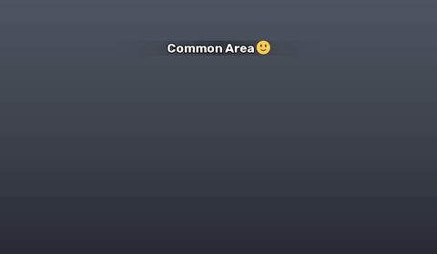</a> <b>AreaGui</b></td>
<td width="33%" valign="top"><a href="screenshots/06_AssetHoverData.jpg">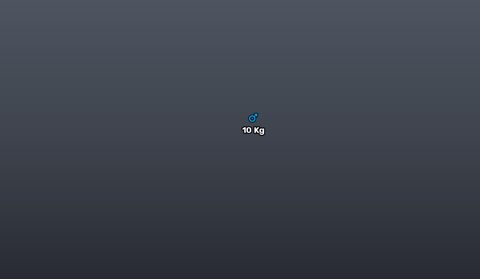</a> <b>AssetHoverData</b></td>
<td width="33%" valign="top"><a href="screenshots/07_AutoSell.jpg">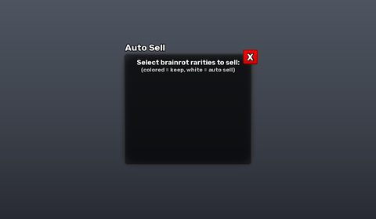</a> <b>AutoSell</b></td>
</tr>
<tr>
<td width="33%" valign="top"><a href="screenshots/09_CaptureTheEggUI.jpg">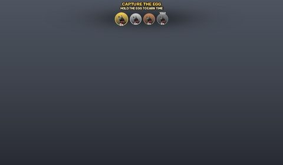</a> <b>CaptureTheEggUI</b></td>
<td width="33%" valign="top"><a href="screenshots/10_CrateOpeningPopUpFrame__CrateOpeningPopUp.jpg">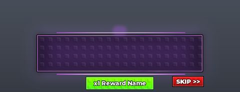</a> <b>CrateOpeningPopUpFrame</b> › CrateOpeningPopUp</td>
<td width="33%" valign="top"><a href="screenshots/11_CutsceneUI__MonstersAreComing.jpg">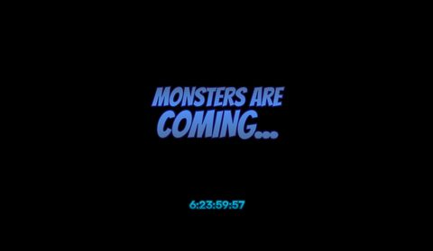</a> <b>CutsceneUI</b> › MonstersAreComing</td>
</tr>
<tr>
<td width="33%" valign="top"><a href="screenshots/12_DragonEggEventUI.jpg">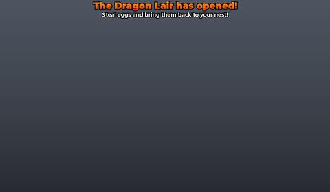</a> <b>DragonEggEventUI</b></td>
<td width="33%" valign="top"><a href="screenshots/13_DropHeldEgg.jpg">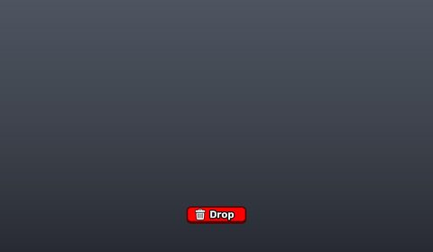</a> <b>DropHeldEgg</b></td>
<td width="33%" valign="top"><a href="screenshots/15_GetMoreSpeedOnHit.jpg">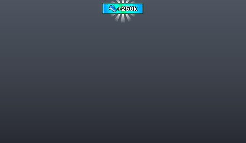</a> <b>GetMoreSpeedOnHit</b></td>
</tr>
<tr>
<td width="33%" valign="top"><a href="screenshots/16_GreatBloomBanner.jpg">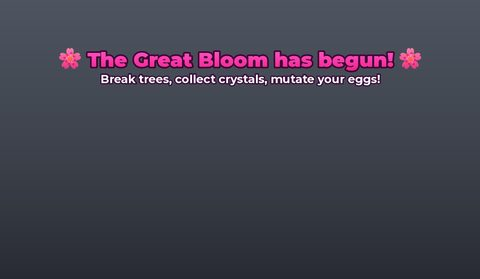</a> <b>GreatBloomBanner</b></td>
<td width="33%" valign="top"><a href="screenshots/24_MonsterChargeUI.jpg">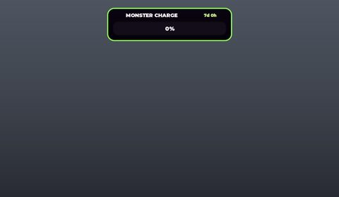</a> <b>MonsterChargeUI</b></td>
<td width="33%" valign="top"> <b>MonsterEventUI</b></td>
</tr>
<tr>
<td width="33%" valign="top"> <b>PhoneVideoUI</b></td>
<td width="33%" valign="top"> <b>PhoneVideoUI</b> › Phone.Comments</td>
<td width="33%" valign="top"> <b>PhoneVideoUI</b> › Phone.GoToNext</td>
</tr>
<tr>
<td width="33%" valign="top"> <b>RunBackEffects</b></td>
<td width="33%" valign="top"> <b>SakuraCrystalCounter</b></td>
<td width="33%" valign="top"> <b>SakuraEggCharge</b></td>
</tr>
<tr>
<td width="33%" valign="top"> <b>SakuraEggCharge</b> › EggPicker</td>
<td width="33%" valign="top"> <b>SakuraEventTutorialFrame</b></td>
<td width="33%" valign="top"> <b>MonsterEventTutorialFrame</b></td>
</tr>
<tr>
<td width="33%" valign="top"> <b>TutorialInstructions</b></td>
<td width="33%" valign="top"> <b>ScreenGui</b></td>
<td width="33%" valign="top"> <b>Speed</b></td>
</tr>
<tr>
<td width="33%" valign="top"> <b>Item2</b></td>
<td width="33%" valign="top"> <b>BTAnchorToolGUI</b></td>
<td width="33%" valign="top"> <b>BTCollisionToolGUI</b></td>
</tr>
<tr>
<td width="33%" valign="top"> <b>BTDecorateToolGUI</b></td>
<td width="33%" valign="top"> <b>BTLightingToolGUI</b></td>
<td width="33%" valign="top"> <b>BTMaterialToolGUI</b></td>
</tr>
<tr>
<td width="33%" valign="top"> <b>BTMeshToolGUI</b></td>
<td width="33%" valign="top"> <b>BTMoveToolGUI</b></td>
<td width="33%" valign="top"> <b>BTPaintToolGUI</b></td>
</tr>
<tr>
<td width="33%" valign="top"> <b>BTResizeToolGUI</b></td>
<td width="33%" valign="top"> <b>BTRotateToolGUI</b></td>
<td width="33%" valign="top"> <b>BTSurfaceToolGUI</b></td>
</tr>
<tr>
<td width="33%" valign="top"> <b>BTTextureToolGUI</b></td>
<td width="33%" valign="top"> <b>BTWeldToolGUI</b></td>
</tr>
</table>

## Model previews

<table>
<tr>
<td width="25%" valign="top"> <b>CosmicRig</b> <code>models/ReplicatedStorage/CutsceneAssets/DragonEggEventCutscene1/CosmicRig.rbxm</code></td>
<td width="25%" valign="top"> <b>Titan Axe</b> <code>models/ReplicatedStorage/GearTools/ShopItems/Titan Axe.rbxm</code></td>
<td width="25%" valign="top"> <b>Godzilla</b> <code>models/ReplicatedStorage/Assets/Models/Eggs/Godzilla.rbxm</code></td>
<td width="25%" valign="top"> <b>Demon Slap</b> <code>models/ReplicatedStorage/GearTools/ShopItems/Demon Slap.rbxm</code></td>
</tr>
<tr>
<td width="25%" valign="top"> <b>HackerTreadmill</b> <code>models/ReplicatedStorage/Assets/Models/Treadmills/HackerTreadmill.rbxm</code></td>
<td width="25%" valign="top"> <b>FuseMachine</b> <code>models/Workspace/__OBJECTS/Machines/FuseMachine.rbxm</code></td>
<td width="25%" valign="top"> <b>volcano</b> <code>models/Workspace/__OBJECTS/Build/Props/Zone6Props/volcano.rbxm</code></td>
<td width="25%" valign="top"> <b>Chest</b> <code>models/Workspace/Chest.rbxm</code></td>
</tr>
<tr>
<td width="25%" valign="top"> <b>Leaderboard1</b> <code>models/Workspace/__OBJECTS/Leaderboards/Models/Leaderboard1.rbxm</code></td>
<td width="25%" valign="top"> <b>SmokeBomb</b> <code>models/ReplicatedStorage/Assets/Models/Abilities/SmokeBomb.rbxm</code></td>
<td width="25%" valign="top"> <b>Gigantic</b> <code>models/ReplicatedStorage/Assets/Models/Sakura/BloomTrees/Gigantic.rbxm</code></td>
<td width="25%" valign="top"> <b>1</b> <code>models/Workspace/Plots/1.rbxm</code></td>
</tr>
<tr>
<td width="25%" valign="top"> <b>Yeti</b> <code>models/StarterPlayer/StarterPlayerScripts/Game/AdminAbuseClient/Events/MonsterEvent/Cutscene/CutsceneVFX/Eggs/Yeti.rbxm</code></td>
</tr>
</table>

## Notable scripts

Top-scored scripts of this game per topic (full tree in [source/scripts](source/scripts/)).

| Topic | Scripts |
|---|---|
| UI animation (tweens, hover / click, pop-ins, springs) | [`AdminPanelUi`](source/scripts/StarterPlayer/StarterPlayerScripts/GUI/AdminPanelUi.client.lua) 3752 lines [`CrateOpeningSpinner`](source/scripts/ReplicatedStorage/Client/UI/CrateOpeningSpinner.lua) 552 lines [`GuardTutorialPresentation`](source/scripts/ReplicatedStorage/Client/GuardTutorialPresentation.lua) 682 lines [`SpeedGainPopup`](source/scripts/ReplicatedStorage/Client/UI/VFX/SpeedGainPopup.lua) 455 lines [`Main`](source/scripts/StarterPlayer/StarterPlayerScripts/GUI/BackpackController/Main.lua) 6146 lines |
| UI controllers / window managers / menus | [`Window`](source/scripts/ReplicatedStorage/CmdrClient/CmdrInterface/Window.lua) 314 lines [`LimitedEgg`](source/scripts/StarterPlayer/StarterPlayerScripts/GUI/Shop/LimitedEgg.client.lua) 592 lines [`Main`](source/scripts/StarterPlayer/StarterPlayerScripts/GUI/BackpackController/Main.lua) 6146 lines [`AdminPanelUi`](source/scripts/StarterPlayer/StarterPlayerScripts/GUI/AdminPanelUi.client.lua) 3752 lines [`Index`](source/scripts/StarterPlayer/StarterPlayerScripts/GUI/Index.client.lua) 902 lines |
| Notifications, toasts, popups, prompts | [`Message`](source/scripts/ReplicatedStorage/Client/Message.lua) 234 lines [`Message`](source/scripts/ReplicatedStorage/Client/Notifications/Message.lua) 392 lines [`ProximityPromptScript`](source/scripts/StarterPlayer/StarterPlayerScripts/Game/ProximityPromptScript.client.lua) 812 lines [`ActiveAssetIncomePopup`](source/scripts/StarterPlayer/StarterPlayerScripts/GUI/ActiveAssetIncomePopup.lua) 162 lines [`NotificationInstance`](source/scripts/ReplicatedStorage/Client/Notifications/NotificationInstance.lua) 272 lines |
| Loading / intro screens | [`HotbarImagePreloadController`](source/scripts/ReplicatedStorage/Client/HotbarImagePreloadController.lua) 366 lines [`AddCurrencyScreen`](source/scripts/ReplicatedStorage/Client/UI/VFX/AddCurrencyScreen.lua) 304 lines [`CutscenePart2`](source/scripts/StarterPlayer/StarterPlayerScripts/Game/AdminAbuseClient/Events/DragonEggEvent/CutscenePart2.lua) 421 lines [`SakuraIncubator`](source/scripts/StarterPlayer/StarterPlayerScripts/Game/SakuraIncubator.client.lua) 1059 lines [`CaptureTheEgg`](source/scripts/StarterPlayer/StarterPlayerScripts/Game/AdminAbuseClient/Events/CaptureTheEgg.lua) 1858 lines |
| Camera, cutscenes, screen shake | [`CutscenePart2`](source/scripts/StarterPlayer/StarterPlayerScripts/Game/AdminAbuseClient/Events/DragonEggEvent/CutscenePart2.lua) 421 lines [`CutscenePart1`](source/scripts/StarterPlayer/StarterPlayerScripts/Game/AdminAbuseClient/Events/DragonEggEvent/CutscenePart1.lua) 1000 lines [`Cutscene`](source/scripts/StarterPlayer/StarterPlayerScripts/Game/AdminAbuseClient/Events/MonsterEvent/Cutscene.lua) 1036 lines [`DragonEggEvent`](source/scripts/StarterPlayer/StarterPlayerScripts/Game/AdminAbuseClient/Events/DragonEggEvent.lua) 923 lines [`DemonicEvent`](source/scripts/StarterPlayer/StarterPlayerScripts/Game/AdminAbuseClient/Events/DemonicEvent.lua) 249 lines |
| VFX, particles, beams, hit effects | [`Cutscene`](source/scripts/StarterPlayer/StarterPlayerScripts/Game/AdminAbuseClient/Events/MonsterEvent/Cutscene.lua) 1036 lines [`VFX`](source/scripts/ReplicatedStorage/Shared/Utils/VFX.lua) 189 lines [`CutscenePart1`](source/scripts/StarterPlayer/StarterPlayerScripts/Game/AdminAbuseClient/Events/DragonEggEvent/CutscenePart1.lua) 1000 lines [`SakuraFX`](source/scripts/ReplicatedStorage/Client/SakuraFX.lua) 80 lines [`SakuraIncubator`](source/scripts/StarterPlayer/StarterPlayerScripts/Game/SakuraIncubator.client.lua) 1059 lines |
| DataStore / player data | [`DataService`](source/scripts/ServerScriptService/DataService.lua) 550 lines |
| Monetization (dev products, game passes, receipts) | [`OfferServer`](source/scripts/Workspace/OfferPodiums/OfferServer.server.lua) 269 lines [`AdminPanelService`](source/scripts/ServerScriptService/AdminPanelService.lua) 1095 lines [`PromptPurchase`](source/scripts/ReplicatedStorage/Client/Functions/PromptPurchase.lua) 262 lines [`GamepassButtons`](source/scripts/StarterGui/ScreenGui/Top/GamepassButtons.client.lua) 21 lines |
| RNG, eggs, gacha, rarity rolls, pets | [`EggRecords`](source/scripts/ReplicatedStorage/Shared/Util/EggRecords.lua) 639 lines [`AreaEggService`](source/scripts/ServerScriptService/AreaEggService.lua) 871 lines [`DragonEgg`](source/scripts/ReplicatedStorage/Data/DragonEgg.lua) 109 lines [`CrateOpeningSpinner`](source/scripts/ReplicatedStorage/Client/UI/CrateOpeningSpinner.lua) 552 lines [`Sakura`](source/scripts/ReplicatedStorage/Data/Sakura.lua) 207 lines |
| Combat, weapons, hitboxes, abilities | [`GunToolHandler`](source/scripts/StarterPlayer/StarterPlayerScripts/Game/Tools/GunToolHandler.client.lua) 107 lines [`Client`](source/scripts/ReplicatedStorage/Shared/Modules/BatController/Client.lua) 493 lines [`Server`](source/scripts/ReplicatedStorage/Shared/Modules/BatController/Server.lua) 500 lines [`_scriptThatsUnderTrap`](source/scripts/ReplicatedStorage/GearTools/ShopItems/Trap/_scriptThatsUnderTrap.lua) 308 lines [`SubspaceMine`](source/scripts/StarterPlayer/StarterPlayerScripts/Game/Tools/SubspaceMine.client.lua) 73 lines |
| NPC / AI / monsters | [`MonsterEvent`](source/scripts/StarterPlayer/StarterPlayerScripts/Game/AdminAbuseClient/Events/MonsterEvent.lua) 603 lines [`MonsterParasite`](source/scripts/StarterPlayer/StarterPlayerScripts/Game/MonsterParasite.client.lua) 3757 lines |
| Character movement (sprint, dash, double jump, slide) | [`Slider`](source/scripts/ReplicatedStorage/GearTools/Building%20Tools/UI/ColorPicker/Slider.lua) 109 lines [`Client`](source/scripts/ReplicatedStorage/Shared/Modules/BatController/Client.lua) 493 lines [`ObbyAntiTPClient`](source/scripts/StarterPlayer/StarterPlayerScripts/Game/ObbyAntiTPClient.client.lua) 533 lines [`Settings`](source/scripts/StarterPlayer/StarterPlayerScripts/GUI/Settings.client.lua) 681 lines [`AntiCollisionHighSeedPushBack`](source/scripts/StarterPlayer/StarterCharacterScripts/AntiCollisionHighSeedPushBack.client.lua) 30 lines |
| Tycoon / plots / bases / building | [`EggPlacementController`](source/scripts/StarterPlayer/StarterPlayerScripts/Game/Eggs/EggPlacementController.client.lua) 184 lines [`AdminPanelService`](source/scripts/ServerScriptService/AdminPanelService.lua) 1095 lines [`PlotService`](source/scripts/ServerScriptService/PlotService.lua) 254 lines [`PlotUpgradeController`](source/scripts/StarterPlayer/StarterPlayerScripts/GUI/PlotUpgradeController.client.lua) 315 lines [`AreaEggService`](source/scripts/ServerScriptService/AreaEggService.lua) 871 lines |
| Admin panels & commands | [`AdminPanelService`](source/scripts/ServerScriptService/AdminPanelService.lua) 1095 lines [`AdminPanelUi`](source/scripts/StarterPlayer/StarterPlayerScripts/GUI/AdminPanelUi.client.lua) 3752 lines |
| Sound & music | [`Audio`](source/scripts/ReplicatedStorage/Shared/Audio.lua) 442 lines [`MusicDirector`](source/scripts/ReplicatedStorage/Client/MusicDirector.lua) 290 lines [`AssetSounds`](source/scripts/ReplicatedStorage/Shared/Util/AssetSounds.lua) 153 lines [`AudioSettings`](source/scripts/StarterPlayer/StarterPlayerScripts/Game/AudioSettings.client.lua) 113 lines [`Abyss Ocean`](source/scripts/ReplicatedStorage/Data/Guards/Configs/Abyss%20Ocean.lua) 72 lines |
| Daily rewards, quests, codes, playtime | [`CodesService`](source/scripts/ServerScriptService/CodesService.lua) 79 lines [`CodesController`](source/scripts/StarterPlayer/StarterPlayerScripts/GUI/CodesController.client.lua) 91 lines [`GroupRewards`](source/scripts/StarterPlayer/StarterPlayerScripts/GUI/GroupRewards.client.lua) 162 lines [`ClaimRewardPanel`](source/scripts/StarterPlayer/StarterPlayerScripts/GUI/Index/ClaimRewardPanel.lua) 96 lines |
| Utility modules (number format, signals, tables, timers) | [`DataService`](source/scripts/ServerScriptService/DataService.lua) 550 lines [`ServerFastFlags`](source/scripts/ServerScriptService/UserGenerated/Server/ServerFastFlags.lua) 139 lines [`AreaEggService`](source/scripts/ServerScriptService/AreaEggService.lua) 871 lines [`AdminPanelService`](source/scripts/ServerScriptService/AdminPanelService.lua) 1095 lines [`Signal`](source/scripts/ReplicatedStorage/GearTools/Building%20Tools/Libraries/Signal.lua) 149 lines |

## ⚠️ Safety

HIGH flags (backdoors, `require(id)`, `loadstring`, webhooks). Review or delete before reusing:

- `scripts/ReplicatedStorage/Data/Products.lua`
- `scripts/ReplicatedStorage/GearTools/Building Tools/Libraries/Cryo/List.lua`
- `scripts/ReplicatedStorage/GearTools/Building Tools/Libraries/Cryo/List/reverse.spec.lua`
- `scripts/StarterPlayer/StarterPlayerScripts/GUI/ResetStartTimer.client.lua`
- `scripts/Workspace/Avalog/Avalog/Packages/.pesde/csqrl_sift@0.0.9/sift/Array.lua`

## Folders

| Folder | What |
|---|---|
| `screenshots/` | full frames; `crops/` = the panel only; `models/` = 3D previews; `thumbs/` = gallery thumbnails |
| `ui/` | every screen as a Lua builder (`require(module)()` returns the ScreenGui); `_StarterGui-all.lua` builds every StarterGui screen |
| `models/` | every model as .rbxm (the only .rbxm files), mirroring the place tree, scripts removed |
| `map/` | `workspace.rbxm` (the map as a model), `lighting.lua` (sky + post effects), `materials.lua`, `Environment.lua` |
| `animations/`, `audio/` | KeyframeSequence / Sound builders (.lua), `AnimationIds.lua`, `Sounds.lua` |
| `source/` | all scripts as .luau, `tree.txt`, `ui.txt`, `remotes.txt`, `assets.txt`, `flags.txt` |
