# Steal an Egg (latest)

> 🧠 **Brainrot** · steal / tycoon (eggs, pets, plots) · source file `SLBR- VIP - SAE LATEST.rbxl`

[⬅ Back to the catalog](../../README.md) · [Assets inventory](ASSETS.md) · [Style numbers](reference.md) · [Scripts](source/scripts/) · [Code analysis](source/README.md)

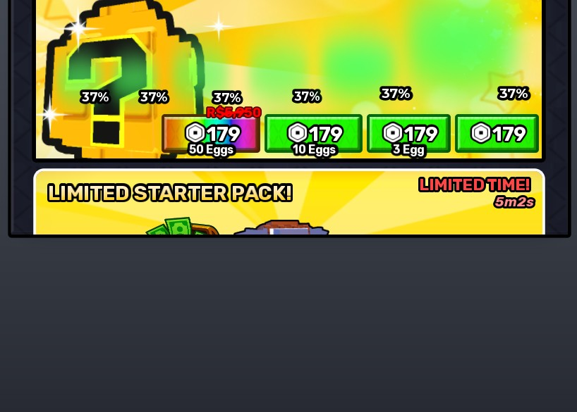

## At a glance

| | |
|---|---|
| Provenance | copy of a live game (saveinstance / decompiled client code) |
| Screens | 79 ScreenGuis, 4477 GUI objects → **103 screenshots** |
| Models (.rbxm) | 526 models, 10 model sets, 90 VFX sets |
| Lua builders (.lua) | 375 UI screens, 25 animation packs, 9 audio packs |
| Code | 3167 scripts, 759,853 lines |
| Asset ids | 135 animations, 176 sounds |
| Safety scan | 58 HIGH / 15 MED flags ([flags.txt](source/flags.txt)) |

**Fonts:** `Rubik Bold`×522, `GothamSSm Bold`×124, `ComicNeueAngular Bold`×109, `GothamSSm ExtraBold`×82, `GothamSSm Heavy`×80

## UI screenshots

Captured in Studio from the place's own ScreenGuis (scripts stripped). Each panel was opened on its own; click a thumbnail for the full 1519×886 frame. Runtime-filled lists (shop items, inventories) show their template state.

### Shop & Robux store

<table>
<tr>
<td width="33%" valign="top"><a href="screenshots/20_GearShop.jpg">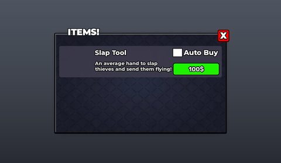</a> <b>GearShop</b></td>
<td width="33%" valign="top"><a href="screenshots/25_LimitedStarterPackOffer.jpg">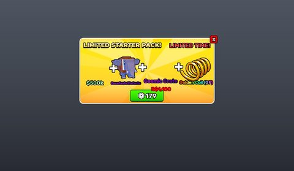</a> <b>LimitedStarterPackOffer</b></td>
<td width="33%" valign="top"><a href="screenshots/41_Shop.jpg">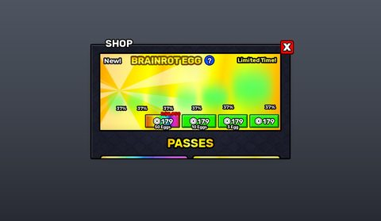</a> <b>Shop</b></td>
</tr>
<tr>
<td width="33%" valign="top"><a href="screenshots/42_Shop__StarterPack.jpg">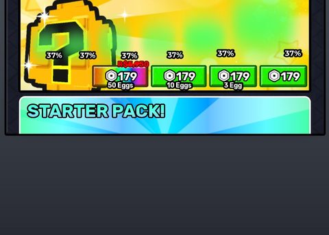</a> <b>Shop</b> › Frame.Main.ScrollingFrame.StarterPack</td>
<td width="33%" valign="top"><a href="screenshots/43_Shop__SecretStarterPack.jpg">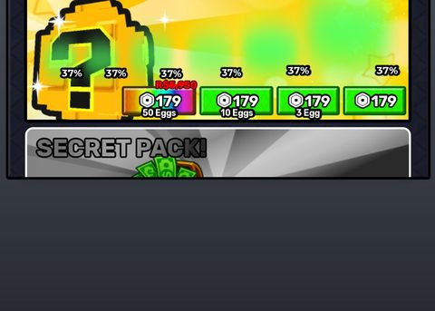</a> <b>Shop</b> › Frame.Main.ScrollingFrame.SecretStarterPack</td>
<td width="33%" valign="top"> <b>Shop</b> › Frame.Main.ScrollingFrame.LimitedStarterPack</td>
</tr>
<tr>
<td width="33%" valign="top"><a href="screenshots/45_Shop__ServerLuck.jpg">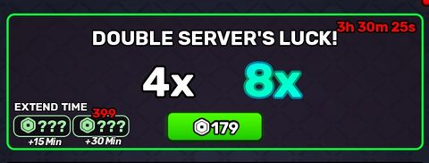</a> <b>Shop</b> › Frame.Main.ScrollingFrame.ServerLuck</td>
<td width="33%" valign="top"><a href="screenshots/46_Shop__TemporarySpeedBoosts.jpg">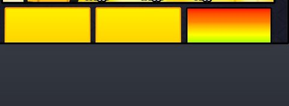</a> <b>Shop</b> › Frame.Main.ScrollingFrame.TemporarySpeedBoosts</td>
<td width="33%" valign="top"><a href="screenshots/47_Shop__DoubleYourSpeed.jpg">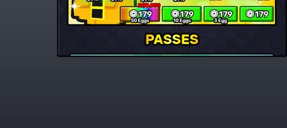</a> <b>Shop</b> › Frame.Main.ScrollingFrame.DoubleYourSpeed</td>
</tr>
<tr>
<td width="33%" valign="top"><a href="screenshots/55_TrailShop.jpg">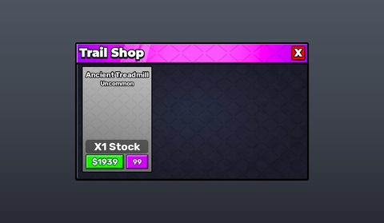</a> <b>TrailShop</b></td>
<td width="33%" valign="top"><a href="screenshots/57_TreadmillShop.jpg">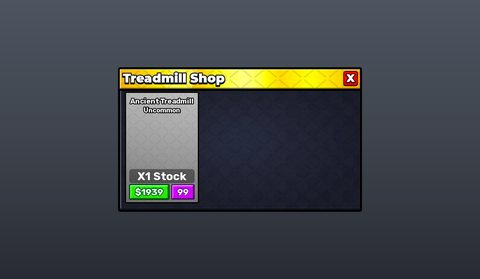</a> <b>TreadmillShop</b></td>
<td width="33%" valign="top"><a href="screenshots/58_TreadmillSpeedShop.jpg">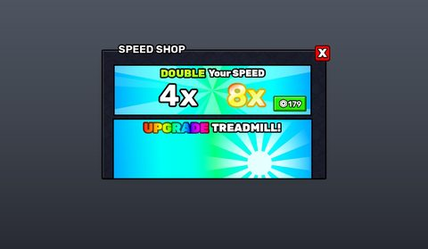</a> <b>TreadmillSpeedShop</b></td>
</tr>
<tr>
<td width="33%" valign="top"><a href="screenshots/59_TreadmillSpeedShop__1.jpg">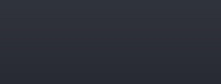</a> <b>TreadmillSpeedShop</b> › Frame.Main.ScrollingFrame.SpeedTop_oldtimer.1</td>
<td width="33%" valign="top"><a href="screenshots/80_Put_me_in_StarterGui.jpg">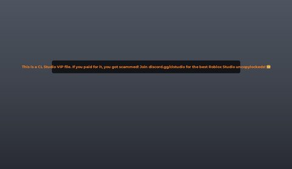</a> <b>Put me in StarterGui</b></td>
</tr>
</table>

### Inventory / backpack / pets

<table>
<tr>
<td width="33%" valign="top"> <b>InventoryTemplate</b></td>
<td width="33%" valign="top"><a href="screenshots/05_HotbarTemplate.jpg">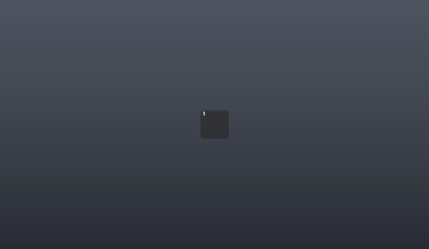</a> <b>HotbarTemplate</b></td>
<td width="33%" valign="top"><a href="screenshots/09_BackpackGui__Backpack.jpg">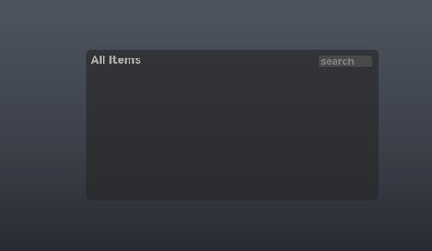</a> <b>BackpackGui</b> › Backpack</td>
</tr>
<tr>
<td width="33%" valign="top"><a href="screenshots/18_FuseMachine__BackpackScrollingFrameContainer.jpg">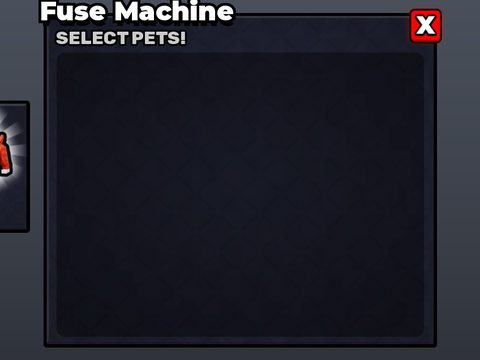</a> <b>FuseMachine</b> › Main.FuseMachine.BackpackScrollingFrameContainer</td>
<td width="33%" valign="top"><a href="screenshots/34_PetList.jpg">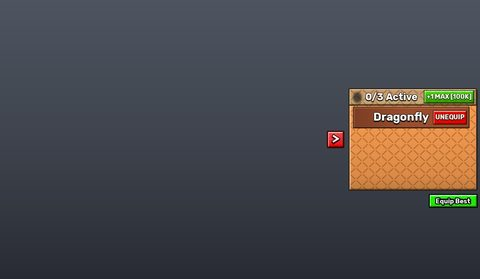</a> <b>PetList</b></td>
<td width="33%" valign="top"><a href="screenshots/68_AdminPanel__GivePet.jpg">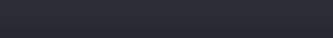</a> <b>AdminPanel</b> › Main.Commands.GivePet</td>
</tr>
<tr>
<td width="33%" valign="top"><a href="screenshots/70_AdminPanel__PetSelector.jpg">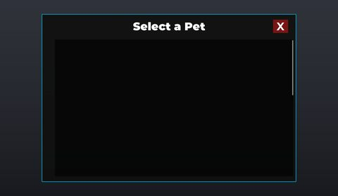</a> <b>AdminPanel</b> › PetSelector</td>
<td width="33%" valign="top"><a href="screenshots/81_ItemAlert.jpg">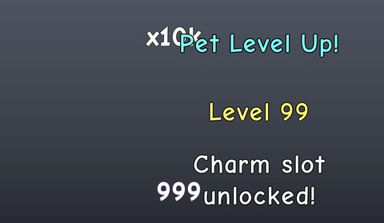</a> <b>ItemAlert</b></td>
<td width="33%" valign="top"><a href="screenshots/87_Item.jpg">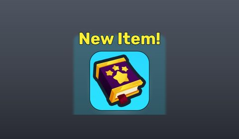</a> <b>Item</b></td>
</tr>
<tr>
<td width="33%" valign="top"><a href="screenshots/96_PetLevel.jpg">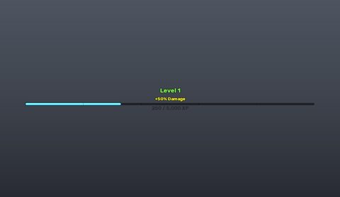</a> <b>PetLevel</b></td>
</tr>
</table>

### Index / codex / glossary

<table>
<tr>
<td width="33%" valign="top"><a href="screenshots/24_Index.jpg">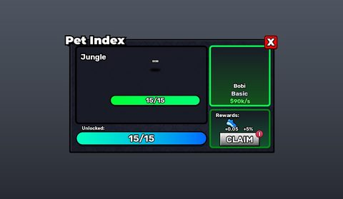</a> <b>Index</b></td>
</tr>
</table>

### Rewards, daily, spin, codes

<table>
<tr>
<td width="33%" valign="top"><a href="screenshots/11_Codes.jpg">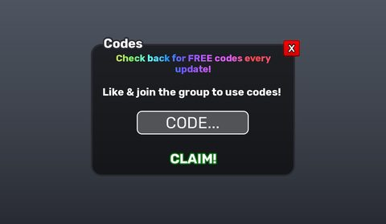</a> <b>Codes</b></td>
<td width="33%" valign="top"><a href="screenshots/16_FreeGifts.jpg">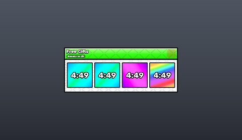</a> <b>FreeGifts</b></td>
<td width="33%" valign="top"><a href="screenshots/22_GroupReward.jpg">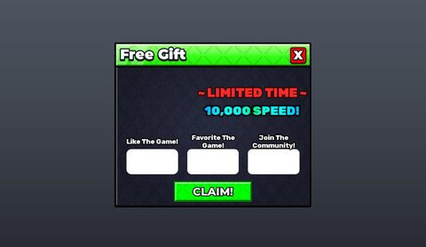</a> <b>GroupReward</b></td>
</tr>
<tr>
<td width="33%" valign="top"><a href="screenshots/31_OfflineCashAndAssetLevelGrew.jpg">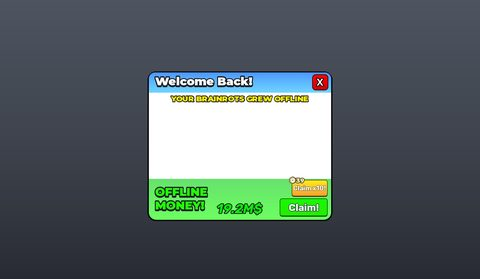</a> <b>OfflineCashAndAssetLevelGrew</b></td>
<td width="33%" valign="top"><a href="screenshots/32_OfflineCashAndAssetLevelGrew__Template.jpg">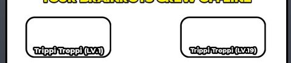</a> <b>OfflineCashAndAssetLevelGrew</b> › Frame.AssetsLevelGrowth.ScrollingFrame.Template</td>
<td width="33%" valign="top"><a href="screenshots/33_OfflineCashOnly.jpg">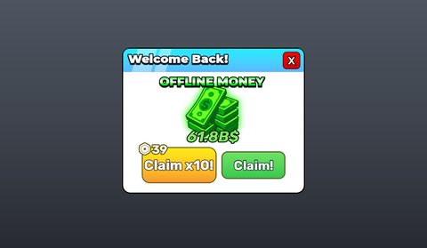</a> <b>OfflineCashOnly</b></td>
</tr>
<tr>
<td width="33%" valign="top"><a href="screenshots/48_Shop__Gift.jpg">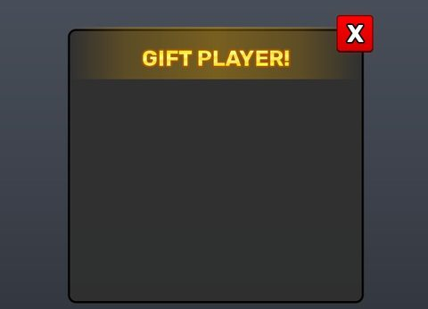</a> <b>Shop</b> › Gift</td>
<td width="33%" valign="top"><a href="screenshots/62_TreadmillSpeedShop__Gift.jpg">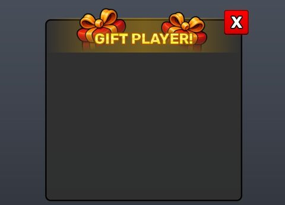</a> <b>TreadmillSpeedShop</b> › Gift</td>
<td width="33%" valign="top"><a href="screenshots/76_FollowRewardsUI__FollowUI.jpg">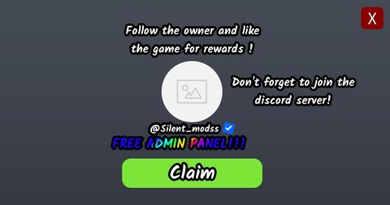</a> <b>FollowRewardsUI</b> › FollowUI</td>
</tr>
<tr>
<td width="33%" valign="top"> <b>Rewards</b></td>
<td width="33%" valign="top"> <b>RewardsUI</b> › Frame</td>
</tr>
</table>

### Quests & progression

<table>
<tr>
<td width="33%" valign="top"><a href="screenshots/12_DistanceProgression.jpg">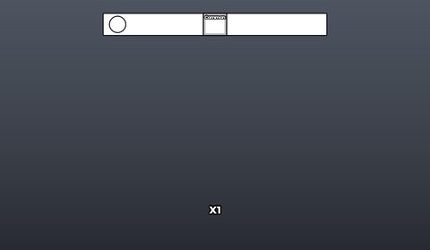</a> <b>DistanceProgression</b></td>
<td width="33%" valign="top"><a href="screenshots/35_Rebirth.jpg">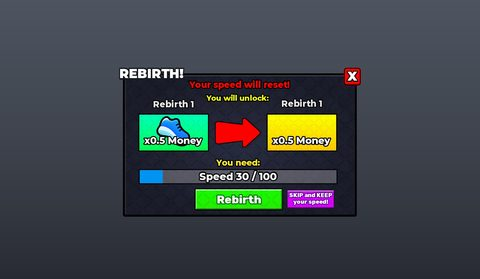</a> <b>Rebirth</b></td>
<td width="33%" valign="top"><a href="screenshots/85_Progress.jpg">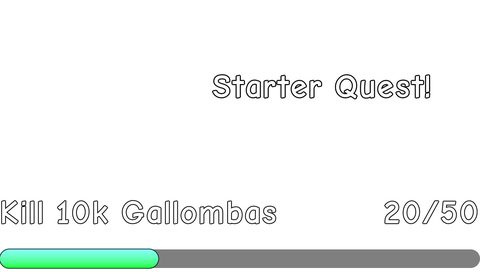</a> <b>Progress</b></td>
</tr>
<tr>
<td width="33%" valign="top"><a href="screenshots/98_TutorialTask.jpg">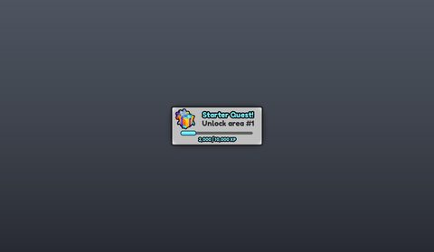</a> <b>TutorialTask</b></td>
<td width="33%" valign="top"><a href="screenshots/106_LevelDisplayUI.jpg">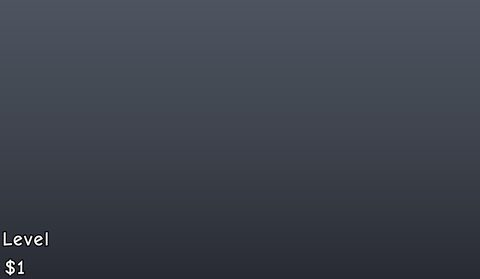</a> <b>LevelDisplayUI</b></td>
</tr>
</table>

### Trading

<table>
<tr>
<td width="33%" valign="top"><a href="screenshots/51_TradeMessage.jpg">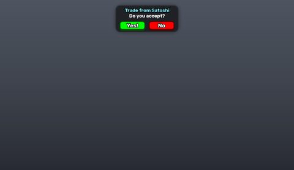</a> <b>TradeMessage</b></td>
<td width="33%" valign="top"><a href="screenshots/52_TradePlayerList.jpg">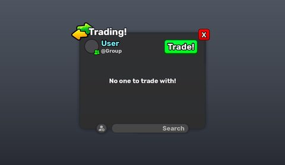</a> <b>TradePlayerList</b></td>
<td width="33%" valign="top"><a href="screenshots/53_TradeWindow.jpg">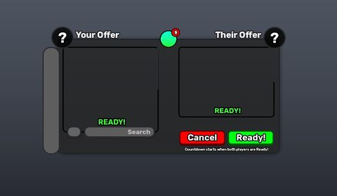</a> <b>TradeWindow</b></td>
</tr>
<tr>
<td width="33%" valign="top"><a href="screenshots/54_TradeWindow__ChatOverlay.jpg">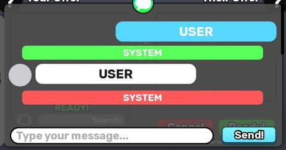</a> <b>TradeWindow</b> › Frame.ChatOverlay</td>
<td width="33%" valign="top"><a href="screenshots/100_Trade.jpg">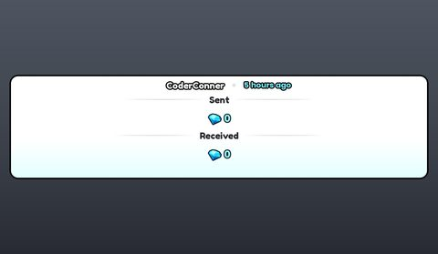</a> <b>Trade</b></td>
</tr>
</table>

### Settings & menus

<table>
<tr>
<td width="33%" valign="top"><a href="screenshots/40_Settings.jpg">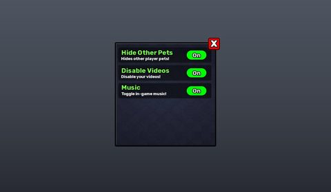</a> <b>Settings</b></td>
</tr>
</table>

### Popups, notifications, prompts

<table>
<tr>
<td width="33%" valign="top"><a href="screenshots/26_Message.jpg">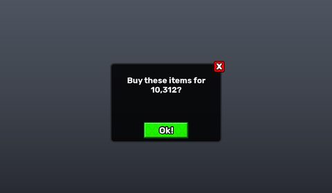</a> <b>Message</b></td>
<td width="33%" valign="top"><a href="screenshots/49_StealDnaMessage.jpg">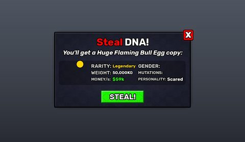</a> <b>StealDnaMessage</b></td>
<td width="33%" valign="top"><a href="screenshots/61_TreadmillSpeedShop__Multiplier.jpg">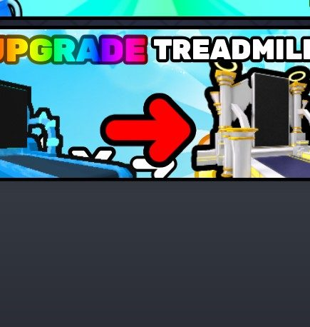</a> <b>TreadmillSpeedShop</b> › Frame.Main.ScrollingFrame.UpgradeTreadmill.Pack.Multiplier</td>
</tr>
<tr>
<td width="33%" valign="top"><a href="screenshots/82_ItemAlert__Notification.jpg">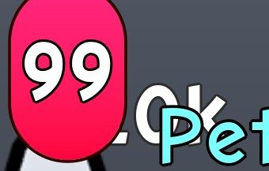</a> <b>ItemAlert</b> › Holder.ItemSlot.Notification</td>
</tr>
</table>

### Leaderboards & stats

<table>
<tr>
<td width="33%" valign="top"><a href="screenshots/29_Notifications__Top.jpg">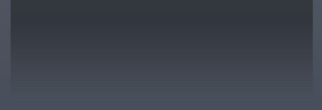</a> <b>Notifications</b> › Top</td>
<td width="33%" valign="top"><a href="screenshots/50_StealDnaMessage__Top.jpg">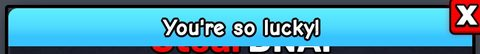</a> <b>StealDnaMessage</b> › Frame.Top</td>
</tr>
</table>

### End of round, death, results

<table>
<tr>
<td width="33%" valign="top"> <b>GrowingEggList</b></td>
</tr>
</table>

### Crafting, fusing, machines

<table>
<tr>
<td width="33%" valign="top"> <b>FuseMachine</b></td>
<td width="33%" valign="top"> <b>_MACHINES</b></td>
</tr>
</table>

### Admin panels

<table>
<tr>
<td width="33%" valign="top"> <b>AdminPanel</b></td>
<td width="33%" valign="top"> <b>AdminPanel</b> › Main.Info</td>
</tr>
</table>

### HUD & currency

<table>
<tr>
<td width="33%" valign="top"> <b>Data</b> › BottomRight.Composition</td>
<td width="33%" valign="top"> <b>BottomUI</b></td>
<td width="33%" valign="top"> <b>Elements2</b> › RightFrame</td>
</tr>
<tr>
<td width="33%" valign="top"> <b>Money</b></td>
<td width="33%" valign="top"> <b>Money</b> › Bottom.Frame.BoostsList.Luck.LuckHoverInfo</td>
<td width="33%" valign="top"> <b>Elements</b> › RightFrame</td>
</tr>
<tr>
<td width="33%" valign="top"> <b>Money</b></td>
<td width="33%" valign="top"> <b>Currency___</b></td>
</tr>
</table>

### Character / avatar / emotes

<table>
<tr>
<td width="33%" valign="top"> <b>Rebirth</b> › Content.Holder.HolderImage.RequiredCharacters</td>
</tr>
</table>

### Map vote / teams / matchmaking

<table>
<tr>
<td width="33%" valign="top"> <b>RoundChoices</b> › EscapeAndKeep</td>
<td width="33%" valign="top"> <b>GameResetTimer</b></td>
</tr>
</table>

### Other

<table>
<tr>
<td width="33%" valign="top"> <b>Data</b></td>
<td width="33%" valign="top"> <b>AreaGui</b></td>
<td width="33%" valign="top"> <b>AssetHoverData</b></td>
</tr>
<tr>
<td width="33%" valign="top"> <b>AutoSell</b></td>
<td width="33%" valign="top"> <b>DropHeldEgg</b></td>
<td width="33%" valign="top"> <b>Elements2</b></td>
</tr>
<tr>
<td width="33%" valign="top"> <b>GetMoreSpeedOnHit</b></td>
<td width="33%" valign="top"> <b>Odds_UI</b></td>
<td width="33%" valign="top"> <b>RunBackEffects</b></td>
</tr>
<tr>
<td width="33%" valign="top"> <b>RunButton</b></td>
<td width="33%" valign="top"> <b>RunCharge</b></td>
<td width="33%" valign="top"> <b>TreadmillClickX2</b> › Frame</td>
</tr>
<tr>
<td width="33%" valign="top"> <b>TutorialInstructions</b></td>
<td width="33%" valign="top"> <b>Vignette</b> › Vignette</td>
<td width="33%" valign="top"> <b>Elements</b></td>
</tr>
<tr>
<td width="33%" valign="top"> <b>Elements</b> › Other</td>
<td width="33%" valign="top"> <b>Troll</b></td>
<td width="33%" valign="top"> <b>monetizationGUI</b></td>
</tr>
<tr>
<td width="33%" valign="top"> <b>Award</b></td>
<td width="33%" valign="top"> <b>GlobalEvent</b></td>
<td width="33%" valign="top"> <b>Item2</b></td>
</tr>
<tr>
<td width="33%" valign="top"> <b>BiggestAssetWeight</b></td>
<td width="33%" valign="top"> <b>ExtraAsset</b></td>
<td width="33%" valign="top"> <b>Speed</b></td>
</tr>
<tr>
<td width="33%" valign="top"> <b>Frame</b></td>
<td width="33%" valign="top"> <b>Frame</b> › Holder.Frame.Accept.Hover_Effect</td>
<td width="33%" valign="top"> <b>Player</b></td>
</tr>
<tr>
<td width="33%" valign="top"> <b>Template</b></td>
<td width="33%" valign="top"> <b>Template</b></td>
<td width="33%" valign="top"> <b>GearTemplate</b></td>
</tr>
<tr>
<td width="33%" valign="top"> <b>Template</b></td>
<td width="33%" valign="top"> <b>Template</b></td>
<td width="33%" valign="top"> <b>Elements</b></td>
</tr>
<tr>
<td width="33%" valign="top"> <b>Value</b></td>
</tr>
</table>

## Model previews

<table>
<tr>
<td width="25%" valign="top"> <b>DemonicTreadmill</b> <code>models/ReplicatedStorage/Assets/Models/Treadmills/DemonicTreadmill.rbxm</code></td>
<td width="25%" valign="top"> <b>Volcano Bat</b> <code>models/ReplicatedStorage/GearTools/ShopItems/Volcano Bat.rbxm</code></td>
<td width="25%" valign="top"> <b>Alien Skeleton Boss</b> <code>models/ReplicatedStorage/Assets/Models/Eggs/Alien Skeleton Boss.rbxm</code></td>
<td width="25%" valign="top"> <b>Random Brainrot Block</b> <code>models/ReplicatedStorage/Assets/Models/LuckyBlocks/Random Brainrot Block.rbxm</code></td>
</tr>
<tr>
<td width="25%" valign="top"> <b>Kitsune</b> <code>models/ReplicatedStorage/Assets/Models/Eggs/Kitsune.rbxm</code></td>
<td width="25%" valign="top"> <b>Demon Slap</b> <code>models/ReplicatedStorage/GearTools/ShopItems/Demon Slap.rbxm</code></td>
<td width="25%" valign="top"> <b>FuseMachine</b> <code>models/Workspace/FuseMachine.rbxm</code></td>
<td width="25%" valign="top"> <b>Leaderboard1</b> <code>models/Workspace/__OBJECTS/Leaderboards/Models/Leaderboard1.rbxm</code></td>
</tr>
<tr>
<td width="25%" valign="top"> <b>SmokeBomb</b> <code>models/ReplicatedStorage/Assets/Models/Abilities/SmokeBomb.rbxm</code></td>
<td width="25%" valign="top"> <b>4</b> <code>models/Workspace/Plots/4.rbxm</code></td>
<td width="25%" valign="top"> <b>SwampTree</b> <code>models/Workspace/__OBJECTS/Build/SwampTree.rbxm</code></td>
<td width="25%" valign="top"> <b>AngelicTreadmill</b> <code>models/ReplicatedStorage/Assets/Models/Treadmills/AngelicTreadmill.rbxm</code></td>
</tr>
<tr>
<td width="25%" valign="top"> <b>Jungle Bat</b> <code>models/ReplicatedStorage/GearTools/ShopItems/Jungle Bat.rbxm</code></td>
<td width="25%" valign="top"> <b>Desert</b> <code>models/Workspace/__OBJECTS/Areas/GuardAreas/Desert.rbxm</code></td>
</tr>
</table>

## Notable scripts

Top-scored scripts of this game per topic (full tree in [source/scripts](source/scripts/)).

| Topic | Scripts |
|---|---|
| UI animation (tweens, hover / click, pop-ins, springs) | [`Main`](source/scripts/StarterPlayer/StarterPlayerScripts/GUI/BackpackController/Main.lua) 6730 lines [`SpeedGainAnimation`](source/scripts/ReplicatedStorage/Library/Client/GUIFX/SpeedGainAnimation.lua) 439 lines [`Index`](source/scripts/StarterPlayer/StarterPlayerScripts/GUI/Index.client.lua) 733 lines [`GuardTutorialPresentationComponent`](source/scripts/ReplicatedStorage/Library/Client/GuardTutorialPresentationComponent.lua) 639 lines [`AssetHoverDataDisplay`](source/scripts/StarterPlayer/StarterPlayerScripts/GUI/AssetHoverDataDisplay.lua) 487 lines |
| UI controllers / window managers / menus | [`TabController`](source/scripts/ReplicatedStorage/Library/Client/TabController.lua) 441 lines [`Index`](source/scripts/StarterPlayer/StarterPlayerScripts/GUI/Index.client.lua) 733 lines [`Main`](source/scripts/StarterPlayer/StarterPlayerScripts/GUI/BackpackController/Main.lua) 6730 lines [`TreadmillSpeedShop`](source/scripts/StarterPlayer/StarterPlayerScripts/GUI/Shop/TreadmillSpeedShop.client.lua) 134 lines [`MainShop`](source/scripts/StarterPlayer/StarterPlayerScripts/GUI/Shop/MainShop.client.lua) 180 lines |
| Notifications, toasts, popups, prompts | [`SpeedShopPrompt`](source/scripts/StarterPlayer/StarterPlayerScripts/GUI/Shop/SpeedShopPrompt.client.lua) 89 lines [`NotificationInstance`](source/scripts/ReplicatedStorage/Library/Client/NotificationCmds/NotificationInstance.lua) 494 lines [`Notifications`](source/scripts/StarterPlayer/StarterPlayerScripts/GUI/Trading/Notifications.lua) 191 lines [`Main`](source/scripts/StarterPlayer/StarterPlayerScripts/GUI/BackpackController/Main.lua) 6730 lines [`AssetDnaStealPrompt`](source/scripts/ReplicatedStorage/Library/Client/AssetDnaStealPrompt.lua) 353 lines |
| Loading / intro screens | [`CircularSelection`](source/scripts/ReplicatedStorage/Library/Client/GUIFX/CircularSelection.lua) 621 lines [`AddCurrencyScreen`](source/scripts/ReplicatedStorage/Library/Client/GUIFX/AddCurrencyScreen.lua) 255 lines [`CustomFont`](source/scripts/ReplicatedStorage/Library/Client/UI/CustomFont.lua) 831 lines [`DamageFeedback`](source/scripts/ReplicatedStorage/Library/Client/DamageFeedback.lua) 39 lines [`AnimatedText`](source/scripts/ReplicatedStorage/Library/Client/UI/AnimatedText.lua) 1074 lines |
| Camera, cutscenes, screen shake | [`Cutscene`](source/scripts/ReplicatedStorage/Library/Modules/Cutscene.lua) 827 lines [`ShakePresets`](source/scripts/ReplicatedStorage/Library/Modules/ShakePresets.lua) 118 lines [`ScaryEffectController`](source/scripts/ReplicatedStorage/Library/Client/ScaryEffectController.lua) 589 lines [`TreadmillCharacterPresentationController`](source/scripts/StarterPlayer/StarterPlayerScripts/Game/Plots/TreadmillCharacterPresentationController.lua) 545 lines [`CameraShake`](source/scripts/StarterPlayer/StarterPlayerScripts/Game/CameraShake.client.lua) 14 lines |
| VFX, particles, beams, hit effects | [`AmazingImpactVFX`](source/scripts/ReplicatedStorage/Library/Client/GUIFX/AmazingImpactVFX.lua) 123 lines [`Orb`](source/scripts/ReplicatedStorage/Library/Client/OrbCmds/Orb.lua) 649 lines [`VFX`](source/scripts/ReplicatedStorage/Library/Modules/VFX.lua) 142 lines [`Default`](source/scripts/ReplicatedStorage/Library/Modules/EffectController/Libraries/Default.lua) 289 lines [`PeoUtils`](source/scripts/ReplicatedStorage/Library/Modules/PeoUtils.lua) 357 lines |
| DataStore / player data | [`Core_PlayerData`](source/scripts/ServerScriptService/Core_PlayerData.lua) 235 lines |
| Monetization (dev products, game passes, receipts) | [`Core_Purchases`](source/scripts/ServerScriptService/Core_Purchases.lua) 526 lines [`CashGrabPurchaseHandler`](source/scripts/ServerScriptService/CashGrabPurchaseHandler.server.lua) 90 lines [`PromptPurchase`](source/scripts/ReplicatedStorage/Library/Shared/Functions/PromptPurchase.lua) 430 lines [`PurchasePendingGUI`](source/scripts/StarterPlayer/StarterPlayerScripts/GUI/PurchasePendingGUI.client.lua) 95 lines |
| RNG, eggs, gacha, rarity rolls, pets | [`AssetRollUtil`](source/scripts/ReplicatedStorage/Library/Util/AssetRollUtil.lua) 320 lines [`Core_Purchases`](source/scripts/ServerScriptService/Core_Purchases.lua) 526 lines [`ItemDisplay`](source/scripts/ReplicatedStorage/Library/Modules/ItemDisplay.lua) 859 lines [`EggItemUtil`](source/scripts/ReplicatedStorage/Library/Util/EggItemUtil.lua) 460 lines [`Core_Eggs`](source/scripts/ServerScriptService/Core_Eggs.lua) 1454 lines |
| Trading systems | [`TradingCmds`](source/scripts/ReplicatedStorage/Library/Client/TradingCmds.lua) 395 lines [`TradeState`](source/scripts/ReplicatedStorage/Library/Client/TradingCmds/TradeState.lua) 135 lines [`Trading`](source/scripts/StarterPlayer/StarterPlayerScripts/GUI/Trading.client.lua) 1235 lines |
| Combat, weapons, hitboxes, abilities | [`MurderMysteryProjectileCast`](source/scripts/ReplicatedStorage/Library/Modules/MurderMysteryProjectileCast.lua) 189 lines [`Hitbox`](source/scripts/ReplicatedStorage/Library/Modules/Hitbox.lua) 738 lines [`HitboxClassLocal`](source/scripts/ReplicatedStorage/Library/Modules/Hitbox/HitboxClassLocal.client.lua) 70 lines [`GunToolHandler`](source/scripts/StarterPlayer/StarterPlayerScripts/Game/Tools/GunToolHandler.client.lua) 144 lines [`_scriptThatsUnderTrap`](source/scripts/ReplicatedStorage/GearTools/ShopItems/Trap/_scriptThatsUnderTrap.lua) 388 lines |
| NPC / AI / monsters | [`SimplePath`](source/scripts/ReplicatedStorage/Library/Modules/SimplePath.lua) 536 lines [`NPCMovement`](source/scripts/ReplicatedStorage/Library/Modules/NPCMovement.lua) 605 lines |
| Character movement (sprint, dash, double jump, slide) | [`AdminPanel`](source/scripts/StarterPlayer/StarterPlayerScripts/GUI/AdminPanel.client.lua) 1272 lines [`adhd`](source/scripts/ReplicatedStorage/Library/Modules/Animate/Sandbox/adhd.lua) 897 lines [`original`](source/scripts/ReplicatedStorage/Library/Modules/Animate/Sandbox/original.lua) 864 lines [`Core_Treadmills`](source/scripts/ServerScriptService/Core_Treadmills.lua) 294 lines [`Physics`](source/scripts/ReplicatedStorage/Library/Modules/Physics.lua) 135 lines |
| Tycoon / plots / bases / building | [`Index`](source/scripts/StarterPlayer/StarterPlayerScripts/GUI/Index.client.lua) 733 lines [`Main`](source/scripts/StarterPlayer/StarterPlayerScripts/GUI/BackpackController/Main.lua) 6730 lines [`Core_Plots`](source/scripts/ServerScriptService/Core_Plots.lua) 267 lines [`PlotUpgradeController`](source/scripts/StarterPlayer/StarterPlayerScripts/GUI/PlotUpgradeController.client.lua) 255 lines [`TreadmillUpgrade`](source/scripts/StarterPlayer/StarterPlayerScripts/GUI/TreadmillUpgrade.client.lua) 144 lines |
| Leaderboards & stats | [`LeaderboardManager`](source/scripts/ServerScriptService/LeaderboardManager.server.lua) 109 lines |
| Admin panels & commands | [`AdminPanelHandler`](source/scripts/ServerScriptService/AdminPanelHandler.server.lua) 218 lines [`AdminPanel`](source/scripts/StarterPlayer/StarterPlayerScripts/GUI/AdminPanel.client.lua) 1272 lines [`OrbCmds`](source/scripts/ReplicatedStorage/Library/Client/OrbCmds.lua) 283 lines |
| Sound & music | [`Audio`](source/scripts/ReplicatedStorage/Library/Audio.lua) 598 lines [`AssetSoundUtil`](source/scripts/ReplicatedStorage/Library/Util/AssetSoundUtil.lua) 358 lines [`CreateMusicSound`](source/scripts/ReplicatedStorage/Library/Audio/CreateMusicSound.lua) 32 lines [`Sounds`](source/scripts/StarterPlayer/StarterPlayerScripts/Game/ObbyStages/BreakableBlocks/Sounds.lua) 60 lines [`MusicController`](source/scripts/ReplicatedStorage/Library/Client/MusicController.lua) 897 lines |
| Daily rewards, quests, codes, playtime | [`GroupRewards`](source/scripts/StarterPlayer/StarterPlayerScripts/GUI/GroupRewards.client.lua) 175 lines [`Core_Compatibility`](source/scripts/ServerScriptService/Core_Compatibility.lua) 447 lines [`ClaimRewardPanel`](source/scripts/StarterPlayer/StarterPlayerScripts/GUI/Index/ClaimRewardPanel.lua) 37 lines [`Codes`](source/scripts/ReplicatedStorage/Library/Types/Codes.lua) 108 lines |
| Utility modules (number format, signals, tables, timers) | [`Core_Purchases`](source/scripts/ServerScriptService/Core_Purchases.lua) 526 lines [`Main`](source/scripts/StarterPlayer/StarterPlayerScripts/GUI/BackpackController/Main.lua) 6730 lines [`ItemDisplay`](source/scripts/ReplicatedStorage/Library/Modules/ItemDisplay.lua) 859 lines [`AssetRollUtil`](source/scripts/ReplicatedStorage/Library/Util/AssetRollUtil.lua) 320 lines [`EggItemUtil`](source/scripts/ReplicatedStorage/Library/Util/EggItemUtil.lua) 460 lines |

### In the curated script library

- [Dirty-only autosave + mirrors](../../Scripts/07-Data-Saving/PlayerData-DirtyAutosave__steal-an-egg.lua) — Small data core: deep reconcile, value sanitising on load, Update(changes, removals) that marks dirty and mirrors to attributes/leaderstats, autosave only for dirty players.
- [Idempotent receipts + server test](../../Scripts/08-Monetization/Core_Purchases__steal-an-egg.lua) — Product name routing by pattern (Money_500, Trail_X...), PurchaseId saved in the profile (ProcessedReceipts) plus an in-flight lock, a server pre-check before prompting, prompt cooldown, server-wide luck boost, gamepass sync on load.
- [Plot slots with revisioned owner snapshots](../../Scripts/14-Tycoon-Plots/Core_Plots__steal-an-egg.lua) — Plot slots with a revision number: assigns numbered plots, sets the sign (name + headshot), replicates owner-by-slot snapshots to clients, teleports to the plot on spawn, exposes plot capacity,...
- [Egg carry, claim and validated placement](../../Scripts/14-Tycoon-Plots/EggCarryAndPlacement__steal-an-egg.lua) — Carry-and-deliver plus validated placement: pick up an egg (distance <= 28 studs, one at a time, ownership check), drop/reset it, guards knock it out of your hands, crossing a separation line...
- [Remote binder with xpcall](../../Scripts/19-Utility/Core_Network-SafeBind__steal-an-egg.lua) — Creates remotes on demand in one folder (asserting the class), wraps every handler in xpcall with a traceback, and returns a friendly error from failed RemoteFunctions instead of throwing to the client.

## ⚠️ Safety

HIGH flags (backdoors, `require(id)`, `loadstring`, webhooks). Review or delete before reusing:

- `scripts/ReplicatedStorage/Directory/Products/_Index/Currency/Money_200000.lua`
- `scripts/ReplicatedStorage/Directory/Products/_Index/Currency/Money_24000.lua`
- `scripts/ReplicatedStorage/Directory/Products/_Index/Currency/Money_4000000.lua`
- `scripts/ReplicatedStorage/Directory/Products/_Index/Currency/Money_800000.lua`
- `scripts/ReplicatedStorage/Directory/Products/_Index/Currency/Money_8000000.lua`
- `scripts/ReplicatedStorage/Directory/Products/_Index/LimitedEggs/Limited Egg x10.lua`
- `scripts/ReplicatedStorage/Directory/Products/_Index/LimitedEggs/Limited Egg x3.lua`
- `scripts/ReplicatedStorage/Directory/Products/_Index/LimitedEggs/Limited Egg x50.lua`

## Folders

| Folder | What |
|---|---|
| `screenshots/` | full frames; `crops/` = the panel only; `models/` = 3D previews; `thumbs/` = gallery thumbnails |
| `ui/` | every screen as a Lua builder (`require(module)()` returns the ScreenGui); `_StarterGui-all.lua` builds every StarterGui screen |
| `models/` | every model as .rbxm (the only .rbxm files), mirroring the place tree, scripts removed |
| `map/` | `workspace.rbxm` (the map as a model), `lighting.lua` (sky + post effects), `materials.lua`, `Environment.lua` |
| `animations/`, `audio/` | KeyframeSequence / Sound builders (.lua), `AnimationIds.lua`, `Sounds.lua` |
| `source/` | all scripts as .luau, `tree.txt`, `ui.txt`, `remotes.txt`, `assets.txt`, `flags.txt` |
