# Street Life

> 🏙️ **Roleplay** · open-world roleplay / hood · source file `Street Life Fully Scripted.rbxl`

[⬅ Back to the catalog](../../README.md) · [Assets inventory](ASSETS.md) · [Style numbers](reference.md) · [Scripts](source/scripts/) · [Code analysis](source/README.md)

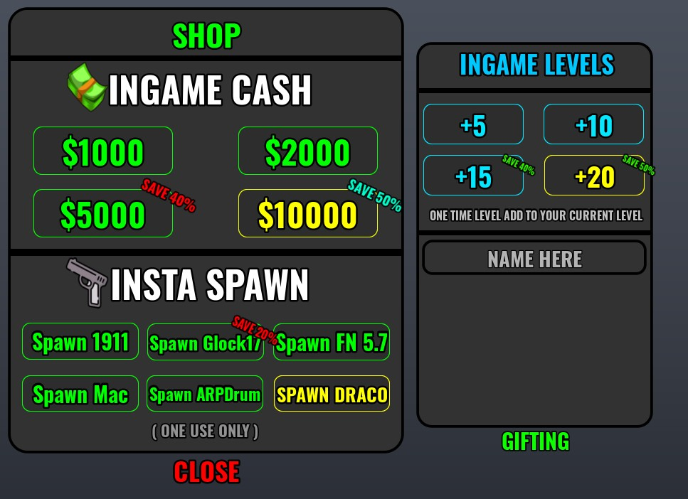

## At a glance

| | |
|---|---|
| Provenance | template with full source |
| Screens | 46 ScreenGuis, 759 GUI objects → **62 screenshots** |
| Models (.rbxm) | 868 models, 38 model sets, 1 VFX sets |
| Lua builders (.lua) | 59 UI screens, 10 animation packs, 14 audio packs |
| Code | 3979 scripts, 774,378 lines |
| Asset ids | 197 animations, 7505 sounds |
| Safety scan | 0 HIGH / 16 MED flags ([flags.txt](source/flags.txt)) |

**Fonts:** `Oswald Bold`×335, `SourceSansPro Regular`×54, `font asset 12187370747 Bold`×35, `DenkOne Bold`×32, `Inconsolata Bold`×12

## UI screenshots

Captured in Studio from the place's own ScreenGuis (scripts stripped). Each panel was opened on its own; click a thumbnail for the full 1519×886 frame. Runtime-filled lists (shop items, inventories) show their template state.

### Shop & Robux store

<table>
<tr>
<td width="33%" valign="top"><a href="screenshots/15_GunStore.jpg">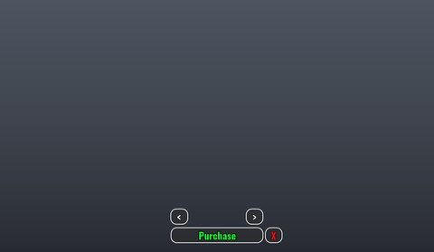</a> <b>GunStore</b></td>
<td width="33%" valign="top"><a href="screenshots/16_GunStore__Frame.jpg">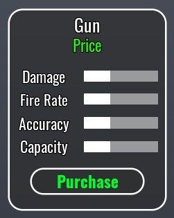</a> <b>GunStore</b> › Frame</td>
<td width="33%" valign="top"><a href="screenshots/17_IDealerGui.jpg">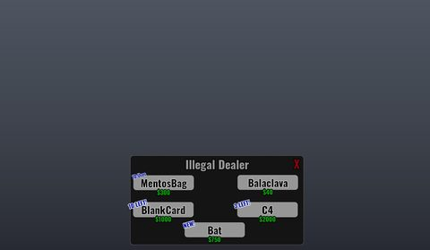</a> <b>IDealerGui</b></td>
</tr>
<tr>
<td width="33%" valign="top"><a href="screenshots/22_CarDealerGui.jpg">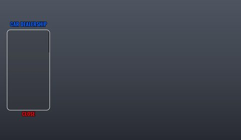</a> <b>CarDealerGui</b></td>
<td width="33%" valign="top"><a href="screenshots/23_CarDealerGui__Interact.jpg">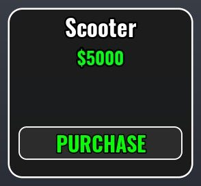</a> <b>CarDealerGui</b> › Interact</td>
<td width="33%" valign="top"><a href="screenshots/37_RStore.jpg">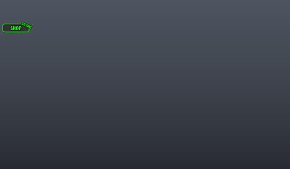</a> <b>RStore</b></td>
</tr>
<tr>
<td width="33%" valign="top"><a href="screenshots/38_RStore__Frame.jpg">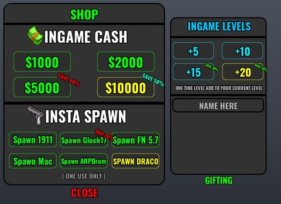</a> <b>RStore</b> › Frame</td>
<td width="33%" valign="top"><a href="screenshots/40_Store.jpg">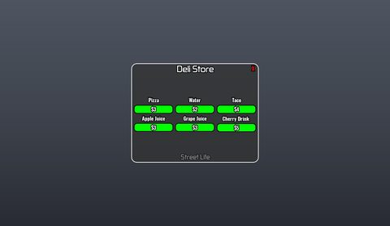</a> <b>Store</b></td>
<td width="33%" valign="top"><a href="screenshots/47_HStore.jpg">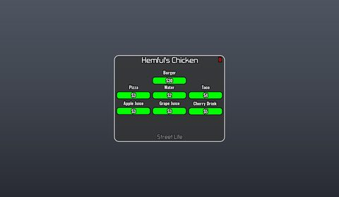</a> <b>HStore</b></td>
</tr>
<tr>
<td width="33%" valign="top"><a href="screenshots/48_GStore.jpg">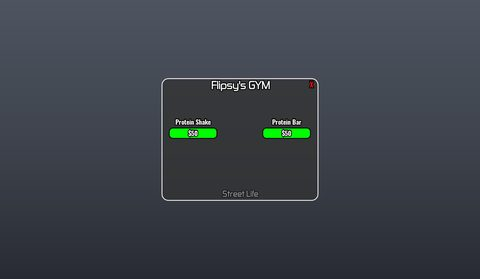</a> <b>GStore</b></td>
<td width="33%" valign="top"><a href="screenshots/49_ClothingStore.jpg">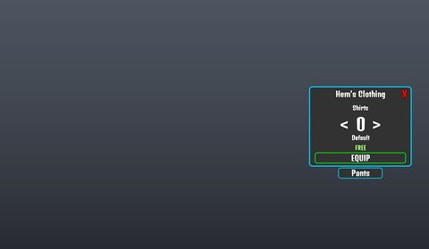</a> <b>ClothingStore</b></td>
<td width="33%" valign="top"><a href="screenshots/50_TattooStore.jpg">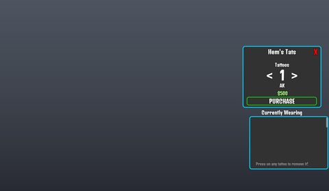</a> <b>TattooStore</b></td>
</tr>
<tr>
<td width="33%" valign="top"><a href="screenshots/51_AccessoriesStore.jpg">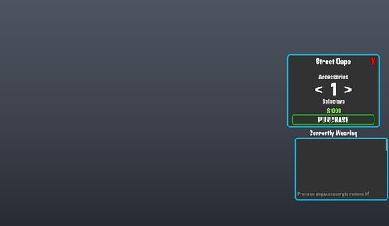</a> <b>AccessoriesStore</b></td>
<td width="33%" valign="top"><a href="screenshots/52_PUStore.jpg">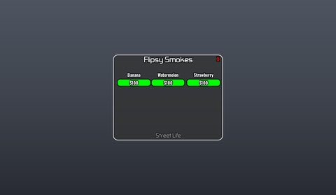</a> <b>PUStore</b></td>
</tr>
</table>

### Quests & progression

<table>
<tr>
<td width="33%" valign="top"><a href="screenshots/25_Settings__Question.jpg">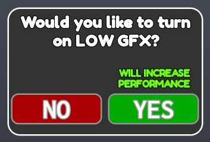</a> <b>Settings</b> › Question</td>
<td width="33%" valign="top"><a href="screenshots/57_SugarQuestion.jpg">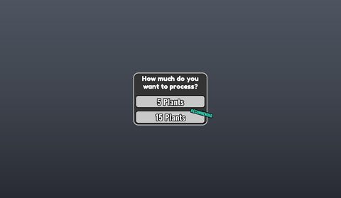</a> <b>SugarQuestion</b></td>
</tr>
</table>

### Settings & menus

<table>
<tr>
<td width="33%" valign="top"><a href="screenshots/12_LoadingScreen__CreditsFrame.jpg">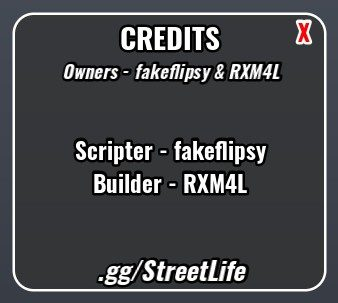</a> <b>LoadingScreen</b> › CreditsFrame</td>
<td width="33%" valign="top"><a href="screenshots/24_Settings.jpg">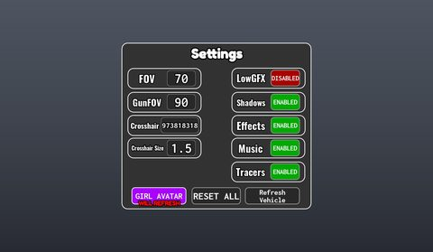</a> <b>Settings</b></td>
<td width="33%" valign="top"><a href="screenshots/33_PlayTime.jpg">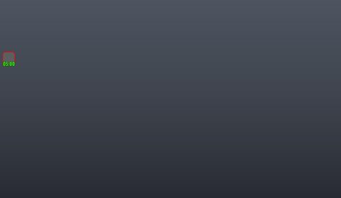</a> <b>PlayTime</b></td>
</tr>
<tr>
<td width="33%" valign="top"><a href="screenshots/35_PlayTime__All.jpg">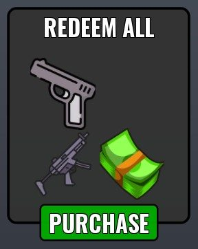</a> <b>PlayTime</b> › All</td>
</tr>
</table>

### Popups, notifications, prompts

<table>
<tr>
<td width="33%" valign="top"><a href="screenshots/41_Notification.jpg">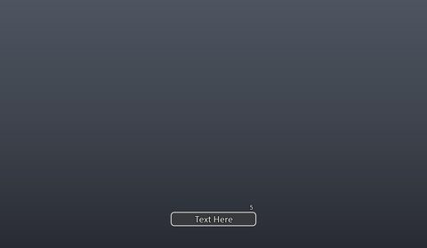</a> <b>Notification</b></td>
<td width="33%" valign="top"><a href="screenshots/43_Notification.jpg">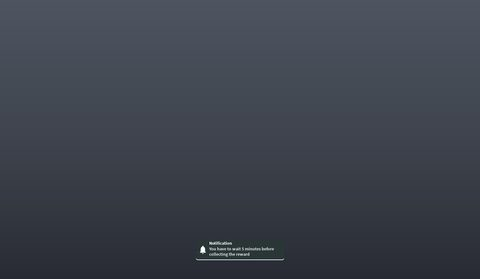</a> <b>Notification</b></td>
</tr>
</table>

### Loading & intro

<table>
<tr>
<td width="33%" valign="top"> <b>LoadingScreen</b></td>
<td width="33%" valign="top"><a href="screenshots/11_LoadingScreen__HelpFrame.jpg">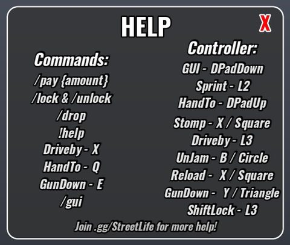</a> <b>LoadingScreen</b> › HelpFrame</td>
<td width="33%" valign="top"><a href="screenshots/13_LoadingScreen__FreeFrame.jpg">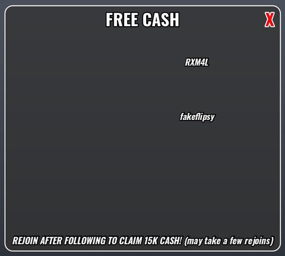</a> <b>LoadingScreen</b> › FreeFrame</td>
</tr>
</table>

### Leaderboards & stats

<table>
<tr>
<td width="33%" valign="top"><a href="screenshots/14_Stats.jpg">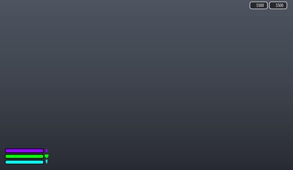</a> <b>Stats</b></td>
<td width="33%" valign="top"><a href="screenshots/28_GymStats.jpg">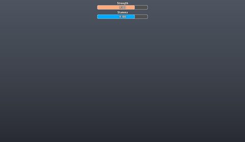</a> <b>GymStats</b></td>
</tr>
</table>

### End of round, death, results

<table>
<tr>
<td width="33%" valign="top"><a href="screenshots/30_Dead.jpg">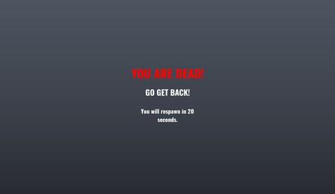</a> <b>Dead</b></td>
</tr>
</table>

### HUD & currency

<table>
<tr>
<td width="33%" valign="top"><a href="screenshots/32_PhoneUI__Main.jpg">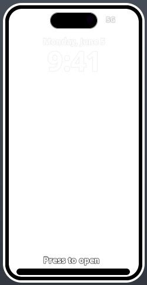</a> <b>PhoneUI</b> › Main</td>
<td width="33%" valign="top"><a href="screenshots/34_PlayTime__Main.jpg">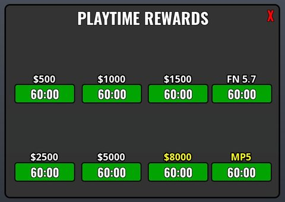</a> <b>PlayTime</b> › Main</td>
<td width="33%" valign="top"><a href="screenshots/56_Radio__Main.jpg">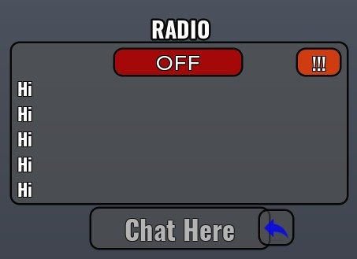</a> <b>Radio</b> › Main</td>
</tr>
</table>

### Character / avatar / emotes

<table>
<tr>
<td width="33%" valign="top"><a href="screenshots/04_Locker__Outfits.jpg">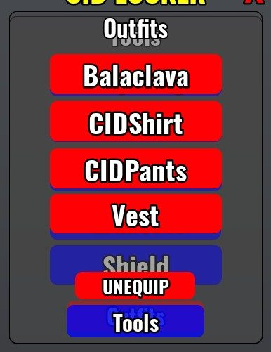</a> <b>Locker</b> › Frame.Outfits</td>
<td width="33%" valign="top"><a href="screenshots/06_Locker__Outfits.jpg">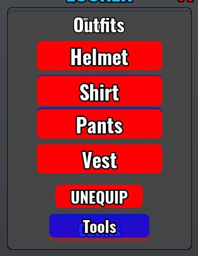</a> <b>Locker</b> › Frame.Outfits</td>
<td width="33%" valign="top"><a href="screenshots/08_Locker__Outfits.jpg">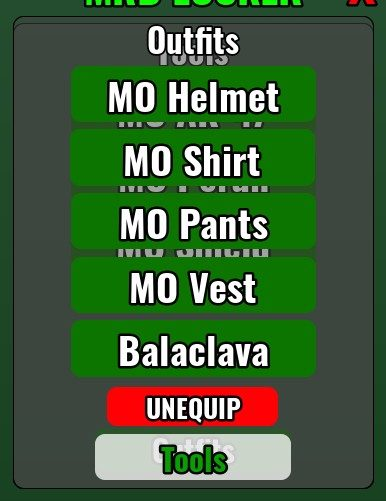</a> <b>Locker</b> › Frame.Outfits</td>
</tr>
<tr>
<td width="33%" valign="top"><a href="screenshots/27_Emotes.jpg">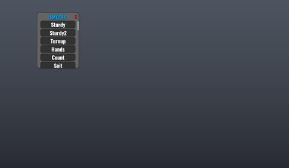</a> <b>Emotes</b></td>
</tr>
</table>

### Other

<table>
<tr>
<td width="33%" valign="top"><a href="screenshots/01_Locker.jpg">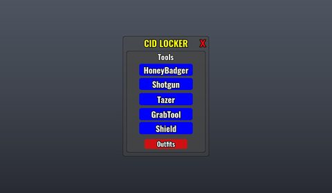</a> <b>Locker</b></td>
<td width="33%" valign="top"><a href="screenshots/05_Locker.jpg">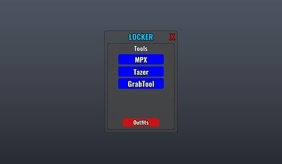</a> <b>Locker</b></td>
<td width="33%" valign="top"><a href="screenshots/07_Locker.jpg">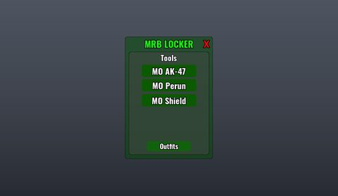</a> <b>Locker</b></td>
</tr>
<tr>
<td width="33%" valign="top"><a href="screenshots/09_Circle.jpg">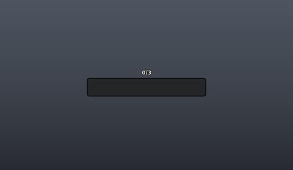</a> <b>Circle</b></td>
<td width="33%" valign="top"><a href="screenshots/18_GarageUI.jpg">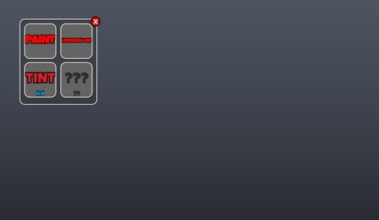</a> <b>GarageUI</b></td>
<td width="33%" valign="top"><a href="screenshots/19_GarageUI__PaintFrame.jpg">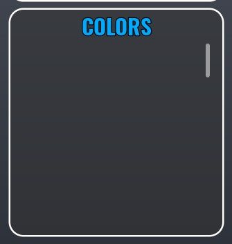</a> <b>GarageUI</b> › Frame.PaintFrame</td>
</tr>
<tr>
<td width="33%" valign="top"><a href="screenshots/20_GarageUI__UnderglowFrame.jpg">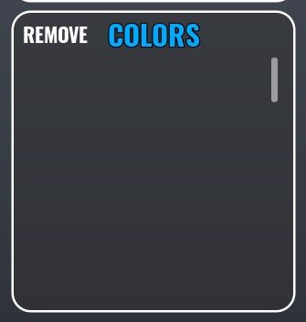</a> <b>GarageUI</b> › Frame.UnderglowFrame</td>
<td width="33%" valign="top"><a href="screenshots/21_GarageUI__TintFrame.jpg">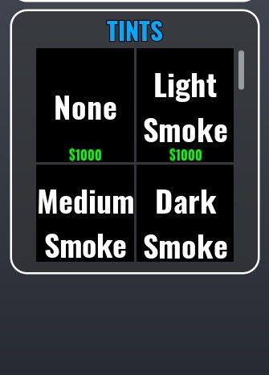</a> <b>GarageUI</b> › Frame.TintFrame</td>
<td width="33%" valign="top"><a href="screenshots/26_Harvested.jpg">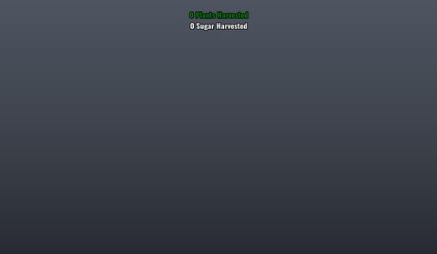</a> <b>Harvested</b></td>
</tr>
<tr>
<td width="33%" valign="top"><a href="screenshots/29_Gang__Frame.jpg">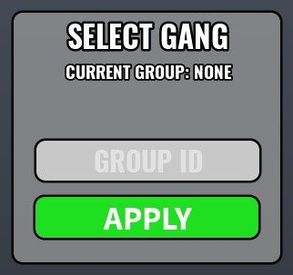</a> <b>Gang</b> › Frame</td>
<td width="33%" valign="top"><a href="screenshots/31_ControllerGui.jpg">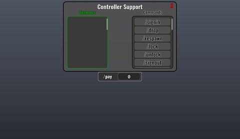</a> <b>ControllerGui</b></td>
<td width="33%" valign="top"><a href="screenshots/36_BankRobbery__Frame.jpg">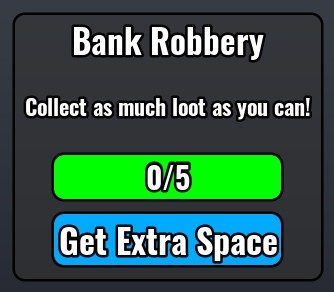</a> <b>BankRobbery</b> › Frame</td>
</tr>
<tr>
<td width="33%" valign="top"><a href="screenshots/39_FrostyUI.jpg">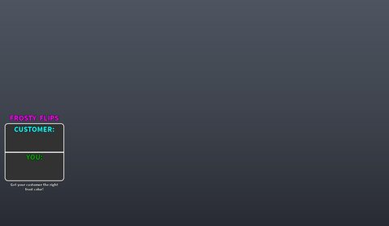</a> <b>FrostyUI</b></td>
<td width="33%" valign="top"><a href="screenshots/42_arrestgui.jpg">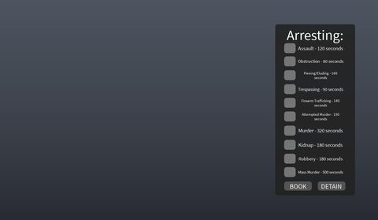</a> <b>arrestgui</b></td>
<td width="33%" valign="top"><a href="screenshots/44_BetterATM.jpg">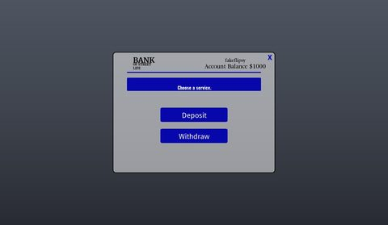</a> <b>BetterATM</b></td>
</tr>
<tr>
<td width="33%" valign="top"> <b>BetterATM</b> › Frame.Interact.FrameWithdraw</td>
<td width="33%" valign="top"> <b>BetterATM</b> › Frame.Interact.FrameDeposit</td>
<td width="33%" valign="top"> <b>Safe</b></td>
</tr>
<tr>
<td width="33%" valign="top"> <b>Zone</b></td>
<td width="33%" valign="top"> <b>SoftShutdown</b></td>
<td width="33%" valign="top"> <b>Spawner</b></td>
</tr>
<tr>
<td width="33%" valign="top"> <b>CarGui</b></td>
<td width="33%" valign="top"> <b>MobilePunchGui</b></td>
<td width="33%" valign="top"> <b>GunGUI</b></td>
</tr>
<tr>
<td width="33%" valign="top"> <b>GunGUI</b> › Scope(OLD)</td>
<td width="33%" valign="top"> <b>GunGUI</b> › Scope</td>
<td width="33%" valign="top"> <b>JailUI</b></td>
</tr>
</table>

## Model previews

<table>
<tr>
<td width="25%" valign="top"> <b>Main Building</b> <code>models/Workspace/Main Building.rbxm</code></td>
<td width="25%" valign="top"> <b>Hellcat</b> <code>models/ServerStorage/Cars/Hellcat.rbxm</code></td>
<td width="25%" valign="top"> <b>600 TommyGun</b> <code>models/ServerStorage/600 TommyGun.rbxm</code></td>
<td width="25%" valign="top"> <b>8B AK-47</b> <code>models/ServerStorage/8B AK-47.rbxm</code></td>
</tr>
<tr>
<td width="25%" valign="top"> <b>SFM Tec-9</b> <code>models/ServerStorage/SFM Tec-9.rbxm</code></td>
<td width="25%" valign="top"> <b>Apt1Inside</b> <code>models/Workspace/Chunks/Apt1Inside.rbxm</code></td>
<td width="25%" valign="top"> <b>Large Filler Apt building</b> <code>models/Workspace/Large Filler Apt building.rbxm</code></td>
<td width="25%" valign="top"> <b>TNK Normal Vest</b> <code>models/ReplicatedStorage/OutfitsOk/TNK Normal Vest.rbxm</code></td>
</tr>
<tr>
<td width="25%" valign="top"> <b>Plant__x105</b> <code>models/Workspace/Plants/Plant__x105.rbxm</code></td>
<td width="25%" valign="top"> <b>Wood Crate</b> <code>models/Workspace/Wood Craftes~2/Wood Crate.rbxm</code></td>
<td width="25%" valign="top"> <b>HK road decoration</b> <code>models/Workspace/Map/HK road decoration.rbxm</code></td>
<td width="25%" valign="top"> <b>Board</b> <code>models/Workspace/Capture Guide~2/Board.rbxm</code></td>
</tr>
<tr>
<td width="25%" valign="top"> <b>Gunstore</b> <code>models/Workspace/Map/Utility buildings/Gunstore.rbxm</code></td>
</tr>
</table>

## Notable scripts

Top-scored scripts of this game per topic (full tree in [source/scripts](source/scripts/)).

| Topic | Scripts |
|---|---|
| UI animation (tweens, hover / click, pop-ins, springs) | [`Intro`](source/scripts/ReplicatedFirst/Intro.client.lua) 340 lines [`GunScript_Local`](source/scripts/ServerStorage/1911/GunScript_Local.client.lua) 1107 lines [`GunScript_Local`](source/scripts/ServerStorage/4M%20AK-47/GunScript_Local.client.lua) 1097 lines [`GunScript_Local`](source/scripts/ServerStorage/4M%20Deagle/GunScript_Local.client.lua) 1107 lines [`GunScript_Local`](source/scripts/ServerStorage/4M%20Draco/GunScript_Local.client.lua) 1096 lines |
| UI controllers / window managers / menus | [`Script`](source/scripts/Workspace/Chunks/1B%20Turf/Model/NormalDoor/Door/Script.server.lua) 58 lines [`Script`](source/scripts/Workspace/Chunks/KTA%20Turf/Model/Door/Script.server.lua) 56 lines [`ShiftGUI`](source/scripts/StarterGui/ShiftLockButton/ImageButton/ShiftGUI.client.lua) 118 lines [`Controls_AC6`](source/scripts/ServerStorage/Cars/DirtBike/Tuner/Plugins/AC6_Controls_Module/Controls_AC6.client.lua) 159 lines [`Drive`](source/scripts/ServerStorage/Cars/PDCar/A-Chassis%20Tune/A-Chassis%20Interface/Drive.client.lua) 708 lines |
| Notifications, toasts, popups, prompts | [`Notification Handler`](source/scripts/StarterPlayer/StarterPlayerScripts/Notification%20Handler.client.lua) 24 lines [`Hooks`](source/scripts/ServerScriptService/Car%20Handler/Hooks.server.lua) 801 lines [`Initialize`](source/scripts/ServerStorage/Cars/CLS/A-Chassis%20Tune/Initialize.server.lua) 712 lines [`Initialize`](source/scripts/ServerStorage/Cars/GLE53/A-Chassis%20Tune/Initialize.server.lua) 713 lines [`Initialize`](source/scripts/ServerStorage/Cars/M2/A-Chassis%20Tune/Initialize.server.lua) 712 lines |
| Loading / intro screens | [`Intro`](source/scripts/ReplicatedFirst/Intro.client.lua) 340 lines [`Handler`](source/scripts/StarterGui/Settings/Handler.client.lua) 357 lines |
| Camera, cutscenes, screen shake | [`GunScript_Local`](source/scripts/ServerStorage/1911/GunScript_Local.client.lua) 1107 lines [`GunScript_Local`](source/scripts/ServerStorage/4M%20Deagle/GunScript_Local.client.lua) 1107 lines [`GunScript_Local`](source/scripts/ServerStorage/4M%20HoneyBadger/GunScript_Local.client.lua) 1097 lines [`GunScript_Local`](source/scripts/ServerStorage/4M%20Shotgun/GunScript_Local.client.lua) 1096 lines [`GunScript_Local`](source/scripts/ServerStorage/600%20FN%205.7/GunScript_Local.client.lua) 1109 lines |
| VFX, particles, beams, hit effects | [`BulletVisualizerServerScript`](source/scripts/StarterPlayer/StarterPlayerScripts/BulletVisualizerServerScript.client.lua) 622 lines [`BulletVisualizerClientScript`](source/scripts/StarterPlayer/StarterPlayerScripts/BulletVisualizerClientScript.client.lua) 554 lines [`VisualizeBulletScript`](source/scripts/ServerScriptService/VisualizeBulletScript.server.lua) 493 lines [`HitSystem`](source/scripts/ReplicatedStorage/Cars/CLS/DriveSeat/HitSystem.server.lua) 94 lines [`HitSystem`](source/scripts/ReplicatedStorage/Cars/Trackhawk/DriveSeat/HitSystem.server.lua) 93 lines |
| DataStore / player data | [`ProfileService`](source/scripts/ServerScriptService/ProfileCache/ProfileService.lua) 2414 lines [`ProfileCache`](source/scripts/ServerScriptService/ProfileCache.lua) 265 lines |
| Monetization (dev products, game passes, receipts) | [`DevProduct`](source/scripts/ServerScriptService/DevProduct.server.lua) 263 lines [`Handler`](source/scripts/StarterGui/RStore/Handler.client.lua) 249 lines [`Handler`](source/scripts/StarterGui/Proximity/CarDealerGui/Handler.client.lua) 230 lines [`Handler`](source/scripts/StarterGui/Proximity/GunStore/Handler.client.lua) 240 lines |
| RNG, eggs, gacha, rarity rolls, pets | [`Wheelie`](source/scripts/ServerStorage/Cars/DirtBike/Tuner/Plugins/Wheelie.client.lua) 136 lines [`Initialize`](source/scripts/ServerStorage/Cars/CLS/A-Chassis%20Tune/Initialize.server.lua) 712 lines [`Initialize`](source/scripts/ServerStorage/Cars/DirtBike/Tuner/Initialize.server.lua) 640 lines [`Initialize`](source/scripts/ServerStorage/Cars/GLE53/A-Chassis%20Tune/Initialize.server.lua) 713 lines [`Initialize`](source/scripts/ServerStorage/Cars/Hellcat/A-Chassis%20Tune/Initialize.server.lua) 718 lines |
| Combat, weapons, hitboxes, abilities | [`Zone`](source/scripts/ReplicatedStorage/Zone.lua) 874 lines |
| Character movement (sprint, dash, double jump, slide) | [`Run`](source/scripts/StarterGui/Run.client.lua) 226 lines [`GunScript_Local`](source/scripts/ServerStorage/1911/GunScript_Local.client.lua) 1107 lines [`GunScript_Local`](source/scripts/ServerStorage/4M%20AK-47/GunScript_Local.client.lua) 1097 lines [`GunScript_Local`](source/scripts/ServerStorage/4M%20Deagle/GunScript_Local.client.lua) 1107 lines [`GunScript_Local`](source/scripts/ServerStorage/4M%20Draco/GunScript_Local.client.lua) 1096 lines |
| Tycoon / plots / bases / building | [`Drive`](source/scripts/ServerStorage/Cars/DirtBike/Tuner/Interface/Drive.client.lua) 1042 lines |
| Leaderboards & stats | [`Leaderstats`](source/scripts/ServerScriptService/Leaderstats.server.lua) 242 lines |
| Sound & music | [`BulletVisualizerServerScript`](source/scripts/StarterPlayer/StarterPlayerScripts/BulletVisualizerServerScript.client.lua) 622 lines [`Audios`](source/scripts/StarterPlayer/StarterPlayerScripts/Audios.client.lua) 83 lines [`GunScript_Local`](source/scripts/ServerStorage/1911/GunScript_Local.client.lua) 1107 lines [`GunScript_Local`](source/scripts/ServerStorage/4M%20AK-47/GunScript_Local.client.lua) 1097 lines [`GunScript_Local`](source/scripts/ServerStorage/4M%20Deagle/GunScript_Local.client.lua) 1107 lines |
| Utility modules (number format, signals, tables, timers) | [`Signal`](source/scripts/StarterPlayer/StarterPlayerScripts/BulletVisualizerClientScript/FastCastRedux/Signal.lua) 153 lines [`ActiveCast`](source/scripts/StarterPlayer/StarterPlayerScripts/BulletVisualizerClientScript/FastCastRedux/ActiveCast.lua) 834 lines [`Zone`](source/scripts/ReplicatedStorage/Zone.lua) 874 lines [`ProfileService`](source/scripts/ServerScriptService/ProfileCache/ProfileService.lua) 2414 lines |

### In the curated script library

- [FastCast Redux (main module)](../../Scripts/11-Combat/FastCastRedux__street-life.lua) — FastCast Redux API (projectile raycasting library) as shipped inside a game.
- [Avatar intro camera sequence](../../Scripts/04-Loading-Screens/AvatarIntroSequence__street-life.lua) — ReplicatedFirst intro: loading screen + music fade-in, hides game GUIs/core UI, clones a player model wearing your avatar into an intro set, tweens the camera between shots, then restores everything after a timeout.
- [ZonePlus area music](../../Scripts/17-Sound-Music/ZoneAudio__street-life.lua) — Area music using ZonePlus: each part in workspace.AudioZones holds a Sound that fades in when the local player enters and fades out on exit; the gym and nightclub zones pick a new random track every loop.
- [Headshot screen effect](../../Scripts/06-VFX/HeadshotScreenFX__street-life.lua) — Hit-confirm screen punch: blur + color correction + small FOV dip.

## Folders

| Folder | What |
|---|---|
| `screenshots/` | full frames; `crops/` = the panel only; `models/` = 3D previews; `thumbs/` = gallery thumbnails |
| `ui/` | every screen as a Lua builder (`require(module)()` returns the ScreenGui); `_StarterGui-all.lua` builds every StarterGui screen |
| `models/` | every model as .rbxm (the only .rbxm files), mirroring the place tree, scripts removed |
| `map/` | `workspace.rbxm` (the map as a model), `lighting.lua` (sky + post effects), `materials.lua`, `Environment.lua` |
| `animations/`, `audio/` | KeyframeSequence / Sound builders (.lua), `AnimationIds.lua`, `Sounds.lua` |
| `source/` | all scripts as .luau, `tree.txt`, `ui.txt`, `remotes.txt`, `assets.txt`, `flags.txt` |
