# Survive LAVA for Brainrot

> 🧠 **Brainrot** · survival / brainrot collecting · source file `1;1 Survive LAVA for Brainrot.rbxl`

[⬅ Back to the catalog](../../README.md) · [Assets inventory](ASSETS.md) · [Style numbers](reference.md) · [Scripts](source/scripts/) · [Code analysis](source/README.md)

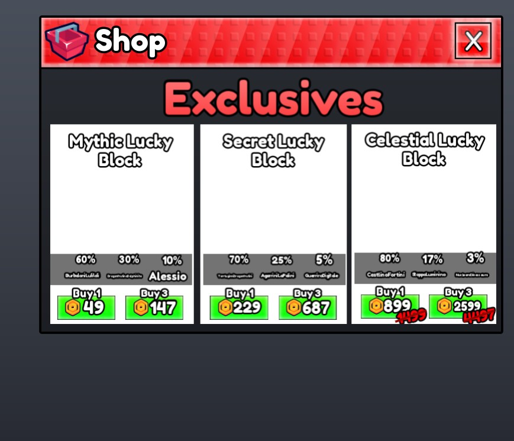

## At a glance

| | |
|---|---|
| Provenance | copy of a live game (saveinstance / decompiled client code) |
| Screens | 6 ScreenGuis, 5206 GUI objects → **21 screenshots** |
| Models (.rbxm) | 944 models, 32 model sets, 4 VFX sets |
| Lua builders (.lua) | 19 UI screens, 0 animation packs, 2 audio packs |
| Code | 332 scripts, 34,769 lines |
| Asset ids | 1066 animations, 37 sounds |
| Safety scan | 0 HIGH / 2 MED flags ([flags.txt](source/flags.txt)) |

**Fonts:** `FredokaOne Regular`×2569, `SourceSansPro Bold`×91, `GothamSSm Bold`×43, `BuilderSans Medium`×26, `LegacyArial Regular`×23

## UI screenshots

Captured in Studio from the place's own ScreenGuis (scripts stripped). Each panel was opened on its own; click a thumbnail for the full 1519×886 frame. Runtime-filled lists (shop items, inventories) show their template state.

### Shop & Robux store

<table>
<tr>
<td width="33%" valign="top"><a href="screenshots/03_HUD__OldMainShop.jpg">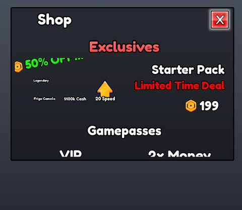</a> <b>HUD</b> › OldMainShop</td>
<td width="33%" valign="top"> <b>HUD</b> › MainShop</td>
</tr>
</table>

### Inventory / backpack / pets

<table>
<tr>
<td width="33%" valign="top"> <b>BackpackGui</b></td>
<td width="33%" valign="top"><a href="screenshots/19_BackpackGui__Inventory.jpg">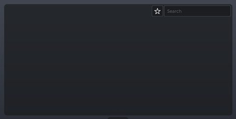</a> <b>BackpackGui</b> › Backpack.Inventory</td>
</tr>
</table>

### Index / codex / glossary

<table>
<tr>
<td width="33%" valign="top"><a href="screenshots/04_HUD__Index.jpg">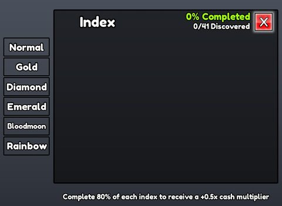</a> <b>HUD</b> › Index</td>
</tr>
</table>

### Rewards, daily, spin, codes

<table>
<tr>
<td width="33%" valign="top"><a href="screenshots/07_HUD__Gift.jpg">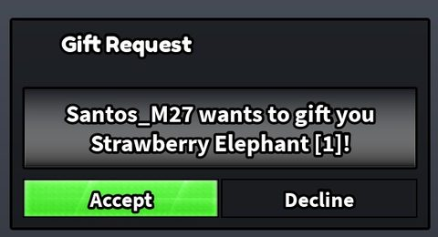</a> <b>HUD</b> › Gift</td>
</tr>
</table>

### Quests & progression

<table>
<tr>
<td width="33%" valign="top"><a href="screenshots/02_HUD__Rebirth.jpg">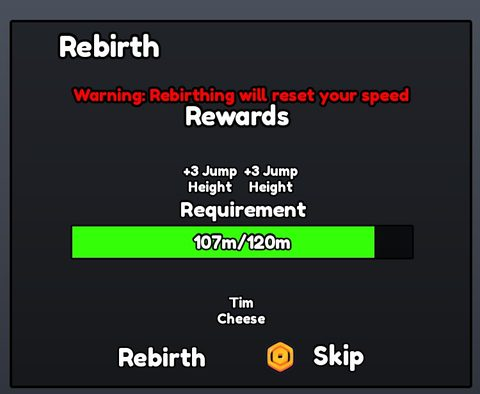</a> <b>HUD</b> › Rebirth</td>
<td width="33%" valign="top"><a href="screenshots/05_HUD__Upgrades.jpg">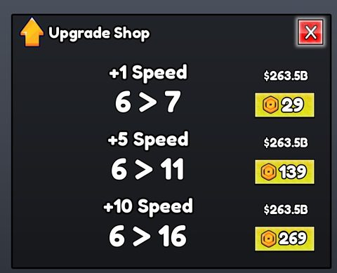</a> <b>HUD</b> › Upgrades</td>
<td width="33%" valign="top"><a href="screenshots/06_HUD__CarryUpgrades.jpg">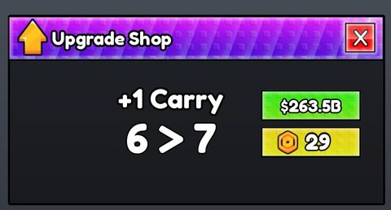</a> <b>HUD</b> › CarryUpgrades</td>
</tr>
<tr>
<td width="33%" valign="top"><a href="screenshots/09_HUD__FakeRebirth.jpg">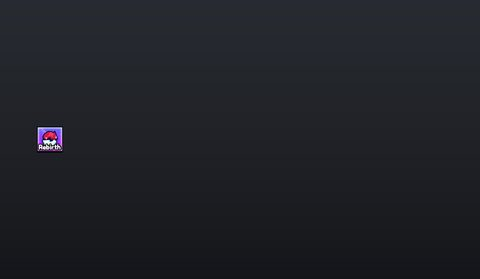</a> <b>HUD</b> › FakeRebirth</td>
</tr>
</table>

### Popups, notifications, prompts

<table>
<tr>
<td width="33%" valign="top"><a href="screenshots/20_BackpackGui__GamepadHintsFrame.jpg">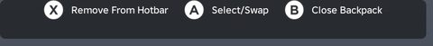</a> <b>BackpackGui</b> › Backpack.GamepadHintsFrame</td>
</tr>
</table>

### Crafting, fusing, machines

<table>
<tr>
<td width="33%" valign="top"><a href="screenshots/15_HUD__FuseMachine.jpg">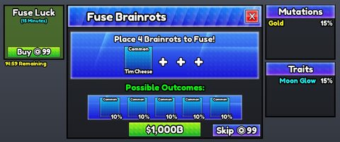</a> <b>HUD</b> › FuseMachine</td>
</tr>
</table>

### Admin panels

<table>
<tr>
<td width="33%" valign="top"><a href="screenshots/14_HUD__Admin.jpg">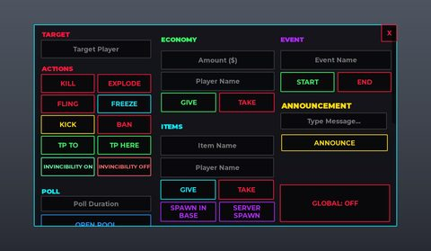</a> <b>HUD</b> › Admin</td>
<td width="33%" valign="top"><a href="screenshots/17_Cmdr__Autocomplete.jpg">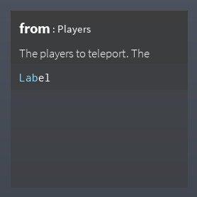</a> <b>Cmdr</b> › Autocomplete</td>
</tr>
</table>

### HUD & currency

<table>
<tr>
<td width="33%" valign="top"><a href="screenshots/01_HUD.jpg">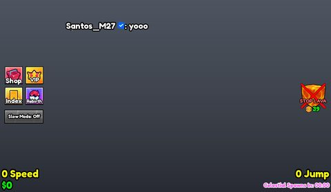</a> <b>HUD</b></td>
<td width="33%" valign="top"><a href="screenshots/08_HUD__Revive.jpg">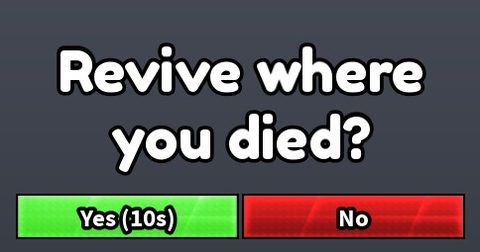</a> <b>HUD</b> › Revive</td>
<td width="33%" valign="top"><a href="screenshots/10_HUD__LuckyBlock.jpg">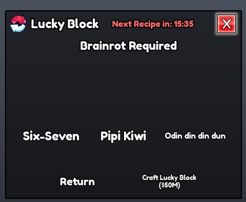</a> <b>HUD</b> › LuckyBlock</td>
</tr>
<tr>
<td width="33%" valign="top"><a href="screenshots/12_HUD__PollCreate.jpg">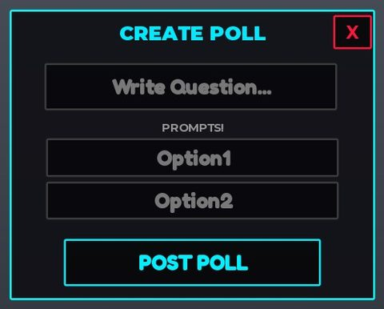</a> <b>HUD</b> › PollCreate</td>
<td width="33%" valign="top"><a href="screenshots/13_HUD__Poll.jpg">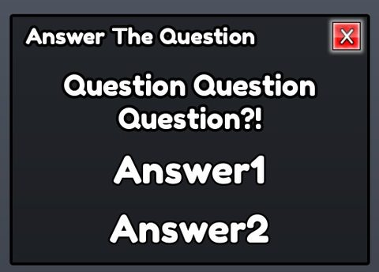</a> <b>HUD</b> › Poll</td>
</tr>
</table>

### Character / avatar / emotes

<table>
<tr>
<td width="33%" valign="top"><a href="screenshots/16_HUD__BaseSkins.jpg">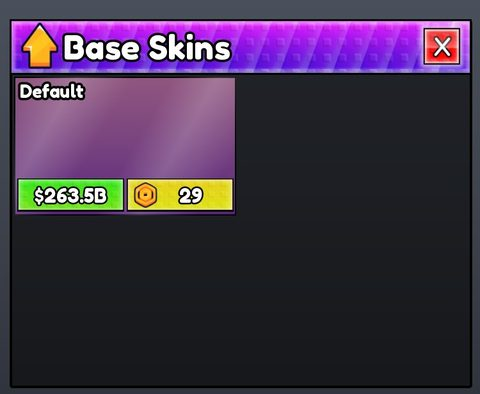</a> <b>HUD</b> › BaseSkins</td>
</tr>
</table>

### Other

<table>
<tr>
<td width="33%" valign="top"><a href="screenshots/21_RotatingToolUIOLD.jpg">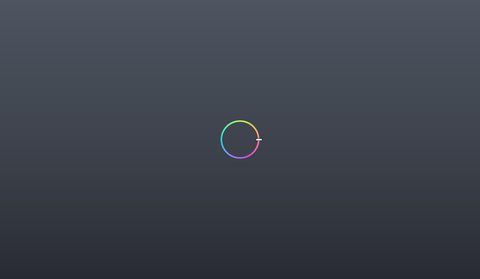</a> <b>RotatingToolUIOLD</b></td>
</tr>
</table>

## Model previews

<table>
<tr>
<td width="25%" valign="top"><a href="models/ReplicatedStorage/Model~3.rbxm">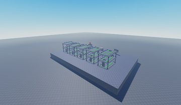</a> <b>Model~3</b> <code>models/ReplicatedStorage/Model~3.rbxm</code></td>
<td width="25%" valign="top"><a href="models/ReplicatedStorage/Brainrots/Bloodmoon/ElefanteLavante.rbxm">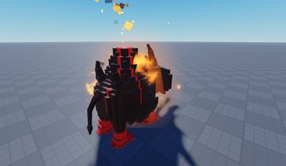</a> <b>ElefanteLavante</b> <code>models/ReplicatedStorage/Brainrots/Bloodmoon/ElefanteLavante.rbxm</code></td>
<td width="25%" valign="top"><a href="models/StarterPack/Bat.rbxm">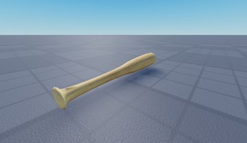</a> <b>Bat</b> <code>models/StarterPack/Bat.rbxm</code></td>
<td width="25%" valign="top"><a href="models/ReplicatedStorage/Assets/LowGravityHelmet.rbxm">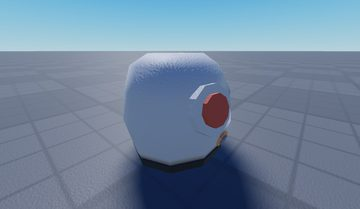</a> <b>LowGravityHelmet</b> <code>models/ReplicatedStorage/Assets/LowGravityHelmet.rbxm</code></td>
</tr>
<tr>
<td width="25%" valign="top"><a href="models/ReplicatedStorage/Assets/Star.rbxm">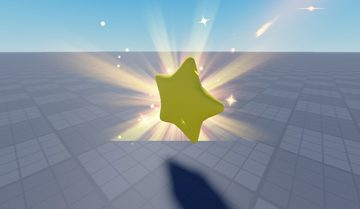</a> <b>Star</b> <code>models/ReplicatedStorage/Assets/Star.rbxm</code></td>
<td width="25%" valign="top"><a href="models/ReplicatedStorage/Folder/Luckyblock~3.rbxm">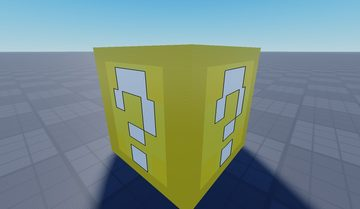</a> <b>Luckyblock~3</b> <code>models/ReplicatedStorage/Folder/Luckyblock~3.rbxm</code></td>
<td width="25%" valign="top"><a href="models/Workspace/GameFolder/Structures/Common/Rock__x26.rbxm">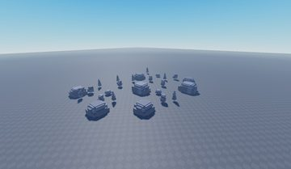</a> <b>Rock__x26</b> <code>models/Workspace/GameFolder/Structures/Common/Rock__x26.rbxm</code></td>
<td width="25%" valign="top"><a href="models/ReplicatedStorage/Assets/LuckyBlockModels/Moon%20Secret%20Lucky%20Block.rbxm">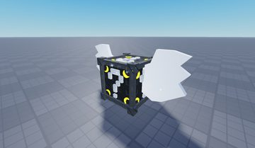</a> <b>Moon Secret Lucky Block</b> <code>models/ReplicatedStorage/Assets/LuckyBlockModels/Moon Secret Lucky Block.rbxm</code></td>
</tr>
<tr>
<td width="25%" valign="top"><a href="models/ReplicatedStorage/Assets/MoonMap/Leaderboard.rbxm">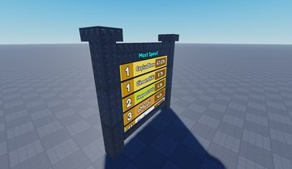</a> <b>Leaderboard</b> <code>models/ReplicatedStorage/Assets/MoonMap/Leaderboard.rbxm</code></td>
<td width="25%" valign="top"><a href="models/Workspace/CommonMap/Pine%20Tree__x10.rbxm">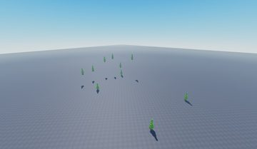</a> <b>Pine Tree__x10</b> <code>models/Workspace/CommonMap/Pine Tree__x10.rbxm</code></td>
<td width="25%" valign="top"><a href="models/ReplicatedStorage/Prop%20Ladder.rbxm">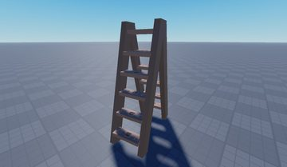</a> <b>Prop Ladder</b> <code>models/ReplicatedStorage/Prop Ladder.rbxm</code></td>
<td width="25%" valign="top"><a href="models/ReplicatedStorage/Assets/BaseSkins/Cheese.rbxm">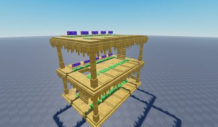</a> <b>Cheese</b> <code>models/ReplicatedStorage/Assets/BaseSkins/Cheese.rbxm</code></td>
</tr>
<tr>
<td width="25%" valign="top"><a href="models/Workspace/The%20Moon%20%28PBR%29.rbxm">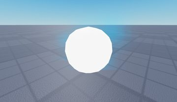</a> <b>The Moon (PBR)</b> <code>models/Workspace/The Moon (PBR).rbxm</code></td>
<td width="25%" valign="top"><a href="models/ReplicatedStorage/Folder/Luckyblock.rbxm">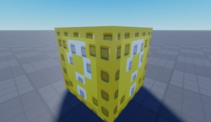</a> <b>Luckyblock</b> <code>models/ReplicatedStorage/Folder/Luckyblock.rbxm</code></td>
</tr>
</table>

## Notable scripts

Top-scored scripts of this game per topic (full tree in [source/scripts](source/scripts/)).

| Topic | Scripts |
|---|---|
| UI animation (tweens, hover / click, pop-ins, springs) | [`NewAdminPanelController`](source/scripts/StarterPlayer/StarterPlayerScripts/Controllers/NewAdminPanelController.lua) 655 lines [`UIController`](source/scripts/StarterPlayer/StarterPlayerScripts/Controllers/UIController.lua) 1550 lines [`Satchel`](source/scripts/StarterPlayer/StarterPlayerScripts/Satchel/Satchel.lua) 1864 lines [`Spring`](source/scripts/ReplicatedStorage/Modules/Spring.lua) 611 lines [`SecretTexts`](source/scripts/StarterPlayer/StarterPlayerScripts/SecretTexts.client.lua) 88 lines |
| UI controllers / window managers / menus | [`UIController`](source/scripts/StarterPlayer/StarterPlayerScripts/Controllers/UIController.lua) 1550 lines [`Window`](source/scripts/ReplicatedStorage/CmdrClient/CmdrInterface/Window.lua) 279 lines [`NewAdminPanelController`](source/scripts/StarterPlayer/StarterPlayerScripts/Controllers/NewAdminPanelController.lua) 655 lines [`Satchel`](source/scripts/StarterPlayer/StarterPlayerScripts/Satchel/Satchel.lua) 1864 lines [`Container`](source/scripts/ReplicatedStorage/Icon/Elements/Container.lua) 212 lines |
| Notifications, toasts, popups, prompts | [`ItemManager`](source/scripts/ServerScriptService/Modules/ItemManager.lua) 412 lines [`PlotManager`](source/scripts/ServerScriptService/PlotManager.server.lua) 179 lines [`SlotManager`](source/scripts/ServerScriptService/Modules/SlotManager.lua) 404 lines [`CarrySystem`](source/scripts/ServerScriptService/Modules/CarrySystem.lua) 241 lines [`TsunamiManager`](source/scripts/ServerScriptService/Modules/TsunamiManager.lua) 201 lines |
| Camera, cutscenes, screen shake | [`CameraShaker`](source/scripts/ReplicatedStorage/Modules/CameraShaker.lua) 127 lines [`CameraShakeInstance`](source/scripts/ReplicatedStorage/Modules/CameraShaker/CameraShakeInstance.lua) 128 lines [`CameraShakeController`](source/scripts/StarterPlayer/StarterPlayerScripts/Controllers/CameraShakeController.lua) 36 lines [`CameraShakePresets`](source/scripts/ReplicatedStorage/Modules/CameraShaker/CameraShakePresets.lua) 66 lines |
| VFX, particles, beams, hit effects | [`MutationHitEffectController`](source/scripts/StarterPlayer/StarterPlayerScripts/Controllers/MutationHitEffectController.lua) 111 lines [`FuseMachineController`](source/scripts/StarterPlayer/StarterPlayerScripts/Controllers/FuseMachineController.lua) 712 lines |
| Monetization (dev products, game passes, receipts) | [`MonetizationController`](source/scripts/ServerScriptService/Controllers/MonetizationController.lua) 101 lines [`UIController`](source/scripts/StarterPlayer/StarterPlayerScripts/Controllers/UIController.lua) 1550 lines |
| RNG, eggs, gacha, rarity rolls, pets | [`LuckyBlocksRegistry`](source/scripts/ReplicatedStorage/Registries/LuckyBlocksRegistry.lua) 302 lines [`RarityRegistry`](source/scripts/ReplicatedStorage/Registries/RarityRegistry.lua) 64 lines [`NewAdminPanelController`](source/scripts/StarterPlayer/StarterPlayerScripts/Controllers/NewAdminPanelController.lua) 655 lines [`UIController`](source/scripts/StarterPlayer/StarterPlayerScripts/Controllers/UIController.lua) 1550 lines [`AdminPanelController`](source/scripts/StarterPlayer/StarterPlayerScripts/Controllers/AdminPanelController.lua) 657 lines |
| Character movement (sprint, dash, double jump, slide) | [`Satchel`](source/scripts/StarterPlayer/StarterPlayerScripts/Satchel/Satchel.lua) 1864 lines |
| Tycoon / plots / bases / building | [`SlotManager`](source/scripts/ServerScriptService/Modules/SlotManager.lua) 404 lines [`PlotsController`](source/scripts/StarterPlayer/StarterPlayerScripts/Controllers/PlotsController.lua) 442 lines [`PlotManager`](source/scripts/ServerScriptService/PlotManager.server.lua) 179 lines [`TutorialController`](source/scripts/StarterPlayer/StarterPlayerScripts/Controllers/TutorialController.lua) 249 lines [`BaseSkinController`](source/scripts/StarterPlayer/StarterPlayerScripts/Controllers/BaseSkinController.lua) 206 lines |
| Leaderboards & stats | [`LeaderboardController`](source/scripts/ServerScriptService/Controllers/LeaderboardController.lua) 228 lines |
| Admin panels & commands | [`AdminPanelController`](source/scripts/StarterPlayer/StarterPlayerScripts/Controllers/AdminPanelController.lua) 657 lines [`NewAdminPanelController`](source/scripts/StarterPlayer/StarterPlayerScripts/Controllers/NewAdminPanelController.lua) 655 lines [`CMDRController`](source/scripts/StarterPlayer/StarterPlayerScripts/Controllers/CMDRController.lua) 37 lines |
| Utility modules (number format, signals, tables, timers) | [`ItemManager`](source/scripts/ServerScriptService/Modules/ItemManager.lua) 412 lines [`SlotManager`](source/scripts/ServerScriptService/Modules/SlotManager.lua) 404 lines [`LeaderboardController`](source/scripts/ServerScriptService/Controllers/LeaderboardController.lua) 228 lines [`SellManager`](source/scripts/ServerScriptService/Modules/SellManager.lua) 137 lines [`Utility`](source/scripts/ReplicatedStorage/Icon/Utility.lua) 592 lines |

### In the curated script library

- [Config-routed receipt (beginner friendly)](../../Scripts/08-Monetization/MonetizationController-ConfigRouted__survive-lava-for-brainrot.lua) — Readable receipt controller: product name from a config module, then reward tables for speed, items, carry upgrades and cash, with lazy-required systems and a client notification.

## Folders

| Folder | What |
|---|---|
| `screenshots/` | full frames; `crops/` = the panel only; `models/` = 3D previews; `thumbs/` = gallery thumbnails |
| `ui/` | every screen as a Lua builder (`require(module)()` returns the ScreenGui); `_StarterGui-all.lua` builds every StarterGui screen |
| `models/` | every model as .rbxm (the only .rbxm files), mirroring the place tree, scripts removed |
| `map/` | `workspace.rbxm` (the map as a model), `lighting.lua` (sky + post effects), `materials.lua`, `Environment.lua` |
| `animations/`, `audio/` | KeyframeSequence / Sound builders (.lua), `AnimationIds.lua`, `Sounds.lua` |
| `source/` | all scripts as .luau, `tree.txt`, `ui.txt`, `remotes.txt`, `assets.txt`, `flags.txt` |
