# The Rake (kill test)

> 👻 **Horror** · horror survival (monster) · source file `THE_RAKE_KILL_TEST_ORIGINAL (1).rbxl`

[⬅ Back to the catalog](../../README.md) · [Assets inventory](ASSETS.md) · [Style numbers](reference.md) · [Scripts](source/scripts/) · [Code analysis](source/README.md)

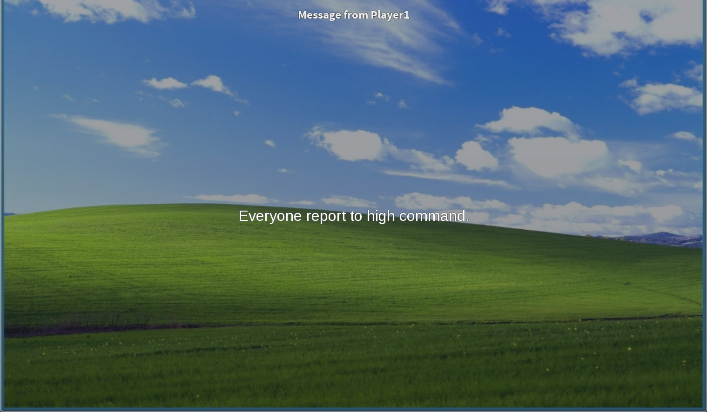

## At a glance

| | |
|---|---|
| Provenance | template with full source |
| Screens | 19 ScreenGuis, 70 GUI objects → **62 screenshots** |
| Models (.rbxm) | 149 models, 3 model sets, 1 VFX sets |
| Lua builders (.lua) | 20 UI screens, 118 animation packs, 6 audio packs |
| Code | 1835 scripts, 430,610 lines |
| Asset ids | 305 animations, 424 sounds |
| Safety scan | 50 HIGH / 125 MED flags ([flags.txt](source/flags.txt)) |

## UI screenshots

Captured in Studio from the place's own ScreenGuis (scripts stripped). Each panel was opened on its own; click a thumbnail for the full 1519×886 frame. Runtime-filled lists (shop items, inventories) show their template state.

### Shop & Robux store

<table>
<tr>
<td width="33%" valign="top"><a href="screenshots/101_ShopGui.jpg">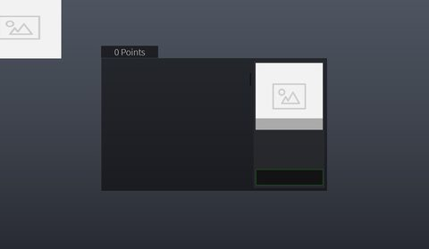</a> <b>ShopGui</b></td>
</tr>
</table>

### Quests & progression

<table>
<tr>
<td width="33%" valign="top"><a href="screenshots/07_TaskManager.jpg">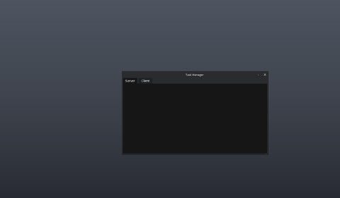</a> <b>TaskManager</b></td>
</tr>
</table>

### Settings & menus

<table>
<tr>
<td width="33%" valign="top"><a href="screenshots/46_Dex_Explorer__SettingsPanel.jpg">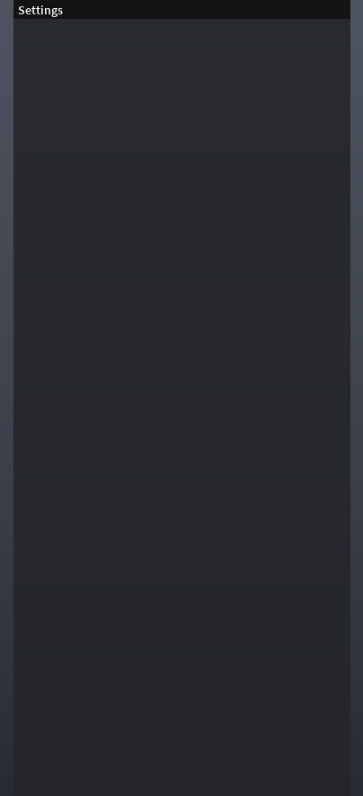</a> <b>Dex_Explorer</b> › SettingsPanel</td>
</tr>
</table>

### Popups, notifications, prompts

<table>
<tr>
<td width="33%" valign="top"><a href="screenshots/01_Message__Frame.jpg">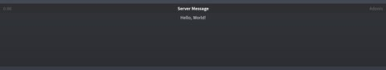</a> <b>Message</b> › BaseClip.Frame</td>
<td width="33%" valign="top"><a href="screenshots/02_Hint__Frame.jpg">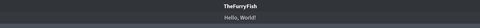</a> <b>Hint</b> › BaseClip.Frame</td>
<td width="33%" valign="top"><a href="screenshots/03_YesNoPrompt__Frame.jpg">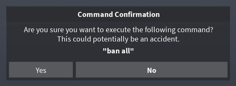</a> <b>YesNoPrompt</b> › BaseClip.Frame</td>
</tr>
<tr>
<td width="33%" valign="top"><a href="screenshots/04_Message.jpg">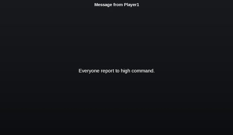</a> <b>Message</b></td>
<td width="33%" valign="top"><a href="screenshots/05_Notify.jpg">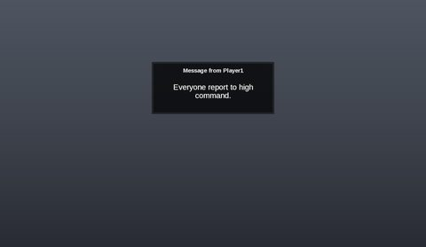</a> <b>Notify</b></td>
<td width="33%" valign="top"><a href="screenshots/10_Hint.jpg">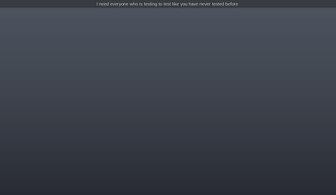</a> <b>Hint</b></td>
</tr>
<tr>
<td width="33%" valign="top"><a href="screenshots/14_Notify.jpg">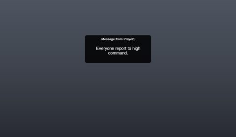</a> <b>Notify</b></td>
<td width="33%" valign="top"><a href="screenshots/15_Message.jpg">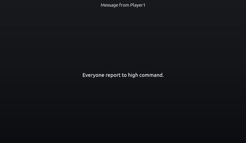</a> <b>Message</b></td>
<td width="33%" valign="top"><a href="screenshots/18_Notify.jpg">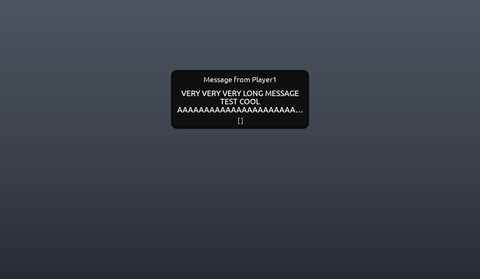</a> <b>Notify</b></td>
</tr>
<tr>
<td width="33%" valign="top"> <b>Notify</b></td>
<td width="33%" valign="top"><a href="screenshots/21_Notif.jpg">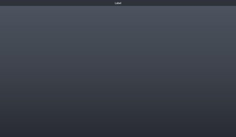</a> <b>Notif</b></td>
<td width="33%" valign="top"><a href="screenshots/22_Message.jpg">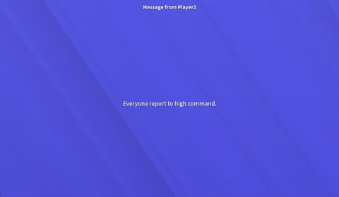</a> <b>Message</b></td>
</tr>
<tr>
<td width="33%" valign="top"><a href="screenshots/28_Message.jpg">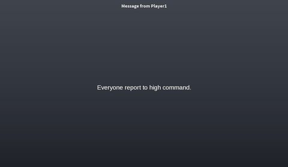</a> <b>Message</b></td>
<td width="33%" valign="top"><a href="screenshots/29_Notify.jpg">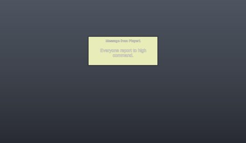</a> <b>Notify</b></td>
<td width="33%" valign="top"><a href="screenshots/69_Notif.jpg">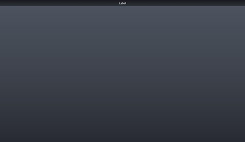</a> <b>Notif</b></td>
</tr>
<tr>
<td width="33%" valign="top"> <b>Message</b></td>
</tr>
</table>

### Loading & intro

<table>
<tr>
<td width="33%" valign="top"><a href="screenshots/48_Dex_Explorer__IntroFrame.jpg">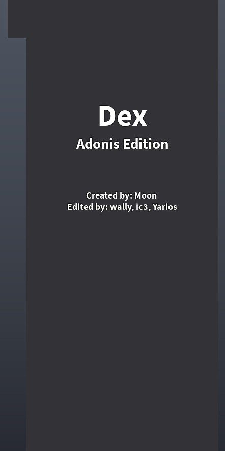</a> <b>Dex_Explorer</b> › IntroFrame</td>
<td width="33%" valign="top"><a href="screenshots/96_Dex_Explorer__IntroFrame.jpg">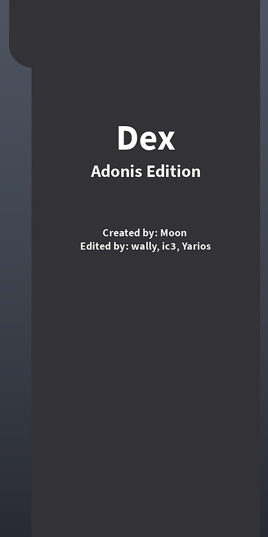</a> <b>Dex_Explorer</b> › IntroFrame</td>
</tr>
</table>

### End of round, death, results

<table>
<tr>
<td width="33%" valign="top"> <b>Window</b></td>
<td width="33%" valign="top"><a href="screenshots/13_Window.jpg">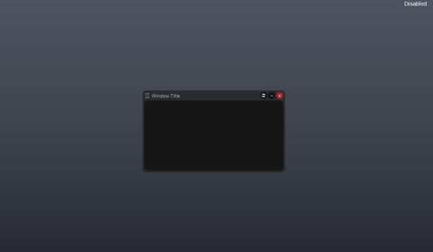</a> <b>Window</b></td>
<td width="33%" valign="top"><a href="screenshots/17_Window.jpg">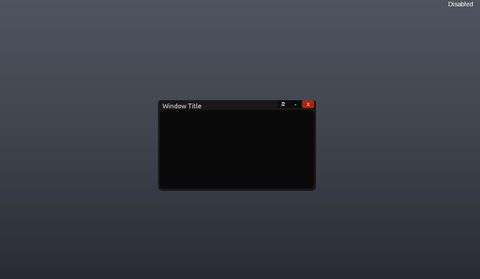</a> <b>Window</b></td>
</tr>
<tr>
<td width="33%" valign="top"><a href="screenshots/19_Window.jpg">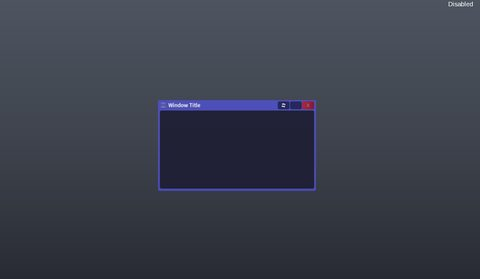</a> <b>Window</b></td>
<td width="33%" valign="top"><a href="screenshots/27_Window.jpg">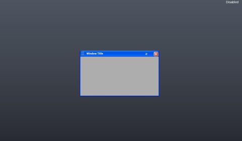</a> <b>Window</b></td>
<td width="33%" valign="top"><a href="screenshots/47_Dex_Explorer__RemoteDebugWindow.jpg">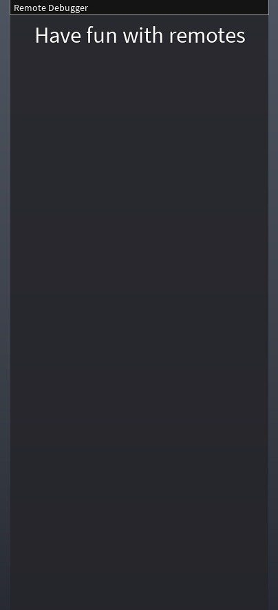</a> <b>Dex_Explorer</b> › RemoteDebugWindow</td>
</tr>
<tr>
<td width="33%" valign="top"><a href="screenshots/57_Window.jpg">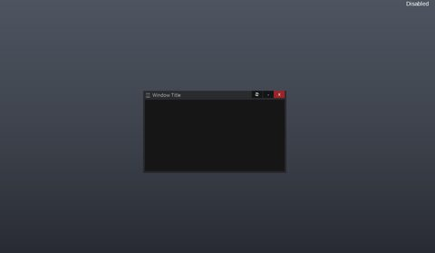</a> <b>Window</b></td>
<td width="33%" valign="top"><a href="screenshots/67_Window.jpg">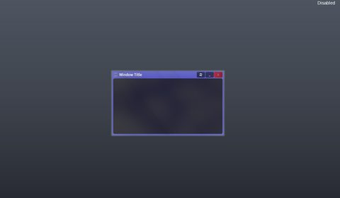</a> <b>Window</b></td>
<td width="33%" valign="top"><a href="screenshots/75_Window.jpg">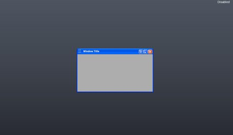</a> <b>Window</b></td>
</tr>
</table>

### Admin panels

<table>
<tr>
<td width="33%" valign="top"><a href="screenshots/11_Console.jpg">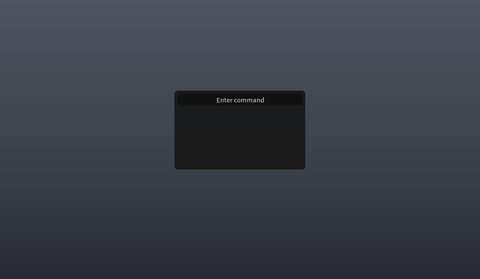</a> <b>Console</b></td>
<td width="33%" valign="top"><a href="screenshots/25_Console.jpg">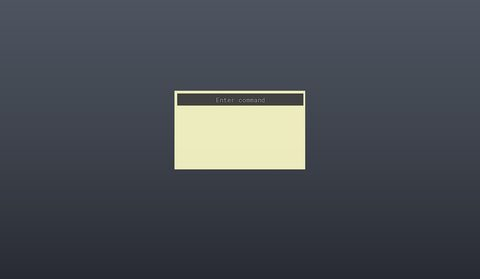</a> <b>Console</b></td>
<td width="33%" valign="top"><a href="screenshots/45_Dex_Explorer__ExplorerPanel.jpg">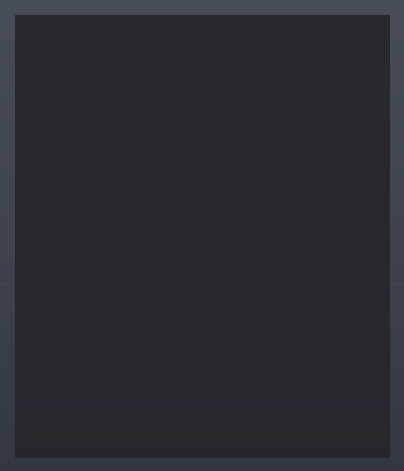</a> <b>Dex_Explorer</b> › ExplorerPanel</td>
</tr>
</table>

### HUD & currency

<table>
<tr>
<td width="33%" valign="top"> <b>UvBarUI</b></td>
</tr>
</table>

### Other

<table>
<tr>
<td width="33%" valign="top"> <b>PlayerList</b></td>
<td width="33%" valign="top"><a href="screenshots/08_Output.jpg">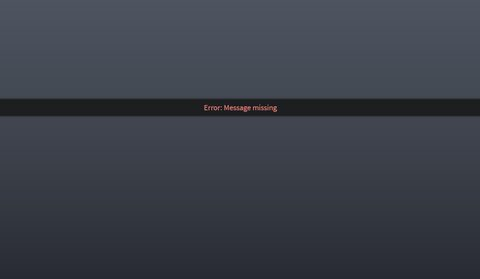</a> <b>Output</b></td>
<td width="33%" valign="top"><a href="screenshots/12_Output.jpg">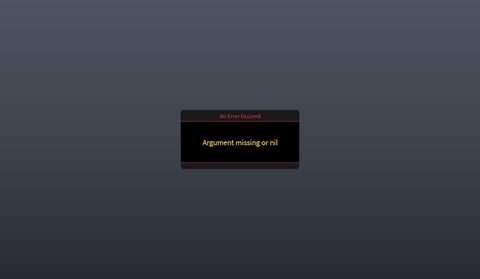</a> <b>Output</b></td>
</tr>
<tr>
<td width="33%" valign="top"><a href="screenshots/16_Output.jpg">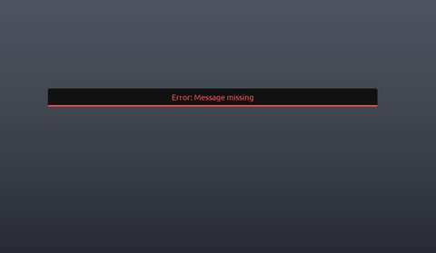</a> <b>Output</b></td>
<td width="33%" valign="top"><a href="screenshots/23_Output.jpg">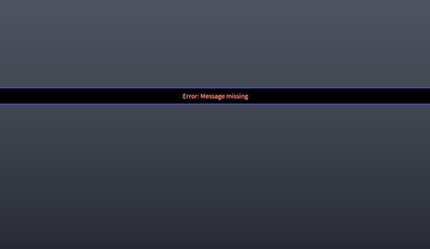</a> <b>Output</b></td>
<td width="33%" valign="top"><a href="screenshots/24_PlayerList.jpg">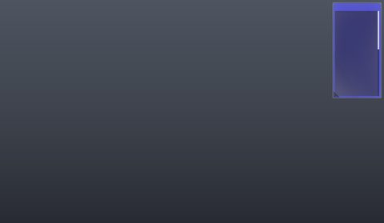</a> <b>PlayerList</b></td>
</tr>
<tr>
<td width="33%" valign="top"><a href="screenshots/26_Output.jpg">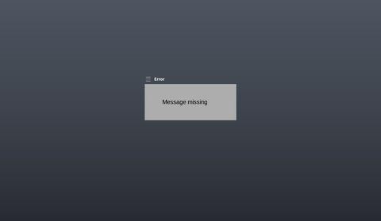</a> <b>Output</b></td>
<td width="33%" valign="top"><a href="screenshots/30_BTAnchorToolGUI.jpg">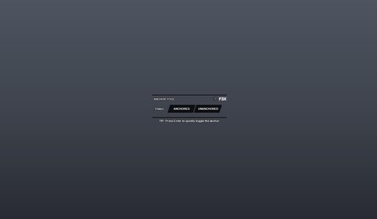</a> <b>BTAnchorToolGUI</b></td>
<td width="33%" valign="top"><a href="screenshots/31_BTCollisionToolGUI.jpg">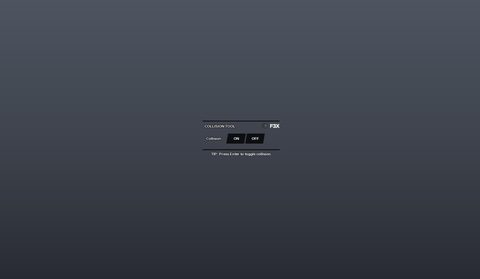</a> <b>BTCollisionToolGUI</b></td>
</tr>
<tr>
<td width="33%" valign="top"><a href="screenshots/32_BTDecorateToolGUI.jpg">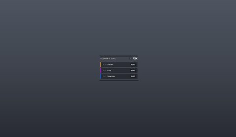</a> <b>BTDecorateToolGUI</b></td>
<td width="33%" valign="top"><a href="screenshots/33_BTLightingToolGUI.jpg">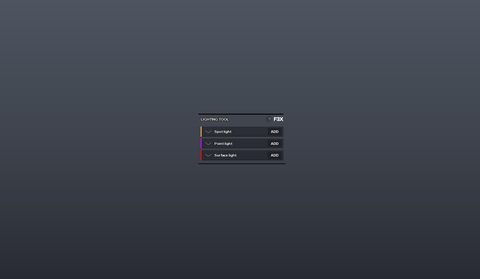</a> <b>BTLightingToolGUI</b></td>
<td width="33%" valign="top"><a href="screenshots/34_BTMaterialToolGUI.jpg">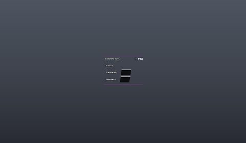</a> <b>BTMaterialToolGUI</b></td>
</tr>
<tr>
<td width="33%" valign="top"><a href="screenshots/35_BTMeshToolGUI.jpg">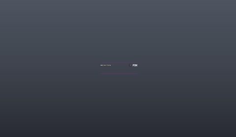</a> <b>BTMeshToolGUI</b></td>
<td width="33%" valign="top"><a href="screenshots/36_BTMoveToolGUI.jpg">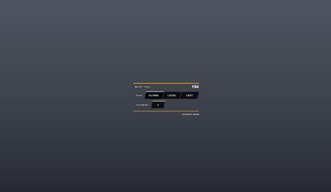</a> <b>BTMoveToolGUI</b></td>
<td width="33%" valign="top"><a href="screenshots/37_BTPaintToolGUI.jpg">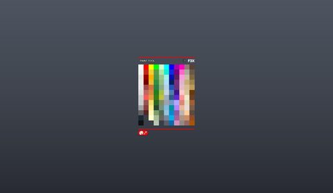</a> <b>BTPaintToolGUI</b></td>
</tr>
<tr>
<td width="33%" valign="top"><a href="screenshots/38_BTResizeToolGUI.jpg">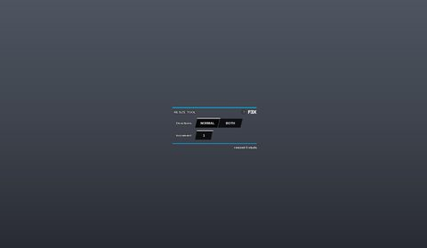</a> <b>BTResizeToolGUI</b></td>
<td width="33%" valign="top"><a href="screenshots/39_BTRotateToolGUI.jpg">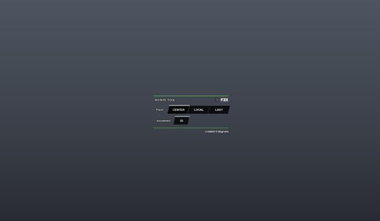</a> <b>BTRotateToolGUI</b></td>
<td width="33%" valign="top"><a href="screenshots/40_BTSurfaceToolGUI.jpg">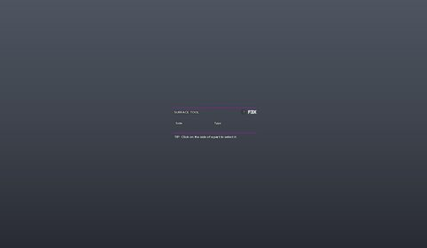</a> <b>BTSurfaceToolGUI</b></td>
</tr>
<tr>
<td width="33%" valign="top"><a href="screenshots/41_BTTextureToolGUI.jpg">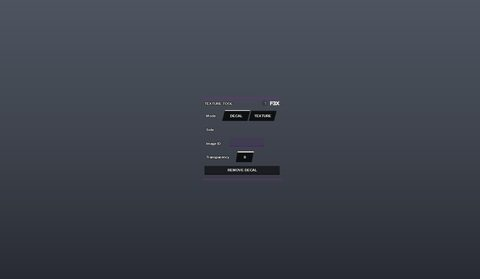</a> <b>BTTextureToolGUI</b></td>
<td width="33%" valign="top"><a href="screenshots/42_BTWeldToolGUI.jpg">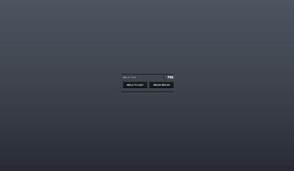</a> <b>BTWeldToolGUI</b></td>
<td width="33%" valign="top"> <b>PianoGui</b></td>
</tr>
<tr>
<td width="33%" valign="top"> <b>Dex_Explorer</b> › PropertiesFrame</td>
<td width="33%" valign="top"> <b>PlayerList</b></td>
<td width="33%" valign="top"> <b>Output</b></td>
</tr>
<tr>
<td width="33%" valign="top"> <b>ScreenGui</b></td>
<td width="33%" valign="top"> <b>ScreenGui</b> › Frame.ScrollingFrame</td>
<td width="33%" valign="top"> <b>SecretGui</b> › Frame</td>
</tr>
<tr>
<td width="33%" valign="top"> <b>mikegui</b> › Frame</td>
</tr>
</table>

## Model previews

<table>
<tr>
<td width="25%" valign="top"> <b>Ban</b> <code>models/ServerStorage/Ban.rbxm</code></td>
<td width="25%" valign="top"> <b>Toxic Gun 2</b> <code>models/Lighting/Toxic Gun 2.rbxm</code></td>
<td width="25%" valign="top"> <b>N0TFla's FROZEN ERADICATOR_R</b> <code>models/Lighting/N0TFla's FROZEN ERADICATOR_R.rbxm</code></td>
<td width="25%" valign="top"> <b>Shop</b> <code>models/Workspace/Shop.rbxm</code></td>
</tr>
<tr>
<td width="25%" valign="top"> <b>DARKSEED</b> <code>models/ServerStorage/DARKSEED.rbxm</code></td>
<td width="25%" valign="top"> <b>CandyCane</b> <code>models/Lighting/CandyCane.rbxm</code></td>
<td width="25%" valign="top"> <b>PowerStation</b> <code>models/ServerScriptService/LoadPower/PowerStation.rbxm</code></td>
<td width="25%" valign="top"> <b>Plane</b> <code>models/Workspace/Plane.rbxm</code></td>
</tr>
<tr>
<td width="25%" valign="top"> <b>The_Rake</b> <code>models/Workspace/The_Rake.rbxm</code></td>
<td width="25%" valign="top"> <b>Frost Blaster</b> <code>models/Lighting/Frost Blaster.rbxm</code></td>
<td width="25%" valign="top"> <b>ELEMENTAL ANOMALY</b> <code>models/ServerStorage/ELEMENTAL ANOMALY.rbxm</code></td>
<td width="25%" valign="top"> <b>Base_Camp</b> <code>models/ServerStorage/Base_Camp.rbxm</code></td>
</tr>
<tr>
<td width="25%" valign="top"> <b>BLIZZARIA_ THE FROZEN</b> <code>models/ServerStorage/BLIZZARIA_ THE FROZEN.rbxm</code></td>
<td width="25%" valign="top"> <b>Rusty_Wheel_Chair</b> <code>models/Workspace/Rusty_Wheel_Chair.rbxm</code></td>
</tr>
</table>

## Notable scripts

Top-scored scripts of this game per topic (full tree in [source/scripts](source/scripts/)).

| Topic | Scripts |
|---|---|
| UI animation (tweens, hover / click, pop-ins, springs) | [`Code`](source/scripts/Workspace/MainModule~2/Client/UI/Aero/Window/Config/Code.lua) 1696 lines [`Code`](source/scripts/Workspace/MainModule~2/Client/UI/Default/Window/Config/Code.lua) 1661 lines [`Code.OLD`](source/scripts/Workspace/MainModule~2/Client/UI/Windows%20XP/Window/Config/Code.OLD.lua) 1605 lines [`Code`](source/scripts/Workspace/MainModule~2/Client/UI/Aero/Console/Config/Code.lua) 269 lines [`Code`](source/scripts/Workspace/MainModule~2/Client/UI/Default/Console/Config/Code.lua) 264 lines |
| UI controllers / window managers / menus | [`Code`](source/scripts/Workspace/MainModule~2/Client/UI/Aero/Console/Config/Code.lua) 269 lines [`Code`](source/scripts/Workspace/MainModule~2/Client/UI/Default/Console/Config/Code.lua) 264 lines [`Code`](source/scripts/Workspace/MainModule~2/Client/UI/Rounded/Console/Config/Code.lua) 211 lines [`Code`](source/scripts/Workspace/MainModule~2/Client/UI/Unity/Console/Config/Code.lua) 261 lines [`Code`](source/scripts/Workspace/MainModule~2/Client/UI/Windows%20XP/Console/Config/Code.lua) 211 lines |
| Notifications, toasts, popups, prompts | [`PrivateMessage`](source/scripts/Workspace/MainModule~2/Client/UI/Default/PrivateMessage.lua) 69 lines [`Notifications`](source/scripts/Workspace/MainModule~2/Server/Dependencies/Assets/F3X%20Deps/UI/Notifications.lua) 90 lines [`NotificationDialog`](source/scripts/Workspace/MainModule~2/Server/Dependencies/Assets/F3X%20Deps/UI/Notifications/NotificationDialog.lua) 91 lines [`Alert`](source/scripts/Workspace/MainModule~2/Client/UI/Default/Alert.lua) 64 lines [`Functions`](source/scripts/Workspace/MainModule~2/Client/Core/Functions.lua) 1667 lines |
| Loading / intro screens | [`ClientLoader`](source/scripts/Workspace/MainModule~2/Server/Dependencies/ClientLoader.client.lua) 286 lines [`Client`](source/scripts/Workspace/MainModule~2/Client/Client.lua) 643 lines [`Server`](source/scripts/Workspace/MainModule~2/Server/Server.lua) 607 lines [`Inspect`](source/scripts/Workspace/MainModule~2/Client/UI/Default/Inspect.lua) 453 lines [`Piano`](source/scripts/Workspace/MainModule~2/Server/Dependencies/Assets/Piano.client.lua) 347 lines |
| Camera, cutscenes, screen shake | [`ScreenShake`](source/scripts/Workspace/rake%20anims/Configuration/UsedRakeThemeGui/AddGui/RakeThemeGui%20%28Keep%20it%20here%29/ScreenShake.client.lua) 25 lines [`viewmodel`](source/scripts/StarterPlayer/StarterCharacterScripts/viewmodel.client.lua) 507 lines [`ArcHandles`](source/scripts/Workspace/MainModule~2/Server/Dependencies/Assets/F3X%20Deps/Libraries/ArcHandles.lua) 508 lines [`LocalInputScript`](source/scripts/Lighting/Barret%2050/LocalInputScript.client.lua) 97 lines [`LocalInputScript`](source/scripts/Lighting/RocketLauncher/LocalInputScript.client.lua) 90 lines |
| VFX, particles, beams, hit effects | [`Main`](source/scripts/ServerStorage/FROST%20Sledgehammer/Main.server.lua) 91 lines [`Main`](source/scripts/ServerStorage/Sledge%20Hammer/Main.server.lua) 88 lines [`Main`](source/scripts/ServerScriptService/LoadItems/Items/ERADICATOR/Main.server.lua) 101 lines [`Main`](source/scripts/Lighting/N0TFla%27s%20FROZEN%20ERADICATOR_R/Main.server.lua) 98 lines [`Main`](source/scripts/ServerStorage/ERADICATOR%20%28ADMIN%29/Main.server.lua) 100 lines |
| DataStore / player data | [`Core`](source/scripts/Workspace/MainModule~2/Server/Core/Core.lua) 1316 lines [`Remote`](source/scripts/Workspace/MainModule~2/Server/Core/Remote.lua) 1308 lines [`PurchaseHandler`](source/scripts/ServerScriptService/PurchaseHandler.server.lua) 38 lines |
| Monetization (dev products, game passes, receipts) | [`CokeGamepass`](source/scripts/ServerScriptService/CokeGamepass.server.lua) 16 lines |
| RNG, eggs, gacha, rarity rolls, pets | [`Fun`](source/scripts/Workspace/MainModule~2/Server/Commands/Fun.lua) 4204 lines [`R15Animate`](source/scripts/Workspace/MainModule~2/Server/Dependencies/Assets/R15Animate.server.lua) 546 lines [`R6Animate`](source/scripts/Workspace/MainModule~2/Server/Dependencies/Assets/R6Animate.server.lua) 493 lines [`AnimateSauce`](source/scripts/Workspace/The_Rake/AnimateSauce.server.lua) 484 lines [`Moderators`](source/scripts/Workspace/MainModule~2/Server/Commands/Moderators.lua) 6526 lines |
| Combat, weapons, hitboxes, abilities | [`Main`](source/scripts/ServerScriptService/LoadItems/Items/MetalBaseballBat/Main.server.lua) 62 lines [`Damage`](source/scripts/ServerStorage/ProtoStunStick/ShockPart/Damage.server.lua) 45 lines [`Damage`](source/scripts/StarterPack/StunStick/ShockPart/Damage.server.lua) 49 lines [`Damage`](source/scripts/ServerScriptService/LoadItems/Items/RainbowStun/ShockPart/Damage.server.lua) 42 lines [`Main`](source/scripts/ServerScriptService/LoadItems/Items/FryingPan/Main.server.lua) 58 lines |
| NPC / AI / monsters | [`BotBrain`](source/scripts/Workspace/MainModule~2/Server/Dependencies/Assets/BotBrain.server.lua) 256 lines |
| Character movement (sprint, dash, double jump, slide) | [`RunScript`](source/scripts/StarterPlayer/StarterCharacterScripts/RunScript.client.lua) 62 lines [`Slider`](source/scripts/Workspace/MainModule~2/Server/Dependencies/Assets/F3X%20Deps/UI/ColorPicker/Slider.lua) 110 lines [`AnimateSauce`](source/scripts/Workspace/The_Rake/AnimateSauce.server.lua) 484 lines [`Main`](source/scripts/ServerScriptService/LoadItems/Items/ERADICATOR/Main.server.lua) 101 lines [`Moderators`](source/scripts/Workspace/MainModule~2/Server/Commands/Moderators.lua) 6526 lines |
| Tycoon / plots / bases / building | [`DefaultSettings`](source/scripts/Workspace/MainModule~2/Server/Dependencies/DefaultSettings.lua) 525 lines [`Moderators`](source/scripts/Workspace/MainModule~2/Server/Commands/Moderators.lua) 6526 lines [`Lighting`](source/scripts/Workspace/MainModule~2/Server/Dependencies/Assets/F3X%20Deps/Tools/Lighting.lua) 861 lines [`Mesh`](source/scripts/Workspace/MainModule~2/Server/Dependencies/Assets/F3X%20Deps/Tools/Mesh.lua) 843 lines [`Texture`](source/scripts/Workspace/MainModule~2/Server/Dependencies/Assets/F3X%20Deps/Tools/Texture.lua) 658 lines |
| Admin panels & commands | [`Admins`](source/scripts/Workspace/MainModule~2/Server/Commands/Admins.lua) 1519 lines [`Admin`](source/scripts/Workspace/MainModule~2/Server/Core/Admin.lua) 1027 lines [`DefaultSettings`](source/scripts/Workspace/MainModule~2/Server/Dependencies/DefaultSettings.lua) 525 lines [`Commands`](source/scripts/Workspace/MainModule~2/Server/Core/Commands.lua) 132 lines [`HeadAdmins`](source/scripts/Workspace/MainModule~2/Server/Commands/HeadAdmins.lua) 405 lines |
| Sound & music | [`Music`](source/scripts/Workspace/MainModule~2/Client/UI/Default/Music.lua) 642 lines [`Client`](source/scripts/ServerScriptService/LoadItems/Items/Cylinder/Client.client.lua) 80 lines [`Admins`](source/scripts/Workspace/MainModule~2/Server/Commands/Admins.lua) 1519 lines [`Restoring`](source/scripts/ServerScriptService/LoadPower/PowerStation/RestorePart/ProximityPrompt/Restoring.server.lua) 86 lines [`Client`](source/scripts/ServerStorage/NerfGun/Client.client.lua) 64 lines |
| Utility modules (number format, signals, tables, timers) | [`Admins`](source/scripts/Workspace/MainModule~2/Server/Commands/Admins.lua) 1519 lines [`Maid`](source/scripts/Workspace/MainModule~2/Server/Dependencies/Assets/F3X%20Deps/Libraries/Maid.lua) 99 lines [`Signal`](source/scripts/Workspace/MainModule~2/Server/Dependencies/Assets/F3X%20Deps/Libraries/Signal.lua) 70 lines [`Fun`](source/scripts/Workspace/MainModule~2/Server/Commands/Fun.lua) 4204 lines [`Moderators`](source/scripts/Workspace/MainModule~2/Server/Commands/Moderators.lua) 6526 lines |

### In the curated script library

- [Realism mode (CloneTrooper1019)](../../Scripts/05-Camera-Cutscene/RealismBobAndBodyLook__the-rake.lua) — Old but famous: body follows camera pitch + walk bobble via CameraOffset (R6).
- [Death jumpscare camera](../../Scripts/05-Camera-Cutscene/DeathJumpscareCam__the-rake.lua) — Simplest death cam: Scriptable camera at a fixed part + FOV kick (120 -> 50).
- [Sprint with FOV tween](../../Scripts/13-Movement/SprintFovRun__the-rake.lua) — Sprint key + mobile button + FOV tween, wired to a server stamina value.
- [Configurable patrol / attack bot](../../Scripts/12-NPC-AI/PatrolSwarmBotBrain__the-rake.lua) — Admin-system bot brain driven by a props table (Target, Swarm, PatrolZone, PatrolDist, Damage, team friendliness) set through a BindableEvent; patrols random points, targets the nearest valid model, walks straight when it can see the goal and pathfinds otherwise, with a forward-ray jump check.
- [PlaybackLoudness bar visualizer](../../Scripts/17-Sound-Music/AudioVisualizerBars__the-rake.lua) — Bar-graph audio visualizer driven by Sound.PlaybackLoudness: keeps a rolling buffer of loudness samples, mirrors it from the center outwards, tweens bar heights and optionally colors bars from a ColorSequence. Note: Frame:Add() is an Adonis helper; replace it with Instance.new.

## ⚠️ Safety

HIGH flags (backdoors, `require(id)`, `loadstring`, webhooks). Review or delete before reusing:

- `scripts/Lighting/.44 MAGNUM/Script.server.lua`
- `scripts/Lighting/ACID SPLITTER/Script.server.lua`
- `scripts/Lighting/AK-47/Script.server.lua`
- `scripts/Lighting/AUG/Script.server.lua`
- `scripts/Lighting/BLACK MATTER  SPLITTER/Script.server.lua`
- `scripts/Lighting/Barret 50/Script.server.lua`
- `scripts/Lighting/D. Eagle/Script.server.lua`
- `scripts/Lighting/Falkor/Script.server.lua`

## Folders

| Folder | What |
|---|---|
| `screenshots/` | full frames; `crops/` = the panel only; `models/` = 3D previews; `thumbs/` = gallery thumbnails |
| `ui/` | every screen as a Lua builder (`require(module)()` returns the ScreenGui); `_StarterGui-all.lua` builds every StarterGui screen |
| `models/` | every model as .rbxm (the only .rbxm files), mirroring the place tree, scripts removed |
| `map/` | `workspace.rbxm` (the map as a model), `lighting.lua` (sky + post effects), `materials.lua`, `Environment.lua` |
| `animations/`, `audio/` | KeyframeSequence / Sound builders (.lua), `AnimationIds.lua`, `Sounds.lua` |
| `source/` | all scripts as .luau, `tree.txt`, `ui.txt`, `remotes.txt`, `assets.txt`, `flags.txt` |
