# Tower Of Hell

> 🧗 **Obby** · obby (procedural tower) · source file `SLBR - Booster - Tower Of Hell.rbxl`

[⬅ Back to the catalog](../../README.md) · [Assets inventory](ASSETS.md) · [Style numbers](reference.md) · [Scripts](source/scripts/) · [Code analysis](source/README.md)

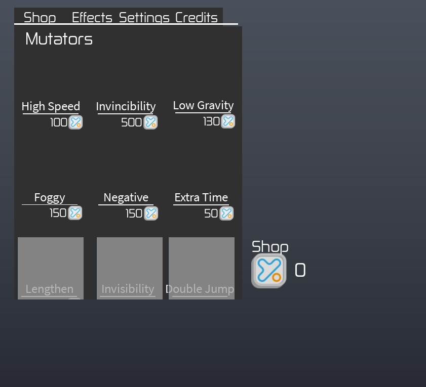

## At a glance

| | |
|---|---|
| Provenance | template with full source |
| Screens | 5 ScreenGuis, 256 GUI objects → **9 screenshots** |
| Models (.rbxm) | 11 models, 1 model sets, 0 VFX sets |
| Lua builders (.lua) | 10 UI screens, 0 animation packs, 1 audio packs |
| Code | 67 scripts, 2,397 lines |
| Asset ids | 1 animations, 14 sounds |
| Safety scan | 0 HIGH / 0 MED flags ([flags.txt](source/flags.txt)) |

**Fonts:** `Zekton Regular`×49, `SourceSansPro Regular`×34, `LegacyArial Regular`×26

## UI screenshots

Captured in Studio from the place's own ScreenGuis (scripts stripped). Each panel was opened on its own; click a thumbnail for the full 1519×886 frame. Runtime-filled lists (shop items, inventories) show their template state.

### Shop & Robux store

<table>
<tr>
<td width="33%" valign="top"><a href="screenshots/01_ShopGui.jpg">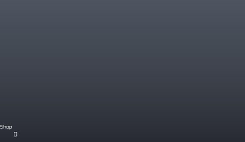</a> <b>ShopGui</b></td>
<td width="33%" valign="top"><a href="screenshots/02_ShopGui__Frame.jpg">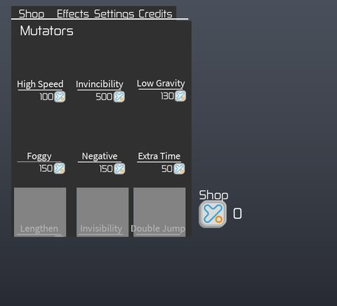</a> <b>ShopGui</b> › Frame</td>
<td width="33%" valign="top"><a href="screenshots/04_ShopGui.jpg">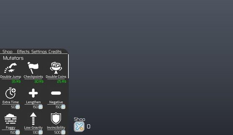</a> <b>ShopGui</b></td>
</tr>
</table>

### Inventory / backpack / pets

<table>
<tr>
<td width="33%" valign="top"> <b>items</b> › settings.theme</td>
<td width="33%" valign="top"><a href="screenshots/07_items__killparthue.jpg">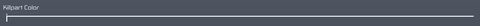</a> <b>items</b> › settings.killparthue</td>
<td width="33%" valign="top"><a href="screenshots/08_items__boxes.jpg">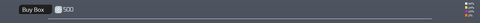</a> <b>items</b> › effects.boxes</td>
</tr>
<tr>
<td width="33%" valign="top"><a href="screenshots/09_items__effects.jpg">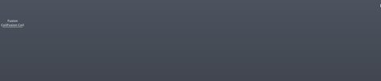</a> <b>items</b> › effects.effects</td>
</tr>
</table>

### Settings & menus

<table>
<tr>
<td width="33%" valign="top"><a href="screenshots/05_items__Credits.jpg">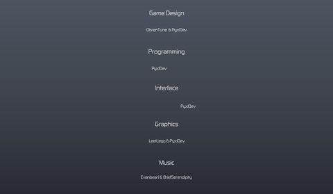</a> <b>items</b> › Credits</td>
</tr>
</table>

### Leaderboards & stats

<table>
<tr>
<td width="33%" valign="top"> <b>StatChanger</b></td>
</tr>
</table>

## Model previews

<table>
<tr>
<td width="25%" valign="top"><a href="models/ServerStorage/Gears/GravityCoil.rbxm">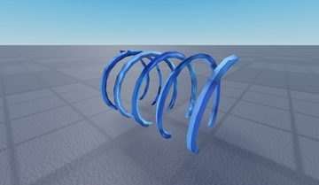</a> <b>GravityCoil</b> <code>models/ServerStorage/Gears/GravityCoil.rbxm</code></td>
<td width="25%" valign="top"><a href="models/Workspace/Storage/End.rbxm">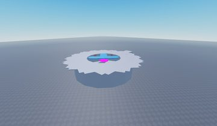</a> <b>End</b> <code>models/Workspace/Storage/End.rbxm</code></td>
<td width="25%" valign="top"><a href="models/ServerStorage/Gears/Hook.rbxm">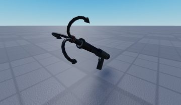</a> <b>Hook</b> <code>models/ServerStorage/Gears/Hook.rbxm</code></td>
<td width="25%" valign="top"><a href="models/ServerStorage/Stages/Stage3__x11.rbxm">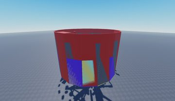</a> <b>Stage3__x11</b> <code>models/ServerStorage/Stages/Stage3__x11.rbxm</code></td>
</tr>
<tr>
<td width="25%" valign="top"><a href="models/ServerStorage/Gears/FusionCoil.rbxm">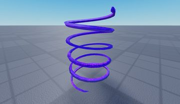</a> <b>FusionCoil</b> <code>models/ServerStorage/Gears/FusionCoil.rbxm</code></td>
<td width="25%" valign="top"><a href="models/Workspace/Storage/Lobby.rbxm">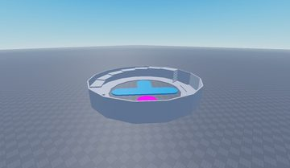</a> <b>Lobby</b> <code>models/Workspace/Storage/Lobby.rbxm</code></td>
<td width="25%" valign="top"><a href="models/ServerStorage/Gears/JumpCoil.rbxm">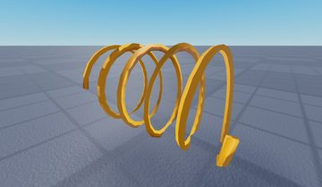</a> <b>JumpCoil</b> <code>models/ServerStorage/Gears/JumpCoil.rbxm</code></td>
<td width="25%" valign="top"><a href="models/ServerStorage/Template.rbxm">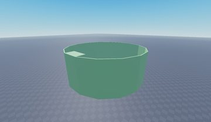</a> <b>Template</b> <code>models/ServerStorage/Template.rbxm</code></td>
</tr>
<tr>
<td width="25%" valign="top"><a href="models/ServerStorage/Gears/SpeedCoil.rbxm">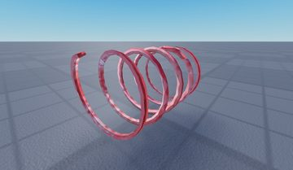</a> <b>SpeedCoil</b> <code>models/ServerStorage/Gears/SpeedCoil.rbxm</code></td>
<td width="25%" valign="top"><a href="models/ServerStorage/Stages/Stage3.rbxm">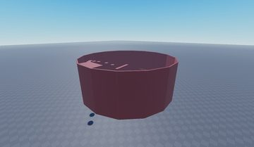</a> <b>Stage3</b> <code>models/ServerStorage/Stages/Stage3.rbxm</code></td>
<td width="25%" valign="top"><a href="models/ServerStorage/Gears/Trowel.rbxm">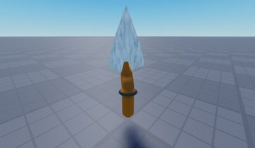</a> <b>Trowel</b> <code>models/ServerStorage/Gears/Trowel.rbxm</code></td>
</tr>
</table>

## Notable scripts

Top-scored scripts of this game per topic (full tree in [source/scripts](source/scripts/)).

| Topic | Scripts |
|---|---|
| UI controllers / window managers / menus | [`LocalScript`](source/scripts/ServerStorage/UsedGuis/ShopGui/Frame/LocalScript.client.lua) 139 lines [`LocalScript`](source/scripts/StarterGui/ShopGui/Frame/LocalScript.client.lua) 138 lines [`LocalScript`](source/scripts/ServerStorage/UsedGuis/ShopGui/Frame/ScrollingFrame/mutators/HighSpeed/LocalScript.client.lua) 41 lines |
| Notifications, toasts, popups, prompts | [`LocalScript`](source/scripts/ServerStorage/UsedGuis/ShopGui/Frame/LocalScript.client.lua) 139 lines [`LocalScript`](source/scripts/StarterGui/ShopGui/Frame/LocalScript.client.lua) 138 lines [`LocalScript`](source/scripts/ServerStorage/UsedGuis/ShopGui/Frame/ScrollingFrame/mutators/HighSpeed/LocalScript.client.lua) 41 lines |
| Loading / intro screens | [`LocalScript`](source/scripts/ServerStorage/Gears/Hook/LocalScript.client.lua) 169 lines |
| Character movement (sprint, dash, double jump, slide) | [`Script`](source/scripts/ServerStorage/Gears/Hook/Script.server.lua) 382 lines |
| Leaderboards & stats | [`Leaderboard`](source/scripts/ServerScriptService/Leaderboard.server.lua) 24 lines |

## Folders

| Folder | What |
|---|---|
| `screenshots/` | full frames; `crops/` = the panel only; `models/` = 3D previews; `thumbs/` = gallery thumbnails |
| `ui/` | every screen as a Lua builder (`require(module)()` returns the ScreenGui); `_StarterGui-all.lua` builds every StarterGui screen |
| `models/` | every model as .rbxm (the only .rbxm files), mirroring the place tree, scripts removed |
| `map/` | `workspace.rbxm` (the map as a model), `lighting.lua` (sky + post effects), `materials.lua`, `Environment.lua` |
| `animations/`, `audio/` | KeyframeSequence / Sound builders (.lua), `AnimationIds.lua`, `Sounds.lua` |
| `source/` | all scripts as .luau, `tree.txt`, `ui.txt`, `remotes.txt`, `assets.txt`, `flags.txt` |
