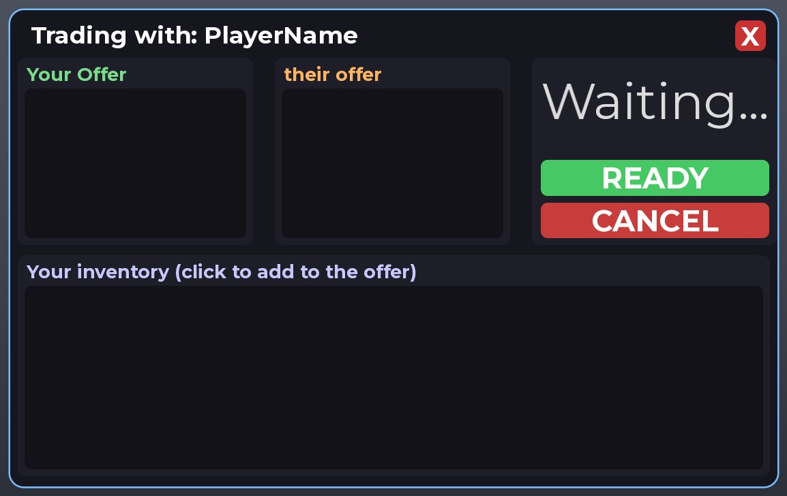
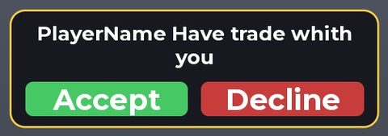
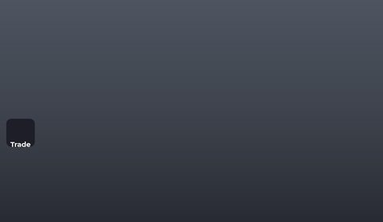
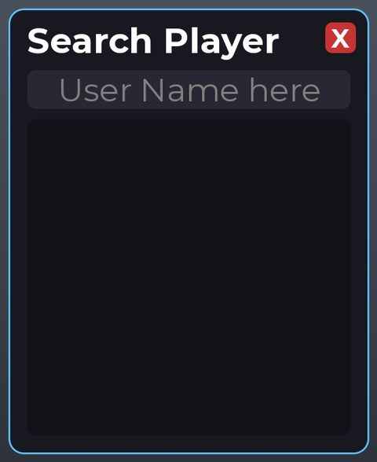
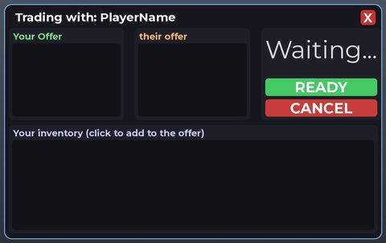

# Trade System V1

> ⚙️ **System** · system module (trading UI + service) · source file `TRADE SYSTEM V1 +1 SPEED MADE BY SLBR.rbxm`

[⬅ Back to the catalog](../../README.md) · [Assets inventory](ASSETS.md) · [Style numbers](reference.md) · [Scripts](source/scripts/) · [Code analysis](source/README.md)

## At a glance

| | |
|---|---|
| Provenance | template with full source |
| Screens | 1 ScreenGuis, 35 GUI objects → **4 screenshots** |
| Models (.rbxm) | 0 models, 0 model sets, 0 VFX sets |
| Lua builders (.lua) | 1 UI screens, 0 animation packs, 0 audio packs |
| Code | 2 scripts, 1,013 lines |
| Asset ids | 0 animations, 0 sounds |
| Safety scan | 0 HIGH / 0 MED flags ([flags.txt](source/flags.txt)) |

**Fonts:** `GothamSSm Bold`×16, `GothamSSm Regular`×3

## UI screenshots

Captured in Studio from the place's own ScreenGuis (scripts stripped). Each panel was opened on its own; click a thumbnail for the full 1519×886 frame. Runtime-filled lists (shop items, inventories) show their template state.

### Quests & progression

<table>
<tr>
<td width="33%" valign="top"> <b>TradeGui</b> › RequestPopup</td>
</tr>
</table>

### Trading

<table>
<tr>
<td width="33%" valign="top"> <b>TradeGui</b></td>
<td width="33%" valign="top"> <b>TradeGui</b> › SearchFrame</td>
<td width="33%" valign="top"> <b>TradeGui</b> › TradeWindow</td>
</tr>
</table>

## Notable scripts

Top-scored scripts of this game per topic (full tree in [source/scripts](source/scripts/)).

| Topic | Scripts |
|---|---|
| UI controllers / window managers / menus | [`TradeClient`](source/scripts/UNGROUP%20ME%20-%20Trade%20System/UNGROUP%20ME%20ON%20STARTER%20PLAYER%20SCRIPTS/TradeClient.client.lua) 424 lines |
| Notifications, toasts, popups, prompts | [`TradeClient`](source/scripts/UNGROUP%20ME%20-%20Trade%20System/UNGROUP%20ME%20ON%20STARTER%20PLAYER%20SCRIPTS/TradeClient.client.lua) 424 lines |
| Trading systems | [`TradeService`](source/scripts/UNGROUP%20ME%20-%20Trade%20System/UNGROUP%20ME%20ON%20SSS-BOOSTRAP-SERVER/TradeService.lua) 591 lines [`TradeClient`](source/scripts/UNGROUP%20ME%20-%20Trade%20System/UNGROUP%20ME%20ON%20STARTER%20PLAYER%20SCRIPTS/TradeClient.client.lua) 424 lines |

### In the curated script library

- [Cross-server trade service](../../Scripts/10-Trading/CrossServerTradeService__trade-system.lua) — Trades across servers using MemoryStore sessions, a presence map for search, and MessagingService sync.
- [Cross-server trade client](../../Scripts/10-Trading/CrossServerTradeClient__trade-system.lua) — Client with live cross-server player search, request popup and offer grids.

## Folders

| Folder | What |
|---|---|
| `screenshots/` | full frames; `crops/` = the panel only; `models/` = 3D previews; `thumbs/` = gallery thumbnails |
| `ui/` | every screen as a Lua builder (`require(module)()` returns the ScreenGui); `_StarterGui-all.lua` builds every StarterGui screen |
| `models/` | every model as .rbxm (the only .rbxm files), mirroring the place tree, scripts removed |
| `map/` | `workspace.rbxm` (the map as a model), `lighting.lua` (sky + post effects), `materials.lua`, `Environment.lua` |
| `animations/`, `audio/` | KeyframeSequence / Sound builders (.lua), `AnimationIds.lua`, `Sounds.lua` |
| `source/` | all scripts as .luau, `tree.txt`, `ui.txt`, `remotes.txt`, `assets.txt`, `flags.txt` |
