# UNO

> 🎉 **Party** · card game · source file `UNO Game Working.rbxl`

[⬅ Back to the catalog](../../README.md) · [Assets inventory](ASSETS.md) · [Style numbers](reference.md) · [Scripts](source/scripts/) · [Code analysis](source/README.md)

## At a glance

| | |
|---|---|
| Provenance | template with full source |
| Screens | 3 ScreenGuis, 3786 GUI objects → **22 screenshots** |
| Models (.rbxm) | 339 models, 6 model sets, 1 VFX sets |
| Lua builders (.lua) | 10 UI screens, 20 animation packs, 1 audio packs |
| Code | 28 scripts, 22,503 lines |
| Asset ids | 3 animations, 49 sounds |
| Safety scan | 0 HIGH / 0 MED flags ([flags.txt](source/flags.txt)) |

**Fonts:** `SourceSansPro Bold`×469, `SourceSansPro SemiBold`×347, `SourceSansPro Regular`×273, `GothamSSm Medium`×18, `DenkOne Regular`×2

## UI screenshots

Captured in Studio from the place's own ScreenGuis (scripts stripped). Each panel was opened on its own; click a thumbnail for the full 1519×886 frame. Runtime-filled lists (shop items, inventories) show their template state.

### Quests & progression

<table>
<tr>
<td width="33%" valign="top"><a href="screenshots/17_GameUI__RequestListTemp.jpg">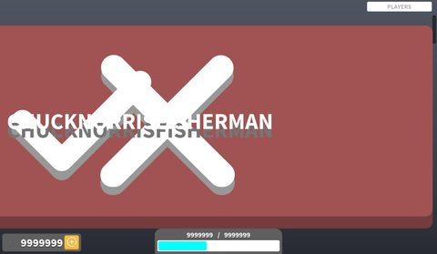</a> <b>GameUI</b> › Everything.GuiTemplates.RequestListTemp</td>
<td width="33%" valign="top"> <b>GameUI</b> › Everything.TradeRequests.RequestTemp</td>
<td width="33%" valign="top"> <b>RealGame</b> › TradeRequests.RequestTemp</td>
</tr>
</table>

### Trading

<table>
<tr>
<td width="33%" valign="top"><a href="screenshots/18_GameUI__TradeListTemp.jpg">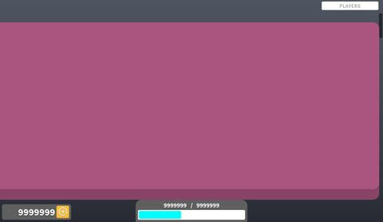</a> <b>GameUI</b> › Everything.GuiTemplates.TradeListTemp</td>
<td width="33%" valign="top"><a href="screenshots/19_GameUI__TradingT.jpg">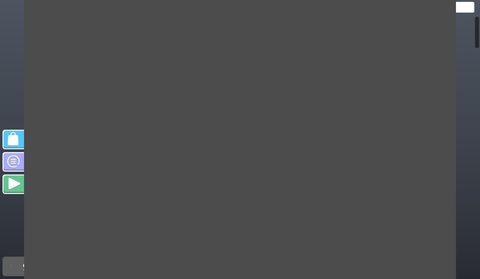</a> <b>GameUI</b> › Everything.GuiTemplates.TradingT</td>
</tr>
</table>

### Settings & menus

<table>
<tr>
<td width="33%" valign="top"><a href="screenshots/13_GameUI__SettingsConstant.jpg">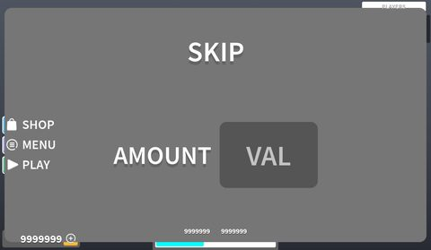</a> <b>GameUI</b> › Everything.GuiTemplates.SettingsConstant</td>
<td width="33%" valign="top"><a href="screenshots/14_GameUI__SettingsVariable.jpg">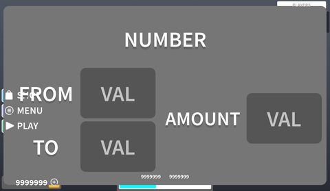</a> <b>GameUI</b> › Everything.GuiTemplates.SettingsVariable</td>
</tr>
</table>

### Popups, notifications, prompts

<table>
<tr>
<td width="33%" valign="top"><a href="screenshots/05_GameUI__NotifTemplate.jpg">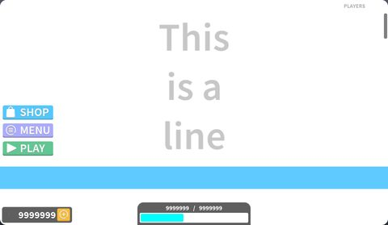</a> <b>GameUI</b> › Everything.GuiTemplates.NotifTemplate</td>
</tr>
</table>

### End of round, death, results

<table>
<tr>
<td width="33%" valign="top"><a href="screenshots/06_GameUI__LoserTemplate.jpg">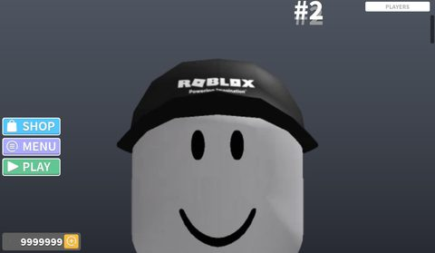</a> <b>GameUI</b> › Everything.GuiTemplates.LoserTemplate</td>
</tr>
</table>

### Other

<table>
<tr>
<td width="33%" valign="top"><a href="screenshots/01_GameUI.jpg">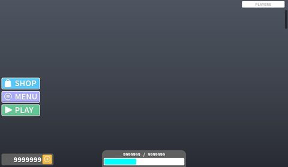</a> <b>GameUI</b></td>
<td width="33%" valign="top"><a href="screenshots/02_GameUI__JoinB.jpg">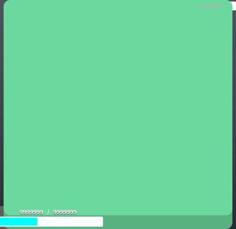</a> <b>GameUI</b> › Everything.GuiTemplates.ListTemp.JoinB</td>
<td width="33%" valign="top"><a href="screenshots/03_GameUI__PlrBoxes.jpg">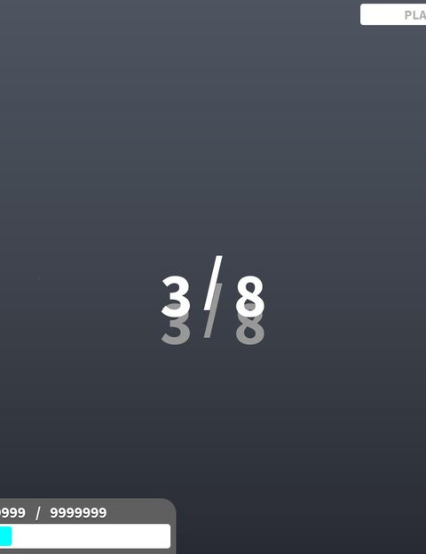</a> <b>GameUI</b> › Everything.GuiTemplates.ListTemp.PlrBoxes</td>
</tr>
<tr>
<td width="33%" valign="top"><a href="screenshots/04_GameUI__PlrTemplate.jpg">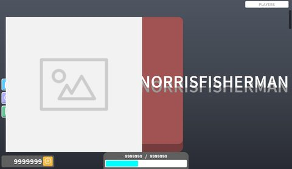</a> <b>GameUI</b> › Everything.GuiTemplates.PlrTemplate</td>
<td width="33%" valign="top"> <b>GameUI</b> › Everything.GuiTemplates.ColB</td>
<td width="33%" valign="top"><a href="screenshots/08_GameUI__SwapTemp.jpg">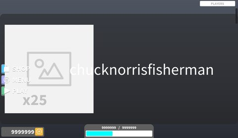</a> <b>GameUI</b> › Everything.GuiTemplates.SwapTemp</td>
</tr>
<tr>
<td width="33%" valign="top"><a href="screenshots/09_GameUI__NumTemp.jpg">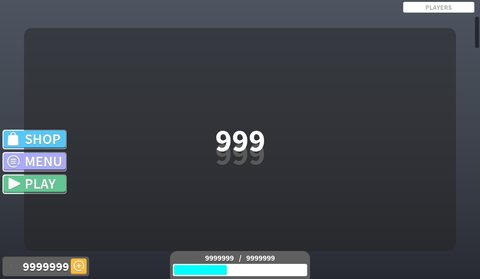</a> <b>GameUI</b> › Everything.GuiTemplates.NumTemp</td>
<td width="33%" valign="top"><a href="screenshots/10_GameUI__InvB.jpg">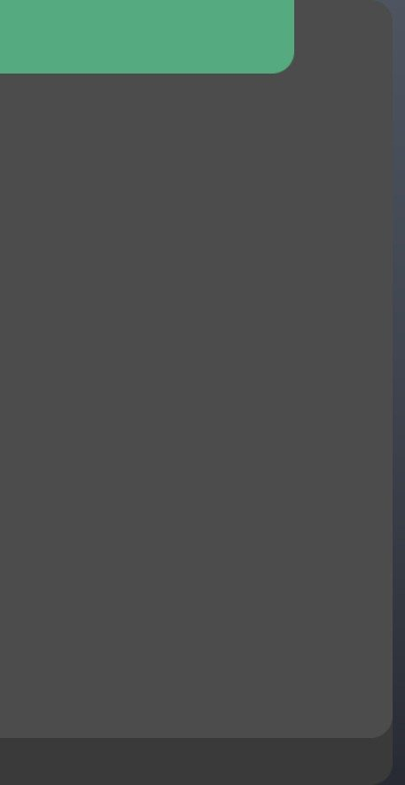</a> <b>GameUI</b> › Everything.GuiTemplates.InvB</td>
<td width="33%" valign="top"><a href="screenshots/11_GameUI__DeckB.jpg">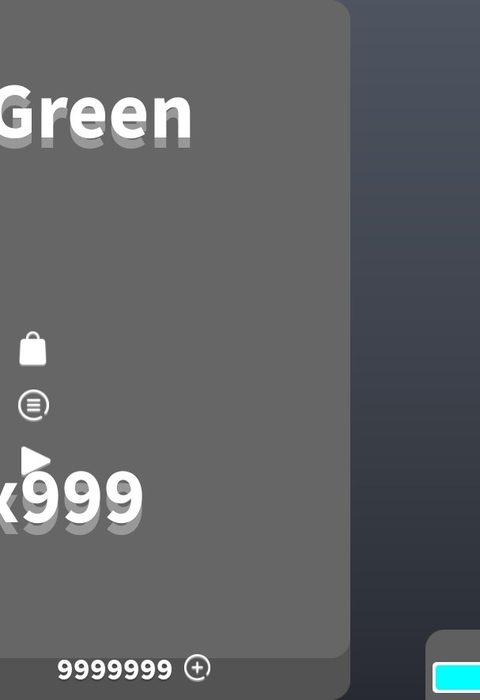</a> <b>GameUI</b> › Everything.GuiTemplates.DeckB</td>
</tr>
<tr>
<td width="33%" valign="top"><a href="screenshots/12_GameUI__CardEdit.jpg">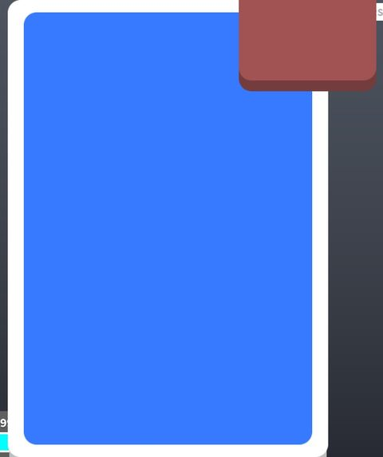</a> <b>GameUI</b> › Everything.GuiTemplates.CardEdit</td>
<td width="33%" valign="top"><a href="screenshots/15_GameUI__SpecTemp.jpg">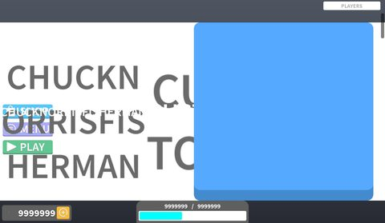</a> <b>GameUI</b> › Everything.GuiTemplates.SpecTemp</td>
<td width="33%" valign="top"><a href="screenshots/16_GameUI__PlrListHolder.jpg">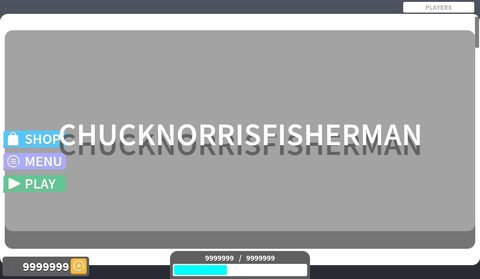</a> <b>GameUI</b> › Everything.GuiTemplates.PlrListHolder</td>
</tr>
<tr>
<td width="33%" valign="top"><a href="screenshots/20_GameUI__CardInfo.jpg">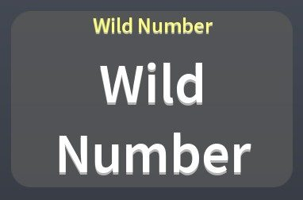</a> <b>GameUI</b> › Everything.CardInfo</td>
</tr>
</table>

## Model previews

<table>
<tr>
<td width="25%" valign="top"><a href="models/ReplicatedStorage/Cosmetics/Decorations/Candy.rbxm">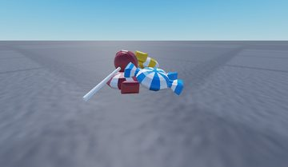</a> <b>Candy</b> <code>models/ReplicatedStorage/Cosmetics/Decorations/Candy.rbxm</code></td>
<td width="25%" valign="top"><a href="models/ReplicatedStorage/CaseRigs/Decor%20Crate%20%231.rbxm">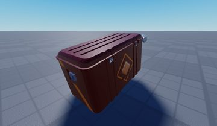</a> <b>Decor Crate #1</b> <code>models/ReplicatedStorage/CaseRigs/Decor Crate #1.rbxm</code></td>
<td width="25%" valign="top"><a href="models/ReplicatedStorage/Cosmetics/Decorations/Water%20Gun.rbxm">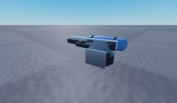</a> <b>Water Gun</b> <code>models/ReplicatedStorage/Cosmetics/Decorations/Water Gun.rbxm</code></td>
<td width="25%" valign="top"><a href="models/ReplicatedStorage/Cosmetics/Decorations/Train.rbxm">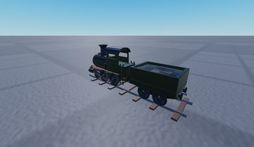</a> <b>Train</b> <code>models/ReplicatedStorage/Cosmetics/Decorations/Train.rbxm</code></td>
</tr>
<tr>
<td width="25%" valign="top"><a href="models/Workspace/ItemShowcase.rbxm">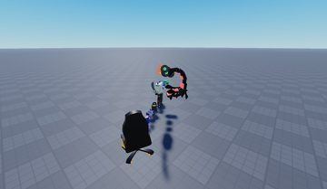</a> <b>ItemShowcase</b> <code>models/Workspace/ItemShowcase.rbxm</code></td>
<td width="25%" valign="top"><a href="models/ReplicatedStorage/MiscAssets/JoinBoards/JoinBoard__x6.rbxm">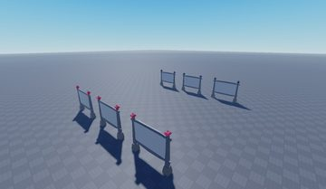</a> <b>JoinBoard__x6</b> <code>models/ReplicatedStorage/MiscAssets/JoinBoards/JoinBoard__x6.rbxm</code></td>
<td width="25%" valign="top"><a href="models/ReplicatedStorage/ViewportModels/Keys.rbxm">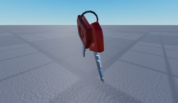</a> <b>Keys</b> <code>models/ReplicatedStorage/ViewportModels/Keys.rbxm</code></td>
<td width="25%" valign="top"><a href="models/ReplicatedStorage/ViewportModels/Plant.rbxm">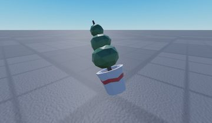</a> <b>Plant</b> <code>models/ReplicatedStorage/ViewportModels/Plant.rbxm</code></td>
</tr>
<tr>
<td width="25%" valign="top"><a href="models/ReplicatedStorage/ViewportModels/Waiting%20Room.rbxm">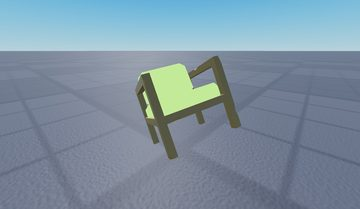</a> <b>Waiting Room</b> <code>models/ReplicatedStorage/ViewportModels/Waiting Room.rbxm</code></td>
<td width="25%" valign="top"><a href="models/Workspace/DecorReference.rbxm">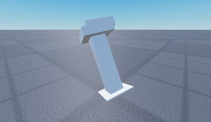</a> <b>DecorReference</b> <code>models/Workspace/DecorReference.rbxm</code></td>
<td width="25%" valign="top"><a href="models/Workspace/CoinsRarityModels.rbxm">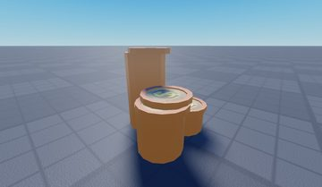</a> <b>CoinsRarityModels</b> <code>models/Workspace/CoinsRarityModels.rbxm</code></td>
<td width="25%" valign="top"><a href="models/ReplicatedStorage/Cosmetics/Decorations/Gold%20Gun.rbxm">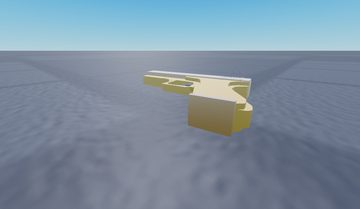</a> <b>Gold Gun</b> <code>models/ReplicatedStorage/Cosmetics/Decorations/Gold Gun.rbxm</code></td>
</tr>
<tr>
<td width="25%" valign="top"><a href="models/ReplicatedStorage/MiscAssets/JoinBoards/JoinBoard.rbxm">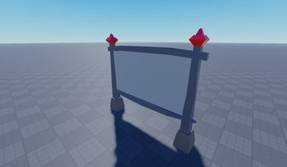</a> <b>JoinBoard</b> <code>models/ReplicatedStorage/MiscAssets/JoinBoards/JoinBoard.rbxm</code></td>
</tr>
</table>

## Notable scripts

Top-scored scripts of this game per topic (full tree in [source/scripts](source/scripts/)).

| Topic | Scripts |
|---|---|
| UI animation (tweens, hover / click, pop-ins, springs) | [`Client`](source/scripts/StarterGui/GameUI/Everything/Client.client.lua) 3544 lines [`ButtonManager`](source/scripts/StarterGui/GameUI/Everything/Client/ButtonManager.lua) 360 lines [`BindableManager`](source/scripts/StarterGui/GameUI/Everything/Client/BindableManager.lua) 5867 lines [`PlayerConManager`](source/scripts/StarterGui/GameUI/Everything/Client/PlayerConManager.lua) 184 lines |
| UI controllers / window managers / menus | [`Server`](source/scripts/ServerScriptService/Server.server.lua) 1368 lines [`Client`](source/scripts/StarterGui/GameUI/Everything/Client.client.lua) 3544 lines [`BindableManager`](source/scripts/StarterGui/GameUI/Everything/Client/BindableManager.lua) 5867 lines [`LobbyManager`](source/scripts/StarterGui/GameUI/Everything/Client/LobbyManager.lua) 230 lines [`GameHandler`](source/scripts/ServerScriptService/Server/GameHandler.lua) 2884 lines |
| Notifications, toasts, popups, prompts | [`NotificationManager`](source/scripts/StarterGui/GameUI/Everything/Client/NotificationManager.lua) 48 lines [`Client`](source/scripts/StarterGui/GameUI/Everything/Client.client.lua) 3544 lines [`BindableManager`](source/scripts/StarterGui/GameUI/Everything/Client/BindableManager.lua) 5867 lines [`Server`](source/scripts/ServerScriptService/Server.server.lua) 1368 lines [`LobbyManager`](source/scripts/StarterGui/GameUI/Everything/Client/LobbyManager.lua) 230 lines |
| Camera, cutscenes, screen shake | [`Client`](source/scripts/StarterGui/GameUI/Everything/Client.client.lua) 3544 lines |
| DataStore / player data | [`DataHandler`](source/scripts/ServerScriptService/Server/DataHandler.lua) 672 lines |
| Monetization (dev products, game passes, receipts) | [`Server`](source/scripts/ServerScriptService/Server.server.lua) 1368 lines |
| RNG, eggs, gacha, rarity rolls, pets | [`CrateIndex`](source/scripts/ReplicatedStorage/Modules/CrateIndex.lua) 560 lines [`Client`](source/scripts/StarterGui/GameUI/Everything/Client.client.lua) 3544 lines [`InventoryHandler`](source/scripts/ServerScriptService/Server/InventoryHandler.lua) 1098 lines [`CraftingHandler`](source/scripts/ServerScriptService/Server/CraftingHandler.lua) 266 lines [`LevelHandler`](source/scripts/ServerScriptService/Server/LevelHandler.lua) 197 lines |
| Trading systems | [`TradeHandler`](source/scripts/ServerScriptService/Server/TradeHandler.lua) 492 lines [`TradeListManager`](source/scripts/StarterGui/GameUI/Everything/Client/TradeListManager.lua) 100 lines |
| Character movement (sprint, dash, double jump, slide) | [`Server`](source/scripts/ServerScriptService/Server.server.lua) 1368 lines [`Client`](source/scripts/StarterGui/GameUI/Everything/Client.client.lua) 3544 lines [`BindableManager`](source/scripts/StarterGui/GameUI/Everything/Client/BindableManager.lua) 5867 lines |
| Tycoon / plots / bases / building | [`BindableManager`](source/scripts/StarterGui/GameUI/Everything/Client/BindableManager.lua) 5867 lines [`Client`](source/scripts/StarterGui/GameUI/Everything/Client.client.lua) 3544 lines |
| Leaderboards & stats | [`GlobalLeaderboard`](source/scripts/ServerScriptService/Server/GlobalLeaderboard.lua) 146 lines |
| Daily rewards, quests, codes, playtime | [`CodeHandler`](source/scripts/ServerScriptService/Server/CodeHandler.lua) 211 lines [`DailyReward`](source/scripts/ServerScriptService/Server/DailyReward.lua) 94 lines [`DataHandler`](source/scripts/ServerScriptService/Server/DataHandler.lua) 672 lines [`Server`](source/scripts/ServerScriptService/Server.server.lua) 1368 lines |
| Utility modules (number format, signals, tables, timers) | [`Util`](source/scripts/ServerScriptService/Server/Util.lua) 310 lines |

### In the curated script library

- [Codes stored in a DataStore (add without updating)](../../Scripts/18-Daily-Rewards-Quests/CodeHandler-DataStoreCodes__uno.lua) — Codes kept in a DataStore list with expiry timestamps and reward types, loaded into the server on start and refreshable, so new codes can be added without shutting servers down.
- [Session store + trade save-lock](../../Scripts/07-Data-Saving/DataHandler-SessionStore__uno.lua) — Separate SessionStore with a heartbeat-style timestamp (90s timeout), plus a SaveLocked flag used to freeze saves during trades so items cannot be duplicated.
- [Basic ordered store board](../../Scripts/15-Leaderboards/GlobalLeaderboard-Basic__uno.lua) — The beginner version: GetSortedAsync top 50 into a SurfaceGui scroller with GetNameFromUserIdAsync, and SetAsync helpers with retry.
- [Sliding notification list](../../Scripts/03-Notifications/SlideNotificationList__uno.lua) — Good/Neutral/Bad notifications with colored side bar and sound; new ones slide in at the top and push older ones down, then slide out left. NOTE: the original has "if true then return end" at the top (disabled in game).
- [Instance-based trade handler](../../Scripts/10-Trading/InstanceTradeHandler__uno.lua) — Trade state as a cloned Folder of Value objects, confirm then accept, save lock while swapping.

## Folders

| Folder | What |
|---|---|
| `screenshots/` | full frames; `crops/` = the panel only; `models/` = 3D previews; `thumbs/` = gallery thumbnails |
| `ui/` | every screen as a Lua builder (`require(module)()` returns the ScreenGui); `_StarterGui-all.lua` builds every StarterGui screen |
| `models/` | every model as .rbxm (the only .rbxm files), mirroring the place tree, scripts removed |
| `map/` | `workspace.rbxm` (the map as a model), `lighting.lua` (sky + post effects), `materials.lua`, `Environment.lua` |
| `animations/`, `audio/` | KeyframeSequence / Sound builders (.lua), `AnimationIds.lua`, `Sounds.lua` |
| `source/` | all scripts as .luau, `tree.txt`, `ui.txt`, `remotes.txt`, `assets.txt`, `flags.txt` |
