# 100 Weapons Models (mtsowiks)

> 📦 **Model Pack** · model pack (weapons) · source file `100 weapons models made by mtsowiks.rbxm`

[⬅ Back to the catalog](../../README.md) · [Assets inventory](ASSETS.md) · [Style numbers](reference.md) · [Scripts](source/scripts/) · [Code analysis](source/README.md)

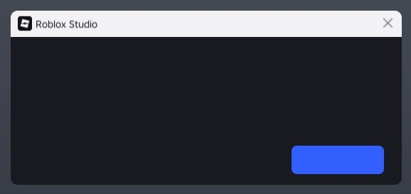

## At a glance

| | |
|---|---|
| Provenance | template with full source |
| Screens | 8 ScreenGuis, 1232 GUI objects → **2 screenshots** |
| Models (.rbxm) | 477 models, 0 model sets, 2 VFX sets |
| Lua builders (.lua) | 8 UI screens, 18 animation packs, 25 audio packs |
| Code | 50 scripts, 14,087 lines |
| Asset ids | 51 animations, 41 sounds |
| Safety scan | 0 HIGH / 2 MED flags ([flags.txt](source/flags.txt)) |

**Fonts:** `LegacyArial Regular`×304, `BuilderSans Regular`×24, `BuilderSans Bold`×24, `BuilderSans SemiBold`×16, `BuilderMono Regular`×16

## UI screenshots

Captured in Studio from the place's own ScreenGuis (scripts stripped). Each panel was opened on its own; click a thumbnail for the full 1519×886 frame. Runtime-filled lists (shop items, inventories) show their template state.

### Other

<table>
<tr>
<td width="33%" valign="top"><a href="screenshots/01_InputBinding__Frame.jpg">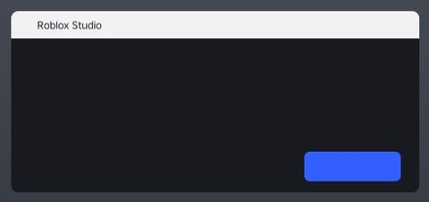</a> <b>InputBinding</b> › Frame</td>
<td width="33%" valign="top"><a href="screenshots/02_InputBinding__Frame.jpg">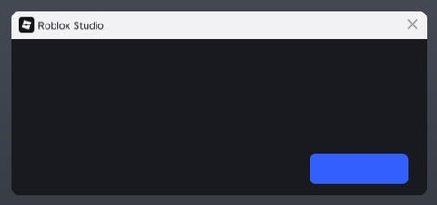</a> <b>InputBinding</b> › Frame</td>
</tr>
</table>

## Model previews

<table>
<tr>
<td width="25%" valign="top"><a href="models/PACK%20100%20MODELS%20BBY%20MTSOWIKSS%20WEAPONS/Folder/Swords/Main~45.rbxm">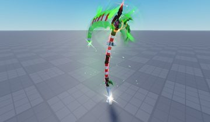</a> <b>Main~45</b> <code>models/PACK 100 MODELS BBY MTSOWIKSS WEAPONS/Folder/Swords/Main~45.rbxm</code></td>
<td width="25%" valign="top"><a href="models/PACK%20100%20MODELS%20BBY%20MTSOWIKSS%20WEAPONS/Folder/Swords/Main.rbxm">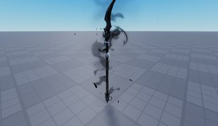</a> <b>Main</b> <code>models/PACK 100 MODELS BBY MTSOWIKSS WEAPONS/Folder/Swords/Main.rbxm</code></td>
<td width="25%" valign="top"><a href="models/PACK%20100%20MODELS%20BBY%20MTSOWIKSS%20WEAPONS/Folder/_~18.rbxm">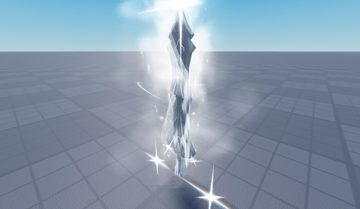</a> <b>_~18</b> <code>models/PACK 100 MODELS BBY MTSOWIKSS WEAPONS/Folder/_~18.rbxm</code></td>
<td width="25%" valign="top"><a href="models/PACK%20100%20MODELS%20BBY%20MTSOWIKSS%20WEAPONS/Folder/Handle~17.rbxm">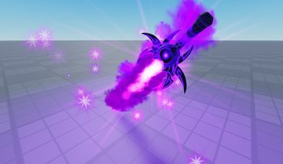</a> <b>Handle~17</b> <code>models/PACK 100 MODELS BBY MTSOWIKSS WEAPONS/Folder/Handle~17.rbxm</code></td>
</tr>
<tr>
<td width="25%" valign="top"><a href="models/PACK%20100%20MODELS%20BBY%20MTSOWIKSS%20WEAPONS/Folder/Meshes_katana_Cylinder.rbxm">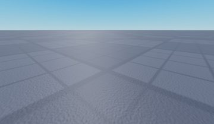</a> <b>Meshes_katana_Cylinder</b> <code>models/PACK 100 MODELS BBY MTSOWIKSS WEAPONS/Folder/Meshes_katana_Cylinder.rbxm</code></td>
<td width="25%" valign="top"><a href="models/PACK%20100%20MODELS%20BBY%20MTSOWIKSS%20WEAPONS/Folder/Meshes_broadsword_Cylinder.rbxm">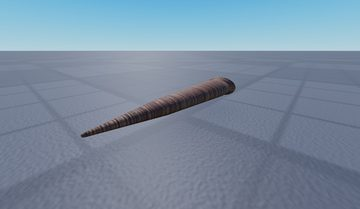</a> <b>Meshes_broadsword_Cylinder</b> <code>models/PACK 100 MODELS BBY MTSOWIKSS WEAPONS/Folder/Meshes_broadsword_Cylinder.rbxm</code></td>
<td width="25%" valign="top"><a href="models/PACK%20100%20MODELS%20BBY%20MTSOWIKSS%20WEAPONS/Folder/Meshes_longsword_Cylinder.rbxm">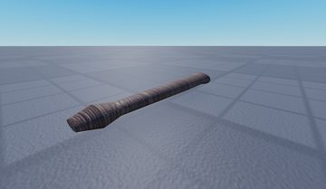</a> <b>Meshes_longsword_Cylinder</b> <code>models/PACK 100 MODELS BBY MTSOWIKSS WEAPONS/Folder/Meshes_longsword_Cylinder.rbxm</code></td>
<td width="25%" valign="top"><a href="models/PACK%20100%20MODELS%20BBY%20MTSOWIKSS%20WEAPONS/Folder/Meshes_easternsword_Cube.rbxm">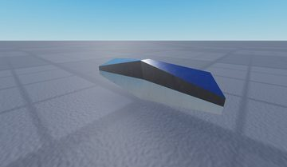</a> <b>Meshes_easternsword_Cube</b> <code>models/PACK 100 MODELS BBY MTSOWIKSS WEAPONS/Folder/Meshes_easternsword_Cube.rbxm</code></td>
</tr>
<tr>
<td width="25%" valign="top"><a href="models/PACK%20100%20MODELS%20BBY%20MTSOWIKSS%20WEAPONS/Folder/Base.rbxm">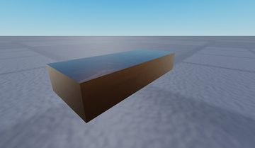</a> <b>Base</b> <code>models/PACK 100 MODELS BBY MTSOWIKSS WEAPONS/Folder/Base.rbxm</code></td>
<td width="25%" valign="top"><a href="models/PACK%20100%20MODELS%20BBY%20MTSOWIKSS%20WEAPONS/Folder/Base~2.rbxm">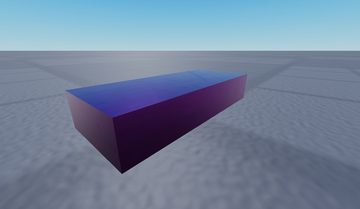</a> <b>Base~2</b> <code>models/PACK 100 MODELS BBY MTSOWIKSS WEAPONS/Folder/Base~2.rbxm</code></td>
<td width="25%" valign="top"><a href="models/PACK%20100%20MODELS%20BBY%20MTSOWIKSS%20WEAPONS/Folder/Pickaxe.rbxm">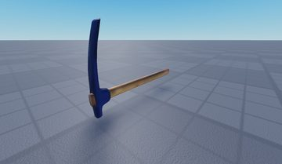</a> <b>Pickaxe</b> <code>models/PACK 100 MODELS BBY MTSOWIKSS WEAPONS/Folder/Pickaxe.rbxm</code></td>
<td width="25%" valign="top"><a href="models/PACK%20100%20MODELS%20BBY%20MTSOWIKSS%20WEAPONS/Folder/M16.rbxm">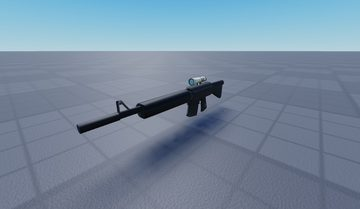</a> <b>M16</b> <code>models/PACK 100 MODELS BBY MTSOWIKSS WEAPONS/Folder/M16.rbxm</code></td>
</tr>
<tr>
<td width="25%" valign="top"><a href="models/PACK%20100%20MODELS%20BBY%20MTSOWIKSS%20WEAPONS/Folder/Carbine.rbxm">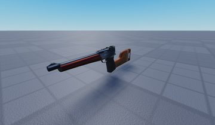</a> <b>Carbine</b> <code>models/PACK 100 MODELS BBY MTSOWIKSS WEAPONS/Folder/Carbine.rbxm</code></td>
</tr>
</table>

## Notable scripts

Top-scored scripts of this game per topic (full tree in [source/scripts](source/scripts/)).

| Topic | Scripts |
|---|---|
| UI animation (tweens, hover / click, pop-ins, springs) | [`ScreenBuilder`](source/scripts/PACK%20100%20MODELS%20BBY%20MTSOWIKSS%20WEAPONS/Folder/Meshes_broadsword_Cylinder/Runtime/RuntimeInput/RuntimeInputContext/MovementElevateAction/InputBinding~3/ScreenBuilder.client.lua) 1216 lines |
| Notifications, toasts, popups, prompts | [`ScreenBuilder`](source/scripts/PACK%20100%20MODELS%20BBY%20MTSOWIKSS%20WEAPONS/Folder/Meshes_broadsword_Cylinder/Runtime/RuntimeInput/RuntimeInputContext/MovementElevateAction/InputBinding~3/ScreenBuilder.client.lua) 1216 lines |
| VFX, particles, beams, hit effects | [`BlackHoleScript`](source/scripts/PACK%20100%20MODELS%20BBY%20MTSOWIKSS%20WEAPONS/Folder/Server/BlackHoleScript.server.lua) 287 lines [`SwordScript`](source/scripts/PACK%20100%20MODELS%20BBY%20MTSOWIKSS%20WEAPONS/Folder/SwordScript.server.lua) 215 lines [`ScreenBuilder`](source/scripts/PACK%20100%20MODELS%20BBY%20MTSOWIKSS%20WEAPONS/Folder/Meshes_broadsword_Cylinder/Runtime/RuntimeInput/RuntimeInputContext/MovementElevateAction/InputBinding~3/ScreenBuilder.client.lua) 1216 lines |
| RNG, eggs, gacha, rarity rolls, pets | [`ScreenBuilder`](source/scripts/PACK%20100%20MODELS%20BBY%20MTSOWIKSS%20WEAPONS/Folder/Meshes_broadsword_Cylinder/Runtime/RuntimeInput/RuntimeInputContext/MovementElevateAction/InputBinding~3/ScreenBuilder.client.lua) 1216 lines |
| Combat, weapons, hitboxes, abilities | [`Attack`](source/scripts/PACK%20100%20MODELS%20BBY%20MTSOWIKSS%20WEAPONS/Folder/Put%20In%20StarterPack/Attack.server.lua) 78 lines [`SwordScript`](source/scripts/PACK%20100%20MODELS%20BBY%20MTSOWIKSS%20WEAPONS/Folder/SwordScript.server.lua) 215 lines |
| Character movement (sprint, dash, double jump, slide) | [`SkeleScript`](source/scripts/PACK%20100%20MODELS%20BBY%20MTSOWIKSS%20WEAPONS/Folder/Server/SkeleScript.server.lua) 353 lines |
| Tycoon / plots / bases / building | [`ScreenBuilder`](source/scripts/PACK%20100%20MODELS%20BBY%20MTSOWIKSS%20WEAPONS/Folder/Meshes_broadsword_Cylinder/Runtime/RuntimeInput/RuntimeInputContext/MovementElevateAction/InputBinding~3/ScreenBuilder.client.lua) 1216 lines [`SkeleScript`](source/scripts/PACK%20100%20MODELS%20BBY%20MTSOWIKSS%20WEAPONS/Folder/Server/SkeleScript.server.lua) 353 lines |

## Folders

| Folder | What |
|---|---|
| `screenshots/` | full frames; `crops/` = the panel only; `models/` = 3D previews; `thumbs/` = gallery thumbnails |
| `ui/` | every screen as a Lua builder (`require(module)()` returns the ScreenGui); `_StarterGui-all.lua` builds every StarterGui screen |
| `models/` | every model as .rbxm (the only .rbxm files), mirroring the place tree, scripts removed |
| `map/` | `workspace.rbxm` (the map as a model), `lighting.lua` (sky + post effects), `materials.lua`, `Environment.lua` |
| `animations/`, `audio/` | KeyframeSequence / Sound builders (.lua), `AnimationIds.lua`, `Sounds.lua` |
| `source/` | all scripts as .luau, `tree.txt`, `ui.txt`, `remotes.txt`, `assets.txt`, `flags.txt` |
