# Work at a Pizza Place

> 🏙️ **Roleplay** · roleplay / job simulator · source file `Work_at_a_pizza_place.rbxl`

[⬅ Back to the catalog](../../README.md) · [Assets inventory](ASSETS.md) · [Style numbers](reference.md) · [Scripts](source/scripts/) · [Code analysis](source/README.md)

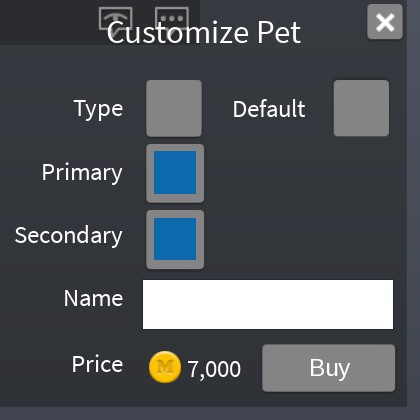

## At a glance

| | |
|---|---|
| Provenance | template with full source |
| Screens | 2 ScreenGuis, 1242 GUI objects → **29 screenshots** |
| Models (.rbxm) | 539 models, 30 model sets, 3 VFX sets |
| Lua builders (.lua) | 7 UI screens, 1 animation packs, 5 audio packs |
| Code | 438 scripts, 56,367 lines |
| Asset ids | 69 animations, 91 sounds |
| Safety scan | 3 HIGH / 9 MED flags ([flags.txt](source/flags.txt)) |

**Fonts:** `LegacyArial Regular`×248, `SourceSansPro Regular`×217, `SourceSansPro Bold`×63, `Arial Bold`×56, `ComicNeueAngular Regular`×5

## UI screenshots

Captured in Studio from the place's own ScreenGuis (scripts stripped). Each panel was opened on its own; click a thumbnail for the full 1519×886 frame. Runtime-filled lists (shop items, inventories) show their template state.

### Inventory / backpack / pets

<table>
<tr>
<td width="33%" valign="top"><a href="screenshots/03_MainGui__Inventory.jpg">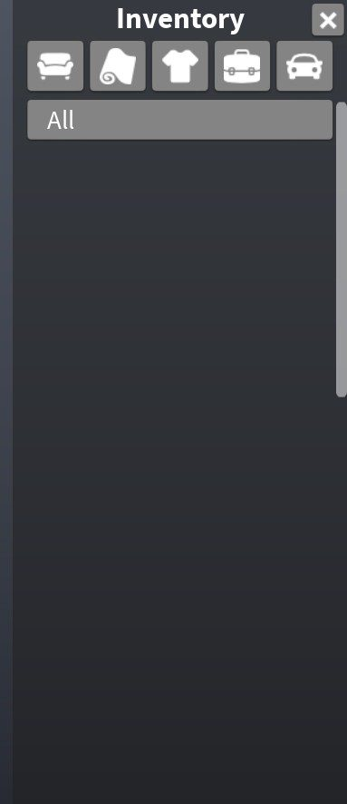</a> <b>MainGui</b> › Menu.Inventory</td>
<td width="33%" valign="top"><a href="screenshots/09_MainGui__PetPanel.jpg">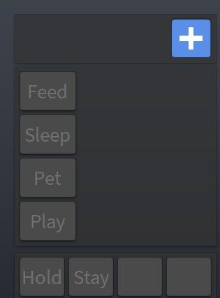</a> <b>MainGui</b> › Menu.Pet.PetPanel</td>
<td width="33%" valign="top"><a href="screenshots/10_MainGui__CustomizePet.jpg">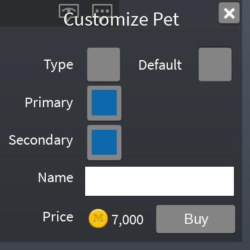</a> <b>MainGui</b> › Menu.Pet.CustomizePet</td>
</tr>
<tr>
<td width="33%" valign="top"><a href="screenshots/11_MainGui__PetHats.jpg">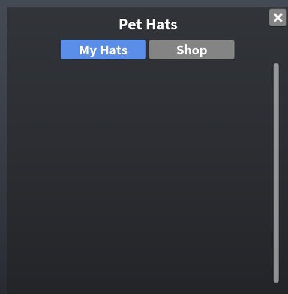</a> <b>MainGui</b> › Menu.Pet.PetHats</td>
</tr>
</table>

### Index / codex / glossary

<table>
<tr>
<td width="33%" valign="top"><a href="screenshots/02_MainGui__Catalog.jpg">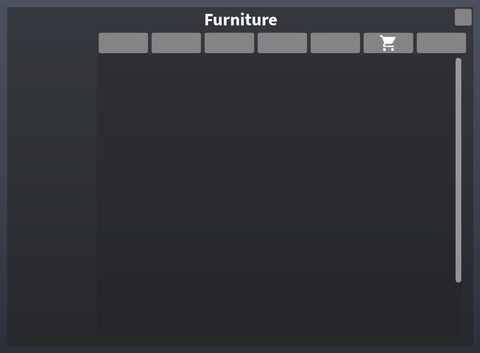</a> <b>MainGui</b> › Menu.Catalog</td>
</tr>
</table>

### Quests & progression

<table>
<tr>
<td width="33%" valign="top"><a href="screenshots/08_MainGui__Upgrade.jpg">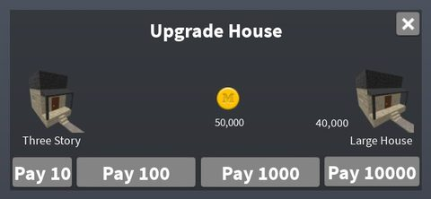</a> <b>MainGui</b> › Menu.Upgrade</td>
</tr>
</table>

### Settings & menus

<table>
<tr>
<td width="33%" valign="top"><a href="screenshots/04_MainGui__Manage.jpg">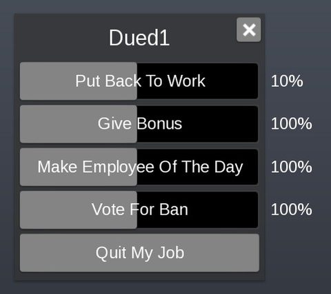</a> <b>MainGui</b> › Menu.Manage</td>
<td width="33%" valign="top"><a href="screenshots/05_MainGui__GamepadMainMenu.jpg">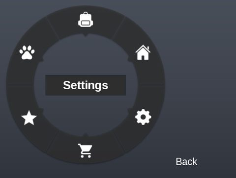</a> <b>MainGui</b> › Menu.GamepadMainMenu</td>
<td width="33%" valign="top"><a href="screenshots/06_MainGui__Settings.jpg">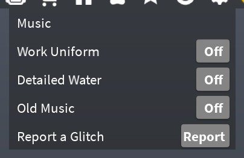</a> <b>MainGui</b> › Menu.Settings</td>
</tr>
<tr>
<td width="33%" valign="top"><a href="screenshots/07_MainGui__Ratings.jpg">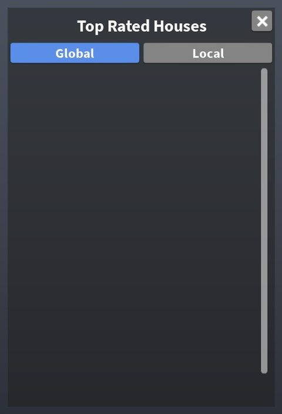</a> <b>MainGui</b> › Menu.Ratings</td>
<td width="33%" valign="top"><a href="screenshots/14_MainGui__FoodMenu.jpg">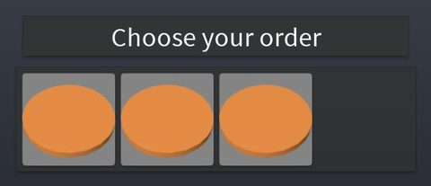</a> <b>MainGui</b> › Prompts.FoodMenu</td>
<td width="33%" valign="top"><a href="screenshots/26_ChooseJob__Play.jpg">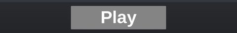</a> <b>ChooseJob</b> › Play</td>
</tr>
</table>

### Popups, notifications, prompts

<table>
<tr>
<td width="33%" valign="top"><a href="screenshots/12_MainGui__Ban.jpg">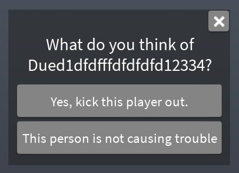</a> <b>MainGui</b> › Prompts.Ban</td>
<td width="33%" valign="top"><a href="screenshots/13_MainGui__DialogBox.jpg">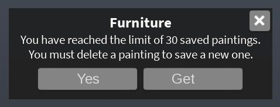</a> <b>MainGui</b> › Prompts.DialogBox</td>
<td width="33%" valign="top"><a href="screenshots/15_MainGui__GetId.jpg">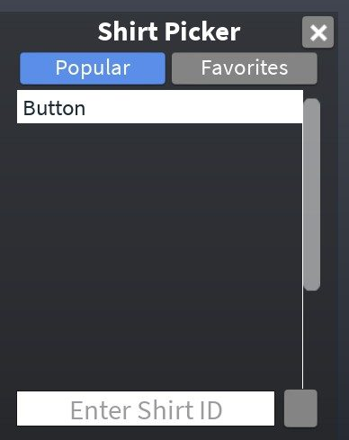</a> <b>MainGui</b> › Prompts.GetId</td>
</tr>
<tr>
<td width="33%" valign="top"><a href="screenshots/16_MainGui__GetName.jpg">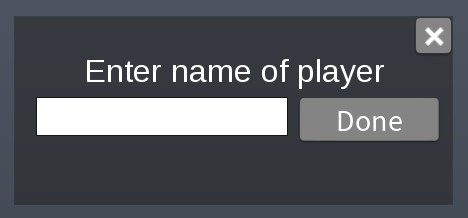</a> <b>MainGui</b> › Prompts.GetName</td>
<td width="33%" valign="top"><a href="screenshots/17_MainGui__GetRating.jpg">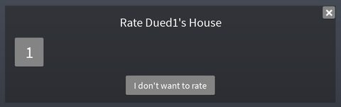</a> <b>MainGui</b> › Prompts.GetRating</td>
<td width="33%" valign="top"><a href="screenshots/18_MainGui__GetShortString.jpg">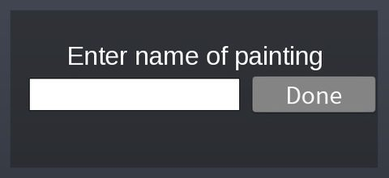</a> <b>MainGui</b> › Prompts.GetShortString</td>
</tr>
<tr>
<td width="33%" valign="top"><a href="screenshots/19_MainGui__GetString.jpg">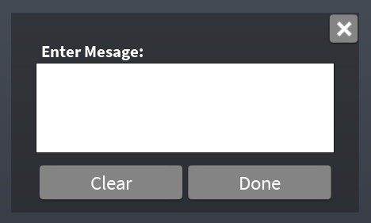</a> <b>MainGui</b> › Prompts.GetString</td>
<td width="33%" valign="top"><a href="screenshots/20_MainGui__Paycheck.jpg">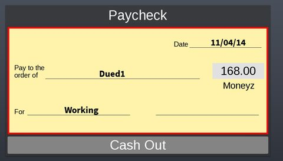</a> <b>MainGui</b> › Prompts.Paycheck</td>
<td width="33%" valign="top"><a href="screenshots/21_MainGui__PixelPaint.jpg">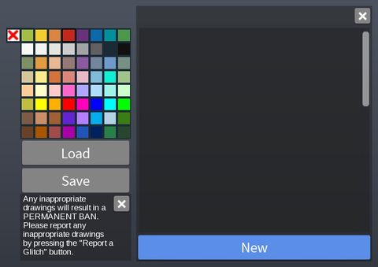</a> <b>MainGui</b> › Prompts.PixelPaint</td>
</tr>
<tr>
<td width="33%" valign="top"><a href="screenshots/23_MainGui__KickList.jpg">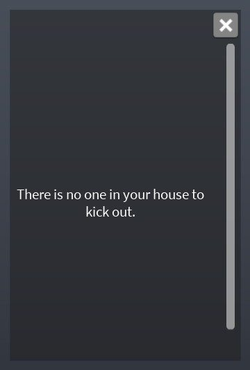</a> <b>MainGui</b> › Prompts.KickList</td>
<td width="33%" valign="top"><a href="screenshots/24_MainGui__Tutorial.jpg">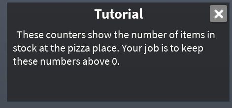</a> <b>MainGui</b> › Prompts.TutorialContainer.Tutorial</td>
</tr>
</table>

### Admin panels

<table>
<tr>
<td width="33%" valign="top"><a href="screenshots/22_MainGui__ResponsePanel.jpg">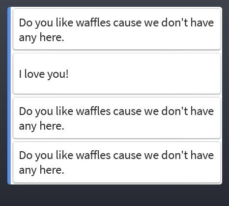</a> <b>MainGui</b> › Prompts.CustomerDialog.ResponsePanel</td>
</tr>
</table>

### HUD & currency

<table>
<tr>
<td width="33%" valign="top"><a href="screenshots/01_MainGui.jpg">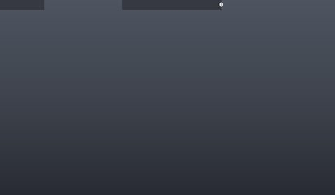</a> <b>MainGui</b></td>
</tr>
</table>

### Other

<table>
<tr>
<td width="33%" valign="top"><a href="screenshots/25_ChooseJob__ChooseJob.jpg">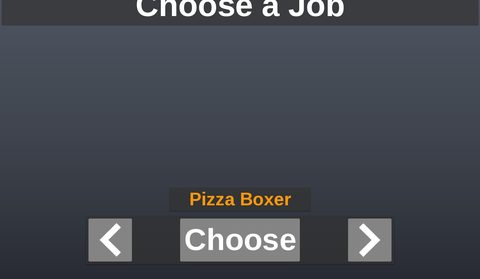</a> <b>ChooseJob</b> › ChooseJob</td>
<td width="33%" valign="top"><a href="screenshots/27_SprayGui.jpg">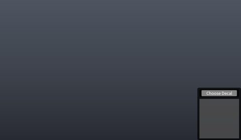</a> <b>SprayGui</b></td>
<td width="33%" valign="top"><a href="screenshots/28_PlatformerGui.jpg">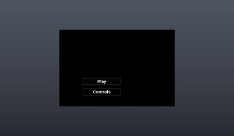</a> <b>PlatformerGui</b></td>
</tr>
<tr>
<td width="33%" valign="top"><a href="screenshots/29_PlatformerGui__ScorePage.jpg">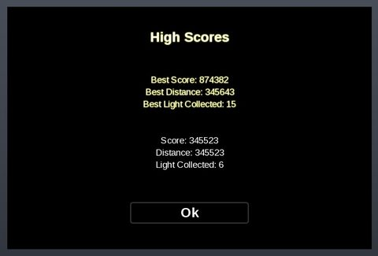</a> <b>PlatformerGui</b> › GameFrame.ScorePage</td>
</tr>
</table>

## Model previews

<table>
<tr>
<td width="25%" valign="top"><a href="models/Workspace/Oakley.rbxm">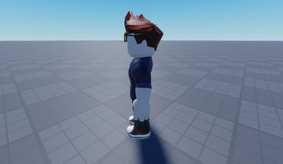</a> <b>Oakley</b> <code>models/Workspace/Oakley.rbxm</code></td>
<td width="25%" valign="top"><a href="models/ServerStorage/PetObjects/Ball.rbxm">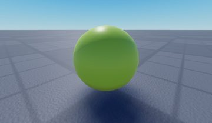</a> <b>Ball</b> <code>models/ServerStorage/PetObjects/Ball.rbxm</code></td>
<td width="25%" valign="top"><a href="models/ServerStorage/DeliveryBike.rbxm">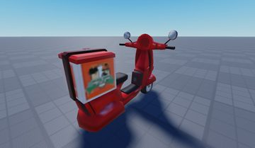</a> <b>DeliveryBike</b> <code>models/ServerStorage/DeliveryBike.rbxm</code></td>
<td width="25%" valign="top"><a href="models/ServerStorage/Candy/Hershey.rbxm">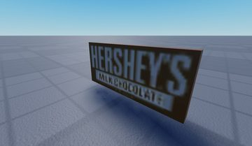</a> <b>Hershey</b> <code>models/ServerStorage/Candy/Hershey.rbxm</code></td>
</tr>
<tr>
<td width="25%" valign="top"><a href="models/ServerScriptService/MainModule/Decoration/Outdoors%20Tree.rbxm">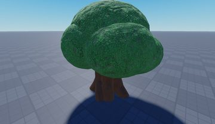</a> <b>Outdoors Tree</b> <code>models/ServerScriptService/MainModule/Decoration/Outdoors Tree.rbxm</code></td>
<td width="25%" valign="top"><a href="models/Workspace/Cloud.rbxm">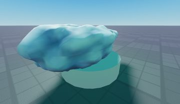</a> <b>Cloud</b> <code>models/Workspace/Cloud.rbxm</code></td>
<td width="25%" valign="top"><a href="models/ServerStorage/GuestOutfits/Girl/LongHairHeadBand.rbxm">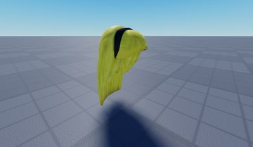</a> <b>LongHairHeadBand</b> <code>models/ServerStorage/GuestOutfits/Girl/LongHairHeadBand.rbxm</code></td>
<td width="25%" valign="top"><a href="models/ServerStorage/NewHouse.rbxm">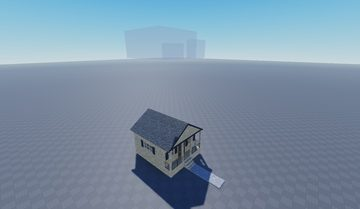</a> <b>NewHouse</b> <code>models/ServerStorage/NewHouse.rbxm</code></td>
</tr>
<tr>
<td width="25%" valign="top"><a href="models/ServerStorage/Ceatar%20Trees/Model.rbxm">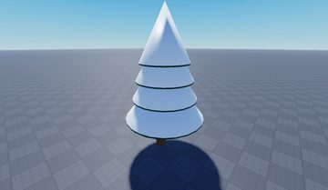</a> <b>Model</b> <code>models/ServerStorage/Ceatar Trees/Model.rbxm</code></td>
<td width="25%" valign="top"><a href="models/ServerScriptService/MainModule/Entertainment/Workout%20Treadmill.rbxm">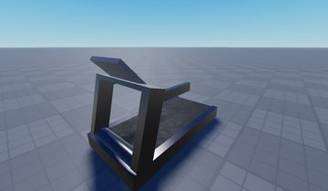</a> <b>Workout Treadmill</b> <code>models/ServerScriptService/MainModule/Entertainment/Workout Treadmill.rbxm</code></td>
<td width="25%" valign="top"><a href="models/Workspace/Sign~2.rbxm">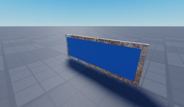</a> <b>Sign~2</b> <code>models/Workspace/Sign~2.rbxm</code></td>
<td width="25%" valign="top"><a href="models/Workspace/Seating/Chair__x22.rbxm">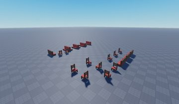</a> <b>Chair__x22</b> <code>models/Workspace/Seating/Chair__x22.rbxm</code></td>
</tr>
</table>

## Notable scripts

Top-scored scripts of this game per topic (full tree in [source/scripts](source/scripts/)).

| Topic | Scripts |
|---|---|
| UI controllers / window managers / menus | [`DropdownMenu`](source/scripts/StarterGui/GuiManager/DropdownMenu.lua) 144 lines [`Door`](source/scripts/ServerScriptService/Door.lua) 261 lines [`GuiManager`](source/scripts/StarterGui/GuiManager.lua) 229 lines [`ChatWindow`](source/scripts/StarterGui/MainGui/Menu/ChatWindow/ChatWindow.client.lua) 529 lines [`Window`](source/scripts/StarterGui/GuiManager/Window.lua) 488 lines |
| Notifications, toasts, popups, prompts | [`PurchaseService`](source/scripts/ServerScriptService/PurchaseService.server.lua) 577 lines [`Glider_LocalMain`](source/scripts/ServerStorage/HangGlider/Glider_LocalMain.client.lua) 296 lines [`ChatWindow`](source/scripts/StarterGui/MainGui/Menu/ChatWindow/ChatWindow.client.lua) 529 lines [`PetPanel`](source/scripts/StarterGui/MainGui/Menu/Pet/PetPanel/PetPanel.client.lua) 880 lines [`Dialog`](source/scripts/StarterGui/MainGui/Prompts/DialogBox/Dialog.client.lua) 154 lines |
| Loading / intro screens | [`ReplicatedFirst`](source/scripts/ReplicatedStorage/ReplicatedFirst.client.lua) 135 lines [`SoundFX`](source/scripts/ReplicatedStorage/SoundFX.lua) 114 lines |
| Camera, cutscenes, screen shake | [`CameraUtil`](source/scripts/ReplicatedStorage/Utilities/CameraUtil.lua) 138 lines [`VehicleCamera`](source/scripts/StarterPlayer/StarterPlayerScripts/VehicleCamera.client.lua) 272 lines [`Upgrade`](source/scripts/StarterGui/MainGui/Menu/Upgrade/Upgrade.client.lua) 378 lines [`LocalMain`](source/scripts/StarterPlayer/StarterPlayerScripts/LocalMain.client.lua) 182 lines |
| DataStore / player data | [`Players`](source/scripts/ServerScriptService/Players.lua) 442 lines [`PetController`](source/scripts/ServerScriptService/PetController.server.lua) 534 lines |
| Monetization (dev products, game passes, receipts) | [`PurchaseService`](source/scripts/ServerScriptService/PurchaseService.server.lua) 577 lines |
| RNG, eggs, gacha, rarity rolls, pets | [`PetController`](source/scripts/ServerScriptService/PetController.server.lua) 534 lines [`PetHats`](source/scripts/StarterGui/MainGui/Menu/Pet/PetHats/PetHats.client.lua) 206 lines [`PurchaseService`](source/scripts/ServerScriptService/PurchaseService.server.lua) 577 lines [`Script`](source/scripts/Workspace/Carpet/RainbowMagicCarpet/Script.server.lua) 368 lines [`Enums`](source/scripts/ReplicatedStorage/Enums.lua) 383 lines |
| Character movement (sprint, dash, double jump, slide) | [`Slider`](source/scripts/StarterGui/GuiManager/Slider.lua) 252 lines [`Climbing`](source/scripts/Workspace/Sign~6/Truss/Climbing.server.lua) 27 lines [`CustomAnimation`](source/scripts/StarterPlayer/StarterCharacterScripts/CustomAnimation.client.lua) 466 lines [`GuiManager`](source/scripts/StarterGui/GuiManager.lua) 229 lines [`LocalSound`](source/scripts/StarterPlayer/StarterCharacterScripts/Sound/LocalSound.client.lua) 357 lines |
| Tycoon / plots / bases / building | [`House`](source/scripts/ServerScriptService/Houses/House.lua) 835 lines [`FurnitureDragger`](source/scripts/StarterPlayer/StarterPlayerScripts/FurnitureDragger.client.lua) 676 lines [`MainModule`](source/scripts/ServerScriptService/MainModule.lua) 758 lines [`Furniture`](source/scripts/ServerScriptService/Houses/House/Furniture.lua) 382 lines |
| Sound & music | [`LocalSound`](source/scripts/StarterPlayer/StarterCharacterScripts/Sound/LocalSound.client.lua) 357 lines [`Music`](source/scripts/StarterPlayer/StarterPlayerScripts/Music.client.lua) 285 lines |
| Utility modules (number format, signals, tables, timers) | [`Utility`](source/scripts/ReplicatedStorage/Utilities/Utility.lua) 663 lines [`Customer`](source/scripts/ServerScriptService/Customers/Customer.lua) 915 lines |

### In the curated script library

- [Orbit pan camera](../../Scripts/05-Camera-Cutscene/OrbitPanCamera__work-at-a-pizza-place.lua) — Orbiting showcase camera with simple wall collision (repeated raycasts ignoring see-through parts).
- [Minimal spinning-icon loader](../../Scripts/04-Loading-Screens/SpinningPizzaLoader__work-at-a-pizza-place.lua) — Minimal ReplicatedFirst loader: parents a prepared LoadingScreen, spins pizza icons on RenderStepped, waits for game:IsLoaded(); commented-out code shows a RequestQueueSize-driven reveal and an asset-id dump helper.
- [Classic PurchaseHistory DataStore](../../Scripts/08-Monetization/ProcessReceipt-PurchaseHistory__work-at-a-pizza-place.lua) — The classic pattern: a PurchaseHistory DataStore keyed 'userId:purchaseId' checked before granting, a handler table keyed by product id, pcall'd handlers, and the purchase recorded after success.
- [Server-or-client dialog service](../../Scripts/03-Notifications/DialogService__work-at-a-pizza-place.lua) — Shared Dialog module usable from server or client: GetChoice yields for the player's yes/no answer (per-player queue, 60s timeout), ShowMessage / ShowMessageAll for one-button messages.
- [Dialog box client (PC + gamepad)](../../Scripts/03-Notifications/DialogBoxClient__work-at-a-pizza-place.lua) — Client side of the pizza-place dialog: queues dialogs, fills title/message/button texts, swaps to A/B gamepad buttons on console, sends the choice back.
- [Clickable-bubble NPC conversation (client)](../../Scripts/12-NPC-AI/CustomerNPCDialog__work-at-a-pizza-place.lua) — Speech bubbles over NPC heads that start a server-driven conversation; server sends choices, client shows up to 5 response buttons, ends the chat if the player walks more than 30 studs away or another player is already talking to that NPC; gamepad support.
- [Location and time-of-day music](../../Scripts/17-Sound-Music/ZoneLocationMusic__work-at-a-pizza-place.lua) — Location-aware music: chooses a track by season/holiday/time of day, switches to house music players or shop songs when the player enters a zone, fades out and in between tracks and resumes the outdoor song where it left off. Volume comes from a settings slider.
- [Client/server SoundFX with zone broadcast](../../Scripts/17-Sound-Music/SoundFX__work-at-a-pizza-place.lua) — Shared client/server sound helper: on the client plays a named sound from a folder; on the server either tells one client to play it or plays it on an object; PlaySoundInsideZone sends a sound only to players standing inside a zone box.
- [House furniture placement in local space](../../Scripts/14-Tycoon-Plots/FurniturePlacement__work-at-a-pizza-place.lua) — Server side of placing furniture in a player house: enforces a per-upgrade furniture cap, removes one from inventory, and stores the CFrame relative to the house's Marker part (ToObjectSpace) so...
- [GuiManager widget framework](../../Scripts/02-UI-Framework/GuiManager__work-at-a-pizza-place.lua) — Registers windows and widgets (tabs, sliders, toggles, dropdowns, lists, radial menu) and closes all windows.
- [Gamepad-aware Window class](../../Scripts/02-UI-Framework/Window__work-at-a-pizza-place.lua) — Tweened show/hide, blur, cancel/B to close, per-window gamepad actions and selection focus.
- [TabGroup class](../../Scripts/02-UI-Framework/TabGroup__work-at-a-pizza-place.lua) — Keeps one tab pressed, fires TabChanged, cycles tabs with L1/R1.
- [Tab button class](../../Scripts/02-UI-Framework/Tab__work-at-a-pizza-place.lua) — Single tab button used by TabGroup with pressed/unpressed styles.
- [Dropdown menu widget](../../Scripts/02-UI-Framework/DropdownMenu__work-at-a-pizza-place.lua) — Expandable option list that fires opened/selected events.
- [Gamepad radial menu](../../Scripts/02-UI-Framework/RadialMenu__work-at-a-pizza-place.lua) — Picks one of six wedges from the thumbstick angle.
- [Slider widget](../../Scripts/02-UI-Framework/Slider__work-at-a-pizza-place.lua) — Draggable 0-1 slider for mouse, touch and gamepad.

## ⚠️ Safety

HIGH flags (backdoors, `require(id)`, `loadstring`, webhooks). Review or delete before reusing:

- `scripts/ServerScriptService/GoogleAnalytics.lua`
- `scripts/ServerScriptService/Main.server.lua`
- `scripts/Workspace/HD Admin/Settings/Loader.server.lua`

## Folders

| Folder | What |
|---|---|
| `screenshots/` | full frames; `crops/` = the panel only; `models/` = 3D previews; `thumbs/` = gallery thumbnails |
| `ui/` | every screen as a Lua builder (`require(module)()` returns the ScreenGui); `_StarterGui-all.lua` builds every StarterGui screen |
| `models/` | every model as .rbxm (the only .rbxm files), mirroring the place tree, scripts removed |
| `map/` | `workspace.rbxm` (the map as a model), `lighting.lua` (sky + post effects), `materials.lua`, `Environment.lua` |
| `animations/`, `audio/` | KeyframeSequence / Sound builders (.lua), `AnimationIds.lua`, `Sounds.lua` |
| `source/` | all scripts as .luau, `tree.txt`, `ui.txt`, `remotes.txt`, `assets.txt`, `flags.txt` |
