# Zombie Outbreak Survival

> 🔫 **Shooter** · wave survival shooter · source file `Zombie Outbreak Survival.rbxl`

[⬅ Back to the catalog](../../README.md) · [Assets inventory](ASSETS.md) · [Style numbers](reference.md) · [Scripts](source/scripts/) · [Code analysis](source/README.md)

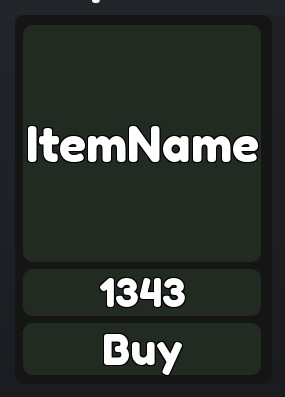

## At a glance

| | |
|---|---|
| Provenance | template with full source |
| Screens | 5 ScreenGuis, 66 GUI objects → **9 screenshots** |
| Models (.rbxm) | 63 models, 3 model sets, 0 VFX sets |
| Lua builders (.lua) | 9 UI screens, 0 animation packs, 1 audio packs |
| Code | 154 scripts, 19,885 lines |
| Asset ids | 19 animations, 45 sounds |
| Safety scan | 0 HIGH / 2 MED flags ([flags.txt](source/flags.txt)) |

**Fonts:** `FredokaOne Regular`×9, `FredokaOne ExtraBold`×8, `SourceSansPro Regular`×3, `GothamSSm Bold`×3, `GothamSSm ExtraBold`×3

## UI screenshots

Captured in Studio from the place's own ScreenGuis (scripts stripped). Each panel was opened on its own; click a thumbnail for the full 1519×886 frame. Runtime-filled lists (shop items, inventories) show their template state.

### Shop & Robux store

<table>
<tr>
<td width="33%" valign="top"><a href="screenshots/01_Tools_shop.jpg">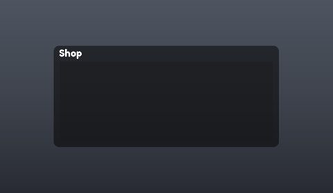</a> <b>Tools_shop</b></td>
<td width="33%" valign="top"><a href="screenshots/02_Tools_shop__Template.jpg">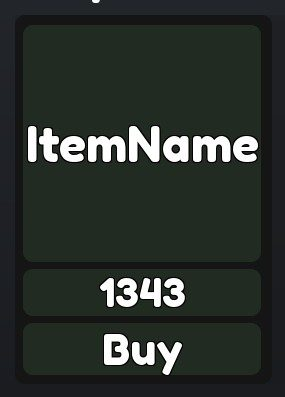</a> <b>Tools_shop</b> › Frame.List.Template</td>
</tr>
</table>

### Rewards, daily, spin, codes

<table>
<tr>
<td width="33%" valign="top"><a href="screenshots/08_Codes.jpg">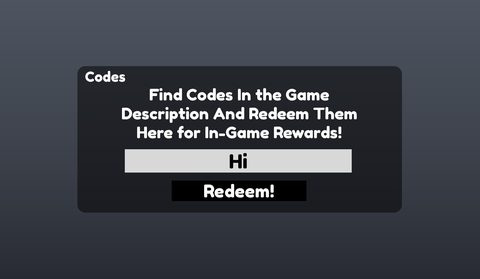</a> <b>Codes</b></td>
</tr>
</table>

### Quests & progression

<table>
<tr>
<td width="33%" valign="top"> <b>LevelUp</b> › LevelUpFrame</td>
</tr>
</table>

### End of round, death, results

<table>
<tr>
<td width="33%" valign="top"><a href="screenshots/06_MainGui__Winners.jpg">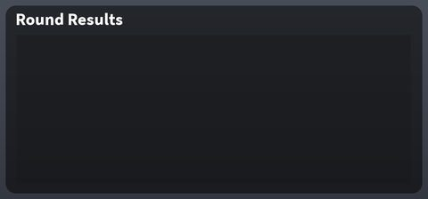</a> <b>MainGui</b> › GameFrame.Winners</td>
</tr>
</table>

### HUD & currency

<table>
<tr>
<td width="33%" valign="top"><a href="screenshots/04_MainGui.jpg">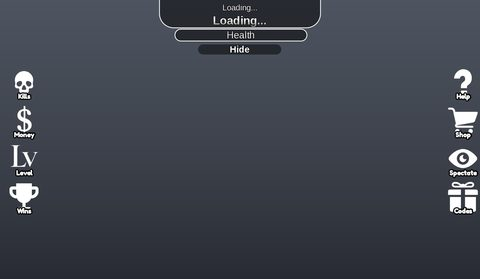</a> <b>MainGui</b></td>
<td width="33%" valign="top"><a href="screenshots/05_MainGui__MainFrame.jpg">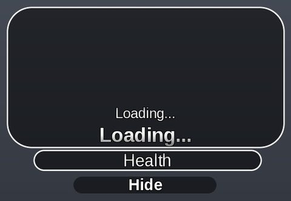</a> <b>MainGui</b> › GameFrame.MainFrame</td>
</tr>
</table>

### Other

<table>
<tr>
<td width="33%" valign="top"><a href="screenshots/03_Tutorial.jpg">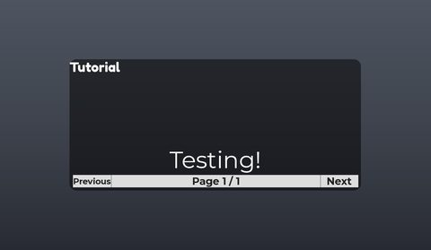</a> <b>Tutorial</b></td>
<td width="33%" valign="top"><a href="screenshots/09_Welcome.jpg">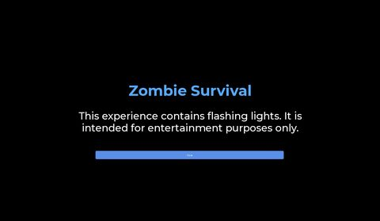</a> <b>Welcome</b></td>
</tr>
</table>

## Model previews

<table>
<tr>
<td width="25%" valign="top"><a href="models/Workspace/Lobby/Stuff/Leaderboards/TimePlayedLeaderboard.rbxm">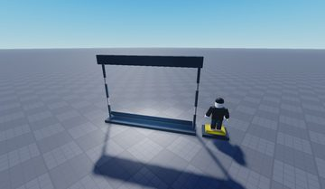</a> <b>TimePlayedLeaderboard</b> <code>models/Workspace/Lobby/Stuff/Leaderboards/TimePlayedLeaderboard.rbxm</code></td>
<td width="25%" valign="top"><a href="models/ReplicatedStorage/Tools/Classic%20Sword.rbxm">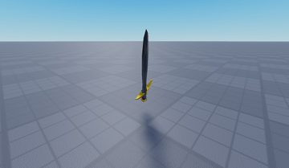</a> <b>Classic Sword</b> <code>models/ReplicatedStorage/Tools/Classic Sword.rbxm</code></td>
<td width="25%" valign="top"><a href="models/Workspace/Chest/Chest.rbxm">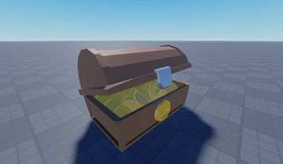</a> <b>Chest</b> <code>models/Workspace/Chest/Chest.rbxm</code></td>
<td width="25%" valign="top"><a href="models/Workspace/Lobby/Stuff/Model.rbxm">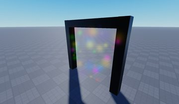</a> <b>Model</b> <code>models/Workspace/Lobby/Stuff/Model.rbxm</code></td>
</tr>
<tr>
<td width="25%" valign="top"><a href="models/ReplicatedStorage/Tools/Flamethrower.rbxm">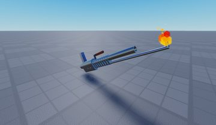</a> <b>Flamethrower</b> <code>models/ReplicatedStorage/Tools/Flamethrower.rbxm</code></td>
<td width="25%" valign="top"><a href="models/Workspace/Lobby/Stuff/Leaderboards/Model__x9.rbxm">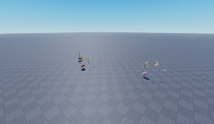</a> <b>Model__x9</b> <code>models/Workspace/Lobby/Stuff/Leaderboards/Model__x9.rbxm</code></td>
<td width="25%" valign="top"><a href="models/ReplicatedStorage/Maps/Junkyard.rbxm">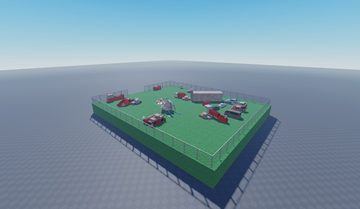</a> <b>Junkyard</b> <code>models/ReplicatedStorage/Maps/Junkyard.rbxm</code></td>
<td width="25%" valign="top"><a href="models/ReplicatedStorage/Tools/Bow.rbxm">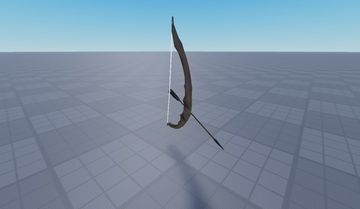</a> <b>Bow</b> <code>models/ReplicatedStorage/Tools/Bow.rbxm</code></td>
</tr>
<tr>
<td width="25%" valign="top"><a href="models/Workspace/Lobby/MainMap/Model~3/Model~2.rbxm">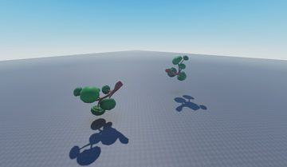</a> <b>Model~2</b> <code>models/Workspace/Lobby/MainMap/Model~3/Model~2.rbxm</code></td>
<td width="25%" valign="top"><a href="models/ReplicatedStorage/Zombie.rbxm">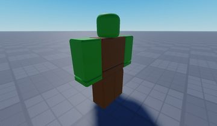</a> <b>Zombie</b> <code>models/ReplicatedStorage/Zombie.rbxm</code></td>
<td width="25%" valign="top"><a href="models/Workspace/Chest/Crown.rbxm">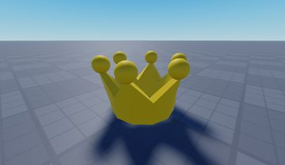</a> <b>Crown</b> <code>models/Workspace/Chest/Crown.rbxm</code></td>
<td width="25%" valign="top"><a href="models/ReplicatedStorage/Tools/Minigun.rbxm">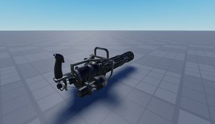</a> <b>Minigun</b> <code>models/ReplicatedStorage/Tools/Minigun.rbxm</code></td>
</tr>
<tr>
<td width="25%" valign="top"><a href="models/Workspace/Lobby/Stuff/Leaderboards/leaderbooard.rbxm">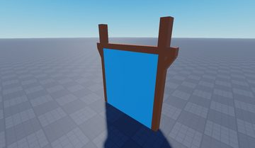</a> <b>leaderbooard</b> <code>models/Workspace/Lobby/Stuff/Leaderboards/leaderbooard.rbxm</code></td>
<td width="25%" valign="top"><a href="models/Workspace/Lobby/Stuff/Stage.rbxm">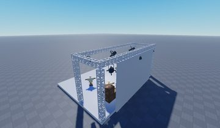</a> <b>Stage</b> <code>models/Workspace/Lobby/Stuff/Stage.rbxm</code></td>
</tr>
</table>

## Notable scripts

Top-scored scripts of this game per topic (full tree in [source/scripts](source/scripts/)).

| Topic | Scripts |
|---|---|
| UI controllers / window managers / menus | [`SingleOpenGuiHandler`](source/scripts/StarterPlayer/StarterPlayerScripts/SingleOpenGuiHandler.client.lua) 49 lines [`GameUi`](source/scripts/StarterGui/MainGui/GameFrame/GameUi.client.lua) 84 lines [`TopbarPlusForeverHD`](source/scripts/ReplicatedStorage/Modules/TopbarPlusForeverHD.lua) 1057 lines |
| Notifications, toasts, popups, prompts | [`ShopScript`](source/scripts/StarterGui/Tools_shop/ShopScript.client.lua) 109 lines |
| VFX, particles, beams, hit effects | [`Rocket`](source/scripts/ReplicatedStorage/Tools/RocketLauncher/Server/Rocket.server.lua) 146 lines [`Server`](source/scripts/ReplicatedStorage/Tools/Minigun/Server.server.lua) 182 lines [`Server`](source/scripts/ReplicatedStorage/Code_Tools/Meteor/Server.server.lua) 96 lines |
| DataStore / player data | [`STATS`](source/scripts/ServerScriptService/STATS.server.lua) 414 lines [`Buy_tools`](source/scripts/ServerScriptService/Buy_tools.server.lua) 251 lines |
| Monetization (dev products, game passes, receipts) | [`ShopScript`](source/scripts/StarterGui/Tools_shop/ShopScript.client.lua) 109 lines |
| RNG, eggs, gacha, rarity rolls, pets | [`MapVoteHandler`](source/scripts/ReplicatedStorage/Modules/MapVoteHandler.lua) 470 lines |
| Combat, weapons, hitboxes, abilities | [`BowServer`](source/scripts/ReplicatedStorage/Tools/Bow/BowServer.server.lua) 70 lines [`SwordScript`](source/scripts/ReplicatedStorage/Tools/Classic%20Sword/SwordScript.server.lua) 225 lines |
| NPC / AI / monsters | [`ZombieAi`](source/scripts/ReplicatedStorage/Zombie/ZombieAi.server.lua) 232 lines |
| Leaderboards & stats | [`Main`](source/scripts/Workspace/Lobby/Stuff/Leaderboards/leaderbooard/GlobalHealthLeaderboard/SurfaceGui/Main.server.lua) 121 lines [`Main`](source/scripts/Workspace/Lobby/Stuff/Leaderboards/leaderbooard~3/GlobalHealthLeaderboard/SurfaceGui/Main.server.lua) 121 lines [`Main`](source/scripts/Workspace/Lobby/Stuff/Leaderboards/leaderbooard~4/GlobalHealthLeaderboard/SurfaceGui/Main.server.lua) 121 lines |
| Daily rewards, quests, codes, playtime | [`DailyChestHandler`](source/scripts/ServerScriptService/DailyChestHandler.server.lua) 75 lines [`MainCodes`](source/scripts/StarterGui/Codes/MainCodes.client.lua) 108 lines [`DailyChestLocal`](source/scripts/StarterPlayer/StarterCharacterScripts/DailyChestLocal.client.lua) 84 lines |
| Utility modules (number format, signals, tables, timers) | [`TopbarPlusForeverHD`](source/scripts/ReplicatedStorage/Modules/TopbarPlusForeverHD.lua) 1057 lines |

### In the curated script library

- [Simple daily chest (beginner)](../../Scripts/18-Daily-Rewards-Quests/DailyChestHandler-Simple__zombie-outbreak-survival.lua) — Standalone daily chest: its own DataStore with LastClaim/Streak, 24h cooldown, 48h streak expiry, 7-day reward table sent to the client for display, claim debounce.
- [Zombie chase / wander AI](../../Scripts/12-NPC-AI/ZombieChaserWander__zombie-outbreak-survival.lua) — Classic per-zombie Script: finds the nearest player on the 'Alive' team, pathfinds toward them, wanders randomly when no one is near, and deals touch damage with a per-victim cooldown.
- [Wave-based zombie round loop](../../Scripts/12-NPC-AI/ZombieWaveRound__zombie-outbreak-survival.lua) — Wave spawner: zombies per wave = base * wave * multiplier, a timed spawn loop over tagged Spawner parts, and a round loop that advances the wave when all zombies die, ends in victory on the last wave or defeat when no players are alive.
- [Alive-enemy registry](../../Scripts/12-NPC-AI/ZombieManager__zombie-outbreak-survival.lua) — Small module that registers / unregisters spawned zombies, prunes destroyed ones and pushes the 'enemies left' count to clients.
- [Single open ScreenGui handler](../../Scripts/02-UI-Framework/SingleOpenGuiHandler__zombie-outbreak-survival.lua) — Disables the other listed ScreenGuis whenever one becomes enabled.

## Folders

| Folder | What |
|---|---|
| `screenshots/` | full frames; `crops/` = the panel only; `models/` = 3D previews; `thumbs/` = gallery thumbnails |
| `ui/` | every screen as a Lua builder (`require(module)()` returns the ScreenGui); `_StarterGui-all.lua` builds every StarterGui screen |
| `models/` | every model as .rbxm (the only .rbxm files), mirroring the place tree, scripts removed |
| `map/` | `workspace.rbxm` (the map as a model), `lighting.lua` (sky + post effects), `materials.lua`, `Environment.lua` |
| `animations/`, `audio/` | KeyframeSequence / Sound builders (.lua), `AnimationIds.lua`, `Sounds.lua` |
| `source/` | all scripts as .luau, `tree.txt`, `ui.txt`, `remotes.txt`, `assets.txt`, `flags.txt` |
