

# 🧱 Godspeed Roblox References

### UI, models, assets and scripts from every place file in Downloads, unpacked and screenshotted

    

[Games](#-games) · [UI gallery by type](UI-GALLERY.md) · [Model previews](MODELS.md) · [Script library](Scripts/README.md) · [UI style numbers](STYLE.md) · [How it was made](#-how-it-was-made)

---

## 📸 Gallery

One cover screen per game (the richest shop / inventory / reward panel). Click for the game page.

<table>
<tr>
<td width="33%" valign="top"><a href="Games/evade/README.md">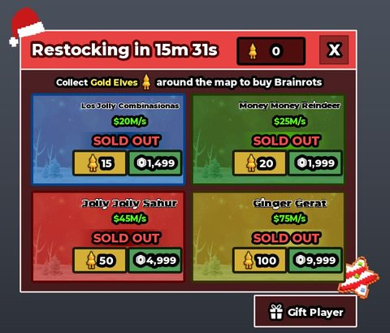</a> <b>"Evade" (brainrot game)</b> — steal / tycoon (brainrots, lucky blocks; file named Evade)</td>
<td width="33%" valign="top"><a href="Games/brainrot-lab/README.md">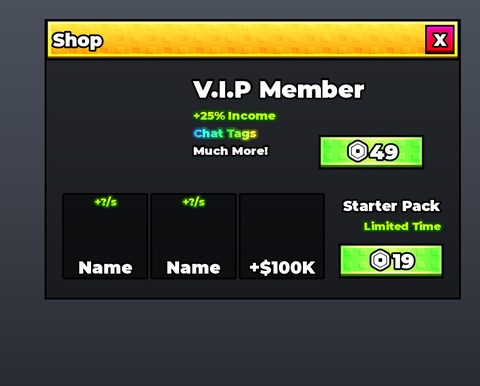</a> <b>Brainrot Lab</b> — brainrot simulator (lab / fusing)</td>
<td width="33%" valign="top"><a href="Games/drive-for-brainrots/README.md">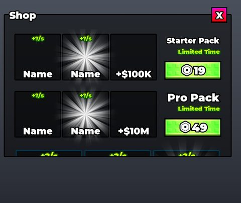</a> <b>Drive For Brainrots</b> — driving / brainrot collecting simulator</td>
</tr>
<tr>
<td width="33%" valign="top"> <b>Kick A ... (template)</b> — kick / launch simulator (fireworks, camera shake)</td>
<td width="33%" valign="top"><a href="Games/steal-a-brainrot/README.md">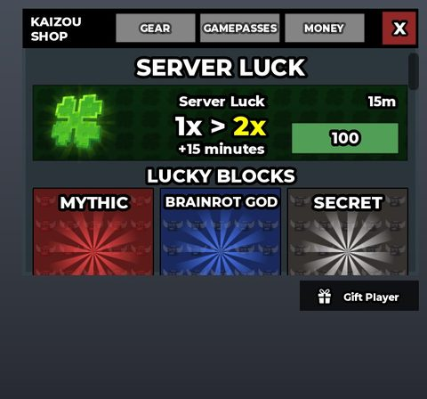</a> <b>Steal a Brainrot</b> — steal / tycoon (brainrots, plots)</td>
<td width="33%" valign="top"><a href="Games/steal-a-brainrot-sab-files/README.md">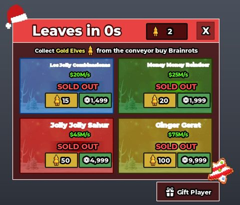</a> <b>Steal a Brainrot (SAB files)</b> — steal / tycoon (brainrots, plots)</td>
</tr>
<tr>
<td width="33%" valign="top"><a href="Games/steal-an-egg/README.md">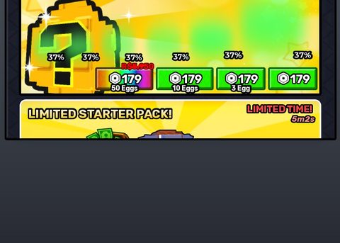</a> <b>Steal an Egg (latest)</b> — steal / tycoon (eggs, pets, plots)</td>
<td width="33%" valign="top"><a href="Games/steal-an-egg-admin/README.md">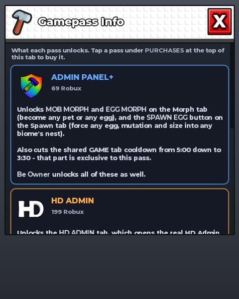</a> <b>Steal an Egg + P2W Admin Panel</b> — steal / tycoon (eggs) + admin panel</td>
<td width="33%" valign="top"><a href="Games/survive-lava-for-brainrot/README.md">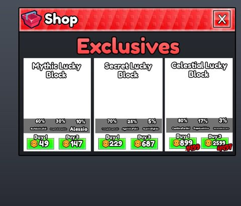</a> <b>Survive LAVA for Brainrot</b> — survival / brainrot collecting</td>
</tr>
<tr>
<td width="33%" valign="top"><a href="Games/drill-and-mine/README.md">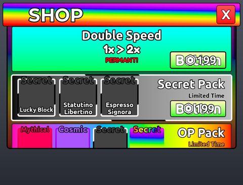</a> <b>+1 Drill & Mine</b> — incremental simulator (+1 speed, mining, drills)</td>
<td width="33%" valign="top"><a href="Games/bee-swarm-sim/README.md">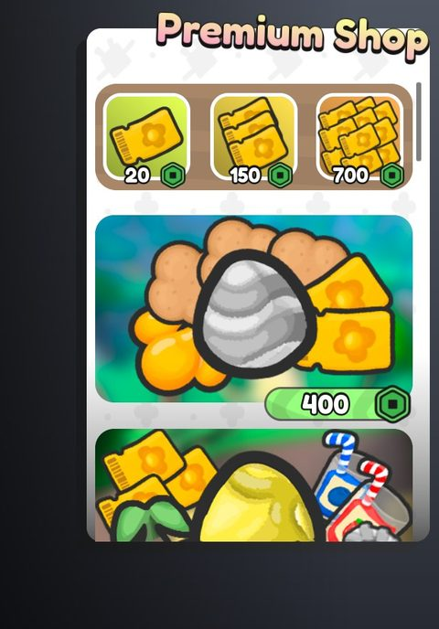</a> <b>Bee Swarm Simulator (remake)</b> — collecting simulator</td>
<td width="33%" valign="top"><a href="Games/grow-a-garden-2/README.md">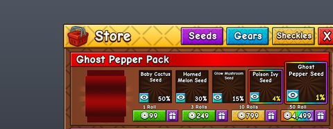</a> <b>Grow a Garden 2 (GAG2)</b> — farming / garden simulator</td>
</tr>
<tr>
<td width="33%" valign="top"><a href="Games/grow-a-garden-2-fixed/README.md">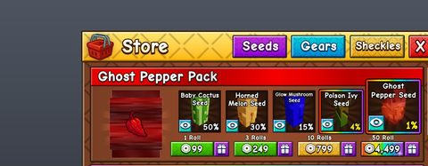</a> <b>Grow a Garden 2 (GAG2, fixed build)</b> — farming / garden simulator</td>
<td width="33%" valign="top"><a href="Games/punching-simulator/README.md">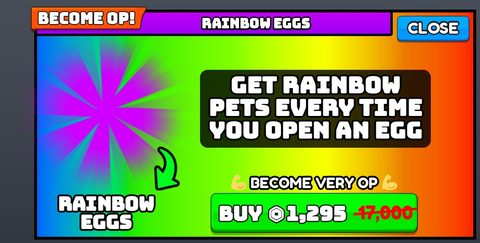</a> <b>Punching Simulator</b> — training simulator</td>
<td width="33%" valign="top"> <b>Smash Egg For Animals</b> — clicker / egg hatching simulator</td>
</tr>
<tr>
<td width="33%" valign="top"><a href="Games/aura-ascension/README.md">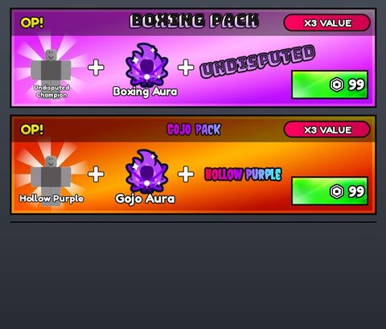</a> <b>Aura Ascension (UPD 3)</b> — RNG / aura rolling</td>
<td width="33%" valign="top"><a href="Games/pet-rng/README.md">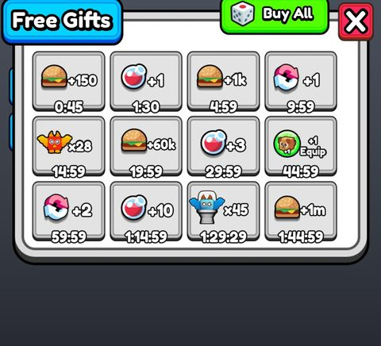</a> <b>Pet RNG</b> — RNG / pet rolling</td>
<td width="33%" valign="top"><a href="Games/rcu-roller/README.md">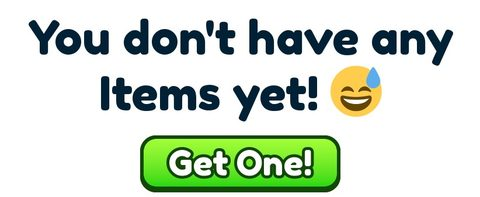</a> <b>RCU (roll / mounts)</b> — RNG roller (Knit, auto roll, mounts)</td>
</tr>
<tr>
<td width="33%" valign="top"><a href="Games/slime-rng/README.md">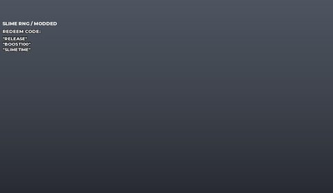</a> <b>Slime RNG</b> — RNG / slime rolling</td>
<td width="33%" valign="top"><a href="Games/advanced-warfare-tycoon/README.md">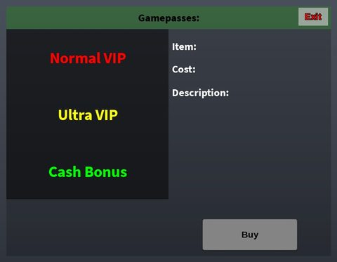</a> <b>Advanced Warfare Tycoon</b> — tycoon (military)</td>
<td width="33%" valign="top"><a href="Games/scp-tycoon/README.md">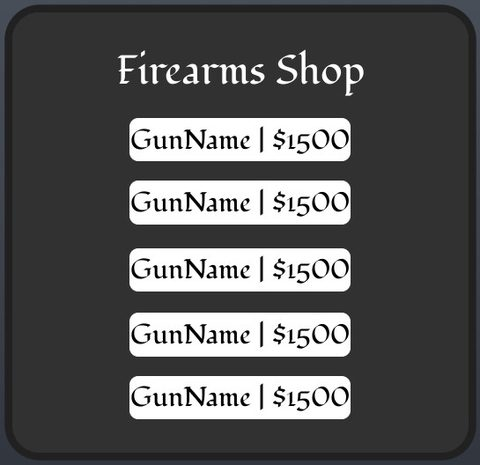</a> <b>SCP Tycoon</b> — tycoon (SCP containment)</td>
</tr>
<tr>
<td width="33%" valign="top"><a href="Games/animal-hospital-horror/README.md">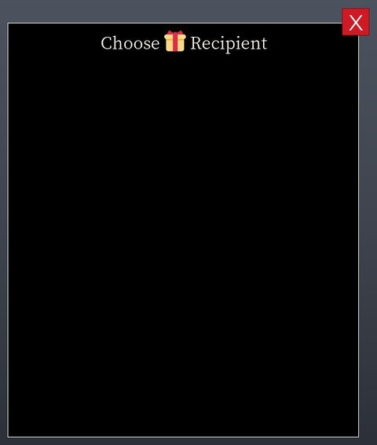</a> <b>Animal Hospital (horror, modded)</b> — horror roleplay (patients, skinwalkers, sanity)</td>
<td width="33%" valign="top"><a href="Games/backrooms-exploration/README.md">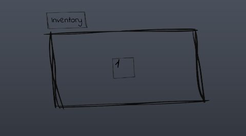</a> <b>Backrooms Exploration</b> — horror exploration</td>
<td width="33%" valign="top"><a href="Games/bite-by-night/README.md">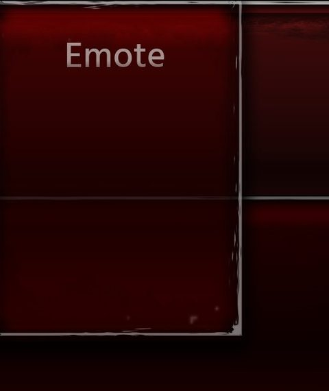</a> <b>Bite By Night</b> — asymmetric horror (killer vs survivors)</td>
</tr>
<tr>
<td width="33%" valign="top"> <b>Dandy's World</b> — horror survival (toons, floors, machines)</td>
<td width="33%" valign="top"><a href="Games/doors/README.md">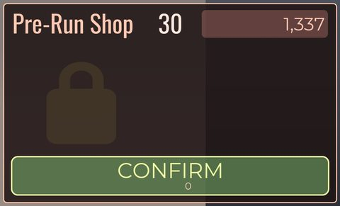</a> <b>Doors (fully scripted)</b> — horror / room escape</td>
<td width="33%" valign="top"> <b>Forsaken (alt copy)</b> — asymmetric horror (killer vs survivors)</td>
</tr>
<tr>
<td width="33%" valign="top"><a href="Games/forsaken-mtsowiks/README.md">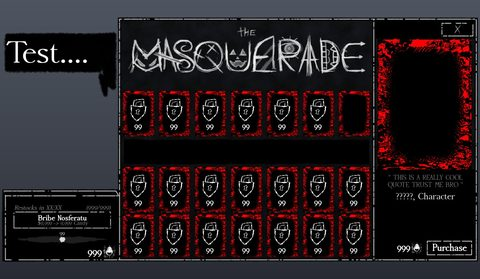</a> <b>Forsaken (mtsowiks remake)</b> — asymmetric horror (killer vs survivors)</td>
<td width="33%" valign="top"><a href="Games/forsaken/README.md">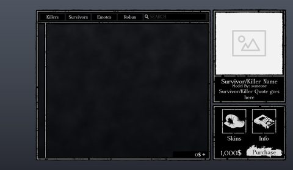</a> <b>Forsaken (uncopylocked)</b> — asymmetric horror (killer vs survivors)</td>
<td width="33%" valign="top"><a href="Games/the-rake/README.md">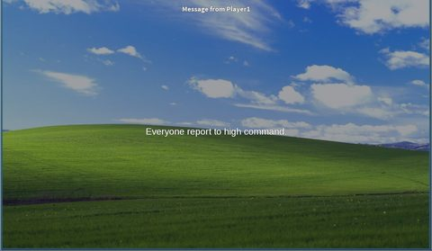</a> <b>The Rake (kill test)</b> — horror survival (monster)</td>
</tr>
<tr>
<td width="33%" valign="top"><a href="Games/big-paintball/README.md">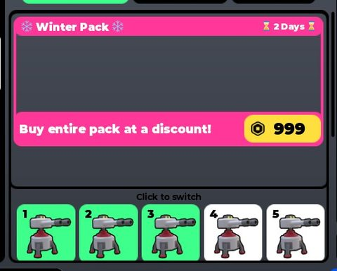</a> <b>BIG Paintball! Classic</b> — arena FPS</td>
<td width="33%" valign="top"><a href="Games/miami-shootout/README.md">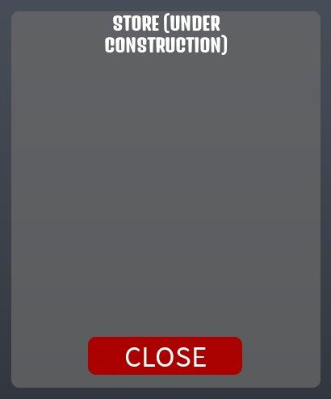</a> <b>Miami Shootout</b> — open-world shooter / hood roleplay</td>
<td width="33%" valign="top"><a href="Games/murderers-vs-sheriffs/README.md">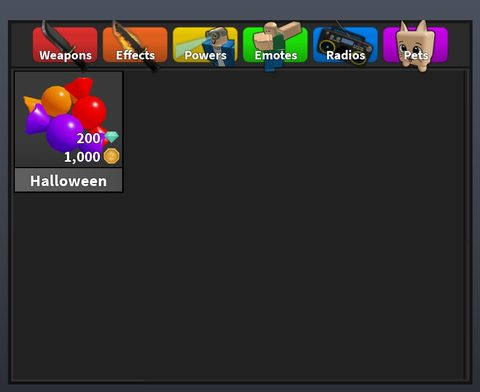</a> <b>Murderers vs Sheriffs (summer update)</b> — duels (murderers vs sheriffs, trading, crafting)</td>
</tr>
<tr>
<td width="33%" valign="top"> <b>RIVALS (modded)</b> — arena FPS (duels)</td>
<td width="33%" valign="top"><a href="Games/zombie-outbreak-survival/README.md">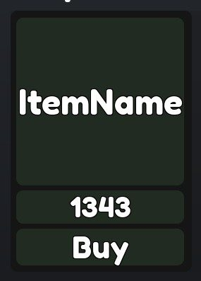</a> <b>Zombie Outbreak Survival</b> — wave survival shooter</td>
<td width="33%" valign="top"><a href="Games/jujutsu-shenanigans/README.md">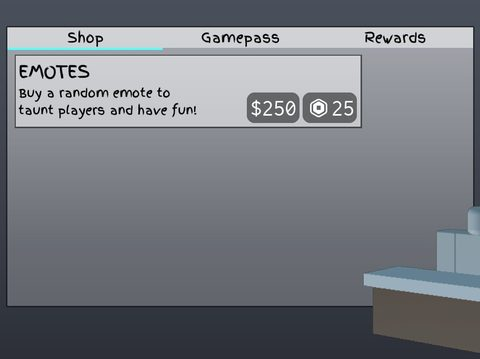</a> <b>Jujutsu Shenanigans</b> — anime battlegrounds (fighting)</td>
</tr>
<tr>
<td width="33%" valign="top"><a href="Games/one-piece-age-of-pirates/README.md">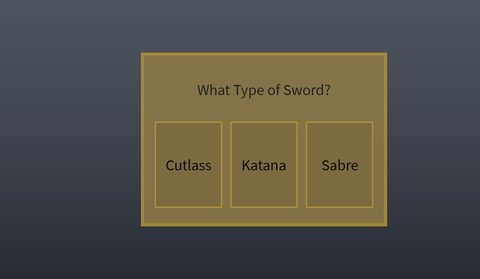</a> <b>One Piece: The Age Of Pirates</b> — anime RPG</td>
<td width="33%" valign="top"><a href="Games/escape-kitty-keyboard/README.md">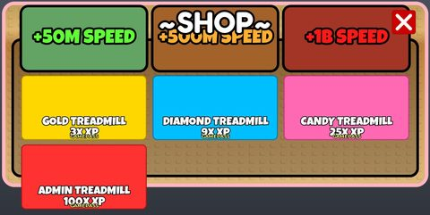</a> <b>+1 Escape Kitty Keyboard</b> — obby / escape (+1 speed)</td>
<td width="33%" valign="top"><a href="Games/needoh-escape/README.md">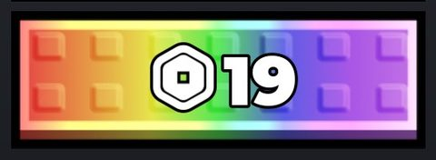</a> <b>+1 NeeDoh Escape</b> — obby / escape (+1 speed)</td>
</tr>
<tr>
<td width="33%" valign="top"><a href="Games/click-keyboard-tower/README.md">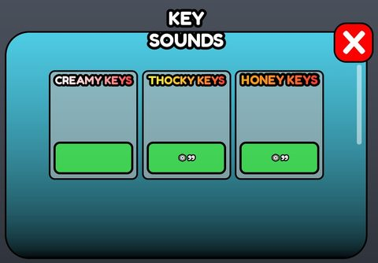</a> <b>Click Keyboard Tower</b> — clicker / tower obby</td>
<td width="33%" valign="top"><a href="Games/flood-escape-2/README.md">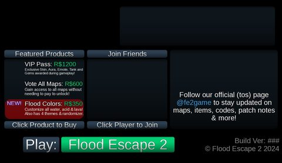</a> <b>Flood Escape 2</b> — obby / survival (rising water maps)</td>
<td width="33%" valign="top"><a href="Games/scooter-obby/README.md">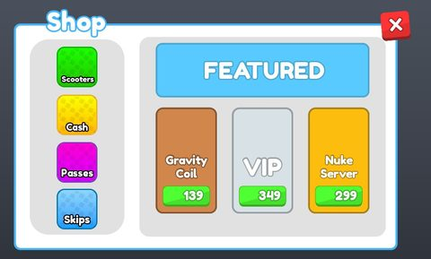</a> <b>Scooter Obby</b> — obby (scooter)</td>
</tr>
<tr>
<td width="33%" valign="top"><a href="Games/tower-of-hell/README.md">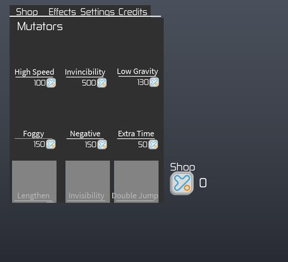</a> <b>Tower Of Hell</b> — obby (procedural tower)</td>
<td width="33%" valign="top"><a href="Games/drag-a-friend/README.md">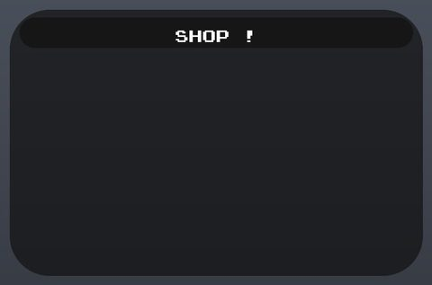</a> <b>Drag A Friend</b> — party / physics (tether a friend)</td>
<td width="33%" valign="top"><a href="Games/murder-mystery-2/README.md">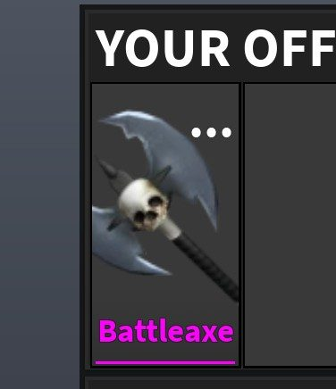</a> <b>Murder Mystery 2</b> — social deduction (murderer vs sheriff)</td>
</tr>
<tr>
<td width="33%" valign="top"><a href="Games/natural-disaster/README.md">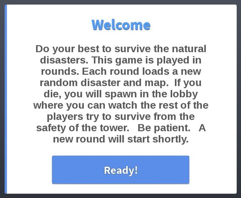</a> <b>Natural Disaster Survival (Sowiks)</b> — survival (random disasters)</td>
<td width="33%" valign="top"> <b>Pass The Bomb (Tower)</b> — party elimination</td>
<td width="33%" valign="top"><a href="Games/pick-a-side/README.md">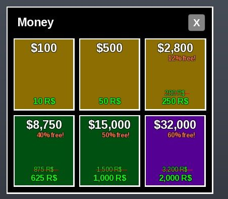</a> <b>Pick a Side</b> — party / team minigames</td>
</tr>
<tr>
<td width="33%" valign="top"><a href="Games/uno/README.md">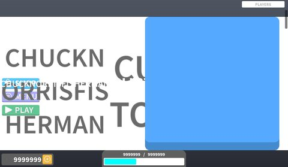</a> <b>UNO</b> — card game</td>
<td width="33%" valign="top"> <b>Animal Hospital (modded)</b> — roleplay / tycoon</td>
<td width="33%" valign="top"><a href="Games/prison-life/README.md">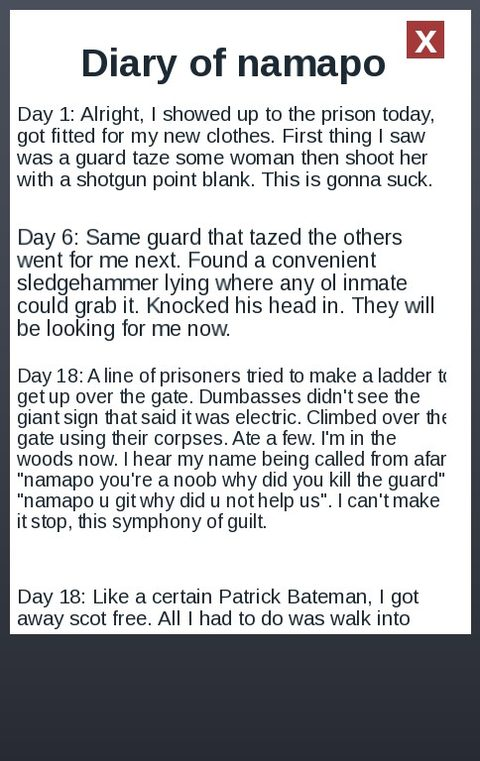</a> <b>Prison Life</b> — roleplay (cops vs prisoners)</td>
</tr>
<tr>
<td width="33%" valign="top"><a href="Games/site-excalibur/README.md">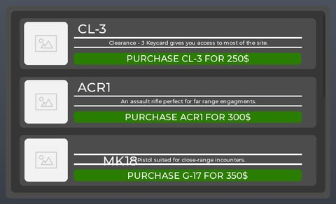</a> <b>Site Excalibur (Lunor)</b> — SCP facility roleplay (detain, solitary, gun shop)</td>
<td width="33%" valign="top"><a href="Games/street-life/README.md">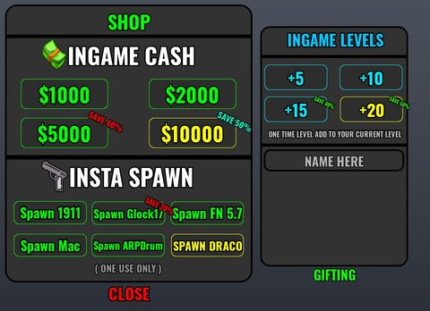</a> <b>Street Life</b> — open-world roleplay / hood</td>
<td width="33%" valign="top"><a href="Games/work-at-a-pizza-place/README.md">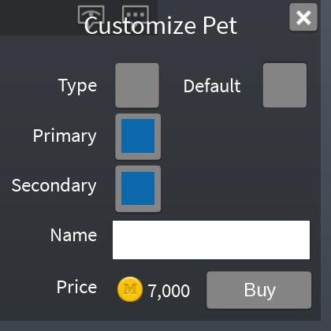</a> <b>Work at a Pizza Place</b> — roleplay / job simulator</td>
</tr>
<tr>
<td width="33%" valign="top"><a href="Games/catalog-avatar-creator-mtsowiks/README.md">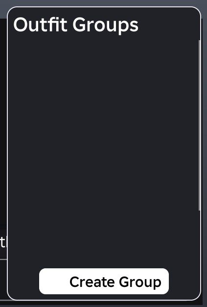</a> <b>Catalog Avatar Creator (mtsowiks)</b> — avatar editor (outfits, poses, Cmdr)</td>
<td width="33%" valign="top"><a href="Games/catalogue-avatar-creator/README.md">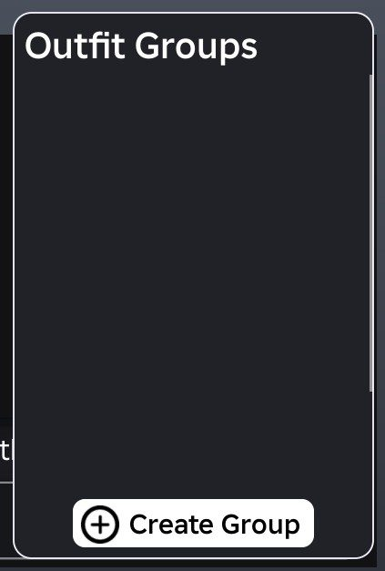</a> <b>Catalogue Avatar Creator</b> — avatar editor / catalog browser</td>
<td width="33%" valign="top"><a href="Games/casino-lvah/README.md">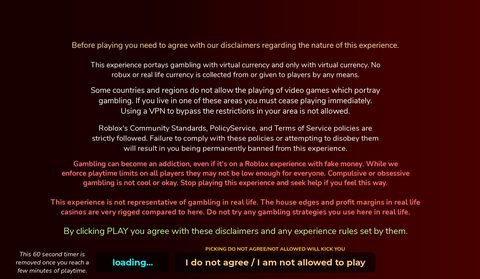</a> <b>LvaH Casino</b> — casino (roulette, blackjack, poker, horse racing, wheels)</td>
</tr>
<tr>
<td width="33%" valign="top"> <b>PLS DONATE (fully scripted)</b> — social / donation booths</td>
<td width="33%" valign="top"> <b>Driving Empire</b> — open-world driving</td>
<td width="33%" valign="top"> <b>Hiroshima Expressway</b> — map / driving (Japanese expressway)</td>
</tr>
<tr>
<td width="33%" valign="top"> <b>Retro Studio</b> — retro sandbox (2008-style UI, bevels)</td>
<td width="33%" valign="top"> <b>Trade System V1</b> — system module (trading UI + service)</td>
<td width="33%" valign="top"> <b>100 Weapons Models (mtsowiks)</b> — model pack (weapons)</td>
</tr>
</table>

---

## 🎮 Games

Every place file, grouped by genre. *Screens* = screenshots taken, *Models* = .rbxm model packs, *Scripts* = scripts in `source/`. ⚠️ = HIGH safety flags (backdoor-like code) — read the game page first.

### 🧠 Brainrot

| Game | Genre | Screens | UI packs | Models | Scripts | Highlights |
|---|---|---:|---:|---:|---:|---|
| ["Evade" (brainrot game)](Games/evade/README.md) ⚠️ | steal / tycoon (brainrots, lucky blocks; file named Evade) | 76 | 103 | 5507 | 1551 | Other, Rewards,, Shop, Crafting, |
| [Brainrot Lab](Games/brainrot-lab/README.md) | brainrot simulator (lab / fusing) | 16 | 23 | 206 | 174 | Other, Quests, Rewards,, Shop |
| [Drive For Brainrots](Games/drive-for-brainrots/README.md) | driving / brainrot collecting simulator | 12 | 17 | 184 | 121 | Other, Quests, Rewards,, Shop |
| [Kick A ... (template)](Games/kick-a-brainrot/README.md) | kick / launch simulator (fireworks, camera shake) | 11 | 18 | 275 | 121 | Other, Quests, Rewards,, Index |
| [Steal a Brainrot](Games/steal-a-brainrot/README.md) ⚠️ | steal / tycoon (brainrots, plots) | 75 | 117 | 9869 | 1630 | Other, Rewards,, Crafting,, HUD |
| [Steal a Brainrot (SAB files)](Games/steal-a-brainrot-sab-files/README.md) ⚠️ | steal / tycoon (brainrots, plots) | 93 | 142 | 5514 | 1967 | Other, Crafting,, Rewards,, Shop |
| [Steal an Egg (latest)](Games/steal-an-egg/README.md) ⚠️ | steal / tycoon (eggs, pets, plots) | 103 | 374 | 536 | 3167 | Other, Shop, Rewards,, Inventory |
| [Steal an Egg + P2W Admin Panel](Games/steal-an-egg-admin/README.md) ⚠️ | steal / tycoon (eggs) + admin panel | 79 | 140 | 740 | 1933 | Other, Inventory, HUD, Popups, |
| [Survive LAVA for Brainrot](Games/survive-lava-for-brainrot/README.md) | survival / brainrot collecting | 21 | 18 | 976 | 332 | HUD, Quests, Shop, Admin |

### ⛏️ Simulator

| Game | Genre | Screens | UI packs | Models | Scripts | Highlights |
|---|---|---:|---:|---:|---:|---|
| [+1 Drill & Mine](Games/drill-and-mine/README.md) | incremental simulator (+1 speed, mining, drills) | 41 | 34 | 765 | 204 | Other, Shop, Rewards,, Quests |
| [Bee Swarm Simulator (remake)](Games/bee-swarm-sim/README.md) ⚠️ | collecting simulator | 23 | 46 | 762 | 269 | Other, Settings, Quests, Rewards, |
| [Grow a Garden 2 (GAG2)](Games/grow-a-garden-2/README.md) | farming / garden simulator | 82 | 109 | 470 | 1122 | Other, Shop, Inventory, Leaderboards |
| [Grow a Garden 2 (GAG2, fixed build)](Games/grow-a-garden-2-fixed/README.md) | farming / garden simulator | 80 | 109 | 470 | 1122 | Other, Shop, Inventory, Leaderboards |
| [Punching Simulator](Games/punching-simulator/README.md) ⚠️ | training simulator | 46 | 64 | 425 | 518 | HUD, Other, Quests, Trading |
| [Smash Egg For Animals](Games/smash-egg-for-animals/README.md) ⚠️ | clicker / egg hatching simulator | 61 | 139 | 3174 | 822 | HUD, Shop, Other, Rewards, |

### 🎲 RNG

| Game | Genre | Screens | UI packs | Models | Scripts | Highlights |
|---|---|---:|---:|---:|---:|---|
| [Aura Ascension (UPD 3)](Games/aura-ascension/README.md) | RNG / aura rolling | 43 | 123 | 183 | 241 | HUD, Settings, End, Inventory |
| [Pet RNG](Games/pet-rng/README.md) ⚠️ | RNG / pet rolling | 10 | 8 | 551 | 199 | Other, Rewards,, Loading, Inventory |
| [RCU (roll / mounts)](Games/rcu-roller/README.md) | RNG roller (Knit, auto roll, mounts) | 41 | 81 | 659 | 513 | Trading, Quests, Inventory, Other |
| [Slime RNG](Games/slime-rng/README.md) ⚠️ | RNG / slime rolling | 1 | 3 | 145 | 538 | HUD |

### 🏭 Tycoon

| Game | Genre | Screens | UI packs | Models | Scripts | Highlights |
|---|---|---:|---:|---:|---:|---|
| [Advanced Warfare Tycoon](Games/advanced-warfare-tycoon/README.md) ⚠️ | tycoon (military) | 10 | 5 | 48 | 1581 | Other, Shop, Popups,, HUD |
| [SCP Tycoon](Games/scp-tycoon/README.md) ⚠️ | tycoon (SCP containment) | 9 | 9 | 133 | 202 | Other, Shop, Rewards,, Loading |

### 👻 Horror

| Game | Genre | Screens | UI packs | Models | Scripts | Highlights |
|---|---|---:|---:|---:|---:|---|
| [Animal Hospital (horror, modded)](Games/animal-hospital-horror/README.md) ⚠️ | horror roleplay (patients, skinwalkers, sanity) | 24 | 51 | 374 | 373 | Other, Character, Leaderboards, Popups, |
| [Backrooms Exploration](Games/backrooms-exploration/README.md) | horror exploration | 4 | 6 | 13 | 25 | Other, Inventory, Settings |
| [Bite By Night](Games/bite-by-night/README.md) | asymmetric horror (killer vs survivors) | 35 | 14 | 1340 | 845 | Other, HUD, Settings, Popups, |
| [Dandy's World](Games/dandys-world/README.md) | horror survival (toons, floors, machines) | 9 | 31 | 147 | 1388 | Other, End, Loading, Admin |
| [Doors (fully scripted)](Games/doors/README.md) | horror / room escape | 21 | 10 | 344 | 1207 | HUD, Popups,, End, Admin |
| [Forsaken (alt copy)](Games/forsaken-alt/README.md) ⚠️ | asymmetric horror (killer vs survivors) | 18 | 186 | 628 | 954 | HUD, Map, Loading, Leaderboards |
| [Forsaken (mtsowiks remake)](Games/forsaken-mtsowiks/README.md) ⚠️ | asymmetric horror (killer vs survivors) | 23 | 314 | 2243 | 2007 | HUD, Other, Map, Loading |
| [Forsaken (uncopylocked)](Games/forsaken/README.md) ⚠️ | asymmetric horror (killer vs survivors) | 27 | 269 | 1888 | 1507 | HUD, Other, Map, Loading |
| [The Rake (kill test)](Games/the-rake/README.md) ⚠️ | horror survival (monster) | 62 | 19 | 152 | 1835 | Other, Popups,, End, Admin |

### 🔫 Shooter

| Game | Genre | Screens | UI packs | Models | Scripts | Highlights |
|---|---|---:|---:|---:|---:|---|
| [BIG Paintball! Classic](Games/big-paintball/README.md) ⚠️ | arena FPS | 28 | 119 | 270 | 502 | Other, Loading, Inventory, Leaderboards |
| [Miami Shootout](Games/miami-shootout/README.md) ⚠️ | open-world shooter / hood roleplay | 49 | 62 | 1133 | 4008 | Other, HUD, Settings, End |
| [Murderers vs Sheriffs (summer update)](Games/murderers-vs-sheriffs/README.md) | duels (murderers vs sheriffs, trading, crafting) | 91 | 88 | 1430 | 1266 | Other, Inventory, Leaderboards, Shop |
| [RIVALS (modded)](Games/rivals-modded/README.md) | arena FPS (duels) | 107 | 281 | 2470 | 2154 | Other, Shop, Map, Settings |
| [Zombie Outbreak Survival](Games/zombie-outbreak-survival/README.md) | wave survival shooter | 9 | 8 | 66 | 154 | Shop, Other, HUD, End |

### 🥊 Fighting

| Game | Genre | Screens | UI packs | Models | Scripts | Highlights |
|---|---|---:|---:|---:|---:|---|
| [Gore game (leak)](Games/gore-game/README.md) | combat / gore physics | 0 | 0 | 91 | 257 |  |
| [Jujutsu Shenanigans](Games/jujutsu-shenanigans/README.md) ⚠️ | anime battlegrounds (fighting) | 34 | 113 | 2116 | 299 | Other, Settings, HUD, Character |
| [One Piece: The Age Of Pirates](Games/one-piece-age-of-pirates/README.md) ⚠️ | anime RPG | 12 | 10 | 117 | 545 | Other, HUD |

### 🧗 Obby

| Game | Genre | Screens | UI packs | Models | Scripts | Highlights |
|---|---|---:|---:|---:|---:|---|
| [+1 Escape Kitty Keyboard](Games/escape-kitty-keyboard/README.md) | obby / escape (+1 speed) | 63 | 54 | 261 | 722 | Settings, Other, HUD, Popups, |
| [+1 NeeDoh Escape](Games/needoh-escape/README.md) | obby / escape (+1 speed) | 14 | 11 | 10201 | 88 | Other, Inventory, Leaderboards, Shop |
| [Click Keyboard Tower](Games/click-keyboard-tower/README.md) ⚠️ | clicker / tower obby | 24 | 5 | 245 | 88 | Settings, HUD, Admin, Popups, |
| [Flood Escape 2](Games/flood-escape-2/README.md) ⚠️ | obby / survival (rising water maps) | 29 | 24 | 921 | 262 | Other, End, Map, Loading |
| [Scooter Obby](Games/scooter-obby/README.md) | obby (scooter) | 32 | 29 | 344 | 834 | Other, Settings, Rewards,, Loading |
| [Tower Of Hell](Games/tower-of-hell/README.md) | obby (procedural tower) | 9 | 9 | 12 | 67 | Inventory, Shop, Leaderboards, Settings |

### 🎉 Party

| Game | Genre | Screens | UI packs | Models | Scripts | Highlights |
|---|---|---:|---:|---:|---:|---|
| [Drag A Friend](Games/drag-a-friend/README.md) ⚠️ | party / physics (tether a friend) | 18 | 6 | 17 | 603 | Other, Shop, HUD |
| [Murder Mystery 2](Games/murder-mystery-2/README.md) ⚠️ | social deduction (murderer vs sheriff) | 91 | 130 | 834 | 1256 | Inventory, Other, Shop, Leaderboards |
| [Natural Disaster Survival (Sowiks)](Games/natural-disaster/README.md) ⚠️ | survival (random disasters) | 70 | 13 | 113 | 982 | Other, Settings, HUD, Popups, |
| [Pass The Bomb (Tower)](Games/pass-the-bomb/README.md) ⚠️ | party elimination | 10 | 7 | 19 | 77 | Other, HUD, Quests, Shop |
| [Pick a Side](Games/pick-a-side/README.md) ⚠️ | party / team minigames | 21 | 6 | 155 | 440 | End, Other, HUD, Popups, |
| [UNO](Games/uno/README.md) | card game | 22 | 9 | 345 | 28 | Other, Quests, Settings, Trading |

### 🏙️ Roleplay

| Game | Genre | Screens | UI packs | Models | Scripts | Highlights |
|---|---|---:|---:|---:|---:|---|
| [Animal Hospital (modded)](Games/animal-hospital-modded/README.md) ⚠️ | roleplay / tycoon | 94 | 67 | 463 | 916 | Other, Settings, Admin, Popups, |
| [Prison Life](Games/prison-life/README.md) ⚠️ | roleplay (cops vs prisoners) | 34 | 15 | 468 | 1345 | Other, HUD, Settings, Loading |
| [Site Excalibur (Lunor)](Games/site-excalibur/README.md) ⚠️ | SCP facility roleplay (detain, solitary, gun shop) | 11 | 19 | 897 | 780 | Other, HUD, Shop, End |
| [Street Life](Games/street-life/README.md) | open-world roleplay / hood | 62 | 58 | 906 | 3979 | Other, Shop, Character, Settings |
| [Work at a Pizza Place](Games/work-at-a-pizza-place/README.md) ⚠️ | roleplay / job simulator | 29 | 6 | 569 | 438 | Popups,, Settings, Inventory, Other |

### 💬 Social

| Game | Genre | Screens | UI packs | Models | Scripts | Highlights |
|---|---|---:|---:|---:|---:|---|
| [Catalog Avatar Creator (mtsowiks)](Games/catalog-avatar-creator-mtsowiks/README.md) | avatar editor (outfits, poses, Cmdr) | 93 | 147 | 49 | 347 | Other, Character, Inventory, HUD |
| [Catalogue Avatar Creator](Games/catalogue-avatar-creator/README.md) | avatar editor / catalog browser | 89 | 146 | 50 | 360 | Other, Character, Inventory, Settings |
| [LvaH Casino](Games/casino-lvah/README.md) ⚠️ | casino (roulette, blackjack, poker, horse racing, wheels) | 39 | 24 | 175 | 597 | Other, Rewards,, HUD, Inventory |
| [PLS DONATE (fully scripted)](Games/please-donate/README.md) ⚠️ | social / donation booths | 27 | 48 | 314 | 452 | Other, Rewards,, Settings, Inventory |

### 🚗 Driving

| Game | Genre | Screens | UI packs | Models | Scripts | Highlights |
|---|---|---:|---:|---:|---:|---|
| [Driving Empire](Games/driving-empire/README.md) | open-world driving | 20 | 8 | 1112 | 321 | HUD, Shop, Other, Settings |
| [Hiroshima Expressway](Games/hiroshima-expressway/README.md) | map / driving (Japanese expressway) | 6 | 4 | 139 | 2042 | Other, End |

### 🧱 Sandbox

| Game | Genre | Screens | UI packs | Models | Scripts | Highlights |
|---|---|---:|---:|---:|---:|---|
| [Retro Studio](Games/retro-studio/README.md) | retro sandbox (2008-style UI, bevels) | 2 | 5 | 27 | 125 | Other, End |

### ⚙️ System

| Game | Genre | Screens | UI packs | Models | Scripts | Highlights |
|---|---|---:|---:|---:|---:|---|
| [Trade System V1](Games/trade-system/README.md) | system module (trading UI + service) | 4 | 1 | 0 | 2 | Trading, Quests |

### 📦 Model Pack

| Game | Genre | Screens | UI packs | Models | Scripts | Highlights |
|---|---|---:|---:|---:|---:|---|
| [100 Weapons Models (mtsowiks)](Games/weapons-pack-100/README.md) | model pack (weapons) | 2 | 8 | 477 | 50 | Other |
| [Forest Pack (slbr)](Games/forest-pack/README.md) | model pack (nature / forest) | 0 | 0 | 56 | 14 |  |
| [Shattered Aether (map)](Games/shattered-aether-map/README.md) | map / environment pack | 0 | 1 | 137 | 1 |  |

---

## 📜 Script library

[`Scripts/`](Scripts/README.md) holds hand-picked `.lua` files from all games, sorted by topic, plus clean copies of the open-source libraries the games ship ([`Scripts/Libraries`](Scripts/Libraries/)).

| Topic | Curated | Candidates scanned |
|---|---:|---:|
| UI animation (tweens, hover / click, pop-ins, springs) | 47 | 825 |
| UI controllers / window managers / menus | 25 | 788 |
| Notifications, toasts, popups, prompts | 26 | 1027 |
| Loading / intro screens | 22 | 141 |
| Camera, cutscenes, screen shake | 23 | 432 |
| VFX, particles, beams, hit effects | 20 | 445 |
| DataStore / player data | 15 | 148 |
| Monetization (dev products, game passes, receipts) | 14 | 109 |
| RNG, eggs, gacha, rarity rolls, pets | 27 | 1125 |
| Trading systems | 19 | 28 |
| Combat, weapons, hitboxes, abilities | 20 | 419 |
| NPC / AI / monsters | 24 | 80 |
| Character movement (sprint, dash, double jump, slide) | 21 | 262 |
| Tycoon / plots / bases / building | 22 | 566 |
| Leaderboards & stats | 14 | 46 |
| Admin panels & commands | 11 | 191 |
| Sound & music | 27 | 144 |
| Daily rewards, quests, codes, playtime | 14 | 130 |
| Utility modules (number format, signals, tables, timers) | 17 | 644 |

---

## 🛠 How it was made

1. **Unpack** — `_tools/rbxdump.py` reads each binary `.rbxl/.rbxm` (LZ4 / ZSTD chunks) and writes every script, the instance tree, UI layout, remotes, asset ids and a safety scan to `Games/<game>/source/`.
2. **Export** — `_tools/extract_library.py` cuts models and the map into script-free `.rbxm` packs; `_tools/rbxm2lua.luau` turns every non-model pack (UI, audio, animations, lighting, materials) into a Lua builder and `_tools/json2lua.py` turns the id lists into Lua tables. All scripts are `.lua`.
3. **Screenshot** — `_tools/make_screens.py` packs every ScreenGui; `_tools/RefShot.luau` runs inside Roblox Studio, opens each screen and hidden / off-screen panel one at a time and captures it with `CaptureService`; `_tools/shot_server.py` saves the frames and panel crops. Models are previewed the same way on a baseplate.
4. **Scripts** — `_tools/classify_scripts.py` scores all scripts by topic; the best were reviewed by hand into `Scripts/`.
5. **Catalog** — `_tools/build_catalog.py` writes these pages.

> These files come from shared / leaked places. Use them as **study references**: rebuild UI in your own style, re-upload animations and audio you have rights to, and never ship code flagged HIGH without reading it.
